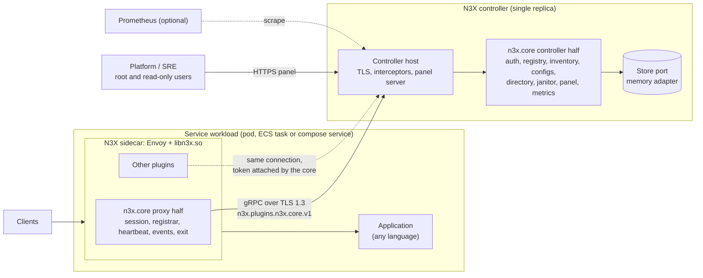
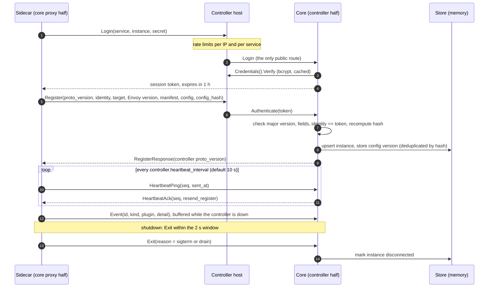
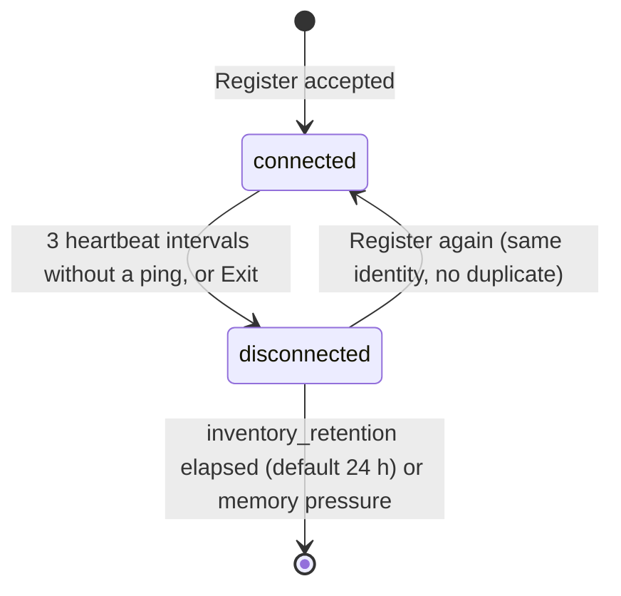
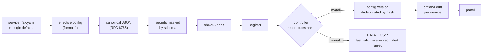
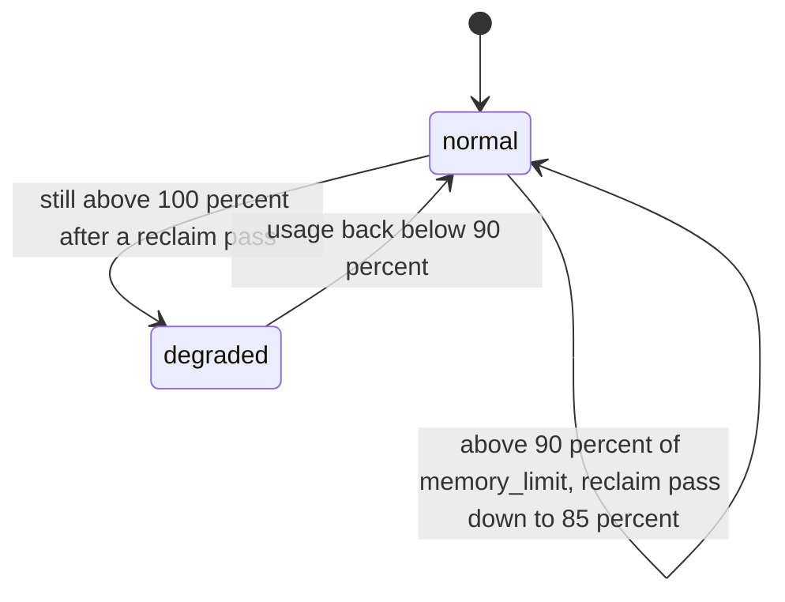

# n3x-plugin-core

The mandatory plugin of the [N3X](#documentation) platform. It registers every sidecar with the controller,
keeps track of which sidecars are alive, records the effective configuration each one runs, and gives the
controller panel its inventory, configuration views and read-only users.

> **Status: design phase.** This repository currently holds the product, architecture and feature design
> documents only (PRD, HLD, ADRs and FDDs, written in Brazilian Portuguese). The code will be built through
> the ten Spec Kit specs listed in [`specs/README.md`](specs/README.md). Paths, packages and commands below
> describe the planned implementation as defined in those documents.

## Contents

- [What it is](#what-it-is)
- [Why it exists](#why-it-exists)
- [Who uses it](#who-uses-it)
- [How it works](#how-it-works)
- [Components](#components)
- [Public contracts](#public-contracts)
- [Configuration](#configuration)
- [Deployment scenarios](#deployment-scenarios)
- [Observability](#observability)
- [Security and privacy](#security-and-privacy)
- [Targets and limits](#targets-and-limits)
- [Out of scope for v1](#out-of-scope-for-v1)
- [Development](#development)
- [Documentation](#documentation)
- [License](#license)

## What it is

N3X (Network Navigation Node eXtensible, pronounced "Nex") is an extensible network middleware that runs as
an override layer on top of an Envoy sidecar. Each application gets a sidecar that becomes its only entry
point, and every sidecar connects to a central controller. Network behaviours are written as plugins,
compiled together into a single Go dynamic module (`libn3x.so`) loaded inside Envoy.

`n3x-plugin-core` (plugin ID `n3x.core`, Go module `github.com/giustech/n3x-plugin-core`) is the one plugin
that every N3X build always contains. It cannot be removed: the builder fails with `N3X-B008` if anyone
tries. Like every N3X plugin, it has two halves that talk to each other through their own gRPC contract:

| Half | Runs inside | Responsibilities |
| --- | --- | --- |
| Proxy half (`agent/`) | `libn3x.so`, in each sidecar | Logs in to the controller, attaches the session token to every plugin call, registers the sidecar, keeps a heartbeat stream, sends events, announces shutdown |
| Controller half (`controller/`) | The controller binary | Issues and validates session tokens, keeps the inventory, versioned configurations and events in memory, loads read-only users, builds the panel screens |

The proxy half declares no request phase and no request hook. Nothing it does happens on the request path,
so it never adds latency to application traffic and its failures never affect it.

It is also the reference implementation of a two-half plugin for other plugin authors.

## Why it exists

- **The controller has no storage of its own.** In N3X, each plugin that stores data brings its own storage.
  Without the core, the panel would have no inventory, no configuration views and no read-only users.
- **Privileged capabilities need a single trusted owner.** The connection interceptor, the session
  authenticator, the public login route and the user directory are reserved by the SDK for the ID
  `n3x.core` coming from this module. No other plugin can register them.
- **Sidecar and controller need one shared format.** Detecting configuration drift between instances of
  the same service requires a single, deterministic format for the effective configuration and its hash,
  and that format must never expose a secret.
- **It proves the plugin model end to end.** "Everything is a plugin" includes sidecar registration.

## Who uses it

| Who | How |
| --- | --- |
| Platform / SRE team (primary audience of N3X) | Writes the core section of the controller `n3x.yaml`, generates password hashes and keys, watches the panel, metrics and alerts |
| Root and read-only panel users | Browse sidecars, configurations and flows. The root is checked by the controller host; read-only users are checked by the core. Only the root sees the user list |
| Product teams | Indirectly. They put the sidecar next to their application; the core is implicit and needs no declaration |
| Other plugins | Call their own controller services over the shared connection; the core attaches the session token without exposing it |
| Plugin authors | Use the core as the reference two-half plugin (in v1, only the project owner writes plugins) |
| `n3x-builder` | Always compiles the core into the sidecar module and the controller binary |

## How it works

### Architecture



Both halves talk over the TLS 1.3 connection the sidecar already keeps with the controller. All work on the
sidecar side runs in background tasks (`env.Background`). The controller keeps everything in memory in v1
and rebuilds its state from the sidecars after a restart: the sidecar is the source of truth, the controller
only observes.

### Sidecar lifecycle



- The token is renewed at 80% of its lifetime (about 48 minutes) with 10% jitter. A rejected token leads to a
  transparent new login.
- If the controller does not know the instance (for example after a restart), the heartbeat ack carries
  `resend_register=true` and the sidecar registers again.
- Events carry an idempotency ID generated on the sidecar, so replaying the buffer after a reconnect never
  duplicates them.
- If the controller is down, the sidecar keeps serving traffic. Events wait in a bounded buffer (oldest
  dropped first) and login is retried with backoff (1 s to 60 s, 20% jitter).

### Instance states



There is no separate "history" phase: `inventory_retention` is the total time a disconnected sidecar stays
in memory.

**Identity conflicts.** If two sessions (two different token nonces) send heartbeats for the same identity
for at least two intervals, the controller flags an identity conflict in the panel, logs and metrics, and
keeps both sessions. The conflict clears on its own when one of the two sessions goes three intervals
without a ping or sends `Exit`.

### Effective configuration, masking and hash



- Every field marked secret in a plugin schema (`plugin.Secret`), plus the sidecar `controller.secret`,
  becomes `***:<12 hex>`: the first 12 hex characters of the SHA-256 of the **encrypted** `ENC[...]` text,
  never of the plain value. Changing a secret changes the hash without revealing it.
- A secret written in clear becomes `***:plain` and the sidecar sends a `secret_in_clear` event. The value
  never leaves the process.
- A plugin configuration the core cannot classify safely (for example, no schema) becomes `***:opaque` and
  is shown as "config not displayed". Documents above 512 KiB replace the largest configs with
  `***:omitted:<12 hex>`.
- Versions are deduplicated by hash, up to 20 per service (a version in use by a live instance is never
  discarded). A difference that comes only from the `format` field means "different core versions", not
  drift. Re-encrypting a secret does count as a change.

### Controller restart and the HMAC key

| Controller restart | What happens | Back in the panel |
| --- | --- | --- |
| With `session.hmac_key` configured | Tokens stay valid. The first heartbeat gets `resend_register` and the inventory is rebuilt | About 10 s (one heartbeat interval) |
| Without `session.hmac_key` (random key) | Every token becomes invalid; every sidecar logs in again with jitter. The host credential cache costs about one bcrypt per service | Up to 30 s for up to about 200 services |

Use a fixed `session.hmac_key` in production. The random key exists so local and compose setups need no
extra configuration.

### Memory ceiling and degraded state



- The reclaim pass discards, in order: the oldest disconnected sidecars, then the oldest events (keeping at
  least 10 per instance), then config versions no instance points to.
- While degraded, the core shows a banner in the panel, sets `n3x_n3x_core_degraded` to 1, keeps accepting
  heartbeats, events and state changes, and refuses only **new** config versions with `RESOURCE_EXHAUSTED`.
  The sidecar retries later. Only the root can enter the panel while the core is degraded.

## Components

| Package (planned) | Half | Responsibility | FDD |
| --- | --- | --- | --- |
| `proto/n3x/plugins/n3x/core/v1` | both | `.proto`, generated stubs, version and limit constants | CORE-01 |
| `types/` | both | Typed configuration of both halves and their generated schemas | CORE-01 |
| `effconfig`, `effconfig/jcs` | both | Effective config format 1, canonical JSON, masking markers, hash | CORE-02 |
| `agent/effective` | proxy | Builds the effective config from the sidecar view | CORE-02 |
| `internal/sessiontoken` | both | Token format: sign, verify, inspect | CORE-03 |
| `agent/session` | proxy | Login loop, token holding, interceptors, renewal, re-login | CORE-03 |
| `controller/auth` | controller | HMAC key, `Login` handler, `Authenticate`, session index | CORE-03 |
| `controller/directory` | controller | Read-only users from `n3x.yaml`: `CheckUser` with bcrypt; `ChangePassword` returns "not supported" | CORE-04 |
| `controller/store`, `controller/store/memory` | controller | Store port and in-memory adapter: byte accounting, ceiling, reclaim, degraded state, immutable snapshots | CORE-05 |
| `agent/registrar`, `heartbeat`, `events`, `exit` | proxy | Register, heartbeat stream, events, Exit | CORE-06 |
| `controller/registry`, `inventory`, `janitor` | controller | `Core` service, inventory, sessions, conflicts, manifest drift, disconnection and retention | CORE-07 |
| `controller/configs` | controller | Config versions, drift per service, diff, YAML snippet | CORE-08 |
| `controller/panel`, `controller/metrics`, `agent/metrics`, `internal/metricdefs` | both | Panel screens and cards, single metric catalogue, alert rules | CORE-09 |

## Public contracts

### gRPC API

Package `n3x.plugins.n3x.core.v1`, served by the controller's single gRPC server.

| Method | Type | Notes | Target |
| --- | --- | --- | --- |
| `Login/Login` | Unary, public (no session) | Checks the service credential, returns the token | p95 < 300 ms |
| `Core/Register` | Unary | Identity, target, Envoy version, manifest, effective config, hash; up to 1 MiB | p95 < 20 ms |
| `Core/Heartbeat` | Bidirectional stream | Ping and ack; `resend_register` in the ack | Ack < 50 ms |
| `Core/Event` | Unary, idempotent by `id` | Panic, breaker open, plugin disabled, config error, drain start, secret in clear | p95 < 20 ms |
| `Core/Exit` | Unary, best effort | Marks the instance disconnected | Within the 2 s shutdown window |

Only the `sidecar` role may call `Core`, and every `Core` call must come from the identity carried by the
token.

| Code | When |
| --- | --- |
| `INVALID_ARGUMENT` | Missing fields or identity, malformed hash, non-canonical document, unmasked secret |
| `FAILED_PRECONDITION` | Proto major version other than 1, or a manifest in a newer format |
| `DATA_LOSS` | The recomputed hash does not match the config |
| `PERMISSION_DENIED` | Identity differs from the token |
| `RESOURCE_EXHAUSTED` | Memory ceiling reached while storing a new config version |

**Compatibility.** v1 accepts only major 1, with any minor. New fields bump the minor; removals and type
changes are blocked by `buf breaking`. When a manifest format changes, upgrade the controller first, then
the sidecars.

### Session token

`v1.<kid>.<iat>.<exp>.<nonce>.<service>.<instance>.<MAC>`, sent as `authorization: Bearer <token>`. The MAC
is HMAC-SHA256, compared in constant time. Lifetime is 1 h by default (5 min to 24 h). Tokens cannot be
revoked one by one in v1; rotating the HMAC key revokes all of them.

### Plugin manifest

```yaml
id: n3x.core
version: 1.0.0                # same as the module tag, without the "v"
sdk: ">=1.0.0 <2.0.0"         # lower bound = SDK required in go.mod
halves: [proxy, controller]
proxy:
  phases: []                  # background-only half
controller:
  required: true
  depends_on: []
```

## Configuration

The core needs no entry in the sidecar's `plugins` list: it is always present. Its settings live in two
files.

### Controller `n3x.yaml`: the `n3x.core` section

```yaml
plugins:
  n3x.core:
    inventory_retention: 24h     # total time a disconnected sidecar stays in memory (1m to 24h)
    memory_limit: 128Mi          # Store ceiling (16Mi to 1Gi)
    session:
      ttl: 1h                    # token lifetime (5m to 24h)
      hmac_key: ENC[v1:...]      # optional, recommended in production; plain text is refused
    users:                       # the only read-only users in v1 (up to 100)
      - name: ana
        password_hash: "$2b$12$..."   # bcrypt, cost 12 to 16
        disabled: false
runtime:
  plugin_limits:
    n3x.core:
      memory:
        max_bytes: 128Mi         # must be >= memory_limit, otherwise the controller does not start
```

- A missing section is valid and means defaults with no read-only users (only the root can log in).
- The controller refuses to start on: duplicate user names (case-insensitive), a user named like the root,
  a hash that is not bcrypt or has a cost outside 12 to 16, or an `hmac_key` that is not sealed in `ENC[...]`.
- Any change (users, key, limits) means editing the file and restarting the controller.

Helper commands from the controller CLI:

| Task | Command |
| --- | --- |
| Generate an HMAC key | `n3x-controller keygen`, then seal it with `n3x-controller encrypt --plugin n3x.core` |
| Hash a user password | `n3x-controller hash` (or `htpasswd -B -C 12`) |
| Check the file | `n3x-controller validate` (`--skip key` checks without the decryption key) |

### Sidecar `n3x.yaml`: controller settings used by the core

```yaml
version: 1
service: pedidos
controller:
  address: n3x-controller:17443
  ca_file: /etc/n3x/ca.pem
  secret: ENC[v1:...]            # service credential, encrypted
  heartbeat_interval: 10s        # 1s to 5m
  timeouts:
    call: 5s
    login: 10s
keys:
  aes_file: /run/n3x/aes.key     # key file mounted in the container, never an env var
runtime:
  plugin_limits:
    n3x.core:
      background:
        max_tasks: 8             # default 8, minimum 6
```

Without a `controller` section the sidecar runs standalone and the core's proxy half stays inactive.

## Deployment scenarios

The core has no artefact or deployment of its own. It ships inside the sidecar image
(`ghcr.io/giustech/n3x/sidecar:<semver>-<target>` as the base) and the controller image
(`ghcr.io/giustech/n3x/controller:<semver>`), built by the operator with multi-stage Dockerfiles from the
`n3x-builder` images. What changes between environments is how the sidecar sits next to the application and
how its instance identity is derived; the core's configuration stays the same.

### Rules for every environment

- Run the controller with exactly **one replica**. The core keeps its state in memory, without a database or
  disk.
- The sidecar and the controller must be built with the same plugin list; otherwise the panel warns that the
  manifests differ.
- Instance identity: the pod name in Kubernetes (for example `pedidos-7d9f8b-xk2lp`), the container ID
  everywhere else. The same identity coming back updates the existing entry instead of creating a new one.
- Default ports: controller gRPC `17443`, controller panel HTTPS `17444`, sidecar listener `17000`, sidecar
  health `17021`, Envoy admin on `127.0.0.1:17001` only.
- Default sidecar drain timeout is 20 s, below the usual 30 s grace period of Kubernetes and ECS. The core's
  `Exit` is sent once, best effort, inside the 2 s shutdown window that follows.

### Docker Compose

- The sidecar shares the application's network namespace (`network_mode: service`).
- Identity is the container ID. A recreated container shows up as a new instance; the old one is marked
  disconnected (immediately through `Exit`, or after three heartbeat intervals) and removed after
  `inventory_retention`.
- `session.hmac_key` can be left out: the random key keeps the setup free of extra configuration. The cost
  is a login burst at each controller restart, which is fine for local work.
- Product goal: controller, sidecar and application start from a single compose file, without Kubernetes, in
  up to 5 minutes. Compose is covered in CI.

### Kubernetes without Istio

- The sidecar runs as a container in the application's pod.
- Identity is the pod name with its hash. A container restarting inside the same pod keeps its identity.
- Configure `session.hmac_key` so sidecars keep their tokens across controller restarts and the inventory
  returns in about one heartbeat interval.
- During a rolling update, instances with different config hashes show up side by side with their diff. Drift
  becomes persistent after 30 minutes, which is also when the v1 drift alert fires.
- Covered in CI with kind.

### Kubernetes with Istio

- Use the `istio-1.31` target (customised `proxyv2` image). The entrypoint reads the same `n3x.yaml`, applies
  the Go runtime settings and hands control to `pilot-agent`, which generates the bootstrap and handles
  draining. Health checks and ports are Istio's.
- A static `EnvoyFilter`, the same for the whole mesh, inserts the N3X filter pointing at the `n3x.yaml`
  mounted in the pod.
- The core's connection to the controller leaves the proxy directly; Istio does not intercept the proxy's own
  traffic.
- Known gap: the drain signal source in Istio mode is still pending in the sidecar, so the core's `Exit`
  always reports `sigterm` there.
- Istio support is compatibility only, not official: the `EnvoyFilter` may break between Istio versions. If
  that happens, run the N3X sidecar without Istio for that service. Covered in CI with kind and Istio.

### Amazon ECS

- The sidecar runs as a container in the same task as the application, sharing its network namespace.
- Identity is the container ID.
- Same image and same `n3x.yaml` as the other environments; no ECS-specific feature is used.
- Configure `session.hmac_key` in production, as in Kubernetes.
- Validated by a guided manual test in v1, not in CI.

### Standalone sidecar (no controller)

- Leave the `controller` section out of the sidecar `n3x.yaml`. The core's proxy half starts no task and logs
  `agent_inactive` with `reason=standalone`.
- The effective config hash is still computed and exposed through `n3x_build_info{config_hash}`.
- A controller that is configured but down is **not** standalone: the core keeps retrying in the background
  while traffic flows normally.

### Summary

| Environment | Sidecar placement | Instance identity | `hmac_key` | Validation in v1 |
| --- | --- | --- | --- | --- |
| Docker Compose | `network_mode: service` | Container ID | Optional | CI |
| Kubernetes | Container in the app pod | Pod name | Recommended | CI (kind) |
| Kubernetes + Istio | `istio-1.31` proxy + static `EnvoyFilter` | Pod name | Recommended | CI (kind + Istio) |
| Amazon ECS | Container in the app task | Container ID | Recommended | Guided manual test |
| Standalone | Any | Not registered | Not used | — |

## Observability

**Metrics.** Business metrics use the `n3x_n3x_core_` prefix and are all declared in one catalogue
(`internal/metricdefs`): 35 families for the controller half and 12 for the proxy half. The core set:

| Metric | Meaning |
| --- | --- |
| `n3x_n3x_core_sidecars{state}` | Sidecars by state (`connected`, `disconnected`) |
| `n3x_n3x_core_divergences{service,kind}` | Config or manifest drift per service |
| `n3x_n3x_core_identity_conflicts` | Active identity conflicts |
| `n3x_n3x_core_registers_total{result}` | Register calls by result |
| `n3x_n3x_core_logins_total{result}` | Logins by result |
| `n3x_n3x_core_events_total{kind}` | Events received by kind |
| `n3x_n3x_core_memory_bytes` | Estimated Store usage |
| `n3x_n3x_core_degraded` | 1 while the core is degraded |
| `n3x_n3x_core_heartbeat_lag_seconds` | Heartbeat lag (histogram) |

The sidecar's own `n3x_controller_*` metrics (connection state, session age, logins, buffer) are defined by
`n3x-sidecar`; the core's session manager reports login and session data to them.

**Logs.** JSON through `log/slog`, with the plugin ID, service, instance and `x-request-id` when present.
Heartbeats are logged only at `debug`. No distributed tracing in v1.

**Alerts and SLOs in v1.**

| Alert | Condition |
| --- | --- |
| Core degraded | `n3x_n3x_core_degraded == 1` for 5 min |
| Sidecars disconnected | More than 10% of sidecars disconnected for 5 min |
| Identity conflict | `n3x_n3x_core_identity_conflicts > 0` |
| Persistent drift | Config drift in a service for more than 30 min |
| Login failures | High rate of `n3x_n3x_core_logins_total{result="fail"}` |

SLO indicators: percentage of connected sidecars, and inventory rebuild time after a controller restart
(target: 30 s or less).

## Security and privacy

- No token, secret, password hash or unmasked config ever appears in logs, gRPC errors, metrics or events.
  Every package is tested with a canary secret that must never leak.
- Plugin secrets never leave the sidecar: only the fingerprint of the encrypted value, or `***:plain` with an
  alert.
- `session.hmac_key` is accepted only sealed in `ENC[...]` (AES-256-GCM) and is decrypted by the host before
  it reaches the core.
- TLS 1.3 between sidecar and controller; HTTPS on the panel.
- A sidecar of service A cannot present itself as service B: identity mismatches get `PERMISSION_DENIED` and
  an alert log.
- LGPD: IP addresses and user names exist only in memory, for at most 24 h after disconnection, and only
  authenticated users can see them. Panel exports (CSV and JSON) never include addresses.
- Known gap: v1 has no formal audit trail. Panel login, logout and lockout go to the controller's operational
  log. Audit returns in v2 together with a database behind the same Store port.

## Targets and limits

| Area | Target |
| --- | --- |
| Request path | Zero added cost; zero application errors caused by the core or the controller |
| Recovery | Sidecars back in the panel within 30 s after a controller restart |
| Scale | 500 sidecars within 150 MB and 0.15 vCPU for the core; panel p95 under 300 ms |
| Availability | Controller (and the core's controller half) 99.5% per month |
| Hot paths | `Authenticate` and heartbeat handling with zero allocations |
| Retention | 24 h for disconnected sidecars, 20 config versions per service, 200 events per instance |

## Out of scope for v1

- Audit trail (deferred to v2 with a database).
- Managing read-only users from the panel, or users changing their own password.
- More than one controller replica, and any database or disk persistence.
- Editing any sidecar configuration from the panel.
- Key rotation without restart and per-token revocation.
- Distributed tracing and any observation of application traffic.

## Development

### Planned repository layout

```text
n3x-plugin.yaml            plugin manifest
buf.yaml, buf.gen.yaml     proto lint, breaking-change and generation config
Makefile                   tools, generate, lint, breaking, test, check
proto/n3x/plugins/n3x/core/v1/
types/
effconfig/                 effconfig/jcs
agent/                     session, effective, registrar, heartbeat, events, exit, metrics
controller/                auth, directory, store, registry, inventory, janitor, configs, panel, metrics
internal/                  sessiontoken, eventid, metricdefs
tools/                     separate Go module for pinned generators
docs/                      PRD, HLD, ADRs, FDDs
specs/                     Spec Kit specs
```

### Stack

Go 1.26 or later without cgo, `log/slog`, grpc-go and protobuf (versions from the SDK's `go.mod`),
`golang.org/x/crypto/bcrypt`, buf CLI 1.x, and the `n3x-sdk` (`v0.x` pre-releases during development; the
manifest requires `>=1.0.0 <2.0.0` for release). The canonical JSON encoder is implemented in this
repository, with no external dependency. The panel screens are SDK widget trees rendered by the controller
host (Echo v5 + templ + htmx); the core writes no HTML.

### Rules

These rules come from the [project constitution](.specify/memory/constitution.md), which defines nine
principles: staying off the request path, secrets never leaving the sidecar, the sidecar as source of
truth, additive-only contracts, bounded memory with explicit degradation, a single owner with least
privilege, the core as the SDK reference plugin, test first with measured targets, and v1 simplicity.

- **Test-driven development is mandatory.** Every contract and acceptance criterion in the FDDs becomes a
  failing test before the implementation.
- **Line coverage of at least 90%** in every package.
- **Every pull request:** `buf lint`, `buf breaking`, `make generate` followed by `git diff --exit-code`,
  `go vet`, `go test -race`.
- **Nightly:** 5-minute fuzzing per target.
- **Also required:** table and property tests, golden files, `-benchmem` benchmarks, the SDK conformance
  suites, the secret-leak canary, `promtool` tests for alert rules and axe (WCAG 2.1 AA) on the panel.
- The SDK static analysis runs with no `//n3x:allow` exceptions.
- Documentation produced by the Spec Kit commands is written in Brazilian Portuguese; file names, branches
  and identifiers stay in English.

### Implementation order

| Spec | Scope | Depends on |
| --- | --- | --- |
| `01_fundacao_proto_manifesto_types` | FDD-CORE-01: proto, manifest, types | — |
| `02_catalogo_metricas` | FDD-CORE-09, metric catalogue only | 01 |
| `03_config_efetiva_canonica_hash` | FDD-CORE-02 | 01, 02 |
| `04_login_sessao_hmac` | FDD-CORE-03 | 01, 02 |
| `05_diretorio_usuarios_leitura` | FDD-CORE-04 | 01, 02, 04 |
| `06_store_em_memoria` | FDD-CORE-05 | 01, 02 |
| `07_agente_registro_heartbeat` | FDD-CORE-06 | 01 to 04 |
| `08_registry_inventario` | FDD-CORE-07 | 01 to 04, 06, 07 |
| `09_configs_versionadas_divergencia` | FDD-CORE-08 | 03, 06, 08 |
| `10_telas_cartoes_alertas` | FDD-CORE-09, screens, cards and alerts | 02, 05, 06, 08, 09 |

## Documentation

All design documents are in Brazilian Portuguese.

- Product requirements: [`docs/prd/PRD-N3X.md`](docs/prd/PRD-N3X.md)
- High-level design: [`docs/HLD.md`](docs/HLD.md)
- Architecture decisions: [`docs/adr/`](docs/adr/README.md)
- Feature designs: [`docs/fdd/`](docs/fdd/)
- Spec index: [`specs/README.md`](specs/README.md)
- Project constitution (governing rules): [`.specify/memory/constitution.md`](.specify/memory/constitution.md)
- Constitution context and resolved divergences: [`DRAFT_CONSTITUITION.md`](DRAFT_CONSTITUITION.md)

When documents disagree, the order of precedence is: the constitution, the "approved decisions" blocks of
the FDDs, the FDD body, the ADRs, the HLD, and the PRD. The `.md` files take precedence over their `.json`
copies.

Related repositories: `n3x-sdk` (plugin contracts and test kit), `n3x-sidecar` (runtime image and `.so`
core), `n3x-controller` (gRPC server, panel and plugin host), `n3x-builder` (build images).

## License

[Apache License 2.0](LICENSE)
