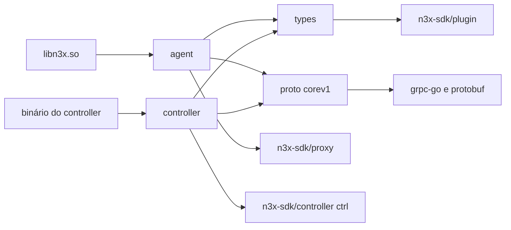
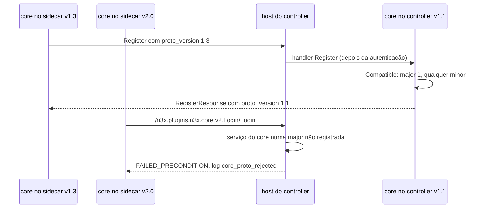
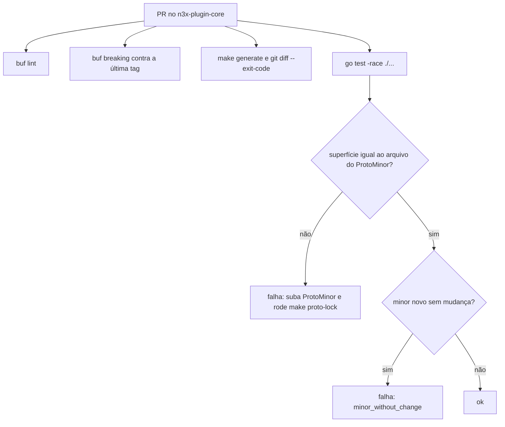

### FDD: Fundação do plugin core: proto `Core`, manifesto e `types/` (CORE-01)

Versão: 1.0
Data: 2026-10-20
Responsável: Guilherme Giusti

---

### 1. Contexto e motivação técnica

**Problema técnico.** O plugin core é o único plugin obrigatório e o primeiro cliente real dos contratos do SDK. As FDDs 37 a 45 e a conexão compartilhada do sidecar (FDD 38) dependem de três artefatos que ainda não existem: o contrato de fio `n3x.plugins.n3x.core.v1`, o manifesto `n3x-plugin.yaml` do core e as structs de config que geram o schema da seção `plugins["n3x.core"]`. Os documentos atuais deixam seis pontos sem resposta:

- **Nome do login (L-11).** O PRD (FR-002 e FR-005), o ADR-004, o ADR-012 e o ADR-019 do `n3x-sdk` falam no serviço `n3x.plugins.n3x.core.v1.Login`. O ADR-007 e o HLD do core põem `Login` como método do serviço `Core`. A FDD 09 já criou a tabela pública do registrador (`TablePublic`), que aceita um único serviço com um único método unário `Login` e recusa o mesmo serviço em duas tabelas.
- **`minor` do `proto_version`.** O ADR-007 manda subir o `minor` a cada campo novo, mas nada diz de onde vem o número nem como a CI impede esquecer de subi-lo.
- **Recusa de outra major.** O FR-016 exige `FAILED_PRECONDITION` para o proto do core em outra major; o FR-005 manda responder `UNIMPLEMENTED` a "versão não suportada". Um sidecar de outra major chama outro pacote (`...core.v2`), que o controller nem conhece, então a checagem de `proto_version` dentro do `Register` sozinha não basta.
- **Janela da major anterior (L-32).** O HLD do core deixa "a definir".
- **Seção do core sem tipos.** Unidades, faixas e defaults de `inventory_retention`, `memory_limit` e `session.ttl` não estão fixados; o `password_hash` é bcrypt em claro num campo `plugin.Secret` (L-64, decidida na FDD 03).
- **Pacote `controller/` do SDK no `.so` (novo).** O exemplo da FDD 09 põe `ValidateHost(h ctrl.HostFacts)` em `types/`. Como `agent/` importa `types/`, o `.so` passaria a compilar o pacote `controller/` do SDK e o renderizador de widgets, contra o ADR-011 ("o `.so` não carrega o renderizador de widgets") e o pedido P-10 da FDD 08.

Além disso, o marco M2 precisa de um `.so` do builder com o plugin core, antes das FDDs 37 a 45 (FDD 17, I-11 e P-05; pedido do coordenador). Esta FDD define essa versão mínima do core.

**Encaixe no HLD.** Esta FDD especifica o componente "`proto/` e `types/`" e os três primeiros "Próximos passos" do HLD do `n3x-plugin-core`, com a estrutura padrão de repositório de plugin do HLD do `n3x-sdk` (FR-014) e a convenção gRPC `n3x.plugins.<namespace>.<nome>.v<major>` com `buf breaking` (HLD de plataforma, "Regras de versionamento entre repositórios"). Consumidores:

- FDD 37: `RegisterRequest.config`, `config_hash` e o teto de 1 MiB do `Register`
- FDD 38: nome do método público de login (exceção de prazo da L-08)
- FDD 39: serviço `Login`, `LoginRequest`, `LoginResponse`, `session.ttl` e `session.hmac_key`
- FDD 40: `users[]` e os métodos de validação de `controller.Config`
- FDD 41: `memory_limit`
- FDD 42: `RegisterRequest`, `HeartbeatPing`, `EventRequest`, `ExitRequest` e `corev1.Version()`
- FDD 43: regra de compatibilidade, limites dos campos e `inventory_retention`
- FDDs 17, 20, 21 e 30: `agent.Plugin()`, `controller.Plugin()` e o manifesto do core no build e na subida
- FDD 33: recusa de chamada a um pacote do core em major não registrada

**Atores.** Mantenedor do core (escreve o `.proto`, as structs e o manifesto), CI do repositório (buf, golden, superfície), builder (inclui o core sempre, lê o manifesto e gera os schemas), executor do sidecar (cria a instância implícita `core`), host do controller (valida a seção do core e registra os serviços) e operador (escreve a seção do core no `n3x.yaml` do controller).

**Limites.** Esta FDD entrega contratos de dados e a base do repositório: `.proto` e stubs, constantes de versão e de limites, manifesto, structs de config, o tipo de config da metade de controller e a versão mínima das duas metades. Nenhum comportamento de RPC: login e sessão (FDD 39), usuários (40), store (41), agente (42), registro e inventário (43), configs (44) e telas (45).

**Suposições**
- SDK com as FDDs 01, 02, 03, 05, 06, 08 e 09 implementadas, em pré-release `v0.x` até a `v1.0.0` (ADR-021)
- O builder fixa a versão do core por imagem (`/etc/n3x/builder.yaml`, FDD 19) e confere o manifesto com `check.CoreManifest` (FDD 20)
- O controller tem uma réplica (ADR-001 do `n3x-sdk`) e o host registra os serviços do core pelo `Registrar` (FDDs 08 e 09)
- buf CLI 1.x com arquivos de config `v2`; `buf`, `protoc-gen-go` e `protoc-gen-go-grpc` com versões fixadas num módulo de ferramentas separado (hipótese)

**Restrições**
- Go 1.26, sem cgo; namespace `n3x` reservado a `github.com/giustech/` (ADR-012)
- Proto só evolui por adição, com `buf breaking` em todo PR (ADR-007 do core; HLD de plataforma)
- `types/` só importa a biblioteca padrão e `github.com/giustech/n3x-sdk/plugin`; `agent/` nunca alcança `github.com/giustech/n3x-sdk/controller` (ADR-011; FDD 08, P-10)
- O core nunca importa `secret/` (FDD 03)
- Nenhum valor de `hmac_key`, `password_hash`, segredo do serviço ou token em log, erro ou evento
- Documentação em pt-BR; identificadores em inglês

**Rastreabilidade**
- PRD 1.5: FR-002 (login, token e interceptor), FR-005 (login como única rota pública; chave HMAC na seção do core), FR-006 e FR-007 (registro com manifesto, config e hash), FR-009 (seção `users`), FR-014 (estrutura do repositório; stubs desatualizados falham o build), FR-016 (proto, eventos, saída e `FAILED_PRECONDITION`); critérios de aceite "testes de compatibilidade de protos com `buf breaking` em todo PR" e "proto do core aceito só na mesma major"
- ADRs do `n3x-plugin-core`: ADR-001 (`storage.dsn` não existe), ADR-003 (`users`), ADR-004 (`session.hmac_key`), ADR-005 (`session.ttl`), ADR-006 (hash), ADR-007 (proto), ADR-008 (sem fase), ADR-009 (`memory_limit` e retenções) e ADR-010 (prefixo das métricas)
- ADRs do `n3x-sdk`: ADR-004, ADR-011, ADR-012, ADR-013, ADR-015, ADR-019, ADR-020 e ADR-021; ADR-003 do `n3x-builder`
- FDDs aplicadas: 01 (manifesto, `phases: []`, `BackgroundOnly`, `CoreID`, `OwnsGRPCService`, L-34), 02 (tags, `plugin.Size`, `time.Duration`, schema por metade, golden), 03 (`plugin.Secret`, L-64, `ControllerScope`), 05 e 06 (`proxy.Define`, `Env`), 08 (`ctrl.Define`, `Validator`, `Registrar`), 09 (`CoreEnv`, L-10, `TablePublic`, `HostValidator`, `CheckHost`, `CheckPrivileged`), 15 (`core_implicit`), 17 (`entry.Core(module, p)`, `CoreConfig = "{}"`, core mínimo de `chaintest`), 19 e 20 (core fixado pela imagem, `CoreManifest`)
- Lacunas do README:
  - **L-11 fechada aqui:** o login é o serviço próprio `n3x.plugins.n3x.core.v1.Login`, com um único método unário `Login` (método completo `/n3x.plugins.n3x.core.v1.Login/Login`), registrado por `PublicGRPC` na tabela pública da FDD 09. O serviço `n3x.plugins.n3x.core.v1.Core` fica com `Register`, `Heartbeat`, `Event` e `Exit`. As cinco RPCs do ADR-007 continuam no mesmo pacote `v1`, com as mesmas mensagens; muda só o agrupamento (I-01). O nome canônico nos documentos é `n3x.plugins.n3x.core.v1.Login`, como o PRD e os ADRs do SDK já escrevem; `Core/Login` deixa de existir (hipótese)
  - **L-32 fechada aqui, como fora da v1:** a v1 aceita só a major 1. A janela da major anterior é decidida por um ADR novo do `n3x-plugin-core` na primeira quebra real do proto. A regra futura fica anotada nesta FDD (contrato 3) e como reflexo pendente no ADR-007 e no HLD do core
  - **L-10 aplicada (FDDs 01 e 09):** manifesto com `proxy.phases: []` e sem `default_*`; uma instância `core` por processo do `.so`, criada primeiro pelo executor com config `{}` (`CoreConfig` da FDD 17), também no standalone (inativa). `types.ProxyConfig` é vazia e aceita `{}` (contratos 6 e 9)
  - **L-64 aplicada (FDD 03):** `password_hash` bcrypt em claro é o caso normal, aceito sem aviso; `ENC[...]` é opcional, com o escopo `ControllerScope("n3x.core")` (contrato 7)
  - **L-34 aplicada (FDD 01):** a seção se escreve `plugins["n3x.core"]` em documentação, erros e logs; nunca `plugins.n3x.core` nem `plugins."n3x.core"`
- Pedidos de FDDs anteriores atendidos:
  - FDD 02: golden dos schemas dos tipos reais do core (contrato 6)
  - FDD 03: `password_hash` em claro aceito sem aviso e `ENC[...]` opcional (contrato 7)
  - FDDs 06, 07 e 09: nome `core` e uma instância por processo da metade só de fundo (contrato 9)
  - FDD 08: `Validate` dos usuários no tipo de config do core; aviso de `hmac_key` fora da `Validate`, no `New` (contrato 7, regras nas FDDs 39 e 40)
  - FDD 09: serviço próprio do login (L-11, contrato 1); `HostValidator` no tipo de config com a regra `root_name` que a FDD 40 aplica (contrato 7); tipo de config da metade de proxy vazio (contrato 6)
  - FDD 17: config da metade de proxy vazia e versão mínima do core para o M2, com a instância `core` e as capacidades conferidas por `CheckPrivileged` (contrato 8)
- Decisões aprovadas pelo responsável do produto em 2026-10-22 (resolvem as hipóteses correspondentes deste documento):
  - **D-01 (L-11):** o login é o serviço próprio `n3x.plugins.n3x.core.v1.Login`, com o método `Login`; `Core/Login` deixa de existir. O ADR-007 e o HLD do core, que ainda põem `Login` em `Core`, precisam ser corrigidos (reflexo pendente)
  - **D-02 (I-09 e I-02):** ficam aprovados `RegisterResponse.proto_version` (campo 1), `EventRequest.plugin_instance` (6) e `EventRequest.suppressed` (7), e o prefixo `EVENT_KIND_` nos valores do enum. O HLD e o ADR-007 precisam refletir isso (reflexo pendente)
  - **D-03:** faixas e defaults do contrato 6 aprovados como escritos: `inventory_retention` de 1 min a 7 dias (padrão 24 h), `memory_limit` de 16 MiB a 1 GiB (padrão 128 MiB), `session.ttl` de 5 min a 24 h (padrão 1 h), até 100 usuários de leitura e seção ausente valendo `{}`
  - **D-05 (decidida na análise da FDD 39/CORE-03):** `session.hmac_key` só é aceita em `ENC[...]`; chave em claro é recusada na `Validate` e o controller não sobe. O aviso `hmac_key_in_clear` deixa de existir. A L-64 (hash em claro aceito sem aviso) continua valendo só para `users[].password_hash`
  - **D-04 (L-32):** a v1 aceita só a major 1; não há janela da major anterior. `Register` sem `proto_version` é recusado com `FAILED_PRECONDITION`, e pacote do core em major não registrada é recusado pelo host antes da autenticação. A pendência "janela de aceitação da major anterior" do HLD fica fora da v1

---

### 2. Objetivos técnicos

- **Contrato de fio único e verificável.** Medida: o descritor compilado do pacote tem exatamente os serviços `Login` (1 método unário) e `Core` (3 unários e 1 bidirecional), 12 mensagens e o enum `EventKind` com 7 valores; conferido pela superfície golden `testdata/surface/1.0.txt` (contrato 3).
- **Nenhuma quebra de fio na major.** Invariante: todo PR passa no `buf breaking` (categoria `FILE`) contra a última tag estável; nenhuma mudança de superfície entra sem `ProtoMinor` novo e sem o arquivo de superfície do minor novo.
- **Stubs sempre em dia.** Medida: `make generate` seguido de `git diff --exit-code` sem diferença em 100% dos PRs (FR-014).
- **Schema determinístico e conferido.** Medida: os bytes do schema de cada metade são iguais ao golden em 100 execuções seguidas e nas CIs amd64 e arm64; `agent.Plugin().ConfigSchema()` e `controller.Plugin().ConfigSchema()` geram exatamente esses bytes.
- **Compatibilidade explícita.** Invariante: o controller aceita `major == 1` com qualquer `minor` e recusa qualquer outra major com `FAILED_PRECONDITION`, inclusive `proto_version` ausente, com mensagem e campos de log fixos.
- **`.so` enxuto.** Medida: `go list -deps ./agent/...` não lista `github.com/giustech/n3x-sdk/controller` nem `controller/ui`; `go list -deps ./types` lista só a biblioteca padrão e `n3x-sdk/plugin`; `go list -deps ./proto/...` lista só a biblioteca padrão, `google.golang.org/protobuf` e `google.golang.org/grpc`.
- **Segredo nunca em mensagem.** Medida: canário `n3x-canary-` em `session.hmac_key` e em `users[i].password_hash` com 0 ocorrência nos erros de `Check` e `CheckHost` sobre 50 seções inválidas.
- **Versão mínima que falha fechada.** Invariante: enquanto as FDDs 39, 40 e 42 não estão implementadas, nenhum token é emitido nem aceito, nenhum usuário de leitura entra e nenhuma tarefa de fundo roda; o `.so` sobe com a instância `core` e passa no `proxy.CheckPrivileged` sem troca.

---

### 3. Escopo e exclusões

**Incluído**
- `.proto` do pacote `n3x.plugins.n3x.core.v1`: serviços `Login` e `Core`, as mensagens `LoginRequest`, `LoginResponse`, `ProtoVersion`, `Identity`, `RegisterRequest`, `RegisterResponse`, `HeartbeatPing`, `HeartbeatAck`, `EventRequest`, `EventResponse`, `ExitRequest`, `ExitResponse` e o enum `EventKind`, com números de campo e semântica; stubs gerados e versionados
- Pacote Go `corev1`, escrito à mão ao lado dos stubs: `ProtoMajor`, `ProtoMinor`, `Version`, `Compatible`, `IncompatibleError`, `EventKindLabel`, nomes dos serviços, limites dos campos e valores de `reason`
- Regra de evolução, superfície golden por minor e o teste que impede esquecer o `minor`
- `buf.yaml`, `buf.gen.yaml`, módulo de ferramentas `tools/`, alvos do `Makefile` e jobs de CI
- Manifesto `n3x-plugin.yaml` do core e a checagem dele na CI do próprio repositório
- `types.ProxyConfig` (vazia) e `types.ControllerConfig` com `SessionConfig` e `UserConfig`; golden dos dois schemas
- `controller.Config`, o tipo `C` da metade de controller, com `Validate` e `ValidateHost` como pontos de composição das regras das FDDs 39 e 40, e os códigos de regra reservados
- Versão mínima das duas metades (`agent.Plugin()`, `controller.Plugin()`) para o M2 (pedido da FDD 17)
- Estrutura do repositório: `agent/`, `controller/`, `types/`, `proto/`, `tools/`, `internal/repotest/` e `Makefile`
- Aplicação da L-10 (core implícito no sidecar), da L-64 e da L-34

**Excluído**
- Comportamento de cada RPC: login e token na FDD 39 (CORE-03); registro, heartbeat, eventos e saída no sidecar na FDD 42 (CORE-06); tratamento no controller na FDD 43 (CORE-07)
- Formato da config efetiva enviada em `RegisterRequest.config`, mascaramento e hash: FDD 37 (CORE-02)
- Regras de validação dos usuários (duplicado, `root_name`, bcrypt, custo, gramática do nome): FDD 40 (CORE-04); aqui só os pontos de composição e os códigos reservados
- Formato da `session.hmac_key`, aviso de chave ausente, recusa de chave em claro e formato do token: FDD 39 (CORE-03)
- Teto de memória, contabilidade e retenções de 20 versões e 200 eventos (constantes, sem campo de config na v1): FDD 41 (CORE-05), com as FDDs 43 e 44
- Sentido exato de `inventory_retention` (L-66): FDD 43 (CORE-07)
- Inclusão obrigatória do core no build (`N3X-B008`): FDD 20 (BLD-02)
- Interfaces privilegiadas (`CoreEnv`, `Sidecar`, `TablePublic`, `HostValidator`, `CheckHost`, `CheckPrivileged`): FDD 09 (SDK-09), só aplicadas
- Formato do manifesto embutido: FDD 22 (BLD-04)
- Recusa no host de chamada a pacote do core em outra major: FDD 33 (CTL-04), por pedido desta FDD
- Telas, cartões e registro único das métricas `n3x_n3x_core_*`: FDD 45 (CORE-09)
- Teste cruzado sidecar N-1 contra controller N: FDD 48 (SDK-16)
- Janela de aceitação da major anterior (L-32): fora da v1

---

### 4. Fluxos detalhados e diagramas

**Fluxo principal: mudança no contrato e CI do repositório (todo PR)**
1. O mantenedor edita `proto/n3x/plugins/n3x/core/v1/core.proto`.
2. Se a superfície mudou (campo, mensagem, valor de enum, método ou serviço novo), sobe `ProtoMinor` em `version.go` e roda `make proto-lock`, que grava `testdata/surface/1.<ProtoMinor>.txt`.
3. Roda `make generate` (buf com `protoc-gen-go` e `protoc-gen-go-grpc` das versões de `tools/go.mod`) e versiona os stubs.
4. A CI roda, em paralelo:
   - `buf lint` (categoria `STANDARD` com três exceções, contrato 4)
   - `buf breaking` contra a última tag (`FILE`); bloqueante a partir da primeira tag estável do core
   - `make generate` e `git diff --exit-code` (stubs em dia)
   - `go vet` e `go test -race ./...`, que incluem: superfície (`TestSurface`), golden dos schemas, teste do manifesto e da estrutura (`internal/repotest`), checagens de dependência (`go list -deps`) e canário
5. Na tag, a CI confere ainda: `version` do manifesto igual à tag sem `v`; arquivos de `testdata/surface/` da tag anterior inalterados (só acréscimo); nenhuma tag estável com a versão mínima (contrato 8).

**Fluxo de build (comportamento das FDDs 20 e 21; aqui só o que o core entrega)**
1. A imagem de build fixa o core (`builder.yaml`, `core.module` e `core.version`, FDD 19).
2. No passo 3, `check.CoreManifest` lê `<Dir do core>/n3x-plugin.yaml` com `yamlconv.ToJSON` e `plugin.DecodeManifest`; ID diferente de `n3x.core` ou manifesto inválido dá `N3X-B008` (`core_invalid`, FDD 20).
3. No passo 5, o programa auxiliar chama `agent.Plugin()` e `controller.Plugin()` do core e grava os schemas `proxy` e `controller` (FDD 02, contrato 9).
4. O `main` do `.so` registra `entry.Core("github.com/giustech/n3x-plugin-core", coreagent.Plugin())` (FDD 17, contrato 1); o `main` do controller entrega `controller.Plugin()` ao `host.Run` com o mesmo módulo (FDD 30).

**Fluxo de subida no sidecar (L-10 aplicada; orquestração das FDDs 15 e 17)**
1. O `n3x.yaml` do serviço não declara o core; `n3x.core` em `plugins[]` dá `core_implicit` (FDD 15). `runtime.plugin_limits["n3x.core"]` é aceito.
2. O executor cria a instância `core` primeiro, com `CoreConfig = "{}"`: `Instantiate([]byte("{}"), coreEnv, opener)` decodifica em `types.ProxyConfig{}` e chama `agent.New`.
3. `agent.New` exige `env.(proxy.CoreEnv)`; sem ela, devolve erro e o Envoy não sobe.
4. O executor sela e chama `proxy.CheckPrivileged(plugin.CoreID(), módulo, manifesto, inst)`: tipo no módulo do core, `ConnInterceptors` presente, nenhum hook (FDD 09).
5. Com a seção `controller`, o runtime chama `ConnInterceptors()` uma vez e instala os interceptors por último na cadeia (FDD 38). No standalone, a instância existe e fica inativa.

**Fluxo de subida no controller (orquestração das FDDs 30 e 32)**
1. O host lê `plugins["n3x.core"]` do `n3x.yaml` do controller; seção ausente vale `{}` (FDD 02, raiz vazia) e recebe todos os defaults (hipótese; aplicação na FDD 30).
2. Fase de config: `ctrl.PrivilegesOf(p, nil)` acha `host_validator` (aceito só para o core) e o host chama `p.CheckHost(seção, ctrl.HostFacts{RootUser: root.user}, plugin.WithSecretOpener(key.Opener(secret.ControllerScope("n3x.core"))))`.
3. `CheckHost` decodifica com `plugin.DecodeConfig[controller.Config]` (schema, defaults, `plugin.Secret` abertos), chama `Config.Validate()` e, sem erro, `Config.ValidateHost(h)`.
4. Fase de instâncias: `controller.New(cfg, env)` exige `env.(ctrl.CoreEnv)`; o host chama `ctrl.CheckPrivileged` (`public_grpc`, `authenticate` e `user_directory` presentes).
5. Ordem da FDD 08 com o acréscimo da 09: `Start`, `GRPC` (serviço `Core` na tabela `sidecar`), `PublicGRPC` (serviço `Login` na tabela pública), `PluginAPI`, `Routes`, `Cards`, `Close`.

**Fluxo de compatibilidade do proto (anunciada e conferida)**
1. O core do sidecar envia `RegisterRequest.proto_version = corev1.Version()` (`{major: 1, minor: ProtoMinor}`) (FDD 42).
2. O core do controller confere com `corev1.Compatible(v)` antes de qualquer outra validação: `major == 1` segue, com qualquer `minor`; `proto_version` ausente vale `0.0` e é recusado (FDD 43 aplica).
3. Recusa: `corev1.IncompatibleError(v)` (`FAILED_PRECONDITION` com mensagem fixa) e log `core_proto_rejected` com `proto_major` e `proto_minor`.
4. Aceite: `RegisterResponse.proto_version` leva a versão do controller, que o sidecar loga (FDD 42).
5. Campo desconhecido de um `minor` mais novo é ignorado pelo proto3; valor de enum desconhecido é tratado como genérico (contrato 1).
6. Sidecar de outra major: o core dele chama `/n3x.plugins.n3x.core.v2.Login/Login`, que o controller v1 não registra. O host responde `FAILED_PRECONDITION` antes da autenticação, porque o serviço pertence ao namespace do core (`plugin.CoreID().OwnsGRPCService`) numa major não registrada (pedido à FDD 33, hipótese). O mesmo vale para um sidecar v1 contra um controller v2.

**Fluxos alternativos e exceções**
- **Superfície mudou sem `ProtoMinor` novo:** `TestSurface` falha com a diferença e a instrução "suba `ProtoMinor` e rode `make proto-lock`".
- **`ProtoMinor` subiu sem mudança de superfície:** `TestSurface` falha (`minor_without_change`): minor novo só com contrato novo.
- **Remoção, renomeação, troca de tipo ou de número:** `buf breaking` falha; a mudança só cabe numa major nova (`v2`), fora da v1.
- **Antes da primeira tag estável do core:** o `buf breaking` contra uma tag `v0.x` só avisa, e o arquivo `1.0.txt` pode ser regravado; a partir da `v1.0.0`, o `buf breaking` bloqueia e os arquivos de superfície só crescem (hipótese).
- **Seção do core inválida:** `plugin.ErrInvalidConfig` com todos os problemas, prefixados com `plugins["n3x.core"]`; o controller não sobe (FDD 30). `storage.dsn` (removido pelo ADR-001) cai em `unknown_field`.
- **`password_hash` sem `ENC[...]`:** aceito, `InClear()` verdadeiro, sem aviso (L-64).
- **`session.hmac_key` ausente ou vazia:** aceita; a FDD 39 gera a chave aleatória no `Start` e avisa no `New` (`hmac_key_missing`).
- **Envoy cria a config do filtro mais de uma vez:** a instância `core` continua única no processo (FDDs 16, 17 e 38).
- **Validação do bootstrap (`N3X_ENVOY_VALIDATE=1`):** o `.so` não chama `New`, nem o do core (FDD 26).

**Diagramas**

Pacotes do repositório e o que cada artefato compila:



O caminho `agent` → `types` nunca chega a `n3x-sdk/controller`: a validação que precisa de `ctrl.HostFacts` mora em `controller.Config`.

Compatibilidade anunciada e conferida:



CI do proto:



---

### 5. Contratos públicos (assinaturas, endpoints, headers, exemplos)

**Contrato 1: `.proto` do pacote `n3x.plugins.n3x.core.v1`**
- Tipo: stream e endpoint gRPC (protobuf)
- Assinatura/Rota: `proto/n3x/plugins/n3x/core/v1/core.proto`
  ```proto
  syntax = "proto3";

  package n3x.plugins.n3x.core.v1;

  import "google/protobuf/duration.proto";
  import "google/protobuf/timestamp.proto";

  option go_package = "github.com/giustech/n3x-plugin-core/proto/n3x/plugins/n3x/core/v1;corev1";

  // Login é a única rota pública do controller: sem sessão, registrada por PublicGRPC (L-11).
  service Login {
    rpc Login(LoginRequest) returns (LoginResponse);
  }

  // Core recebe registro, heartbeat, eventos e saída dos sidecars (papel sidecar).
  service Core {
    rpc Register(RegisterRequest) returns (RegisterResponse);
    rpc Heartbeat(stream HeartbeatPing) returns (stream HeartbeatAck);
    rpc Event(EventRequest) returns (EventResponse);
    rpc Exit(ExitRequest) returns (ExitResponse);
  }

  message LoginRequest {
    string service = 1;
    string instance = 2;
    string secret = 3;
  }

  message LoginResponse {
    string token = 1;
    google.protobuf.Timestamp expires_at = 2;
  }

  message ProtoVersion {
    uint32 major = 1;
    uint32 minor = 2;
  }

  message Identity {
    string service = 1;
    string instance = 2;
    string address = 3;
  }

  message RegisterRequest {
    ProtoVersion proto_version = 1;
    Identity identity = 2;
    string target = 3;
    string envoy_version = 4;
    bytes manifest = 5;
    bytes config = 6;
    string config_hash = 7;
    google.protobuf.Duration heartbeat_interval = 8;
  }

  message RegisterResponse {
    ProtoVersion proto_version = 1; // versão do controller
  }

  message HeartbeatPing {
    uint64 seq = 1;
    google.protobuf.Timestamp sent_at = 2;
  }

  message HeartbeatAck {
    uint64 seq = 1;
    bool resend_register = 2;
  }

  enum EventKind {
    EVENT_KIND_UNSPECIFIED = 0;
    EVENT_KIND_PANIC = 1;
    EVENT_KIND_BREAKER_OPEN = 2;
    EVENT_KIND_PLUGIN_DISABLED = 3;
    EVENT_KIND_CONFIG_ERROR = 4;
    EVENT_KIND_DRAIN_START = 5;
    EVENT_KIND_SECRET_IN_CLEAR = 6;
  }

  message EventRequest {
    string id = 1;
    EventKind kind = 2;
    string plugin = 3;
    string detail = 4;
    google.protobuf.Timestamp occurred_at = 5;
    string plugin_instance = 6;
    uint32 suppressed = 7;
  }

  message EventResponse {}

  message ExitRequest {
    string reason = 1; // sigterm | drain
  }

  message ExitResponse {}
  ```
- Método: `Login/Login`, `Core/Register`, `Core/Event` e `Core/Exit` unários; `Core/Heartbeat` bidirecional
- Semântica de status/headers:
  - **Nomes completos:** `/n3x.plugins.n3x.core.v1.Login/Login`, `/n3x.plugins.n3x.core.v1.Core/Register`, `/n3x.plugins.n3x.core.v1.Core/Heartbeat`, `/n3x.plugins.n3x.core.v1.Core/Event` e `/n3x.plugins.n3x.core.v1.Core/Exit`. `plugin.CoreID().OwnsGRPCService` é verdadeiro para os dois serviços (FDD 01)
  - **Metadados:** `authorization` em toda chamada a `Core`, anexado só pelo interceptor do core e retirado pelo host antes do handler (FDD 09); `Login` vai sem `authorization`; `x-request-id` em todas (L-13, FDD 06)
  - **Papel:** só `sidecar` chama `Core` (ADR-007 do `n3x-controller`); `Login` não tem papel (tabela pública)
  - **Números de campo:** os do HLD do core; os campos 6 e 7 de `EventRequest` e o campo 1 de `RegisterResponse` são acréscimos desta FDD (hipótese, I-09). Número publicado nunca é reutilizado; campo removido numa major futura vira `reserved`
  - **Enum:** valores com o prefixo `EVENT_KIND_` (regra `ENUM_VALUE_PREFIX` do buf), os mesmos seis tipos e os mesmos números do ADR-007 e do HLD (I-02). O proto3 tem enum aberto: valor desconhecido chega como número e é tratado como genérico (`unknown`); `EVENT_KIND_UNSPECIFIED` é recusado
  - **`reason`:** texto, não enum, como a FDD 09 já usa (`corev1.ExitRequest{Reason: reason}`); valores da v1 `sigterm` e `drain`; valor desconhecido no formato válido é tratado como `sigterm` (hipótese), para que um `reason` novo entre por minor sem recusa

Campos, semântica e limites (os limites viram constantes no contrato 2; quem recusa está na coluna "Aplica"):

| Mensagem.campo | Nº | Tipo | Semântica | Limite | Aplica |
| --- | --- | --- | --- | --- | --- |
| `LoginRequest.service` | 1 | string | `service` do `n3x.yaml` do sidecar | 1 a 63 bytes, gramática da FDD 15 | FDD 39 |
| `LoginRequest.instance` | 2 | string | identidade da instância do sidecar (pod ou container, FDD 25) | 1 a 253 bytes ASCII visível, sem espaço | FDD 39 |
| `LoginRequest.secret` | 3 | string | `controller.secret` aberto pelo `.so`; nunca em log | 1 a 1.024 bytes | FDD 39 |
| `LoginResponse.token` | 1 | string | token de sessão (formato da FDD 39) | 1 a 1.024 bytes | FDD 39 |
| `LoginResponse.expires_at` | 2 | Timestamp | expiração do token, UTC | obrigatório | FDD 39 |
| `ProtoVersion.major` | 1 | uint32 | major do contrato, igual à do pacote | 1 na v1 | FDD 43 |
| `ProtoVersion.minor` | 2 | uint32 | minor do contrato | qualquer | FDD 43 |
| `Identity.service` | 1 | string | igual ao serviço do token | como `LoginRequest.service` | FDD 43 |
| `Identity.instance` | 2 | string | igual à instância do token | como `LoginRequest.instance` | FDD 43 |
| `Identity.address` | 3 | string | endereço anunciado (L-68, FDD 25) | 1 a 260 bytes | FDD 43 |
| `RegisterRequest.proto_version` | 1 | ProtoVersion | versão do sidecar (`corev1.Version()`) | ausente vale `0.0` | FDD 43 |
| `RegisterRequest.identity` | 2 | Identity | identidade da instância | obrigatório | FDD 43 |
| `RegisterRequest.target` | 3 | string | ID do alvo do catálogo (`envoy-1.40`, FDD 19) | 1 a 32 bytes | FDD 43 |
| `RegisterRequest.envoy_version` | 4 | string | versão do Envoy em execução (L-69, FDD 25) | 1 a 64 bytes | FDD 43 |
| `RegisterRequest.manifest` | 5 | bytes | bytes exatos de `Sidecar.Manifest()` (FDD 09; formato da FDD 22) | dentro do teto da mensagem | FDD 43 |
| `RegisterRequest.config` | 6 | bytes | config efetiva canônica e mascarada (FDD 37) | dentro do teto da mensagem | FDD 43 |
| `RegisterRequest.config_hash` | 7 | string | `sha256:` mais 64 hex minúsculos (ADR-006) | exatamente 71 bytes | FDD 43 |
| `RegisterRequest.heartbeat_interval` | 8 | Duration | `controller.heartbeat_interval` (FDD 15) | 1 s a 5 min | FDD 43 |
| `RegisterRequest` inteira | | | mensagem serializada | até 1 MiB (HLD do core) | FDDs 42 e 43 |
| `RegisterResponse.proto_version` | 1 | ProtoVersion | versão do controller | sempre preenchido | FDD 43 |
| `HeartbeatPing.seq` | 1 | uint64 | contador do stream, começa em 1 | crescente no stream (hipótese) | FDD 43 |
| `HeartbeatPing.sent_at` | 2 | Timestamp | hora do envio no sidecar, UTC | obrigatório | FDD 43 |
| `HeartbeatAck.seq` | 1 | uint64 | eco do `seq` respondido | | FDD 43 |
| `HeartbeatAck.resend_register` | 2 | bool | o controller pede o `Register` de novo (ADR-007) | | FDD 43 |
| `EventRequest.id` | 1 | string | ID de idempotência (formato da FDD 42) | 1 a 64 bytes de `[A-Za-z0-9._:-]` | FDD 43 |
| `EventRequest.kind` | 2 | EventKind | tipo do evento | diferente de 0 | FDD 43 |
| `EventRequest.plugin` | 3 | string | ID do plugin; vazio em eventos do processo | vazio ou `plugin.ParseID` válido | FDD 43 |
| `EventRequest.detail` | 4 | string | detalhe saneado (FDD 09) | até 256 bytes UTF-8 | FDD 43 |
| `EventRequest.occurred_at` | 5 | Timestamp | quando aconteceu, UTC | obrigatório | FDD 43 |
| `EventRequest.plugin_instance` | 6 | string | instância do plugin; vazio quando não se aplica | vazio ou até 63 bytes, gramática da FDD 15 | FDD 43 |
| `EventRequest.suppressed` | 7 | uint32 | panics suprimidos da mesma instância desde o último aceito (FDD 09) | | FDD 43 |
| `ExitRequest.reason` | 1 | string | motivo da saída | `^[a-z][a-z_]{0,15}$` | FDD 43 |

Tipos de evento (mesma ordem e mesmos números de `proxy.EventKind`, FDD 09; a conversão é da FDD 42):

| `proxy.EventKind` (SDK) | `corev1.EventKind` | Rótulo `kind` (`EventKindLabel`) |
| --- | --- | --- |
| `EventPanic` (1) | `EVENT_KIND_PANIC` (1) | `panic` |
| `EventBreakerOpen` (2) | `EVENT_KIND_BREAKER_OPEN` (2) | `breaker_open` |
| `EventPluginDisabled` (3) | `EVENT_KIND_PLUGIN_DISABLED` (3) | `plugin_disabled` |
| `EventConfigError` (4) | `EVENT_KIND_CONFIG_ERROR` (4) | `config_error` |
| `EventDrainStart` (5) | `EVENT_KIND_DRAIN_START` (5) | `drain_start` |
| `EventSecretInClear` (6) | `EVENT_KIND_SECRET_IN_CLEAR` (6) | `secret_in_clear` |
| valor desconhecido | número recebido | `unknown` |

Códigos gRPC por RPC (definidos pelo ADR-007 e pelo HLD do core; aplicados pelas FDDs 33, 39 e 43):

| RPC | Códigos |
| --- | --- |
| `Login/Login` | `OK`; `UNAUTHENTICATED` (credencial); `RESOURCE_EXHAUSTED` (bloqueio ou verificador ocupado, FDD 09); `INVALID_ARGUMENT` (limites); `DEADLINE_EXCEEDED`; `FAILED_PRECONDITION` (outra major, host) |
| `Core/Register` | `OK`; `FAILED_PRECONDITION` (major); `INVALID_ARGUMENT` (campos e limites); `PERMISSION_DENIED` (identidade diferente do token); `DATA_LOSS` (hash); `RESOURCE_EXHAUSTED` (teto de memória); `UNAUTHENTICATED` e `UNAVAILABLE` (host, FDD 09) |
| `Core/Heartbeat` | `PERMISSION_DENIED`; `INVALID_ARGUMENT`; `UNAUTHENTICATED` e `UNAVAILABLE` (host) |
| `Core/Event` e `Core/Exit` | `OK`; `INVALID_ARGUMENT`; `PERMISSION_DENIED`; `UNAUTHENTICATED` e `UNAVAILABLE` (host) |

**Exemplo de requisição** (`Core/Register` em protojson; `manifest` e `config` encurtados)
```json
{
  "protoVersion": { "major": 1, "minor": 0 },
  "identity": { "service": "pedidos", "instance": "pedidos-7d9f8b-xk2lp", "address": "10.42.3.17:17000" },
  "target": "envoy-1.40",
  "envoyVersion": "1.40.1",
  "manifest": "eyJmb3JtYXQiOjEsInRhcmdldCI6ImVudm95LTEuNDAi...",
  "config": "eyJmb3JtYXQiOjEsInBsdWdpbnMiOlsuLi5dLCJzaWRlY2FyIjp7Li4ufX0=",
  "configHash": "sha256:3b8f0c6a1d9e4f2b7c5a0e8d6f4b2a1c9e7d5b3a1f0e8c6d4b2a0f9e7c5d3b1a",
  "heartbeatInterval": "10s"
}
```

**Exemplo de resposta**
```json
{ "protoVersion": { "major": 1, "minor": 0 } }
```

**Exemplo de requisição** (`Core/Event` com rajada amostrada, a partir do `proxy.Event` da FDD 09)
```json
{
  "id": "4f1c2e9a7b3d5c60:000000000000002a",
  "kind": "EVENT_KIND_PANIC",
  "plugin": "giustech.ratelimit",
  "pluginInstance": "rl-api",
  "detail": "hook=request_headers",
  "occurredAt": "2026-10-20T14:00:03.120Z",
  "suppressed": 9
}
```

**Exemplo de resposta** (`Core/Register` de um sidecar com `proto_version` 2.0)
```text
rpc error: code = FailedPrecondition desc = proto do core 2.0 não suportado; este controller aceita a major 1
```

---

**Contrato 2: pacote `corev1` escrito à mão (versão, compatibilidade e limites)**
- Tipo: sdk (API Go do repositório `n3x-plugin-core`)
- Assinatura/Rota: `proto/n3x/plugins/n3x/core/v1/version.go` e `limits.go`, no mesmo pacote dos stubs
  ```go
  package corev1 // github.com/giustech/n3x-plugin-core/proto/n3x/plugins/n3x/core/v1

  const (
      ProtoMajor = 1 // igual à major do pacote (v1); conferido por teste
      ProtoMinor = 0 // sobe a cada mudança de superfície (contrato 3)

      PackageName      = "n3x.plugins.n3x.core.v1"
      CoreServiceName  = "n3x.plugins.n3x.core.v1.Core"
      LoginServiceName = "n3x.plugins.n3x.core.v1.Login"
      // Gerados pelo protoc-gen-go-grpc: Login_Login_FullMethodName,
      // Core_Register_FullMethodName, Core_Heartbeat_FullMethodName,
      // Core_Event_FullMethodName e Core_Exit_FullMethodName.

      ExitReasonSigterm = "sigterm"
      ExitReasonDrain   = "drain"
  )

  // Version devolve a versão deste contrato, enviada no Register e no RegisterResponse.
  func Version() *ProtoVersion

  // Compatible é verdadeiro se v tem a mesma major (qualquer minor). nil vale 0.0.
  func Compatible(v *ProtoVersion) bool

  // IncompatibleError devolve o status FAILED_PRECONDITION com a mensagem fixa.
  func IncompatibleError(v *ProtoVersion) error

  // EventKindLabel devolve o rótulo do tipo: "panic", ..., "unknown".
  func EventKindLabel(k EventKind) string

  const (
      MaxRegisterBytes     = 1 << 20 // RegisterRequest serializado
      MaxServiceLen        = 63
      MaxInstanceLen       = 253
      MaxAddressLen        = 260
      MaxTargetLen         = 32
      MaxEnvoyVersionLen   = 64
      ConfigHashLen        = 71   // "sha256:" + 64 hex
      MaxSecretLen         = 1024
      MaxTokenLen          = 1024
      MaxEventIDLen        = 64
      MaxEventDetailLen    = 256  // igual a proxy.MaxEventDetail (FDD 09)
      MaxPluginInstanceLen = 63
      MaxExitReasonLen     = 16
      MinHeartbeatInterval = time.Second
      MaxHeartbeatInterval = 5 * time.Minute
  )
  ```
- Método: n/a (chamada local)
- Semântica de status/headers:
  - **Dependências:** o pacote importa só a biblioteca padrão, `google.golang.org/protobuf` e `google.golang.org/grpc` (com `codes` e `status`). Nunca importa o SDK, para um plugin de terceiro poder usar o client do core sem puxar o resto (caso previsto na FDD 20, `core_gomod`)
  - **`Compatible`:** compara só a major; `nil` e `major` 0 são incompatíveis (o `Register` sem `proto_version` vira `FAILED_PRECONDITION`, coerente com a ordem "major primeiro" do HLD; hipótese)
  - **`IncompatibleError`:** `status.Error(codes.FailedPrecondition, "proto do core <major>.<minor> não suportado; este controller aceita a major 1")`; sem `proto_version`, `"proto do core sem proto_version; este controller aceita a major 1"`. O texto não leva identidade nem nada que venha do token
  - **Limites:** contrato de fio, iguais nos dois lados; `MaxEventDetailLen` tem teste de igualdade com `proxy.MaxEventDetail` num teste do `agent/` (que importa o SDK)
  - **Por que à mão:** o buf não gera constante de versão. O número fica num arquivo pequeno, revisado no PR, e o teste de superfície (contrato 3) impede que o proto mude sem ele

**Exemplo de requisição**
```go
fmt.Println(corev1.Version())
fmt.Println(corev1.Compatible(&corev1.ProtoVersion{Major: 1, Minor: 7}), corev1.Compatible(nil))
fmt.Println(corev1.IncompatibleError(&corev1.ProtoVersion{Major: 2}))
fmt.Println(corev1.EventKindLabel(corev1.EventKind_EVENT_KIND_BREAKER_OPEN), corev1.EventKindLabel(42))
```

**Exemplo de resposta**
```text
major:1
true false
rpc error: code = FailedPrecondition desc = proto do core 2.0 não suportado; este controller aceita a major 1
breaker_open unknown
```

---

**Contrato 3: regra de compatibilidade e de evolução do proto**
- Tipo: sdk (política de versão do contrato de fio, ADR-007 do core e FR-016)
- Assinatura/Rota: `corev1.ProtoMajor`, `corev1.ProtoMinor` e `proto/n3x/plugins/n3x/core/v1/testdata/surface/1.<minor>.txt`
- Método: n/a
- Semântica de status/headers:
  - **Aceitação no controller:** mesma major, qualquer `minor`, nos dois sentidos (sidecar mais novo ou mais velho que o controller). Outra major: `FAILED_PRECONDITION`, pelo `Register` (FDD 43) e pelo host para pacote do core em major não registrada (FDD 33)
  - **O que sobe o `minor`:** campo novo, mensagem nova, valor de enum novo, método novo ou serviço novo no pacote. Comentário, opção de geração e formatação não sobem
  - **O que é barrado:** remover ou renomear campo, mudar tipo, número, cardinalidade ou streaming, remover método, serviço ou valor de enum. O `buf breaking` com a categoria `FILE` recusa todos (renomear quebra o JSON e o código gerado, por isso `FILE` e não só `WIRE`)
  - **Superfície:** listagem canônica do descritor compilado (`File_n3x_plugins_n3x_core_v1_core_proto`), sem comentários nem opções: declarações por tipo (enum, message, service) e nome; campos por número com nome e tipo; cardinalidade só quando não é singular; RPCs por nome com o modo (`unary`, `client_stream`, `server_stream`, `bidi_stream`)
  - **Teste `TestSurface`:** a listagem atual é igual a `testdata/surface/1.<ProtoMinor>.txt`; os arquivos de minor formam a sequência `1.0`, `1.1`, ... sem buraco, e o último é o de `ProtoMinor`; dois arquivos consecutivos iguais dão `minor_without_change`. `make proto-lock` grava o arquivo do minor atual (`go test ./proto/... -run TestSurface -args -update`)
  - **Imutabilidade:** na tag, a CI confere que os arquivos de `testdata/surface/` da tag estável anterior não mudaram (só arquivo novo). Antes da primeira tag estável do core, `1.0.txt` pode ser regravado e o `buf breaking` só avisa (hipótese)
  - **Major nova (fora da v1, L-32):** pacote `n3x.plugins.n3x.core.v2` em arquivo novo, `ProtoMajor` 2 nele, superfície `2.0.txt`. A janela em que o controller registra as duas majors é decidida por ADR novo do `n3x-plugin-core` na primeira quebra real; até lá a regra "major não registrada recebe `FAILED_PRECONDITION`" vale sem exceção
  - **Versões do core nos dois lados:** a imagem do sidecar e a do controller podem trazer versões diferentes do core; o que precisa coincidir é a major do proto, não a versão do módulo

| Mudança | Versão do proto | Versão do módulo do core |
| --- | --- | --- |
| Campo, mensagem, valor de enum, método ou serviço novo | `ProtoMinor` + 1 e arquivo de superfície novo | minor |
| Comentário, opção de geração, formatação | nenhuma | patch |
| Remoção, renomeação, troca de tipo, número ou streaming | major nova (`v2`), fora da v1 | major |
| Limite de campo mais folgado (contrato 2) | nenhuma | minor, com nota |
| Limite de campo mais apertado | major (quebra quem já envia) | major |

**Exemplo de requisição** (PR que acrescenta `string trace_id = 8;` a `EventRequest` sem subir o minor)
```text
$ go test ./proto/...
```

**Exemplo de resposta**
```text
--- FAIL: TestSurface (0.00s)
    surface_test.go:41: a superfície de n3x.plugins.n3x.core.v1 mudou e ProtoMinor continua 0:
        + message EventRequest: 8 trace_id string
      suba ProtoMinor para 1 e rode make proto-lock
FAIL
```

Superfície da v1.0 (`testdata/surface/1.0.txt`, golden):
```text
package n3x.plugins.n3x.core.v1
enum EventKind
  0 EVENT_KIND_UNSPECIFIED
  1 EVENT_KIND_PANIC
  2 EVENT_KIND_BREAKER_OPEN
  3 EVENT_KIND_PLUGIN_DISABLED
  4 EVENT_KIND_CONFIG_ERROR
  5 EVENT_KIND_DRAIN_START
  6 EVENT_KIND_SECRET_IN_CLEAR
message EventRequest
  1 id string
  2 kind enum .n3x.plugins.n3x.core.v1.EventKind
  3 plugin string
  4 detail string
  5 occurred_at message .google.protobuf.Timestamp
  6 plugin_instance string
  7 suppressed uint32
message EventResponse
message ExitRequest
  1 reason string
message ExitResponse
message HeartbeatAck
  1 seq uint64
  2 resend_register bool
message HeartbeatPing
  1 seq uint64
  2 sent_at message .google.protobuf.Timestamp
message Identity
  1 service string
  2 instance string
  3 address string
message LoginRequest
  1 service string
  2 instance string
  3 secret string
message LoginResponse
  1 token string
  2 expires_at message .google.protobuf.Timestamp
message ProtoVersion
  1 major uint32
  2 minor uint32
message RegisterRequest
  1 proto_version message .n3x.plugins.n3x.core.v1.ProtoVersion
  2 identity message .n3x.plugins.n3x.core.v1.Identity
  3 target string
  4 envoy_version string
  5 manifest bytes
  6 config bytes
  7 config_hash string
  8 heartbeat_interval message .google.protobuf.Duration
message RegisterResponse
  1 proto_version message .n3x.plugins.n3x.core.v1.ProtoVersion
service Core
  rpc Event EventRequest EventResponse unary
  rpc Exit ExitRequest ExitResponse unary
  rpc Heartbeat HeartbeatPing HeartbeatAck bidi_stream
  rpc Register RegisterRequest RegisterResponse unary
service Login
  rpc Login LoginRequest LoginResponse unary
```

---

**Contrato 4: estrutura do repositório, buf e `Makefile`**
- Tipo: sdk (layout e ferramentas do repositório `github.com/giustech/n3x-plugin-core`)
- Assinatura/Rota:
  ```text
  n3x-plugin-core/                        github.com/giustech/n3x-plugin-core
  ├── n3x-plugin.yaml                     manifesto (contrato 5)
  ├── go.mod, go.sum                      go 1.26; SDK igual ao limite inferior da faixa sdk
  ├── buf.yaml, buf.gen.yaml              config v2 do buf
  ├── Makefile                            tools, generate, lint, breaking, proto-lock, test, check
  ├── agent/                              metade de proxy: Plugin() e New (contrato 8; FDDs 39 e 42)
  ├── controller/                         metade de controller: Plugin(), Config e capacidades (contratos 7 e 8)
  ├── types/                              structs de config, só dados (contrato 6)
  │   └── testdata/schema/                proxy.json e controller.json (golden)
  ├── proto/n3x/plugins/n3x/core/v1/
  │   ├── core.proto                      contrato 1
  │   ├── core.pb.go, core_grpc.pb.go     gerados e versionados
  │   ├── version.go, limits.go           contrato 2 (à mão)
  │   ├── surface_test.go                 contrato 3
  │   └── testdata/surface/1.0.txt
  ├── internal/repotest/                  testes do manifesto, da estrutura e das dependências
  ├── tools/go.mod, tools/go.sum          módulo separado com buf, protoc-gen-go e protoc-gen-go-grpc
  └── docs/                               PRD, HLD, ADRs e FDDs
  ```
  ```yaml
  # buf.yaml
  version: v2
  modules:
    - path: proto
  lint:
    use:
      - STANDARD
    except:
      - SERVICE_SUFFIX              # nomes Core e Login fixados pelos ADRs
      - RPC_REQUEST_STANDARD_NAME   # HeartbeatPing fixado pelo ADR-007
      - RPC_RESPONSE_STANDARD_NAME  # HeartbeatAck fixado pelo ADR-007
  breaking:
    use:
      - FILE
  ```
  ```yaml
  # buf.gen.yaml
  version: v2
  inputs:
    - directory: proto
  plugins:
    - local: protoc-gen-go
      out: proto
      opt: paths=source_relative
    - local: protoc-gen-go-grpc
      out: proto
      opt: paths=source_relative
  ```
- Método: alvos do `make`
- Semântica de status/headers:
  - **Ferramentas fora do `go.mod` do core** (hipótese): `buf`, `protoc-gen-go` e `protoc-gen-go-grpc` ficam com versão fixada em `tools/go.mod`, um módulo aninhado que não entra no `.zip` do core. Assim as dependências das ferramentas não entram no MVS dos builds do sidecar e do controller (FDD 20, L-57). `make tools` compila os três em `bin/` (ignorado pelo git) e os alvos põem `bin/` no `PATH`
  - **Stubs versionados:** o builder compila o core a partir do Go module proxy e não roda o buf; os `.pb.go` precisam estar no módulo. Cabeçalho gerado com as versões das ferramentas e `protoc (unknown)`, estável entre máquinas
  - **`require_unimplemented_servers`** fica no padrão (verdadeiro): toda implementação embute `UnimplementedCoreServer` ou `UnimplementedLoginServer`, e um método novo num minor não quebra a compilação do core
  - **`go.mod`:** o SDK exigido é o limite inferior da faixa `sdk` do manifesto (regra pedida pela FDD 20 à FDD 14, aplicada ao core); `grpc-go` e `protobuf` compatíveis com o código gerado (`SupportPackageIsVersion` aceito pela versão do `go.mod` do SDK)

| Alvo | Faz | Falha quando |
| --- | --- | --- |
| `make tools` | `go -C tools build -o ../bin/` das três ferramentas | módulo de ferramentas sem checksum |
| `make generate` | `buf generate` | `.proto` inválido |
| `make lint` | `buf lint` e `go vet ./...` | regra de lint violada |
| `make breaking` | `buf breaking --against '.git#tag=<última tag>'`; sem tag, avisa e passa | quebra de fio, de nome ou de tipo |
| `make proto-lock` | grava `testdata/surface/1.<ProtoMinor>.txt` | n/a |
| `make test` | `go test -race ./...` | qualquer teste |
| `make check` | os anteriores e `git diff --exit-code` | stub, golden ou superfície fora do versionado |

**Exemplo de requisição**
```text
$ make check
```

**Exemplo de resposta**
```text
bin/buf generate
bin/buf lint
go vet ./...
bin/buf breaking --against '.git#tag=v1.0.0'
go test -race ./...
ok  	github.com/giustech/n3x-plugin-core/agent	0.41s
ok  	github.com/giustech/n3x-plugin-core/controller	0.63s
ok  	github.com/giustech/n3x-plugin-core/internal/repotest	0.12s
ok  	github.com/giustech/n3x-plugin-core/proto/n3x/plugins/n3x/core/v1	0.08s
ok  	github.com/giustech/n3x-plugin-core/types	0.10s
git diff --exit-code
```

---

**Contrato 5: manifesto `n3x-plugin.yaml` do core**
- Tipo: sdk (manifesto do ADR-013, formato da FDD 01)
- Assinatura/Rota: `n3x-plugin.yaml` na raiz do módulo
  ```yaml
  id: n3x.core
  version: 1.0.0                # igual à tag do módulo, sem o "v"
  sdk: ">=1.0.0 <2.0.0"         # limite inferior = SDK exigido no go.mod
  halves: [proxy, controller]
  proxy:
    phases: []                  # metade só de fundo (FDD 01, L-10); nenhum default_*
  controller:
    required: true
    depends_on: []
  ```
- Método: n/a (lido por `yamlconv.ToJSON` e `plugin.DecodeManifest`)
- Semântica de status/headers:
  - `Manifest.BackgroundOnly()` verdadeiro; `Has(HalfProxy)` e `Has(HalfController)` verdadeiros; `Controller.Required` verdadeiro; nenhuma dependência (ADR-008 do core)
  - `plugin.CheckNamespace(id, "github.com/giustech/n3x-plugin-core")` sem erro e `plugin.IsCoreOrigin(id, módulo)` verdadeiro (FDDs 01 e 09)
  - **Pré-releases:** enquanto o SDK está em `v0.x`, o core usa `version: 0.y.z` e a faixa de uma minor da série 0 (ex.: `">=0.1.0 <0.2.0"`), porque a faixa não atravessa minor na série 0 (FDD 01, L-47)
  - **Plugin sem fase no builder:** o `add` do core na versão da imagem só avisa `core_implicit` e não lê o manifesto (FDD 19, passo 4); o build lê com `check.CoreManifest` (FDD 20). A metade só de fundo é exclusiva do core (regra `background_only_reserved` pedida pela FDD 09 à FDD 20)
  - **CI do core** (`internal/repotest`): decodifica o manifesto com o SDK da versão do `go.mod`, confere os itens acima, a estrutura que o `add` exige de um plugin (`agent/` e `controller/` com pelo menos um `.go` que não é `_test.go`, FDD 19, passo 11) e, na tag, `version` igual à tag sem `v`

**Exemplo de requisição**
```json
{ "id": "n3x.core", "version": "1.0.0", "sdk": ">=1.0.0 <2.0.0", "halves": ["proxy", "controller"], "proxy": { "phases": [] }, "controller": { "required": true, "depends_on": [] } }
```

**Exemplo de resposta**
```json
{ "DecodeManifest": "ok", "BackgroundOnly": true, "Controller.Required": true, "CheckNamespace": null, "IsCoreOrigin": true }
```

---

**Contrato 6: structs de `types/` e os schemas golden**
- Tipo: sdk (structs de config com tags da FDD 02)
- Assinatura/Rota:
  ```go
  // Package types tem as structs de config das duas metades do plugin core.
  // Só dados: importa a biblioteca padrão e github.com/giustech/n3x-sdk/plugin,
  // nunca proxy/ nem controller/ do SDK (ADR-011).
  package types // github.com/giustech/n3x-plugin-core/types

  // ProxyConfig é a config da metade de proxy. Vazia na v1: o executor chama
  // Instantiate com {} (CoreConfig, FDD 17) e todos os parâmetros vêm de
  // proxy.CoreEnv.Sidecar() (FDD 09).
  type ProxyConfig struct{}

  // ControllerConfig é a seção plugins["n3x.core"] do n3x.yaml do controller.
  type ControllerConfig struct {
      InventoryRetention time.Duration `json:"inventory_retention" n3x:"min=1m,max=168h" default:"24h" desc:"Tempo até um sidecar desconectado sair da lista ativa e ir para o histórico"`
      MemoryLimit        plugin.Size   `json:"memory_limit" n3x:"min=16Mi,max=1Gi" default:"128MiB" desc:"Teto do armazenamento em memória do core (inventário, configs e eventos)"`
      Session            SessionConfig `json:"session" desc:"Sessão dos sidecars: validade do token e chave HMAC"`
      Users              []UserConfig  `json:"users" n3x:"max=100" desc:"Usuários de leitura do painel"`
  }

  type SessionConfig struct {
      TTL     time.Duration `json:"ttl" n3x:"min=5m,max=24h" default:"1h" desc:"Validade do token de sessão dos sidecars"`
      HMACKey plugin.Secret `json:"hmac_key" desc:"Chave HMAC do token, de preferência em ENC[...]; ausente, uma chave aleatória é gerada a cada subida"`
  }

  type UserConfig struct {
      Name         string        `json:"name" n3x:"required,min=1,max=64" desc:"Nome de login do usuário de leitura"`
      PasswordHash plugin.Secret `json:"password_hash" n3x:"required" desc:"Hash bcrypt da senha, custo 12 ou mais; ENC[...] opcional"`
      Disabled     bool          `json:"disabled" desc:"Impede o login sem remover o usuário"`
  }

  const (
      DefaultInventoryRetention = 24 * time.Hour
      DefaultMemoryLimit        = 128 * plugin.MiB
      DefaultSessionTTL         = time.Hour
      MaxUsers                  = 100
      MaxUserNameLen            = 64
  )
  ```
- Método: n/a (lidas por reflexão em `plugin.SchemaOf`)
- Semântica de status/headers:
  - **Proxy vazia:** `{}`, entrada vazia e `null` na raiz decodificam em `ProxyConfig{}` (FDD 02); qualquer chave dá `unknown_field`. É o que permite ao executor usar `CoreConfig = "{}"` sem schema próprio (FDD 17)
  - **Unidades:** `inventory_retention` e `session.ttl` são `time.Duration` em texto no formato Go (`24h`, `90m`), sem número JSON; `memory_limit` é `plugin.Size`, que aceita `128MiB` (forma do HLD) e `128Mi`, sempre base 1024, e recusa `128MB` (FDD 02). Forma canônica no schema e no `Normalize`: `24h0m0s`, `1h0m0s` e `128Mi`
  - **Faixas (hipótese):** `inventory_retention` de 1 min a 7 dias (mínimo útil em teste; acima de uma semana o histórico em memória perde sentido, porque some no restart); `memory_limit` de 16 MiB a 1 GiB (o teto de 1 GiB é o mesmo das cotas da FDD 04); `session.ttl` de 5 min a 24 h (renovação em 80% com jitter de 10% precisa de folga; TTL longo amplia a janela de abuso, ADR-005); até 100 usuários; nome de 1 a 64 caracteres (a FDD 40 pode apertar a gramática na `Validate`)
  - **Segredos:** `session.hmac_key` e `users[].password_hash` são `plugin.Secret` (ADR-003, ADR-004 e ADR-020): sem default, `***` em toda saída e valor só por `Reveal()`. `hmac_key` não é ponteiro: ausente e `""` dão `IsZero()` e o mesmo efeito, chave aleatória (hipótese)
  - **Retenções fixas:** 20 versões de config por serviço e 200 eventos por instância são constantes das FDDs 41, 43 e 44 na v1, sem campo aqui (ADR-009)
  - **`memory_limit` não é a cota do SDK:** o teto do Store (L-15, FDD 41) é este campo; a cota de `memory.Map` da metade de controller continua em `runtime.plugin_limits["n3x.core"].memory.max_bytes` (FDD 04)
  - **Golden (pedido da FDD 02):** `types/testdata/schema/proxy.json` = `plugin.SchemaOf[types.ProxyConfig]()` e `controller.json` = `plugin.SchemaOf[types.ControllerConfig]()`, em bytes. Os bytes reais são os que o SDK gera; o texto abaixo é a leitura esperada pelas regras da FDD 02 e, se divergir em forma, vale o SDK e o golden é atualizado com nota

**Exemplo de requisição** (`plugin.SchemaOf[types.ProxyConfig]()` e `plugin.SchemaOf[types.ControllerConfig]()`)
```go
p, _ := plugin.SchemaOf[types.ProxyConfig]()
c, _ := plugin.SchemaOf[types.ControllerConfig]()
pb, _ := p.MarshalJSON()
cb, _ := c.MarshalJSON()
```

**Exemplo de resposta** (`proxy.json`, compacto como no arquivo)
```json
{"$schema":"https://json-schema.org/draft/2020-12/schema","x-n3x-schema":1,"type":"object","properties":{},"additionalProperties":false}
```

**Exemplo de resposta** (`controller.json`, formatado só aqui para leitura)
```json
{
  "$schema": "https://json-schema.org/draft/2020-12/schema",
  "x-n3x-schema": 1,
  "type": "object",
  "properties": {
    "inventory_retention": { "type": "string", "description": "Tempo até um sidecar desconectado sair da lista ativa e ir para o histórico", "x-n3x-format": "duration", "x-n3x-minimum": "1m0s", "x-n3x-maximum": "168h0m0s", "default": "24h0m0s" },
    "memory_limit": { "type": ["integer", "string"], "description": "Teto do armazenamento em memória do core (inventário, configs e eventos)", "x-n3x-format": "size", "x-n3x-minimum": "16Mi", "x-n3x-maximum": "1Gi", "default": "128Mi" },
    "session": {
      "type": "object",
      "description": "Sessão dos sidecars: validade do token e chave HMAC",
      "properties": {
        "ttl": { "type": "string", "description": "Validade do token de sessão dos sidecars", "x-n3x-format": "duration", "x-n3x-minimum": "5m0s", "x-n3x-maximum": "24h0m0s", "default": "1h0m0s" },
        "hmac_key": { "type": "string", "description": "Chave HMAC do token, de preferência em ENC[...]; ausente, uma chave aleatória é gerada a cada subida", "x-n3x-secret": true }
      },
      "additionalProperties": false,
      "default": {}
    },
    "users": {
      "type": "array",
      "description": "Usuários de leitura do painel",
      "maxItems": 100,
      "items": {
        "type": "object",
        "properties": {
          "name": { "type": "string", "description": "Nome de login do usuário de leitura", "minLength": 1, "maxLength": 64 },
          "password_hash": { "type": "string", "description": "Hash bcrypt da senha, custo 12 ou mais; ENC[...] opcional", "x-n3x-secret": true },
          "disabled": { "type": "boolean", "description": "Impede o login sem remover o usuário", "default": false }
        },
        "required": ["name", "password_hash"],
        "additionalProperties": false
      },
      "default": []
    }
  },
  "additionalProperties": false
}
```

`Normalize` da seção vazia (`{}`): `{"inventory_retention":"24h0m0s","memory_limit":"128Mi","session":{"ttl":"1h0m0s"},"users":[]}`.

---

**Contrato 7: `controller.Config` e a seção `plugins["n3x.core"]` do `n3x.yaml` do controller**
- Tipo: sdk (tipo `C` da metade de controller; capacidades `ctrl.Validator` e `ctrl.HostValidator`)
- Assinatura/Rota:
  ```go
  package controller // github.com/giustech/n3x-plugin-core/controller

  import (
      ctrl "github.com/giustech/n3x-sdk/controller" // pacote ctrl (FDD 08)
      "github.com/giustech/n3x-plugin-core/types"
  )

  // Config é o tipo C da metade de controller: os mesmos campos e tags de
  // types.ControllerConfig (o mesmo schema, byte a byte), mais as regras.
  type Config types.ControllerConfig

  // Validate roda depois da decodificação, com os plugin.Secret abertos.
  // Pura: sem I/O, sem log, sem estado. Regras das FDDs 39 e 40.
  func (c Config) Validate() error

  // ValidateHost roda depois da Validate, só pelo Plugin.CheckHost (FDD 09, contrato 15).
  // Regra root_name da FDD 40.
  func (c Config) ValidateHost(h ctrl.HostFacts) error

  var (
      _ ctrl.Validator     = Config{}
      _ ctrl.HostValidator = Config{}
  )

  func Plugin() ctrl.Plugin // ctrl.Define[Config](New)
  ```
- Método: n/a (chamado pelo host na fase de config e pelo `n3x-controller validate`)
- Semântica de status/headers:
  - **Por que um tipo definido:** `ValidateHost` recebe `ctrl.HostFacts`, então quem o declara importa `controller/` do SDK. Declarado em `types/`, esse import chegaria ao `.so` por `agent` (I-03). `type Config types.ControllerConfig` tem os mesmos campos e tags, logo o mesmo schema, e recebe os métodos no pacote `controller` do core, que só entra no binário do controller. O tipo mora no módulo do core, o que atende à regra de origem do `CheckPrivileged` (FDD 09, regra 2)
  - **Composição das regras:** nesta FDD, `Validate` e `ValidateHost` devolvem `nil`; as FDDs 39 e 40 acrescentam as regras abaixo, sem mudar as assinaturas. Erros no formato da FDD 08: `plugin.FieldErrors` com caminho relativo à seção (`users[1].name`), prefixado pelo host com `plugin.PrefixErrors(err, plugin.PathKey("plugins", "n3x.core"))`, e `Detail` sem valor
  - **Aviso de `hmac_key` (pedido da FDD 08):** a `Validate` é pura e não loga. O aviso de chave ausente (`hmac_key_missing`) sai no `New` da metade de controller, com `env.Log()`, uma vez por processo (FDD 39); chave em claro não gera aviso, é recusada pela `Validate` (D-05)
  - **Segredos na validação:** a FDD 40 lê o `password_hash` só por `Reveal()` para conferir prefixo e custo; nada do valor entra em `Detail`
  - **L-64:** `password_hash` sem `ENC[...]` é o caso normal e não gera aviso; com `ENC[...]`, cifrado por `n3x-controller encrypt --plugin n3x.core` com a AAD `n3x:v1:controller:n3x.core` (FDD 03, L-05)
  - **Seção ausente:** vale `{}` (hipótese; FDD 30 aplica): sem usuários de leitura (só o root entra) e com chave HMAC aleatória

Códigos de regra reservados para a seção (nomes além de `root_name` são hipótese; as FDDs donas confirmam):

| Caminho (relativo à seção) | `Rule` | Condição | Dono |
| --- | --- | --- | --- |
| `users[i].name` | `duplicate` | nome repetido na lista | FDD 40 |
| `users[i].name` | `root_name` | igual a `root.user` do host (por `ValidateHost`) | FDD 40, com a FDD 09 |
| `users[i].name` | `name_format` | fora da gramática de nome | FDD 40 |
| `users[i].password_hash` | `bcrypt_format` | não é bcrypt (prefixos da L-39) | FDD 40, com a FDD 30 |
| `users[i].password_hash` | `bcrypt_cost` | custo menor que 12 | FDD 40 |
| `session.hmac_key` | `hmac_key_format` | não é o base64 de 32 bytes do `keygen` | FDD 39 |
| `session.hmac_key` | `hmac_key_not_sealed` | chave presente sem `ENC[...]` (nome da regra proposto; D-05) | FDD 39 |

**Exemplo de requisição** (seção com erros, `CheckHost` com root `admin`)
```yaml
plugins:
  n3x.core:
    inventory_retention: 30s
    memory_limit: 128MB
    storage:
      dsn: postgres://core:n3x-canary-db@db:5432/core
    session:
      ttl: 1h
      hmac_key: ENC[v1:Q2hhdmUgZGUgdGVzdGUgZG8gY29yZQ...]
    users:
      - name: ana
        disabled: false
```

**Exemplo de resposta** (`err.Error()` depois do `PrefixErrors`, ordem da FDD 02)
```text
plugins["n3x.core"].storage: campo desconhecido [unknown_field]
plugins["n3x.core"].inventory_retention: abaixo do mínimo 1m0s [min]
plugins["n3x.core"].memory_limit: tamanho inválido; use bytes ou os sufixos Ki, Mi, Gi e Ti (ex.: 256Mi) [format]
plugins["n3x.core"].users[0].password_hash: campo obrigatório [required]
```

**Exemplo de requisição** (seção do HLD, com hash bcrypt real de custo 12)
```yaml
plugins:
  n3x.core:
    inventory_retention: 24h
    memory_limit: 128MiB
    session:
      ttl: 1h
      hmac_key: ENC[v1:Q2hhdmUgZGUgdGVzdGUgZG8gY29yZQ...]
    users:
      - name: ana
        password_hash: "$2b$12$R9h/cIPz0gi.URNNX3kh2OPST9/PgBkqquzi.Ss7KIUgO2t0jWMUW"
        disabled: false
```

**Exemplo de resposta** (struct entregue ao `New`)
```go
controller.Config{
    InventoryRetention: 24 * time.Hour,
    MemoryLimit:        128 * plugin.MiB,
    Session:            types.SessionConfig{TTL: time.Hour, HMACKey: /* Sealed() verdadeiro */},
    Users:              []types.UserConfig{{Name: "ana", PasswordHash: /* InClear() verdadeiro, sem aviso */, Disabled: false}},
}
```

---

**Contrato 8: versão mínima do core (esqueleto das duas metades, pedido da FDD 17)**
- Tipo: sdk (código das metades `agent` e `controller`, substituído pelas FDDs 39, 40 e 42)
- Assinatura/Rota:
  ```go
  package agent // github.com/giustech/n3x-plugin-core/agent

  func Plugin() proxy.Plugin { return proxy.Define[types.ProxyConfig](New) }

  // New da versão mínima: exige a visão do sidecar, não registra tarefas, não tem hooks.
  func New(_ types.ProxyConfig, env proxy.Env) (proxy.Instance, error) {
      cenv, ok := env.(proxy.CoreEnv)
      if !ok {
          return nil, errors.New("core: Env sem a visão do sidecar")
      }
      env.Log().Warn("core_skeleton", "half", "proxy")
      return &Core{env: env, sc: cenv.Sidecar()}, nil
  }

  // ConnInterceptors repassa a chamada sem anexar token (igual ao core mínimo de chaintest, FDD 17).
  func (c *Core) ConnInterceptors() (grpc.UnaryClientInterceptor, grpc.StreamClientInterceptor)
  ```
  ```go
  package controller // github.com/giustech/n3x-plugin-core/controller

  func Plugin() ctrl.Plugin { return ctrl.Define[Config](New) }

  func New(cfg Config, env ctrl.Env) (ctrl.Instance, error) // exige env.(ctrl.CoreEnv); log core_skeleton

  func (c *Core) GRPC(r ctrl.GRPCRegistrar)       // corev1.RegisterCoreServer(r, coreServer{})
  func (c *Core) PublicGRPC(r ctrl.GRPCRegistrar) // corev1.RegisterLoginServer(r, loginServer{})
  func (c *Core) Authenticate(ctx context.Context, token string) (ctrl.Identity, error)
  func (c *Core) CheckUser(ctx context.Context, user string, password plugin.Secret) (ctrl.Identity, error)
  func (c *Core) ChangePassword(ctx context.Context, user string, current, next plugin.Secret) error
  ```
- Método: n/a (instâncias criadas pelo executor do `.so` e pelo host do controller)
- Semântica de status/headers:
  - **Para que serve:** o M2 exige um `.so` gerado pelo `n3x-plugin build` com o plugin core (FDDs 20 e 21), antes das FDDs 37 a 45 (FDD 17, I-11 e P-05). Publicada como a primeira pré-release do core (`v0.1.0`, hipótese), fixada pela imagem de build de desenvolvimento (FDD 21)
  - **O que entra:** as duas funções `Plugin()`, os tipos de config reais (contratos 6 e 7), a exigência de `CoreEnv` nos dois lados e exatamente as capacidades que o `CheckPrivileged` exige do core (FDD 09, regra 4): `ConnInterceptors` no sidecar; `PublicGRPC`, `Authenticate` e `CheckUser`/`ChangePassword` no controller. Nenhum hook na metade de proxy (regra 5). Assim a conferência roda sem troca, com o par (`n3x.core`, `github.com/giustech/n3x-plugin-core`) e o tipo dinâmico do módulo do core
  - **O que fica inerte:** nenhuma tarefa de fundo (sem login, sessão, registro, heartbeat, consumo de eventos nem `Exit`); sem `Store`, telas, cartões e métricas `n3x_n3x_core_*`
  - **Efeito de cada parte enquanto inerte:**

| Parte | Comportamento da versão mínima | Substituída por |
| --- | --- | --- |
| `agent.New` | aceita `{}`; exige `proxy.CoreEnv`; 0 tarefas | FDDs 39 e 42 |
| `ConnInterceptors` | repassa ao `invoker` sem `authorization`; o controller responde `UNAUTHENTICATED` às chamadas dos plugins | FDD 39 |
| Fila de eventos | não consumida; com controller, descarta o mais antigo e conta em `n3x_sidecar_events_dropped_total` (FDD 09); no standalone, não existe | FDD 42 |
| `controller.New` | aceita a seção inteira (schema da FDD 02); exige `ctrl.CoreEnv`; estado `ok` | FDDs 39, 40, 41 e 43 |
| `Login/Login` | `UNIMPLEMENTED` (`UnimplementedLoginServer`) | FDD 39 |
| `Core/*` | `UNIMPLEMENTED` (`UnimplementedCoreServer`), depois da autenticação do host | FDDs 42 e 43 |
| `Authenticate` | sempre `ctrl.ErrUnauthenticated`: nenhum token aceito | FDD 39 |
| `CheckUser` | sempre `ctrl.ErrInvalidCredentials`: só o root entra no painel | FDD 40 |
| `ChangePassword` | sempre `ctrl.ErrUnsupported` (já é o definitivo, ADR-003) | (fica) |
| `Validate` e `ValidateHost` | `nil` | FDDs 39 e 40 |

  - **Tipos separados por serviço:** `coreServer` embute `corev1.UnimplementedCoreServer` e `loginServer` embute `corev1.UnimplementedLoginServer`, para não haver seletor ambíguo entre os dois embutidos
  - **Marca e trava de release:** cada `New` loga `core_skeleton` (warn) uma vez por processo; uma constante não exportada `skeleton = true` existe em `agent` e `controller` enquanto houver parte inerte, e a CI recusa tag estável (`vX.Y.Z` sem pré-release) com ela verdadeira (hipótese)
  - **Uso nos testes do sidecar:** com esta versão, `conformance.RunCore` pode rodar com `chaintest.WithCore(plugin.CoreModule, coreagent.Plugin())` e `proxy.CheckPrivileged` sem troca (FDD 17, contrato 11; pedido P-14 da FDD 07)

**Exemplo de requisição** (`.so` do M2 em standalone; teste do sidecar)
```go
conformance.RunCore(t, chaintest.Harness(chaintest.WithCore(plugin.CoreModule, coreagent.Plugin())))
```

**Exemplo de resposta** (logs da subida do `.so` com a versão mínima)
```text
{"ts":"2026-10-20T14:00:01.150Z","level":"warn","component":"core","service":"pedidos","msg":"core_skeleton","plugin_id":"n3x.core","instance":"core","half":"proxy"}
{"ts":"2026-10-20T14:00:01.152Z","level":"info","component":"core","msg":"privileged_granted","plugin_id":"n3x.core","module":"github.com/giustech/n3x-plugin-core","capabilities":"conn_interceptors,background_only,sidecar"}
{"ts":"2026-10-20T14:00:01.190Z","level":"info","component":"core","service":"pedidos","msg":"chain_compiled","instances":2,"implicit":"n3x.core/core","groups":1,"layout":"transform/50[add-header]","duration_ms":24}
```

---

**Contrato 9: core implícito no sidecar (L-10 aplicada)**
- Tipo: sdk (regra de criação aplicada pelo executor; decisão da FDD 09, contrato 4)
- Assinatura/Rota: `proxy.CoreInstance = "core"`; `chain.CoreConfig = "{}"` (FDD 17); `plugin.CoreID()` e `plugin.CoreModule` (FDD 01)
- Método: n/a
- Semântica de status/headers:
  - **Quantas:** uma instância da metade de proxy do core por processo do `.so`, mesmo com a config do filtro criada mais de uma vez
  - **Quem cria e quando:** o executor, antes das instâncias de `plugins[]`, com `{}`; também no standalone, onde fica inativa (`ControllerSettings()` falso, `NextEvent` com `ErrStandalone`, `ConnInterceptors()` não é chamado)
  - **Nome:** `instance="core"` em `env.Instance()`, nos logs e nas métricas, sempre com `plugin_id="n3x.core"` (rótulo `plugin="n3x.core"`); o nome não fica reservado em `plugins[].instance`
  - **No `n3x.yaml` do serviço:** o core não se declara (`core_implicit`, FDD 15); não há bloco de config para ele; os limites vão em `runtime.plugin_limits["n3x.core"]`; os parâmetros da conexão vêm da seção `controller` pela visão `Sidecar()`
  - **Exclusividade:** metade só de fundo só para o core na v1 (FDD 09; build com `background_only_reserved`, FDD 20)

**Exemplo de requisição**
```yaml
service: pedidos
runtime:
  plugin_limits:
    n3x.core: { background: { max_tasks: 8 } }
plugins:
  - id: n3x.core
    instance: core
```

**Exemplo de resposta**
```text
plugins[0].id: o plugin core é implícito e não se declara em plugins [core_implicit]
```

---

### 6. Erros, exceções e fallback

**Matriz de erros previstos e tratamentos**

| Condição | Tratamento | Observações |
| --- | --- | --- |
| `.proto` alterado sem gerar os stubs | CI falha em `git diff --exit-code` | FR-014 |
| Superfície mudou sem `ProtoMinor` novo | `TestSurface` falha com a diferença e a instrução | Contrato 3 |
| `ProtoMinor` subiu sem mudança de superfície | `TestSurface` falha (`minor_without_change`) | Minor só com contrato novo |
| Remoção, renomeação, troca de tipo ou número | `buf breaking` falha; bloqueante a partir da primeira tag estável | Só cabe em `v2` |
| Regra de lint violada | `buf lint` falha | Exceções só as três do contrato 4 |
| Arquivo de superfície de tag anterior alterado | CI da tag falha | Superfície publicada é imutável |
| `Register` com `proto_version` ausente ou major diferente de 1 | `FAILED_PRECONDITION` por `IncompatibleError`; log `core_proto_rejected` | FDD 43 aplica |
| Chamada a pacote do core em major não registrada | `FAILED_PRECONDITION` no host, antes da autenticação | Pedido à FDD 33; sem ele, o sidecar veria `UNAUTHENTICATED` ou `UNIMPLEMENTED` |
| `minor` diferente | Aceito; campo desconhecido ignorado | Nos dois sentidos |
| `EventKind` desconhecido | Aceito como genérico, rótulo `unknown` | FDD 43 |
| `EVENT_KIND_UNSPECIFIED` | `INVALID_ARGUMENT` | FDD 43 |
| `reason` desconhecido no formato válido | Aceito como `sigterm` | FDD 43 |
| Campo fora dos limites do contrato 1 | `INVALID_ARGUMENT` | Login na FDD 39; demais na FDD 43 |
| `Register` acima de 1 MiB | O sidecar não envia e loga `register_too_large` (FDD 42); o controller recusa com `INVALID_ARGUMENT` (FDD 43) | Manifesto e config grandes; risco 5 |
| Seção do core com campo desconhecido, tipo, faixa ou formato errados | `plugin.ErrInvalidConfig` com todos os problemas; o controller não sobe | `storage.dsn` cai aqui (ADR-001) |
| `password_hash` sem `ENC[...]` | Aceito, sem aviso (L-64) | `InClear()` verdadeiro |
| `password_hash` ou `hmac_key` em `ENC[...]` de outro escopo | `secret_decrypt`; o controller não sobe | FDD 03 |
| `hmac_key` ausente ou vazia | Aceita; chave aleatória; aviso `hmac_key_missing` no `New` | FDD 39 |
| `hmac_key` em claro | Recusada pela regra `hmac_key_not_sealed` na `Validate`; o controller não sobe | FDD 39; D-05 |
| `n3x.core` declarado em `plugins[]` do sidecar | `core_implicit`; o Envoy não sobe | FDD 15 |
| Config da metade de proxy diferente de `{}` | `unknown_field` | Só o executor cria a instância |
| `New` sem `CoreEnv` (sidecar ou controller) | Erro; a subida falha | Runtime errado ou teste mal montado |
| Manifesto do core inválido na imagem | `N3X-B008` (`core_invalid`) | FDD 20 |
| Versão mínima em uso | Interceptor sem token; login `UNIMPLEMENTED`; `Authenticate` sempre recusa; painel só root; log `core_skeleton` | Contrato 8 |
| Tag estável com a versão mínima | CI da tag falha | Contrato 8 |

**Estratégias de resiliência**
- Timeouts, retries, backoff e circuit breaker não se aplicam a esta FDD: ela entrega tipos, constantes e o esqueleto, sem I/O. Os prazos das RPCs são das FDDs 38 (teto e exceção do login, L-08), 39 e 43
- A resiliência aqui é de contrato: `buf breaking`, superfície golden imutável, enum aberto tratado como genérico, campos novos ignorados pela versão mais antiga, limites fixos nos dois lados e recusa explícita de outra major

**Política de fallback**
- Sem fallback silencioso: major diferente nunca é aceita "por tentativa"; valor inválido na seção nunca vira default
- Só ausência recebe default: seção ausente vale `{}`; `hmac_key` ausente vira chave aleatória (ADR-004); `reason` e `EventKind` desconhecidos têm tratamento genérico definido

**Invariantes**
- `ProtoMajor` é igual à major do pacote (`v1`)
- Número de campo publicado nunca é reutilizado; arquivo de superfície publicado nunca muda
- `Compatible(v)` é verdadeiro se, e só se, `v.GetMajor() == 1`
- `types/` não importa `proxy/` nem `controller/` do SDK; `agent/` não alcança `controller/` do SDK
- O schema embutido de cada metade é igual ao golden; `controller.Config` e `types.ControllerConfig` geram os mesmos bytes
- `Validate` e `ValidateHost` são puras e nenhum `Detail` cita valor recebido
- Uma instância `core` por processo do `.so`, criada antes de `plugins[]`
- A versão mínima nunca emite nem aceita token

---

### 7. Observabilidade

**Métricas**
- Nenhuma métrica nova nesta FDD. As famílias `n3x_n3x_core_*` são das FDDs 39, 41, 43 e 44, consolidadas na 45 (D-08), com o prefixo `n3x_n3x_core_` derivado do ID (FDD 01)
- Recusa por major: valor `result="incompatible"` em `n3x_n3x_core_registers_total{result}` (hipótese; a FDD 43 fixa os valores)
- A versão do proto nunca vira rótulo de métrica (cardinalidade); ela aparece só em log
- Instância da metade de proxy: rótulos `plugin="n3x.core"` e `instance="core"` nas métricas da plataforma (`n3x_plugin_*`)

**Logs** (JSON pelo handler do SDK, FDD 06; definidos aqui, emitidos onde indicado)

| Evento (`msg`) | Nível | Campos | Emitido por | Amostragem |
| --- | --- | --- | --- | --- |
| `core_proto_rejected` | warn | `plugin_id`, `method`, `service`, `instance` (quando conhecidos), `proto_major`, `proto_minor`, `accepted_major` | FDD 43 (`Register`) e FDD 33 (major não registrada, sem identidade) | no máximo 1 por minuto por par (serviço, major) (hipótese) |
| `core_skeleton` | warn | `plugin_id`, `instance`, `half` | versão mínima (contrato 8) | uma vez por processo e metade |
| `hmac_key_missing` | warn | `plugin_id` | FDD 39, no `New` | uma vez por processo |
| `hmac_key_in_clear` | (removido) | | | Substituído pela recusa `hmac_key_not_sealed` (D-05) |

- Exemplo: `{"ts":"2026-10-20T14:05:00.010Z","level":"warn","component":"host","msg":"core_proto_rejected","plugin_id":"n3x.core","method":"/n3x.plugins.n3x.core.v1.Core/Register","service":"pedidos","instance":"pedidos-7d9f8b-xk2lp","proto_major":2,"proto_minor":0,"accepted_major":1}`
- No sidecar, a FDD 42 loga a recusa recebida com os mesmos nomes de campo (`proto_major`, `proto_minor`) e o `accepted_major` lido da mensagem
- **Proteção de dados:** `hmac_key`, `password_hash`, `LoginRequest.secret` e `LoginResponse.token` nunca aparecem em log, erro, evento ou mensagem de status. Garantido por `plugin.Secret` (FDD 03), pelo `Detail` sem valor (FDDs 02 e 08) e pelo teste de canário (seção 9). Os erros de `IncompatibleError` levam só números de versão

**Tracing**
- Sem tracing distribuído na v1 (ADR-010 do core, ADR-009 do SDK). A correlação é pelo `x-request-id` no fio e pelo par serviço e instância nos logs

**Dashboards e alertas**
- Sem painel próprio. Alerta sugerido para a FDD 45 consolidar: `increase(n3x_n3x_core_registers_total{result="incompatible"}[15m]) > 0` (sidecar com proto de outra major)
- Sinais de CI que bloqueiam o PR: `proto-lint`, `proto-breaking`, `proto-generate-diff`, `test` (superfície, schemas golden, manifesto, dependências, canário) e, na tag, `release-gate` (versão do manifesto, superfície imutável, versão mínima)

---

### 8. Dependências e compatibilidade

| Componente | Versão mínima | Observações |
| --- | --- | --- |
| Go | 1.26 | Toolchain das imagens do builder (ADR-021 do SDK) |
| `github.com/giustech/n3x-sdk` | `v0.1.0` (pré-release); estável a partir da `v1.0.0` | `plugin/` (FDDs 01, 02 e 03), `proxy/` (05, 06 e 09), `controller/` (08 e 09), `yamlconv` só em teste; versão do `go.mod` igual ao limite inferior da faixa `sdk` |
| `google.golang.org/protobuf` | a do `go.mod` do SDK | `timestamppb`, `durationpb`; descritor para a superfície |
| `google.golang.org/grpc` | a do `go.mod` do SDK | Código gerado compatível com a versão do SDK |
| buf CLI | 1.x, fixada em `tools/go.mod` (hipótese) | Config `v2`; `lint` `STANDARD` e `breaking` `FILE` |
| `protoc-gen-go` e `protoc-gen-go-grpc` | fixadas em `tools/go.mod` (hipótese) | Fora do MVS dos builds |
| `n3x-builder` (FDDs 19, 20 e 21) | consumidor | `check.CoreManifest`, `schemagen`, `main` com `entry.Core(módulo, coreagent.Plugin())` |
| `n3x-sidecar` (FDDs 15 e 17) | consumidor | `core_implicit`, instância `core` com `CoreConfig`, `CheckPrivileged` |
| `n3x-controller` (FDDs 30, 32 e 33) | consumidor | `CheckHost` na seção do core; tabela pública; recusa de major não registrada |
| FDDs 37 a 45 | consumidoras | Contratos 1, 2, 6 e 7 |

**Garantias de compatibilidade**
- Proto: mesma major aceita com qualquer `minor`, nos dois sentidos; outra major recusada com `FAILED_PRECONDITION` (FR-016); evolução só por adição, conferida por `buf breaking` e pela superfície golden
- L-32: janela da major anterior fora da v1; decidida por ADR novo na primeira quebra real, com a regra de recusa valendo até lá
- `corev1`: constantes de limite só ficam mais folgadas em minor; apertar é major
- Seção do core: evolução só por adição dentro da major do core (ADR-020); campo novo tem default ou é opcional; `n3x-new schema-check` contra a última tag na CI do core (FDD 14)
- Schemas: mesma struct, mesmos bytes, na major do SDK (FDD 02)
- Módulo do core: semver; sidecar e controller podem rodar versões diferentes do core desde que a major do proto coincida; o teste cruzado sidecar N-1 contra controller N fica na FDD 48
- `types/` é API pública do core para leitura (ferramentas e testes); só cresce por adição na major

---

### 9. Critérios de aceite técnicos

- **Descritor:** `TestSurface` passa com `testdata/surface/1.0.txt` igual ao contrato 3; o pacote tem 2 serviços, 5 métodos (1 bidirecional), 12 mensagens e 1 enum com 7 valores; `plugin.CoreID().OwnsGRPCService` verdadeiro para `n3x.plugins.n3x.core.v1.Core` e `n3x.plugins.n3x.core.v1.Login`
- **Esquecer o minor:** num ramo de teste, acrescentar um campo sem subir `ProtoMinor` faz `TestSurface` falhar com a linha `+ message EventRequest: 8 ...`; subir `ProtoMinor` sem mudar a superfície dá `minor_without_change`; com o minor e o arquivo novos, passa
- **`buf breaking`:** contra uma tag de referência, remover `EventRequest.detail` falha, renomear `RegisterRequest.target` falha, trocar o tipo de `ExitRequest.reason` falha e acrescentar um campo opcional passa (4 casos num teste de CI com cópia temporária do repositório)
- **Stubs:** `make generate && git diff --exit-code` sem diferença; um `.proto` alterado sem regenerar reprova o PR (FR-014)
- **Lint:** `buf lint` passa com exatamente as três exceções do contrato 4
- **Versão:** `corev1.ProtoMajor == 1` e `ProtoMinor == 0` na `v1.0.0`; `Compatible` verdadeiro para `1.0` e `1.7` (minor maior que o local), falso para `nil`, `0.9` e `2.0`; `IncompatibleError` com código `FailedPrecondition` e o texto do contrato 2
- **Rótulos:** `EventKindLabel` devolve os 6 rótulos da tabela do contrato 1 e `unknown` para `0` e `42`; teste no `agent/` confere que cada `proxy.EventKind` tem o mesmo número e o mesmo texto que o rótulo, e que `MaxEventDetailLen == proxy.MaxEventDetail`
- **Schemas golden:** `types/testdata/schema/proxy.json` e `controller.json` iguais aos bytes de `plugin.SchemaOf` em 100 execuções seguidas e nas CIs amd64 e arm64; `agent.Plugin().ConfigSchema()`, `controller.Plugin().ConfigSchema()` e `plugin.SchemaOf[controller.Config]()` dão os mesmos bytes dos golden; `ParseSchema(b).MarshalJSON() == b`
- **Defaults:** `Normalize("{}")` da seção dá exatamente o JSON do contrato 6; os defaults do schema são iguais às constantes `DefaultInventoryRetention`, `DefaultMemoryLimit` e `DefaultSessionTTL`
- **Proxy vazia:** `agent.Plugin().Instantiate([]byte("{}"), coreEnv)`, entrada vazia e `null` sobem; `{"x":1}` dá `unknown_field`
- **Seção do controller:** a seção do HLD (com hash bcrypt real) passa em `CheckHost` com root `admin`; o exemplo com erros do contrato 7 dá exatamente as 4 linhas mostradas, na ordem; `memory_limit: 8Mi` dá `min`, `2Gi` dá `max`; `session.ttl: 1m` dá `min`; `inventory_retention: 5` dá `type`; 101 usuários dão `max`
- **L-64:** `password_hash` `$2b$12$...` sem `ENC[...]` decodifica com `InClear()` verdadeiro, sem nenhuma linha de log; com `ENC[...]` cifrado com `ControllerScope("n3x.core")` e a chave de teste de `secret/secrettest`, `Sealed()` verdadeiro; o mesmo envelope com `ControllerScope("acme.x")` dá `secret_decrypt`
- **Canário:** 50 seções inválidas com `n3x-canary-` em `hmac_key`, `password_hash` e `storage.dsn` dão 0 ocorrência do canário em `err.Error()` de `Check` e `CheckHost`
- **Privilégios:** `ctrl.PrivilegesOf(controller.Plugin(), nil)` contém `host_validator`; `ctrl.CheckPrivileged(plugin.CoreID(), plugin.CoreModule, controller.Plugin(), inst)` e `proxy.CheckPrivileged(plugin.CoreID(), plugin.CoreModule, manifesto, inst)` devolvem `nil` para a versão mínima; com o kit da FDD 12, `Services(TablePublic)` é `["n3x.plugins.n3x.core.v1.Login"]` e `Services(TableSidecar)` contém `n3x.plugins.n3x.core.v1.Core`, sem `public_method` nem `public_overlap`
- **Versão mínima no sidecar:** `conformance.RunCore` passa com `chaintest.WithCore(plugin.CoreModule, coreagent.Plugin())` e `proxy.CheckPrivileged` sem troca (teste do `n3x-sidecar`, FDD 17); com a config do filtro criada duas vezes, `agent.New` roda uma vez; o `.so` do M2 sobe em standalone com `implicit: "n3x.core/core"` no `chain_compiled`
- **Versão mínima no controller:** `Authenticate` com qualquer texto dá `ctrl.ErrUnauthenticated`; `CheckUser` dá `ctrl.ErrInvalidCredentials`; `Login/Login` dá `UNIMPLEMENTED`; `core_skeleton` aparece uma vez por metade; a CI de tag recusa `v1.0.0` com `skeleton = true`
- **Manifesto e estrutura:** `internal/repotest` decodifica o `n3x-plugin.yaml` com o SDK do `go.mod`, confere `BackgroundOnly()`, `Controller.Required`, `depends_on` vazio, `CheckNamespace`, `IsCoreOrigin` e as pastas `agent/` e `controller/` com código; na tag, `version` igual à tag sem `v`; no build, `check.CoreManifest` aceita o manifesto sem `core_invalid` (teste da FDD 20 com a versão fixada do core)
- **Dependências:** `go list -deps ./types` só lista biblioteca padrão e `n3x-sdk/plugin`; `go list -deps ./agent/...` não lista `n3x-sdk/controller` nem `n3x-sdk/controller/ui`; `go list -deps ./proto/...` só lista biblioteca padrão, protobuf e grpc; `tools/` não aparece no `.zip` do módulo (`go mod download -json` de uma tag de teste)
- **Qualidade:** `go vet` e `go test -race ./...` passam; cobertura de linhas de no mínimo 90% em `types/`, `controller/config.go` e nos arquivos à mão de `corev1` (hipótese, igual às FDDs anteriores)
- **Desempenho:** `controller.Plugin().Check` da seção com 100 usuários (sem bcrypt) em até 5 ms por operação no runner da CI (hipótese)

---

### 10. Riscos e mitigação

### Mudança incompatível no proto quebrando sidecars antigos

- **Probabilidade:** média
- **Impacto:** sidecars fora do painel, sem registro nem eventos; o tráfego não é afetado
- **Mitigação:**
    - `buf breaking` com a categoria `FILE` em todo PR, bloqueante desde a primeira tag estável
    - Superfície golden por minor, imutável depois da tag, e teste que impede mudança sem `ProtoMinor`
    - `proto_version` no `Register` e recusa explícita de outra major (`FAILED_PRECONDITION`), também no host para pacote não registrado
    - Teste cruzado sidecar N-1 contra controller N na CI cruzada (FDD 48)
- **Plano de contingência:** rollback da imagem de build do controller para a versão anterior do core; se a quebra for necessária, `v2` com a janela decidida por ADR novo (L-32)

### Contrato congelado com erro de design antes da `v1.0.0` do SDK

- **Probabilidade:** média
- **Impacto:** campo ou serviço errado preso na major; correção só com `v2` do proto
- **Mitigação:**
    - Core validado contra as pré-releases `v0.x` do SDK (ADR-021); a versão mínima (`v0.1.0`) já exercita `CheckPrivileged`, `TablePublic` e `CheckHost`
    - `buf breaking` só avisa e `1.0.txt` pode ser regravado até a primeira tag estável do core
    - FDDs 37 a 43 revisam os campos antes da `v1.0.0` do core
- **Plano de contingência:** campo errado vira obsoleto por comentário e é substituído por um novo num minor; remoção só na `v2`

### Plugin sem fase não previsto pelo manifesto do SDK

- **Probabilidade:** baixa
- **Impacto:** mudança tardia no formato do `n3x-plugin.yaml` e em todos os consumidores
- **Mitigação:**
    - Formato já fechado na FDD 01 (`phases: []`, `BackgroundOnly()`) e criação fechada na FDD 09 (L-10)
    - Teste do manifesto do core na CI do core e no build (`check.CoreManifest`)
    - Exclusividade do core na v1 (`background_only_reserved`, FDD 20)
- **Plano de contingência:** campo opcional novo no manifesto, em minor do SDK, com a regra de faixa `sdk` da FDD 01

### Esquecer de subir o `minor` ou subir sem motivo

- **Probabilidade:** média
- **Impacto:** controller e sidecar com o mesmo `minor` e contratos diferentes; diagnóstico errado de compatibilidade
- **Mitigação:**
    - `TestSurface` e `minor_without_change` em todo PR
    - Arquivos de superfície conferidos na tag
- **Plano de contingência:** minor corretivo com o arquivo de superfície certo e nota na release

### `Register` acima de 1 MiB com manifesto e config grandes

- **Probabilidade:** baixa
- **Impacto:** o sidecar não se registra e some do painel
- **Mitigação:**
    - `MaxRegisterBytes` conferido no sidecar antes do envio, com log `register_too_large` (FDD 42)
    - Limites de tamanho do manifesto embutido (FDD 22) e da config efetiva (FDD 37)
    - Folga do host de 4 MiB por mensagem
- **Plano de contingência:** subir o teto do `Register` numa minor do core (limite mais folgado é compatível), dentro dos 4 MiB do host

### Pacote `controller/` do SDK no `.so` por causa de `types/`

- **Probabilidade:** média (sem a regra desta FDD)
- **Impacto:** `.so` maior, com renderizador e dependências da metade de controller, contra o ADR-011
- **Mitigação:**
    - `types/` só com dados; validação em `controller.Config` (tipo definido)
    - Checagem `go list -deps ./agent/...` na CI do core
    - Pedido P-10 da FDD 08 à FDD 24 continua válido e o core já o cumpre
- **Plano de contingência:** mover o tipo ofensor para o pacote `controller` do core numa minor

### Versão mínima publicada como estável

- **Probabilidade:** baixa
- **Impacto:** sidecars nunca registram e usuários de leitura nunca entram, embora nada vaze (a versão falha fechada)
- **Mitigação:**
    - Constante `skeleton` e trava na CI de tag estável
    - Log `core_skeleton` em toda subida
- **Plano de contingência:** retirar a tag e publicar a versão com as FDDs 39, 40 e 42

### Divergência entre os documentos e o contrato (L-11 e nomes do enum)

- **Probabilidade:** média
- **Impacto:** autores e FDDs seguintes usando `Core/Login` ou `PANIC` sem prefixo
- **Mitigação:**
    - Superfície golden como fonte única do fio
    - Reflexos pendentes listados no checkpoint para o ADR-007 e o HLD do core
- **Plano de contingência:** correção dos documentos na fase de revisão, sem mudar o contrato
