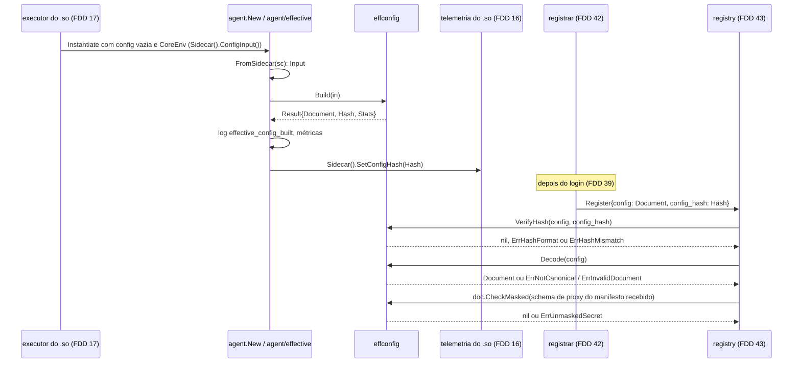
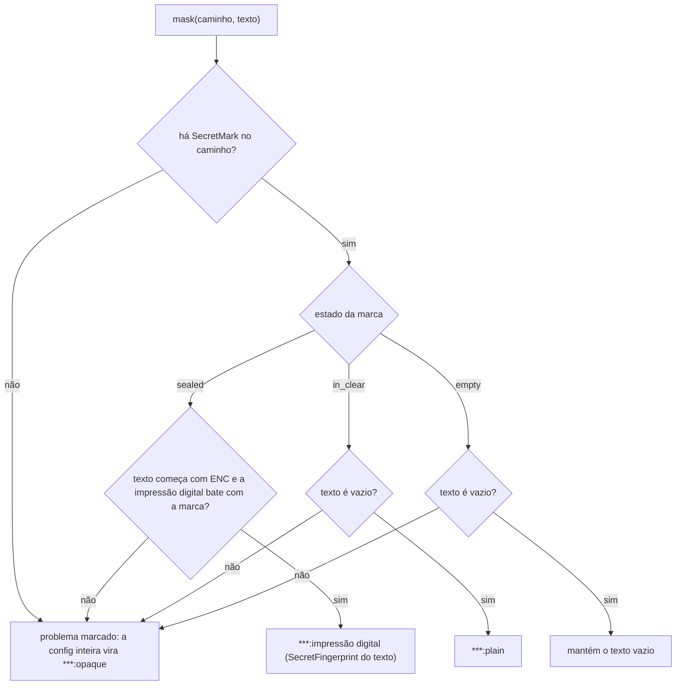

### FDD: Config efetiva canônica, mascaramento e hash (CORE-02)

Versão: 1.0
Data: 2026-10-20
Responsável: Guilherme Giusti

---

### 1. Contexto e motivação técnica

**Problema técnico.** O controller detecta divergência entre instâncias de um serviço comparando o hash da config efetiva que cada sidecar envia no `Register` (FR-006 e FR-007). Para isso funcionar, o hash precisa ser idêntico para a mesma config, qualquer que seja a ordem das chaves no `n3x.yaml`, e tem de mudar quando um segredo muda, sem que nenhum segredo saia do sidecar. O ADR-006 do `n3x-plugin-core` fixou o formato (JSON canônico pela RFC 8785, `***:<impressão digital>`, `***:plain` e `sha256:<hex>`), mas deixou sem resposta:

- quais campos do `n3x.yaml` entram no objeto `sidecar` e com que nomes; o exemplo do ADR-006 e do HLD do core usa `listen: 15001`, que não existe no `n3x.yaml` v1 (`listener.port`, padrão `17000`, FDD 15) (L-06)
- como o core recebe os textos `ENC[...]` e a marca "veio sem `ENC`", se o plugin recebe a config decifrada e não pode importar `secret/` (L-07; a interface foi definida na FDD 09 e é aplicada aqui)
- se a RFC 8785 é implementada no próprio core ou vem de uma biblioteca (L-26)
- se `10s` e `10000ms`, ou a mesma lista de plugins em outra ordem, dão o mesmo hash
- o que acontece com um segredo vazio, com um campo cujo schema não é conhecido, com números grandes e com uma config maior que o `Register` de 1 MiB
- se o controller confere o hash sobre os bytes recebidos ou recanonicaliza antes

Esta entrevista achou quatro problemas novos:

- **Números grandes.** A RFC 8785 serializa todo número como double IEEE 754. Um campo `int64` ou `uint64` de plugin com valor acima de 2^53 (por exemplo `9007199254740993`) seria mostrado no painel com outro valor, em silêncio.
- **Capacidade de entrega do hash ausente.** A FDD 16 publica `n3x_build_info{config_hash}` por `Platform.SetConfigHash`, "capacidade da FDD 09", mas a visão `proxy.Sidecar` da FDD 09 não tem método para o core entregar o hash.
- **`async` e `match` fora do formato.** O ADR-006 lista só `id`, `instance`, `phase`, `order`, `failure` e `config` por item de `plugins[]`. Duas instâncias com `match` diferente (recortes diferentes) teriam o mesmo hash, o que contraria "o hash corresponde à config em uso". A FDD 09 já entrega esses campos em `PluginConfig.Settings`.
- **Mudança de formato muda o hash de todos.** Qualquer mudança nos bytes gerados para a mesma entrada (campo novo no objeto `sidecar`, outra ordem) faz todo sidecar parecer com config nova depois de um upgrade do core. Precisa de regra explícita para o `format`.

**Encaixe no HLD.** O HLD do `n3x-plugin-core` põe a montagem, o mascaramento e o hash no `agent/registrar` e o recálculo no `controller/registry`. Esta FDD tira essa lógica dos dois componentes e a coloca num pacote público compartilhado pelas duas metades, `github.com/giustech/n3x-plugin-core/effconfig` (com o subpacote `effconfig/jcs`, o canonicalizador da RFC 8785), mais um adaptador fino na metade de proxy, `agent/effective`, que converte a visão `proxy.Sidecar` (FDD 09) na entrada do pacote e entrega o hash à telemetria do `.so` (FDD 16). O `registrar` (FDD 42) só envia os bytes prontos; o `registry` (FDD 43) só chama a verificação.

```text
.so do sidecar                                       binário do controller
 core/chain (FDD 17)                                  controller/registry (FDD 43)
   proxy.ConfigInput + ControllerSettings               │ VerifyHash, Decode, CheckMasked
        │ (FDD 09)                                      ▼
   agent/effective ──▶ effconfig.Build ──▶ bytes + hash ─▶ Register (FDD 42) ─▶ controller/configs (FDD 44)
        │                    │ jcs                           │
        └─▶ Sidecar.SetConfigHash ─▶ n3x_build_info (FDD 16) └─▶ painel (FDD 45)
```

**Atores.** Executor do `.so` (FDD 17: fornece `ConfigInput` e `ControllerSettings`), metade de proxy do core (gera), metade de controller do core (confere), telemetria do `.so` (publica `n3x_build_info`), painel (exibe), operador (lê logs, métricas e o painel) e o simulador de sidecars (FDD 51, gera registros válidos com o mesmo pacote).

**Limites.** `effconfig` e `effconfig/jcs` são funções puras: sem I/O, sem log, sem goroutine, sem estado global, seguras para uso concorrente. Quem loga e publica métrica é o adaptador `agent/effective` no sidecar e o `registry` no controller. O pacote não decifra nada e não vê nenhum valor em claro: recebe os textos `ENC[...]`, o texto de segredo em claro já trocado por `""` pelo runtime e as marcas de cada segredo (FDD 09).

**Suposições**
- A config do sidecar é estática: o `.so` lê o `n3x.yaml` uma vez na subida (ADR-007 do `n3x-sidecar`), então a config efetiva é calculada uma vez por processo e reaproveitada em cada `Register`
- Depois de um `config.Load` sem erro, todo texto que começa com `ENC[` num campo segredo é um envelope válido que abriu (FDDs 09 e 15), e nenhum campo que não é segredo contém um envelope (`secret_unexpected`, FDDs 03 e 15)
- Toda metade de proxy tem schema no manifesto embutido (FDD 02, um schema por metade; FDD 15 confere); o caso "sem schema" é só defensivo
- `Schema.Normalize` e `Schema.MaskSecrets` (FDD 02) devolvem duração e tamanho em forma canônica (`time.Duration.String()` e `plugin.Size.String()`), com formas congeladas na major do SDK
- O core e o SDK entram no `.so` na versão fixada pela imagem de build (FDD 20, `N3X-B008`); sidecar e controller podem rodar versões diferentes do core

**Restrições**
- O core nunca importa `secret/` (ADR-014 do `n3x-sdk`)
- `effconfig` importa só a biblioteca padrão e `github.com/giustech/n3x-sdk/plugin`; nunca `proxy/`, `controller/`, gRPC ou protobuf, para entrar nos dois binários sem puxar a metade errada (regra da FDD 36: o caminho do `agent` nunca chega a `controller/` do SDK)
- Nenhum valor em claro, texto `ENC[...]` completo ou trecho de config sem máscara em log, erro, evento ou métrica (HLD do core, "Logs e erros")
- Nada no caminho da requisição (ADR-008 do `n3x-plugin-core`)
- Documentação e mensagens em pt-BR; identificadores, nomes de campo e valores de rótulo em inglês

**Rastreabilidade**
- PRD 1.5: FR-006 (divergência pelo hash), FR-007 (JSON canônico, `***:<impressão digital>`, `***:plain`, hash recalculado, `INVALID_ARGUMENT` e `DATA_LOSS`), FR-016 (config mascarada no registro); segurança: "nenhum segredo na config enviada ao controller"; critérios de aceite "config efetiva em JSON canônico com segredos só como `***:<impressão digital>` ou `***:plain`", "hash que não bate é recusado com `DATA_LOSS`" e "teste automatizado de que nenhum segredo aparece na config enviada"
- ADRs: ADR-006, ADR-008 e ADR-010 do `n3x-plugin-core`; ADR-011, ADR-014, ADR-020 e ADR-022 do `n3x-sdk`; ADR-007 do `n3x-sidecar`
- FDDs aplicadas: 01 (`FieldError`, `ID`, `Phase`, `FailurePolicy`, notação L-34), 02 (`Normalize`, `MaskSecrets`, `Walk`, formas canônicas), 03 (`SecretFingerprint`, `Secret.Fingerprint()`, `Sealed`, `InClear`, vetores), 04 e 06 (`runtime.plugin_limits`), 09 (`ConfigInput`, `PluginConfig`, `SecretMark`, `NewPluginConfig`, `ControllerSettings`), 15 (campos do `n3x.yaml`), 16 (`n3x_build_info`), 17 (montagem do `ConfigInput`), 36 (`RegisterRequest.config`, `config_hash`, `ConfigHashLen`, `MaxRegisterBytes`)
- Lacunas do README fechadas aqui:
  - **L-06 fechada:** o objeto `sidecar` usa os mesmos nomes do `n3x.yaml` v1 (FDD 15), com uma lista fechada de campos por `format` (contrato 1): `service`, `controller` (sem o valor do segredo, que vira marcador), `keys`, `listener`, `app`, `resources` e `runtime`, inclusive `runtime.plugin_limits` com os valores efetivos. `listen` não existe; o exemplo do ADR-006 fica desatualizado (I-01)
  - **L-07 fechada (com a interface da FDD 09):** o core recebe de `proxy.Sidecar.ConfigInput()` cada config normalizada com o `ENC[...]` intacto, o segredo em claro trocado por `""` e uma `SecretMark` por segredo; recebe o `controller.secret` como `plugin.Secret` em `ControllerSettings()`. O mascaramento usa `Schema.MaskSecrets` com a impressão digital de `plugin.SecretFingerprint` (plugins) e `Secret.Fingerprint()` (`controller.secret`), as duas formas únicas da FDD 03 (contratos 2 e 3)
  - **L-26 fechada:** RFC 8785 implementada no próprio core, no subpacote `effconfig/jcs`, só com a biblioteca padrão, conferida pelos vetores da RFC e por teste diferencial contra a implementação de referência num módulo só de ferramentas (contrato 6) (hipótese do HLD confirmada)
- Pedidos de FDDs anteriores atendidos:
  - FDD 02: a config efetiva usa `Normalize` (via `NewPluginConfig`) e `MaskSecrets` (contrato 3)
  - FDD 03: impressão digital só por `plugin.SecretFingerprint` e `Secret.Fingerprint()`, nunca uma terceira; segredo vazio fica `""` e não conta como em claro (contrato 2)
  - FDD 04: `runtime.plugin_limits` entra no objeto `sidecar`, com os valores efetivos (contrato 1)
  - FDD 09: `SecretMark` decide o marcador de cada segredo (contrato 3)
  - FDD 15: lista exata dos campos do objeto `sidecar` (contrato 1, L-06)
  - FDD 16: o core entrega o `config_hash` também no standalone (contrato 7)
- Decisões aprovadas pelo responsável do produto em 2026-10-22 (resolvem as hipóteses correspondentes deste documento):
  - **D-01 (L-06):** o objeto `sidecar` usa a lista fechada de campos do contrato 1, com os nomes do `n3x.yaml` v1 (`listener.port`, nunca `listen`). O exemplo do HLD e do ADR-006, que usa `listen: 15001`, precisa ser corrigido (reflexo pendente)
  - **D-02 (I-02):** cada item de `plugins[]` inclui `async` e `match`, além dos campos do ADR-006, e a lista é ordenada por fase, depois `order`, depois `instance`, e não pela ordem do arquivo. O ADR-006 e o FR-007 do PRD precisam refletir isso (reflexo pendente)
  - **D-03 (L-26):** a RFC 8785 é implementada no próprio core (`effconfig/jcs`), com o desvio explícito `BigIntegersAsText`: inteiro com valor absoluto acima de 2^53 − 1 sai como texto com os dígitos exatos. O controller confere a forma canônica com a RFC pura
  - **D-04:** ficam aprovados os marcadores de config inteira `***:opaque` e `***:omitted:<12 hex>`, o segredo vazio mantido como `""` e o limite de 512 KiB na geração. O critério de aceite do PRD ("segredos só como `***:<impressão digital>` ou `***:plain`") precisa citar essa extensão (reflexo pendente)

---

### 2. Objetivos técnicos

- **Mesmo hash para a mesma config.** Invariante: `Build` devolve os mesmos bytes e o mesmo hash para entradas que diferem só na ordem das chaves (em `Sidecar`, `Settings` e `Config`), na ordem de `Plugins`, na ordem dos itens de `match` ou na forma escrita de duração e tamanho (`10s` e `10000ms`; `1Mi` e `1024Ki`). Medida: teste de propriedade com 1.000 permutações aleatórias por caso, 0 diferenças.
- **Nenhum segredo sai do sidecar.** Invariante: no documento gerado, todo campo segredo tem `""`, `***:plain` ou `***:<12 hex>`; o texto `ENC[` e o valor em claro nunca aparecem. Medida: teste de propriedade com 10.000 schemas e configs aleatórios, com canário `n3x-canary-` em todo segredo em claro, 0 ocorrências.
- **Troca de segredo muda o hash sem expor o valor.** Medida: trocar o envelope de um único segredo muda o hash e exatamente um marcador do documento; nenhum outro byte muda.
- **Hash que corresponde à config em uso.** Invariante: todo campo que altera o comportamento do sidecar ou de um plugin, e que é igual em todas as instâncias de um mesmo `n3x.yaml`, entra no documento; nada que varia por instância (nome do pod, endereço, versão do Envoy) entra.
- **RFC 8785 exata.** Medida: 100% dos vetores da RFC (números do Apêndice B, ordenação da seção 3.2.3 e o exemplo da seção 3.2.2) passam; o teste diferencial contra a implementação de referência dá 0 divergências no corpus e em 5 minutos de fuzzing (hipótese de duração, igual às FDDs anteriores).
- **Falha fechada.** Invariante: uma config que o core não sabe classificar (sem schema, marcas que não batem, JSON inválido) nunca sai como está; vira `***:opaque`.
- **Uma regra só nos dois lados.** Invariante: o sidecar gera e o controller confere com o mesmo pacote; o controller confere o hash sobre os bytes recebidos, então uma diferença de versão do canonicalizador entre sidecar e controller nunca gera `DATA_LOSS` falso.
- **Custo baixo.** Metas no runner da CI (hipótese): `Build` com 16 instâncias de 4 KiB em até 2 ms; `VerifyHash` de 512 KiB em até 1 ms; `Decode` de 512 KiB em até 15 ms; `jcs.Canonicalize` com vazão de pelo menos 50 MiB/s.

---

### 3. Escopo e exclusões

**Incluído**
- Formato 1 da config efetiva: raiz, objeto `sidecar` com a lista fechada de campos e nomes (L-06), itens de `plugins[]` com `async` e `match`, ordem dos itens e dos recortes (contrato 1)
- Regra da impressão digital e marcadores `***:<12 hex>`, `***:plain`, `***:opaque` e `***:omitted:<12 hex>`, e o tratamento do segredo vazio (contrato 2)
- `effconfig.Build`: montagem, mascaramento dirigido pelo schema (inclusive em listas, maps, ponteiros e objetos aninhados), `controller.secret`, inteiros grandes, limite de tamanho e degradação (contrato 3)
- `effconfig.Hash` e `effconfig.VerifyHash` (contrato 4)
- Lado do controller: `effconfig.Decode`, `Document` e `CheckMasked` (contrato 5)
- Canonicalizador `effconfig/jcs` pela RFC 8785, implementado no core (L-26) (contrato 6)
- Adaptador `agent/effective` e a chamada em `agent.New`: converte `proxy.Sidecar` em `effconfig.Input`, calcula uma vez por processo, loga, publica as métricas e entrega o hash por `Sidecar.SetConfigHash`, também no standalone (contrato 7)
- Regras de compatibilidade e evolução do `format` (contrato 8)
- Métricas do core no sidecar `n3x_n3x_core_effective_config_bytes` e `n3x_n3x_core_effective_config_degraded{reason}`

**Excluído**
- Interface que entrega ao core os dados do sidecar (`ConfigInput`, `PluginConfig`, `SecretMark`, `NewPluginConfig`, `ControllerSettings`): FDD 09 (SDK-09), aqui só consumida; a montagem do `ConfigInput` no `.so` é da FDD 17 (SID-03)
- Envio do `Register`, teto de 1 MiB da mensagem e log `register_too_large`: FDD 42 (CORE-06)
- Emissão do evento `secret_in_clear`: o executor põe o evento na fila (FDD 17) e o agente o envia (FDD 42)
- Recusa com `INVALID_ARGUMENT`, `DATA_LOSS` e `RESOURCE_EXHAUSTED` no controller, contagem em `registers_total{result}` e logs do registro: FDD 43 (CORE-07); guarda das versões, deduplicação, diff e divergência: FDD 44 (CORE-08); telas: FDD 45 (CORE-09)
- Formato `ENC[...]`, AAD e a função `plugin.SecretFingerprint`: FDD 03 (SDK-03)
- Formas canônicas de duração e tamanho e o percurso dos segredos (`Normalize`, `MaskSecrets`, `Walk`): FDD 02 (SDK-02)
- Publicação de `n3x_build_info`: FDD 16 (SID-02)
- Comportamento do modo Istio sobre `listener` e `app`: FDD 49 (SID-11)
- Leitor do manifesto embutido, usado pelo controller para achar o schema de proxy de cada plugin no `CheckMasked`: FDD 22 (BLD-04)

---

### 4. Fluxos detalhados e diagramas

**Fluxo principal no sidecar: geração, uma vez por processo**
1. O executor (FDD 17) carrega o `n3x.yaml` com `config.Load` em `SecretsOpen`, monta o `proxy.ConfigInput` (topo efetivo em `Sidecar`, um `PluginConfig` por instância em `Plugins`, com `Config` e `Secrets` de `proxy.NewPluginConfig`) e cria a instância `core` primeiro (FDD 09, L-10).
2. `agent.New` chama `effective.Compute(cenv)` (contrato 7), dentro do prazo de `Instantiate` (5 s, FDD 17).
3. `effective.FromSidecar` converte `ConfigInput()` e `ControllerSettings()` em `effconfig.Input`: cada `SecretMark` vira `effconfig.SecretMark` com o mesmo estado; o `controller.secret` (`plugin.Secret`) vira `ControllerSecret{State, Fingerprint}` por `Sealed()`, `InClear()`, `IsZero()` e `Fingerprint()`; no standalone, `ControllerSecret` é `nil`.
4. `effconfig.Build(in)` (contrato 3):
   1. Confere a entrada: `Sidecar` é objeto JSON com `service` em texto; `controller` presente se, e só se, `ControllerSecret` não é nulo; instâncias únicas; `ID`, `Phase`, `Failure` e `Order` válidos.
   2. Monta o objeto `sidecar` copiando só os campos da lista do contrato 1, com os nomes do `n3x.yaml`; campos fora da lista vão para `Stats.IgnoredSidecar` (só o caminho); `controller.secret` recebe `Marker(ControllerSecret)`.
   3. Ordena `Plugins` por fase (ordem da requisição), depois `order`, depois `instance` em ordem de bytes.
   4. Para cada instância: `async` e `match` vêm de `Settings`, com as listas de `match` ordenadas; `config` sai de `Schema.MaskSecrets(Config, mask)`, em que `mask(caminho, texto)` consulta a `SecretMark` do caminho (fluxograma abaixo). Se o schema é nulo, se uma marca não bate ou se `MaskSecrets` falha, a config inteira vira `***:opaque`.
   5. Canonicaliza com `jcs` em modo `BigIntegersAsText`: inteiro fora de ±(2^53 − 1) vira texto com os dígitos exatos.
   6. Se o documento passa de `MaxSize` (512 KiB), troca a maior config por `***:omitted:<12 hex>` (digest da própria config mascarada) até caber; se nem assim cabe, `ErrTooLarge`.
   7. Calcula `Hash` = `sha256:` mais os 64 hex do SHA-256 dos bytes.
5. `effective.Compute` loga `effective_config_built` (e um `effective_config_degraded` por config trocada), ajusta as duas métricas e chama `Sidecar.SetConfigHash(res.Hash)`, que leva o hash a `n3x_build_info{config_hash}` (FDD 16). Isso acontece também no standalone.
6. O `registrar` (FDD 42) usa `res.Document` e `res.Hash` em todo `Register` do processo (depois de cada login e a cada `resend_register`), sem recalcular.

**Fluxo principal no controller: conferência**
1. O `registry` (FDD 43), depois de conferir a major, os campos obrigatórios e a identidade, chama `effconfig.VerifyHash(req.config, req.config_hash)`: formato do hash inválido ou ausente dá `ErrHashFormat` (`INVALID_ARGUMENT`); SHA-256 dos bytes recebidos diferente dá `ErrHashMismatch` (`DATA_LOSS`).
2. Chama `effconfig.Decode(req.config)`: confere tamanho, forma canônica (os bytes recebidos são iguais a `jcs.Canonicalize` deles), `format` e estrutura. Erro dá `INVALID_ARGUMENT`. `format` maior que o conhecido é aceito com `Document.Newer` verdadeiro (contrato 8).
3. Chama `doc.CheckMasked(lookup)`, com o schema de proxy de cada plugin tirado do manifesto recebido no mesmo `Register` (FDD 22): valor de segredo que não é marcador dá `ErrUnmaskedSecret` (`INVALID_ARGUMENT`) e a config não é guardada.
4. Com tudo válido, o `configs` (FDD 44) guarda os bytes recebidos, como vieram, pelo hash.

**Pergunta respondida neste fluxo: bytes ou recanonicalização.** O controller calcula o hash sobre os bytes recebidos e confere a forma canônica à parte; não recanonicaliza antes de calcular. Motivos: o hash detecta qualquer corrupção de byte (`DATA_LOSS`); um sidecar com outra versão do core nunca gera `DATA_LOSS` falso; e um documento fora da forma canônica é erro de quem gerou (`INVALID_ARGUMENT`), que não pode ser guardado porque quebraria a deduplicação pelo hash. Custo: um SHA-256 e um parse por `Register`, que é raro (subida, novo login, `resend_register`).

**Fluxos alternativos e exceções**
- **Standalone:** sem seção `controller`; o objeto `sidecar` não tem `controller`, `ControllerSecret` é nulo, o hash é calculado e entregue a `n3x_build_info`, e não há `Register`
- **Segredo em claro num plugin:** o runtime já trocou o texto por `""` e a marca diz `in_clear`; o marcador é `***:plain`. O evento `secret_in_clear` e o log `warn` vêm do executor (FDD 17) e o envio do evento, da FDD 42
- **`controller.secret` em claro:** `InClear()` verdadeiro; o marcador é `***:plain` (o valor nunca chega ao `effconfig`)
- **Segredo vazio:** a marca diz `empty`; o valor fica `""`; não conta como em claro (FDD 03)
- **`*plugin.Secret` nulo:** ausente na config normalizada, logo sem marca e sem valor no documento
- **Segredo dentro de lista, map ou objeto aninhado:** `MaskSecrets` chama `mask` com o caminho pela notação da L-34 (`tokens[1]`, `per_route["/api/"].password`); a marca do mesmo caminho decide
- **Plugin sem schema (defensivo):** `config` vira `***:opaque`, com `reason="schema_missing"` no log e na métrica
- **Marca que não bate** (caminho sem marca, marca sem caminho, estado incoerente com o texto, impressão digital diferente da calculada): `config` vira `***:opaque`, `reason="marks_mismatch"`
- **Config que não passa no schema** (não acontece depois do `Load`): `***:opaque`, `reason="invalid_config"`
- **Inteiro fora da faixa segura** (ex.: `max_id: 18446744073709551615` num campo `uint64`): sai como texto `"18446744073709551615"`; `Stats.NumbersAsText` conta e o log `effective_config_built` informa
- **Documento acima de 512 KiB:** as maiores configs viram `***:omitted:<12 hex>` até caber; uma mudança dentro de uma config omitida ainda muda o hash, porque o digest muda
- **`Build` falha** (`ErrInvalidInput` ou `ErrTooLarge`): log `effective_config_failed`, sem hash em `n3x_build_info` (alerta da FDD 16), sem `Register` (FDD 42); a subida do Envoy continua, porque a config efetiva é observabilidade e não pode derrubar o tráfego
- **Mesmo segredo cifrado de novo** (outro nonce): o texto `ENC[...]` muda, a impressão digital muda e o hash muda; é aceito e documentado (ADR-006), e o painel classifica a mudança (FDD 44)
- **Controller recebe documento fora da forma canônica:** `ErrNotCanonical`, `INVALID_ARGUMENT`, nada guardado
- **Controller recebe `format` maior:** aceito, campos desconhecidos tolerados (contrato 8)

**Diagramas**

Sequência de ponta a ponta (o envio e a recusa são das FDDs 42 e 43; aqui só as chamadas ao pacote):



Decisão do valor de cada segredo dentro de `MaskSecrets` (a função `mask` nunca devolve o texto recebido):



---

### 5. Contratos públicos (assinaturas, endpoints, headers, exemplos)

**Contrato 1: formato 1 da config efetiva**
- Tipo: formato de dados (bytes de `RegisterRequest.config`, FDD 36)
- Assinatura/Rota: documento JSON canônico pela RFC 8785, UTF-8, sem espaços, até `effconfig.MaxSize` (512 KiB) quando gerado
- Método: n/a
- Semântica de status/headers:
  - **Raiz:** exatamente `format` (inteiro, `1`), `plugins` (lista) e `sidecar` (objeto). O formato só cresce por adição (ADR-006; regras no contrato 8)
  - **Nomes:** os do `n3x.yaml` v1 (FDD 15), com os mesmos aninhamentos. Assim o operador lê o painel e reconhece o arquivo (L-06)
  - **Valores efetivos:** cada campo tem o valor em uso, com os padrões já aplicados: padrões do topo do `n3x.yaml` (FDD 15), `phase`, `order` e `failure` vindos do manifesto quando ausentes, `async` e `match` com padrões, e a config de cada plugin com todos os defaults do schema (`Normalize`, FDD 02). Campo opcional sem padrão (ponteiro ausente) fica ausente
  - **Duração e tamanho:** texto em forma canônica da FDD 02: duração por `time.Duration.String()` (`"10s"`, `"1m0s"`, `"200ms"`) e tamanho por `plugin.Size.String()` (`"256Ki"`, `"32Mi"`, `"1536"`). Logo `10s` e `10000ms` dão `"10s"`, e `1Mi` e `1024Ki` dão `"1Mi"`; não há conversão para milissegundos ou bytes
  - **Números:** forma da RFC 8785 (ECMAScript `Number.prototype.toString` sobre o double). Inteiro com valor absoluto acima de 2^53 − 1 sai como texto com os dígitos exatos (hipótese; contrato 6)
  - **Segredos:** só `***:<12 hex>`, `***:plain` ou `""` (contrato 2)
  - **Nada por instância:** identidade da instância, endereço anunciado, alvo e versão do Envoy vão em outros campos do `Register` (FDD 36), nunca aqui

Campos do objeto `sidecar` no formato 1 (lista fechada; campo do topo do `n3x.yaml` fora dela não entra até um `format` novo):

| Caminho no JSON | Origem no `n3x.yaml` (FDD 15) | Tipo no JSON | Observação |
| --- | --- | --- | --- |
| `service` | `service` | texto | sempre presente |
| `controller.address` | `controller.address` | texto | `controller` ausente no standalone |
| `controller.ca_file` | `controller.ca_file` | texto | caminho, não é segredo |
| `controller.secret` | `controller.secret` | texto | sempre marcador: `***:<12 hex>` ou `***:plain` |
| `controller.timeouts.call` | `controller.timeouts.call` | duração | padrão `"5s"` |
| `controller.timeouts.login` | `controller.timeouts.login` | duração | padrão `"10s"` |
| `controller.heartbeat_interval` | `controller.heartbeat_interval` | duração | padrão `"10s"` |
| `controller.buffer.max_items` | `controller.buffer.max_items` | inteiro | padrão `1000` |
| `keys.aes_file` | `keys.aes_file` | texto | caminho, não é segredo; `keys` ausente se o arquivo não tem `ENC[...]` |
| `listener.port` | `listener.port` | inteiro | padrão `17000`; nunca `listen` |
| `app.address`, `app.protocol` | `app.address`, `app.protocol` | texto | |
| `app.timeouts.connect`, `app.timeouts.request` | idem | duração | padrões `"1s"` e `"15s"` |
| `app.health.type`, `app.health.path`, `app.health.interval`, `app.health.timeout` | idem | texto e duração | `path` ausente fora de `type: http` |
| `resources.cpus`, `resources.memory` | idem | número e tamanho | `resources` ausente vale "limites do cgroup"; o valor lido do cgroup não entra (é fato do ambiente, não config) |
| `runtime.drain_timeout`, `runtime.log_level` | idem | duração e texto | padrões `"20s"` e `"info"` |
| `runtime.panic_breaker.panics`, `.window`, `.zombies` | idem | inteiro e duração | padrões `5`, `"1m0s"` e `100` |
| `runtime.request_body.max_bytes` | idem | tamanho | padrão `"1Mi"` |
| `runtime.plugin_limits["<id>"].memory.max_bytes`, `.background.max_tasks`, `.dial.max_conns` | `runtime.plugin_limits` (FDDs 04 e 06) | tamanho e inteiro | uma entrada por plugin com pelo menos uma instância e sempre `n3x.core`, com os três limites efetivos (padrão ou do arquivo); plugin sem instância não entra (não tem efeito) (pedido da FDD 04) |

Fica de fora do objeto `sidecar`: `version` do `n3x.yaml` (versão do arquivo, não parâmetro), `plugins` (vira `plugins[]`) e o valor do `controller.secret`.

Campos de cada item de `plugins[]`:

| Campo | Tipo | Origem | Observação |
| --- | --- | --- | --- |
| `id` | texto | `plugins[].id` | `plugin.ID` |
| `instance` | texto | `plugins[].instance` | único no documento |
| `phase` | texto | `plugins[].phase` ou `default_phase` | uma das 8 fases |
| `order` | inteiro | `plugins[].order` ou `default_order` | 0 a 1000 |
| `failure` | texto | `plugins[].failure` ou `default_failure` | `open` ou `closed` |
| `async` | objeto | `plugins[].async` com padrões | `max_inflight` e `timeout` (hipótese: acréscimo ao ADR-006, I-02) |
| `match` | objeto | `plugins[].match` com padrões | `grpc_services`, `methods` e `paths`, cada lista ordenada por bytes (são conjuntos, combinados por OU, FDD 15) (hipótese) |
| `config` | objeto ou texto | `plugins[].config` normalizada e mascarada | texto só nos marcadores `***:opaque` e `***:omitted:<12 hex>` |

- **Ordem de `plugins[]`:** fase (ordem da requisição: `access` até `observe`), depois `order`, depois `instance` em ordem de bytes. É a ordem de execução da cadeia (grupo paralelo em ordem alfabética de instância, FDD 07), não depende da ordem do arquivo e é a ordem que o painel desenha (hipótese)
- **O core não aparece em `plugins[]`:** é implícito (FDD 15, `core_implicit`) e não tem config; os limites dele aparecem em `sidecar.runtime.plugin_limits["n3x.core"]`
- **Limites:** documento até 512 KiB na geração; até 1 MiB na leitura do controller (`MaxDecodeSize`, igual a `corev1.MaxRegisterBytes`)

**Exemplo de requisição** (`n3x.yaml` de referência da FDD 15; o schema do `giustech.ratelimit` é o do contrato 1 da FDD 02 e o do `n3x.example` é hipotético, até a FDD 13)
```yaml
version: 1
service: pedidos
controller:
  address: n3x-controller:17443
  ca_file: /etc/n3x/ca.pem
  secret: ENC[v1:oKGio6SlpqeoqaqrhWoZSSClYdYDCaq3aFezuwLaMHP9mjIJ+GdC6QyJnFO/ZQ+b5cM41CaHLENk]
keys:
  aes_file: /run/n3x/aes.key
app:
  address: 127.0.0.1:3000
  protocol: grpc
runtime:
  request_body: { max_bytes: 256Ki }
  plugin_limits:
    giustech.ratelimit: { memory: { max_bytes: 32Mi } }
plugins:
  - id: n3x.example
    instance: add-header
    config: { header: X-N3X, deny_path: /admin/ }
  - id: giustech.ratelimit
    instance: rl-api
    phase: traffic
    order: 20
    match: { grpc_services: ["pedidos.v1.Pedidos"] }
    config:
      limit: 100
      redis:
        address: redis:6379
        password: ENC[v1:oKGio6SlpqeoqaqrlSsSRXHmZtBPF+K3bgm3Tay7UBrZroDKT/dOy+2Q]
```

**Exemplo de resposta** (formatado só para leitura; os bytes reais são a linha única abaixo)
```json
{
  "format": 1,
  "plugins": [
    {
      "async": { "max_inflight": 1000, "timeout": "200ms" },
      "config": { "limit": 100, "max_body": "1Mi", "mode": "local", "paths": [], "per_route": {},
                  "redis": { "address": "redis:6379", "password": "***:5403f82244f0", "timeout": "50ms" }, "window": "1m0s" },
      "failure": "closed", "id": "giustech.ratelimit", "instance": "rl-api",
      "match": { "grpc_services": ["pedidos.v1.Pedidos"], "methods": [], "paths": [] },
      "order": 20, "phase": "traffic"
    },
    {
      "async": { "max_inflight": 1000, "timeout": "200ms" },
      "config": { "deny_path": "/admin/", "header": "X-N3X" },
      "failure": "open", "id": "n3x.example", "instance": "add-header",
      "match": { "grpc_services": [], "methods": [], "paths": [] },
      "order": 50, "phase": "transform"
    }
  ],
  "sidecar": {
    "app": { "address": "127.0.0.1:3000", "health": { "interval": "5s", "timeout": "1s", "type": "grpc" }, "protocol": "grpc",
             "timeouts": { "connect": "1s", "request": "15s" } },
    "controller": { "address": "n3x-controller:17443", "buffer": { "max_items": 1000 }, "ca_file": "/etc/n3x/ca.pem",
                    "heartbeat_interval": "10s", "secret": "***:b619a75cdb48", "timeouts": { "call": "5s", "login": "10s" } },
    "keys": { "aes_file": "/run/n3x/aes.key" },
    "listener": { "port": 17000 },
    "runtime": {
      "drain_timeout": "20s", "log_level": "info",
      "panic_breaker": { "panics": 5, "window": "1m0s", "zombies": 100 },
      "plugin_limits": {
        "giustech.ratelimit": { "background": { "max_tasks": 8 }, "dial": { "max_conns": 16 }, "memory": { "max_bytes": "32Mi" } },
        "n3x.core": { "background": { "max_tasks": 8 }, "dial": { "max_conns": 16 }, "memory": { "max_bytes": "16Mi" } },
        "n3x.example": { "background": { "max_tasks": 8 }, "dial": { "max_conns": 16 }, "memory": { "max_bytes": "16Mi" } }
      },
      "request_body": { "max_bytes": "256Ki" }
    },
    "service": "pedidos"
  }
}
```

Bytes canônicos (1.578 bytes; golden `effconfig/testdata/golden/reference.json`):
```text
{"format":1,"plugins":[{"async":{"max_inflight":1000,"timeout":"200ms"},"config":{"limit":100,"max_body":"1Mi","mode":"local","paths":[],"per_route":{},"redis":{"address":"redis:6379","password":"***:5403f82244f0","timeout":"50ms"},"window":"1m0s"},"failure":"closed","id":"giustech.ratelimit","instance":"rl-api","match":{"grpc_services":["pedidos.v1.Pedidos"],"methods":[],"paths":[]},"order":20,"phase":"traffic"},{"async":{"max_inflight":1000,"timeout":"200ms"},"config":{"deny_path":"/admin/","header":"X-N3X"},"failure":"open","id":"n3x.example","instance":"add-header","match":{"grpc_services":[],"methods":[],"paths":[]},"order":50,"phase":"transform"}],"sidecar":{"app":{"address":"127.0.0.1:3000","health":{"interval":"5s","timeout":"1s","type":"grpc"},"protocol":"grpc","timeouts":{"connect":"1s","request":"15s"}},"controller":{"address":"n3x-controller:17443","buffer":{"max_items":1000},"ca_file":"/etc/n3x/ca.pem","heartbeat_interval":"10s","secret":"***:b619a75cdb48","timeouts":{"call":"5s","login":"10s"}},"keys":{"aes_file":"/run/n3x/aes.key"},"listener":{"port":17000},"runtime":{"drain_timeout":"20s","log_level":"info","panic_breaker":{"panics":5,"window":"1m0s","zombies":100},"plugin_limits":{"giustech.ratelimit":{"background":{"max_tasks":8},"dial":{"max_conns":16},"memory":{"max_bytes":"32Mi"}},"n3x.core":{"background":{"max_tasks":8},"dial":{"max_conns":16},"memory":{"max_bytes":"16Mi"}},"n3x.example":{"background":{"max_tasks":8},"dial":{"max_conns":16},"memory":{"max_bytes":"16Mi"}}},"request_body":{"max_bytes":"256Ki"}},"service":"pedidos"}}
```
Hash: `sha256:573ea08dfcea466c12a4eaf03609ef12bc2b3fea4d4d5502b7b8cd7f7077ff3b`. As impressões digitais `5403f82244f0` e `b619a75cdb48` são as de `plugin.SecretFingerprint` sobre os dois envelopes, iguais aos vetores da FDD 03. O `rl-api` vem antes do `add-header` porque `traffic` precede `transform`, embora o arquivo liste o `add-header` primeiro.

---

**Contrato 2: impressão digital e marcadores**
- Tipo: regra e função (pacote `effconfig`)
- Assinatura/Rota:
  ```go
  package effconfig

  type SecretState uint8

  const (
      SecretSealed  SecretState = iota + 1 // "sealed": veio em ENC[...]
      SecretInClear                        // "in_clear": texto não vazio sem ENC[...]
      SecretEmpty                          // "empty": texto vazio
  )

  func (s SecretState) String() string

  const (
      MarkerPrefix        = "***:"
      MarkerPlain         = "***:plain"
      MarkerOpaque        = "***:opaque"
      MarkerOmittedPrefix = "***:omitted:"
      FingerprintLen      = 12 // igual a plugin.SecretFingerprintLen
  )

  type MarkerKind uint8

  const (
      MarkerSealed MarkerKind = iota + 1 // ***:<12 hex>
      MarkerInClear                      // ***:plain
      MarkerOpaqueConfig                 // ***:opaque (config inteira)
      MarkerOmittedConfig                // ***:omitted:<12 hex> (config inteira)
  )

  // Marker devolve o marcador de um segredo. Sealed exige impressão digital de 12 hex minúsculos.
  func Marker(state SecretState, fingerprint string) (string, error)

  // ParseMarker reconhece um marcador; ok falso para qualquer outro texto.
  func ParseMarker(s string) (kind MarkerKind, digest string, ok bool)
  ```
- Método: n/a
- Semântica de status/headers:
  - **Impressão digital:** os 12 primeiros caracteres hex minúsculos do SHA-256 dos bytes exatos do texto `ENC[...]` recebido, com `ENC[` e `]` (ADR-006). Nos plugins, calculada por `plugin.SecretFingerprint(texto)`; no `controller.secret`, lida de `Secret.Fingerprint()`. As duas são a implementação única da FDD 03; o core nunca calcula a impressão digital de outro jeito
  - **`Marker`:** `SecretSealed` dá `***:<impressão digital>`; `SecretInClear` dá `***:plain`; `SecretEmpty` dá `""` (o segredo vazio fica vazio, porque não há o que proteger e não é "em claro", FDD 03) (hipótese de manter `""`). Impressão digital fora de `^[0-9a-f]{12}$` em `SecretSealed`, ou estado inválido, dá erro com `ErrInvalidInput` (regra `fingerprint`)
  - **Marcadores de config inteira:** `***:opaque` (o core não soube classificar a config; nada dela sai) e `***:omitted:<12 hex>` (config cortada por tamanho; os 12 hex são do SHA-256 da própria config já mascarada e canônica, então uma mudança nela ainda muda o hash) (hipótese)
  - **Gramática:** `^\*\*\*:([0-9a-f]{12}|plain|opaque|omitted:[0-9a-f]{12})$`. `ParseMarker` é usado pelo `CheckMasked` (contrato 5) e pelo painel (FDDs 44 e 45) para pôr os selos "segredo", "em claro" e "config não exibida"
  - A impressão digital pode aparecer no painel e em log (seção 7); o texto `ENC[...]` nunca

**Exemplo de requisição**
```go
m1, _ := effconfig.Marker(effconfig.SecretSealed, plugin.SecretFingerprint("ENC[v1:oKGio6SlpqeoqaqrlSsSRXHmZtBPF+K3bgm3Tay7UBrZroDKT/dOy+2Q]"))
m2, _ := effconfig.Marker(effconfig.SecretInClear, "")
m3, _ := effconfig.Marker(effconfig.SecretEmpty, "")
_, err := effconfig.Marker(effconfig.SecretSealed, "XYZ")
k, d, ok := effconfig.ParseMarker("***:omitted:0c41f2e9a7b3")
```

**Exemplo de resposta**
```json
{
  "m1": "***:5403f82244f0",
  "m2": "***:plain",
  "m3": "",
  "err": "effconfig: entrada inválida: fingerprint: impressão digital fora do formato de 12 hex minúsculos [fingerprint]",
  "ParseMarker": { "kind": "omitted", "digest": "0c41f2e9a7b3", "ok": true }
}
```

---

**Contrato 3: `effconfig.Build`**
- Tipo: sdk (API Go do core; função pura)
- Assinatura/Rota:
  ```go
  package effconfig // github.com/giustech/n3x-plugin-core/effconfig

  const (
      Format  = 1          // formato gerado por esta versão
      MaxSize = 512 << 10  // documento gerado, em bytes (hipótese)
  )

  type SecretMark struct {
      Path        string      // relativo à config, notação da L-34
      State       SecretState
      Fingerprint string      // plugin.SecretFingerprint do texto em SecretSealed; "" nos outros
  }

  type ControllerSecret struct {
      State       SecretState // de plugin.Secret: Sealed, InClear, IsZero
      Fingerprint string      // Secret.Fingerprint() em SecretSealed
  }

  type PluginInput struct {
      ID       plugin.ID
      Instance string
      Phase    plugin.Phase
      Order    int
      Failure  plugin.FailurePolicy
      Settings []byte         // async e match com padrões (PluginConfig.Settings)
      Config   []byte         // PluginConfig.Config: normalizada, ENC[...] intacto, em claro trocado por ""
      Schema   *plugin.Schema // schema da metade de proxy
      Secrets  []SecretMark
  }

  type Input struct {
      Sidecar          []byte            // ConfigInput.Sidecar: topo efetivo, sem plugins e sem controller.secret
      ControllerSecret *ControllerSecret // nil no standalone
      Plugins          []PluginInput     // qualquer ordem
  }

  type Reason string

  const (
      ReasonSchemaMissing Reason = "schema_missing"
      ReasonMarksMismatch Reason = "marks_mismatch"
      ReasonInvalidConfig Reason = "invalid_config"
      ReasonOmitted       Reason = "omitted"
  )

  type Degraded struct {
      ID       plugin.ID
      Instance string
      Reason   Reason
      Bytes    int // tamanho da config mascarada antes da troca (0 quando não há)
  }

  type Stats struct {
      Plugins        int
      Sealed         int // inclui controller.secret
      InClear        int
      Empty          int
      NumbersAsText  int
      Degraded       []Degraded // na ordem de plugins[]
      IgnoredSidecar []string   // caminhos do topo fora da lista do contrato 1 (só nomes)
  }

  type Result struct {
      Document []byte // canônico e mascarado
      Hash     string // "sha256:" + 64 hex
      Stats    Stats
  }

  func Build(in Input) (Result, error)

  var (
      ErrInvalidInput = errors.New("effconfig: entrada inválida")
      ErrTooLarge     = errors.New("effconfig: config efetiva acima do limite")
  )
  ```
- Método: n/a
- Semântica de status/headers:
  - **Pura e determinística:** sem I/O, log ou estado; mesmos bytes em qualquer SO e arquitetura; não altera `in`
  - **Entrada inválida** (erro embrulhado com `Unwrap() []error`, sentinela `ErrInvalidInput` e `plugin.FieldErrors`, padrão da FDD 01): `Sidecar` não é objeto (`sidecar_syntax`), `service` ausente ou não texto (`service`), `controller` presente sem `ControllerSecret` ou o contrário (`controller_secret`), instância repetida (`duplicate`), `ID`, `Phase`, `Failure` ou `Order` inválidos (`plugin_meta`), `Settings` que não é objeto (`settings`). O `Detail` nunca cita valor
  - **Objeto `sidecar`:** cópia dos campos da lista do contrato 1, na forma recebida (já normalizada pelo runtime); tipo JSON diferente do esperado num campo da lista dá `ErrInvalidInput` (`sidecar_field`); campo fora da lista é ignorado e listado em `Stats.IgnoredSidecar`. `controller.secret` recebe `Marker(ControllerSecret)`
  - **Mascaramento dos plugins (L-07):** `Schema.MaskSecrets(Config, mask)` (FDD 02) normaliza de novo (idempotente) e chama `mask(caminho, texto)` para cada segredo presente. A `mask` consome a `SecretMark` do mesmo caminho (fluxograma da seção 4): `sealed` com texto que começa com `ENC[` e `plugin.SecretFingerprint(texto)` igual à marca dá `***:<impressão digital>`; `in_clear` com texto `""` dá `***:plain`; `empty` com texto `""` dá `""`. Qualquer outra combinação, caminho sem marca ou marca não consumida marca o problema e a config inteira vira `***:opaque` (`marks_mismatch`). A `mask` nunca devolve o texto recebido
  - **Por que `MaskSecrets` e não o `Walk` do core:** o percurso de segredos (objetos, listas, maps, ponteiros) é o mesmo da validação, num lugar só (FDD 02); o core não reimplementa a localização de segredo
  - **Inteiros grandes:** a canonicalização usa `jcs.Options{BigIntegersAsText: true}` (contrato 6)
  - **Limite e degradação:** documento acima de `MaxSize` faz trocar, uma por vez, a config de maior tamanho (empate pela posição em `plugins[]`) por `***:omitted:<12 hex>`, até caber. Se todas as configs já foram trocadas e ainda não cabe, `ErrTooLarge`. O resultado continua determinístico
  - **Custo:** O(tamanho total); uma passada de `MaskSecrets` e uma de canonicalização por instância

**Exemplo de requisição**
```go
res, err := effconfig.Build(effconfig.Input{
    Sidecar:          sidecarJSON, // topo efetivo do n3x.yaml de referência (contrato 1)
    ControllerSecret: &effconfig.ControllerSecret{State: effconfig.SecretSealed, Fingerprint: "b619a75cdb48"},
    Plugins: []effconfig.PluginInput{
        {ID: example, Instance: "add-header", Phase: plugin.PhaseTransform, Order: 50, Failure: plugin.FailOpen,
            Settings: settingsAH, Config: []byte(`{"header":"X-N3X","deny_path":"/admin/"}`), Schema: schemaEx},
        {ID: rl, Instance: "rl-api", Phase: plugin.PhaseTraffic, Order: 20, Failure: plugin.FailClosed,
            Settings: settingsRL, Schema: schemaRL,
            Config:  []byte(`{"limit":100,"window":"1m0s","mode":"local","max_body":"1Mi","paths":[],"per_route":{},"redis":{"address":"redis:6379","password":"ENC[v1:oKGio6SlpqeoqaqrlSsSRXHmZtBPF+K3bgm3Tay7UBrZroDKT/dOy+2Q]","timeout":"50ms"}}`),
            Secrets: []effconfig.SecretMark{{Path: "redis.password", State: effconfig.SecretSealed, Fingerprint: "5403f82244f0"}}},
    },
})
```

**Exemplo de resposta**
```json
{
  "err": null,
  "len(res.Document)": 1578,
  "res.Hash": "sha256:573ea08dfcea466c12a4eaf03609ef12bc2b3fea4d4d5502b7b8cd7f7077ff3b",
  "res.Stats": { "Plugins": 2, "Sealed": 2, "InClear": 0, "Empty": 0, "NumbersAsText": 0, "Degraded": [], "IgnoredSidecar": ["version"] }
}
```

**Exemplo de requisição** (instância com marca que não bate e instância com segredo em claro e vazio)
```go
in.Plugins = append(in.Plugins,
    effconfig.PluginInput{ID: rl, Instance: "rl-b", Phase: plugin.PhaseTraffic, Order: 30, Failure: plugin.FailOpen, Settings: s, Schema: schemaRL,
        Config: cfgComSenhaENC, Secrets: nil}, // falta a marca de redis.password
    effconfig.PluginInput{ID: tk, Instance: "tokens", Phase: plugin.PhaseAuthn, Order: 10, Failure: plugin.FailClosed, Settings: s, Schema: schemaTk,
        Config: []byte(`{"tokens":["",""]}`),
        Secrets: []effconfig.SecretMark{{Path: "tokens[0]", State: effconfig.SecretInClear}, {Path: "tokens[1]", State: effconfig.SecretEmpty}}},
)
```

**Exemplo de resposta** (trechos do documento e do `Stats`)
```json
{
  "plugins[instance=tokens].config": { "tokens": ["***:plain", ""] },
  "plugins[instance=rl-b].config": "***:opaque",
  "Stats.InClear": 1,
  "Stats.Empty": 1,
  "Stats.Degraded": [{ "ID": "giustech.ratelimit", "Instance": "rl-b", "Reason": "marks_mismatch", "Bytes": 0 }]
}
```

---

**Contrato 4: `effconfig.Hash` e `effconfig.VerifyHash`**
- Tipo: sdk (API Go do core; funções puras)
- Assinatura/Rota:
  ```go
  const (
      HashPrefix = "sha256:"
      HashLen    = 71 // igual a corev1.ConfigHashLen (FDD 36)
  )

  func Hash(doc []byte) string                 // "sha256:" + hex minúsculo do SHA-256 dos bytes
  func VerifyHash(doc []byte, hash string) error

  var (
      ErrHashFormat   = errors.New("effconfig: config_hash fora do formato sha256:<64 hex>")
      ErrHashMismatch = errors.New("effconfig: config_hash não corresponde à config")
  )
  ```
- Método: n/a
- Semântica de status/headers:
  - **Sobre os bytes exatos:** `Hash` não canonicaliza nem interpreta; é o SHA-256 do que foi gerado (sidecar) ou recebido (controller)
  - **`VerifyHash`:** primeiro o formato, `^sha256:[0-9a-f]{64}$` com exatamente 71 bytes (vazio, maiúsculas, outro algoritmo ou tamanho errado dão `ErrHashFormat`); depois o cálculo sobre `doc` e a comparação (diferente dá `ErrHashMismatch`). Comparação com `crypto/subtle` (o hash não é segredo; evita discussão)
  - **Mapeamento no controller** (aplicado pela FDD 43): `ErrHashFormat` vira `INVALID_ARGUMENT` (inclui "config recebida sem hash", FR-007); `ErrHashMismatch` vira `DATA_LOSS`
  - O erro não cita bytes do documento; o `registry` loga os dois hashes (seção 7)

**Exemplo de requisição**
```go
doc := golden // bytes canônicos do contrato 1
e1 := effconfig.VerifyHash(doc, "sha256:573ea08dfcea466c12a4eaf03609ef12bc2b3fea4d4d5502b7b8cd7f7077ff3b")
doc2 := bytes.Replace(doc, []byte(`"limit":100`), []byte(`"limit":101`), 1)
e2 := effconfig.VerifyHash(doc2, "sha256:573ea08dfcea466c12a4eaf03609ef12bc2b3fea4d4d5502b7b8cd7f7077ff3b")
e3 := effconfig.VerifyHash(doc, "SHA256:573EA08D...")
e4 := effconfig.VerifyHash(doc, "")
```

**Exemplo de resposta**
```json
{ "e1": null, "e2": "ErrHashMismatch (DATA_LOSS)", "e3": "ErrHashFormat (INVALID_ARGUMENT)", "e4": "ErrHashFormat (INVALID_ARGUMENT)" }
```

---

**Contrato 5: lado do controller, `Decode`, `Document` e `CheckMasked`**
- Tipo: sdk (API Go do core; funções puras)
- Assinatura/Rota:
  ```go
  const MaxDecodeSize = 1 << 20 // igual a corev1.MaxRegisterBytes

  type ConfigState uint8

  const (
      ConfigShown   ConfigState = iota + 1 // objeto
      ConfigOpaque                         // "***:opaque"
      ConfigOmitted                        // "***:omitted:<12 hex>"
  )

  type Entry struct {
      ID       plugin.ID
      Instance string
      Phase    plugin.Phase
      Order    int
      Failure  plugin.FailurePolicy
      Async    json.RawMessage
      Match    json.RawMessage
      Config   json.RawMessage // objeto canônico ou o marcador como texto JSON
      State    ConfigState
  }

  type Document struct {
      Format  int
      Newer   bool            // format maior que Format: campos desconhecidos tolerados
      Sidecar json.RawMessage // objeto sidecar canônico
      Plugins []Entry         // na ordem do documento
  }

  func Decode(doc []byte) (Document, error)

  // SchemaLookup devolve o schema da metade de proxy de um plugin (do manifesto recebido).
  type SchemaLookup func(id plugin.ID) (*plugin.Schema, bool)

  func (d Document) CheckMasked(lookup SchemaLookup) error

  var (
      ErrNotCanonical    = errors.New("effconfig: config fora da forma canônica RFC 8785")
      ErrInvalidDocument = errors.New("effconfig: documento da config efetiva inválido")
      ErrUnmaskedSecret  = errors.New("effconfig: segredo sem máscara na config efetiva")
  )
  ```
- Método: n/a
- Semântica de status/headers:
  - **`Decode`, na ordem:** tamanho até `MaxDecodeSize` (senão `ErrInvalidDocument`, regra `size`); JSON válido pela RFC 8785 (senão `ErrNotCanonical` com a regra do `jcs`); bytes iguais a `jcs.Canonicalize(doc)` (senão `ErrNotCanonical`, regra `not_canonical`); raiz objeto com `format` inteiro maior ou igual a 1 (senão `ErrInvalidDocument`, regra `format`)
  - **Com `format` igual a 1 (estrito):** raiz só com `format`, `plugins` e `sidecar`; `sidecar` objeto com `service`; cada item com exatamente os 8 campos do contrato 1; `id` por `plugin.ParseID`; `phase` e `failure` válidos; `order` de 0 a 1000; `instance` com a gramática da FDD 15 e única; `config` objeto ou marcador de config; itens na ordem do contrato 1 (regra `plugins_order`). Erros saem como `plugin.FieldErrors` com caminho (`plugins[1].phase`) e regra, sem valor no `Detail`
  - **Com `format` maior que 1:** `Newer` verdadeiro; só a raiz, `format`, os tipos de `plugins` e `sidecar` e os campos conhecidos de cada item são conferidos; campo desconhecido é ignorado (contrato 8)
  - **`CheckMasked` (defesa em profundidade):** para cada item com `ConfigShown` cujo schema o `lookup` acha, percorre a config com `Schema.Walk` (FDD 02) e exige, em todo nó com `Secret()` verdadeiro, texto `""`, `***:plain` ou `***:<12 hex>`; confere também `sidecar.controller.secret`, quando existe, com a mesma regra. Violação dá `ErrUnmaskedSecret` com `FieldError{Path: "plugins[0].config.redis.password", Rule: "secret_unmasked"}`, nunca o valor. Plugin sem schema no `lookup` não é conferido (o `registry` loga, FDD 43)
  - **Mapeamento no controller** (FDD 43): `ErrNotCanonical`, `ErrInvalidDocument` e `ErrUnmaskedSecret` viram `INVALID_ARGUMENT`; nos três casos a config não é guardada e o painel mantém a última válida (FR-007)
  - **Uso no painel** (FDDs 44 e 45): `Entry.Config` com `ConfigShown` vai para `ui.ConfigDetail` (FDD 10) com o schema; `ConfigOpaque` e `ConfigOmitted` são mostrados como "config não exibida", sem chamar `ConfigDetail`

**Exemplo de requisição**
```go
d, err := effconfig.Decode(golden)
_, e2 := effconfig.Decode([]byte(`{"format":1, "plugins":[],"sidecar":{"service":"pedidos"}}`))  // espaço
_, e3 := effconfig.Decode([]byte(`{"format":2,"plugins":[],"sidecar":{"service":"pedidos","tracing":{"rate":0.1}}}`))
leak := bytes.Replace(golden, []byte(`"***:5403f82244f0"`), []byte(`"hunter2"`), 1)
dl, _ := effconfig.Decode(leak)
e4 := dl.CheckMasked(func(id plugin.ID) (*plugin.Schema, bool) { return schemas[id], schemas[id] != nil })
```

**Exemplo de resposta**
```json
{
  "err": null,
  "d.Format": 1, "d.Newer": false, "len(d.Plugins)": 2,
  "d.Plugins[0]": { "ID": "giustech.ratelimit", "Instance": "rl-api", "Phase": "traffic", "Order": 20, "State": "shown" },
  "e2": "ErrNotCanonical: [not_canonical]",
  "e3": null,
  "e4": "ErrUnmaskedSecret: plugins[0].config.redis.password: valor de segredo sem máscara [secret_unmasked]"
}
```
(`e3` é `nil` e o documento sai com `Newer` verdadeiro; o `registry` loga `effective_config_format_newer`. O `leak` passa no `Decode` porque continua canônico; quem pega é o `CheckMasked`.)

---

**Contrato 6: canonicalizador `effconfig/jcs` (RFC 8785, L-26)**
- Tipo: sdk (API Go do core; só biblioteca padrão)
- Assinatura/Rota:
  ```go
  package jcs // github.com/giustech/n3x-plugin-core/effconfig/jcs

  const MaxDepth = 64

  type Options struct {
      // BigIntegersAsText escreve como texto JSON, com os dígitos exatos, todo número
      // escrito como inteiro (sem fração nem expoente) com valor absoluto acima de 2^53 - 1.
      // Fora da RFC; usado só pelo Build. O resultado continua canônico.
      BigIntegersAsText bool
  }

  func Canonicalize(data []byte) ([]byte, error)                       // RFC 8785 exata
  func Append(dst, data []byte, opts Options) ([]byte, int, error)     // devolve também quantos inteiros viraram texto
  func IsCanonical(data []byte) bool                                    // Canonicalize(data) == data
  func AppendNumber(dst []byte, f float64) ([]byte, error)             // ECMAScript Number::toString
  func AppendString(dst []byte, s string) []byte                       // escape da RFC 8785
  func Less(a, b string) bool                                          // ordem por unidades UTF-16

  type Error struct {
      Offset int    // posição em bytes na entrada
      Rule   string // syntax, trailing, depth, duplicate_key, utf8, surrogate, number_range
  }

  func (e *Error) Error() string // "jcs: <rule> na posição <offset>"; nunca cita a entrada
  func (e *Error) Is(target error) bool

  var (
      ErrSyntax       = errors.New("jcs: JSON inválido")
      ErrDuplicateKey = errors.New("jcs: chave repetida")
      ErrString       = errors.New("jcs: texto com UTF-8 inválido ou surrogate isolado")
      ErrNumber       = errors.New("jcs: número fora da faixa do double")
      ErrDepth        = errors.New("jcs: aninhamento acima de MaxDepth")
  )
  ```
- Método: n/a
- Semântica de status/headers (RFC 8785, seção 3):
  - **Entrada I-JSON:** UTF-8 válido, sem BOM, um único valor (sobra depois dele é `trailing`), chave repetida no mesmo objeto (comparada depois de decodificar os escapes) é `duplicate_key`, `\uD800` a `\uDFFF` fora de par válido é `surrogate`, aninhamento acima de 64 é `depth`; espaços entre tokens são aceitos e descartados
  - **Literais e espaços:** `true`, `false` e `null` como estão; nenhum espaço na saída
  - **Texto:** só `"` (`\"`), `\` (`\\`) e os caracteres U+0000 a U+001F são escapados; U+0008, U+0009, U+000A, U+000C e U+000D como `\b`, `\t`, `\n`, `\f` e `\r`; os demais como `\u00hh` com hex minúsculo. Todo o resto sai literal em UTF-8, inclusive `/`, U+007F e U+2028
  - **Números:** o literal é lido como double IEEE 754 (`strconv.ParseFloat`); estouro para infinito é `number_range`. A saída segue `Number::toString` do ECMAScript: dígitos mais curtos que voltam ao mesmo double (`strconv.FormatFloat(f, 'e', -1, 64)` reformatado), notação fixa para expoente decimal de -6 a 20 e exponencial `1e+21` e `1e-7` fora disso; `-0` sai `0`
  - **Objetos:** membros ordenados pelas chaves comparadas como sequências de unidades UTF-16 (`Less`), recursivamente; listas mantêm a ordem
  - **`BigIntegersAsText`:** desvio opcional e explícito da RFC, para não mudar um valor em silêncio: `9007199254740993` sairia `9007199254740992` como double; com a opção, sai `"9007199254740993"` (hipótese). O controller confere a forma canônica com `Canonicalize` puro, e a saída com texto passa nele
  - **Por que implementação própria (L-26):** a biblioteca padrão não tem RFC 8785; o pacote tem cerca de 600 linhas, entra no `.so` e no binário do controller, e uma dependência externa ali seria cadeia de suprimento a mais para a referência de plugin. O teste diferencial contra a implementação de referência da RFC roda num módulo só de ferramentas (`tools/jcsdiff`, fora do grafo de produção) (hipótese)

**Exemplo de requisição** (exemplo da seção 3.2.2 da RFC 8785 e vetor de ordenação da seção 3.2.3)
```json
{"numbers":[333333333.33333329,1E30,4.50,2e-3,0.000000000000000000000000001],"string":"€$\u000F\u000aA'B"\\\\"\/","literals":[null,true,false]}
```
```json
{"€":"Euro Sign","\r":"Carriage Return","דּ":"Hebrew Letter Dalet With Dagesh","1":"One","😀":"Emoji: Grinning Face","\u0080":"Control","ö":"Latin Small Letter O With Diaeresis"}
```

**Exemplo de resposta**
```text
{"literals":[null,true,false],"numbers":[333333333.3333333,1e+30,4.5,0.002,1e-27],"string":"€$\u000f\nA'B\"\\\\\"/"}
chaves na ordem: "\r", "1", "\u0080", "ö", "€", "😀" (U+1F600), "דּ" (U+FB33)
AppendNumber: 0x0000000000000001 -> 5e-324; 0x8000000000000000 -> 0; 0x3eb0c6f7a0b5ed8d -> 0.000001; 0x444b1ae4d6e2ef50 -> 1e+21; 0x7fefffffffffffff -> 1.7976931348623157e+308
Append({"max_id":18446744073709551615}, BigIntegersAsText) -> {"max_id":"18446744073709551615"}, 1
```

---

**Contrato 7: `agent/effective` e a entrega do hash à telemetria**
- Tipo: sdk (adaptador da metade de proxy do core; capacidade pedida à FDD 09)
- Assinatura/Rota:
  ```go
  package effective // github.com/giustech/n3x-plugin-core/agent/effective

  // FromSidecar converte ConfigInput e ControllerSettings (FDD 09) na entrada do Build.
  func FromSidecar(sc proxy.Sidecar) effconfig.Input

  // Compute roda uma vez, em agent.New: Build, logs, métricas e SetConfigHash.
  // Erro não deve impedir a subida; o agente segue sem config efetiva.
  func Compute(env proxy.CoreEnv) (effconfig.Result, error)

  // Acréscimo pedido à FDD 09 (minor do SDK; interface implementada só pela plataforma):
  //   type Sidecar interface { ...; SetConfigHash(hash string) }
  // O executor (FDD 17) liga a chamada a Platform().SetConfigHash (FDD 16).
  ```
- Método: n/a
- Semântica de status/headers:
  - **Conversão:** `ConfigInput().Sidecar` vai como está; cada `PluginConfig` vira `PluginInput` campo a campo (`Settings`, `Config`, `Schema` e `Secrets`); `proxy.SecretState` vira `effconfig.SecretState` com os mesmos valores e textos (teste de paridade); `ControllerSettings()` com `ok` falso dá `ControllerSecret` nulo; com `ok` verdadeiro, `Secret.Sealed()` dá `SecretSealed` com `Secret.Fingerprint()`, `Secret.InClear()` dá `SecretInClear` e `Secret.IsZero()` dá `SecretEmpty`. O valor do segredo nunca é lido (`Reveal()` não é chamado)
  - **Quando:** uma vez, dentro de `agent.New`, também no standalone (pedido da FDD 16). A config é estática, então o resultado vale para o processo inteiro; o `registrar` (FDD 42) recebe o `Result` e não recalcula
  - **Entrega do hash:** `env.Sidecar().SetConfigHash(res.Hash)` com o hash inteiro (`sha256:` e 64 hex), que vira o rótulo `config_hash` de `n3x_build_info` (hipótese: hash inteiro no rótulo, para casar com o painel e os logs; I-04)
  - **Falha:** `ErrInvalidInput` ou `ErrTooLarge` geram o log `effective_config_failed` (`error`) e `n3x_n3x_core_effective_config_bytes` igual a 0; `SetConfigHash` não é chamado; `agent.New` continua sem erro (a config efetiva é observabilidade; derrubar a subida trocaria um problema de painel por falta de tráfego)
  - **Até a FDD 09 acrescentar o método:** `Compute` usa a interface opcional `interface{ SetConfigHash(string) }` por type assertion sobre a visão; sem ela, loga `config_hash_unreported` uma vez (hipótese de transição)
  - **Métricas e logs:** criados e preenchidos durante o `New` (FDD 06: métrica só no `New`); nomes na seção 7

**Exemplo de requisição**
```go
func New(_ types.ProxyConfig, env proxy.Env) (proxy.Instance, error) {
    cenv := env.(proxy.CoreEnv)
    res, err := effective.Compute(cenv) // erro já logado; segue
    return &agent{env: cenv, eff: res, effErr: err}, nil
}
```

**Exemplo de resposta** (log e efeito na telemetria, com o `n3x.yaml` de referência)
```text
{"ts":"2026-10-20T14:00:00.120Z","level":"info","component":"plugin","service":"pedidos","msg":"effective_config_built","plugin_id":"n3x.core","instance":"core","config_hash":"sha256:573ea08dfcea466c12a4eaf03609ef12bc2b3fea4d4d5502b7b8cd7f7077ff3b","format":1,"bytes":1578,"plugins":2,"secrets_sealed":2,"secrets_in_clear":0,"secrets_empty":0,"numbers_as_text":0,"degraded":0,"ignored_sidecar":"version"}
n3x_build_info{version="1.0.0",target="envoy-1.40",config_hash="sha256:573ea08dfcea466c12a4eaf03609ef12bc2b3fea4d4d5502b7b8cd7f7077ff3b"} 1
n3x_n3x_core_effective_config_bytes{plugin="n3x.core",instance="core"} 1578
```

---

**Contrato 8: compatibilidade e evolução do `format`**
- Tipo: regra de versionamento (formato de dados e pacote)
- Assinatura/Rota: `effconfig.Format` (gerado) e `Document.Format`, `Document.Newer` (lido)
- Método: n/a
- Semântica de status/headers:
  - **Quando o `format` sobe:** toda mudança que altera os bytes gerados para a mesma entrada exige `Format + 1`: campo novo na lista do objeto `sidecar` ou nos itens, outra ordem, outro marcador, outra regra de número, outro `MaxSize`. Mudança só de código, com os mesmos bytes, não sobe o `format`. O `format` só cresce, e cada formato novo só acrescenta campos ao anterior (ADR-006)
  - **O que não muda dentro da major 1 do core:** nomes e tipos dos campos já existentes, regra da impressão digital (FDD 03), gramática dos marcadores, algoritmo do hash
  - **Controller mais antigo que o sidecar** (`format` recebido maior que o conhecido): aceita, com `Newer` verdadeiro; confere hash e forma canônica (que não dependem do formato); guarda os bytes; o painel mostra os campos conhecidos e o resto como "fora do schema" (texto bruto). Log `effective_config_format_newer` uma vez por valor de `format` (FDD 43)
  - **`format` 0, ausente, não inteiro ou negativo:** `ErrInvalidDocument` (`INVALID_ARGUMENT`)
  - **Hash entre formatos:** o mesmo `n3x.yaml` gera hashes diferentes em formatos diferentes. Durante o upgrade do core, instâncias de um serviço com `format` diferente não são "config divergente": o painel mostra a diferença como "versões do core diferentes" (pedido à FDD 44)
  - **Dependências que também mudam os bytes:** padrões do `n3x.yaml` (só mudam em major do `core/`, FDD 15), formas canônicas de `Normalize` (congeladas na major do SDK, FDD 02) e padrões dos schemas dos plugins (mudam com a versão do plugin, o que é mudança real de config)

**Exemplo de requisição**
```json
{ "controller_conhece": 1, "recebido": "{\"format\":2,\"plugins\":[],\"sidecar\":{\"service\":\"pedidos\",\"tracing\":{\"rate\":0.1}}}" }
```

**Exemplo de resposta**
```json
{ "Decode": "ok", "Format": 2, "Newer": true, "guardado": true, "painel": "campo sidecar.tracing exibido como fora do schema", "log": "effective_config_format_newer" }
```

---

### 6. Erros, exceções e fallback

**Matriz de erros previstos e tratamentos**

| Condição | Onde | Tratamento | Observações |
| --- | --- | --- | --- |
| `Sidecar` inválido, `service` ausente, `controller` sem `ControllerSecret`, instância repetida, metadado inválido | `Build` | `ErrInvalidInput` com `FieldErrors` (`sidecar_syntax`, `service`, `controller_secret`, `duplicate`, `plugin_meta`, `settings`, `sidecar_field`) | Não acontece depois de um `config.Load` sem erro; teste de contrato com a FDD 17 |
| Plugin sem schema | `Build` | `config` vira `***:opaque`, `Degraded{Reason: schema_missing}` | Falha fechada: sem schema não se sabe onde há segredo |
| Marca ausente, sobrando ou incoerente; impressão digital diferente | `Build` | `***:opaque`, `marks_mismatch` | A `mask` nunca devolve o texto recebido |
| `MaskSecrets` falha (config fora do schema) ou canonicalização falha | `Build` | `***:opaque`, `invalid_config` | |
| Inteiro fora de ±(2^53 − 1) | `Build` | texto com os dígitos exatos; `Stats.NumbersAsText` | Sem perda de valor; documentado no guia (FDD 47) |
| Documento acima de 512 KiB | `Build` | maiores configs viram `***:omitted:<12 hex>` até caber; `Degraded{Reason: omitted}` | Mudança dentro da config omitida ainda muda o hash |
| Ainda acima de 512 KiB com todas as configs omitidas | `Build` | `ErrTooLarge` | Só com dezenas de instâncias com `match` enorme; log e alerta |
| `Build` falha | `agent/effective` | log `effective_config_failed`, sem `SetConfigHash`, sem `Register` (FDD 42); subida continua | Alerta da FDD 16 (`config_hash=""` por 5 min) |
| `config_hash` vazio, maiúsculo, outro prefixo ou tamanho | `VerifyHash` | `ErrHashFormat`: `INVALID_ARGUMENT` | FR-007 "config sem hash" |
| SHA-256 dos bytes diferente do recebido | `VerifyHash` | `ErrHashMismatch`: `DATA_LOSS`; painel mantém a última válida e marca alerta | FR-007; FDD 43 recusa e loga os dois hashes |
| JSON inválido ou fora da forma canônica | `Decode` | `ErrNotCanonical`: `INVALID_ARGUMENT` | Não recanonicaliza |
| `format` inválido; estrutura do formato 1 errada; itens fora de ordem | `Decode` | `ErrInvalidDocument`: `INVALID_ARGUMENT` | Erro do gerador, não do operador |
| `format` maior que o conhecido | `Decode` | aceito, `Newer` | Contrato 8 |
| Valor de segredo sem máscara | `CheckMasked` | `ErrUnmaskedSecret`: `INVALID_ARGUMENT`; nada guardado | Defesa em profundidade; o caminho vai no erro, o valor nunca |
| Entrada hostil no `jcs` (aninhamento, UTF-8 inválido, surrogate isolado, número infinito) | `jcs` | `*jcs.Error` com `Offset` e `Rule` | Sem panic; provado por fuzzing |

**Estratégias de resiliência:** não há timeouts, retries, backoff nem circuit breaker, porque o pacote não faz I/O. A resiliência é: entrada limitada (512 KiB na geração, 1 MiB na leitura, profundidade 64), nenhum panic por dado de entrada, cálculo uma vez por processo no sidecar e falha fechada por instância (uma config ruim não impede as outras de aparecer). O prazo de `agent.New` (5 s, FDD 17) cobre o `Build` com folga.

**Política de fallback**
- No sidecar, a unidade de falha é a config de uma instância: ela vira marcador e o resto do documento segue. Só `ErrInvalidInput` e `ErrTooLarge` impedem o documento inteiro, e nesse caso o tráfego não é afetado
- Nunca existe fallback que exponha valor: qualquer dúvida sobre um segredo leva a `***:opaque`, nunca ao texto
- No controller, qualquer erro recusa o `Register` inteiro e mantém a última config válida (FR-007); não há "aceitar parcialmente"

**Invariantes**
- A função `mask` nunca devolve o texto recebido; o documento nunca contém `ENC[` vindo de campo segredo nem texto em claro de segredo
- `Build` é determinístico e não depende da ordem de `Plugins`, das chaves e dos itens de `match`
- `jcs.IsCanonical(res.Document)` é sempre verdadeiro; `Decode(res.Document)` nunca falha para um `res` sem erro
- `VerifyHash(res.Document, res.Hash) == nil` e `len(res.Hash) == HashLen`
- `Hash` é calculado sobre os bytes exatos, nos dois lados
- O objeto `sidecar` só tem campos da lista do formato; nada que varia por instância entra
- `controller.secret`, quando presente, é sempre `***:<12 hex>` ou `***:plain`
- `effconfig` e `effconfig/jcs` não importam `proxy/`, `controller/`, gRPC nem protobuf

---

### 7. Observabilidade

**Métricas**
- `n3x_n3x_core_effective_config_bytes{plugin="n3x.core",instance="core"}` (gauge, nova): tamanho do documento gerado; 0 quando o `Build` falha. Criada no `New` por `env.Metrics()` (prefixo do ADR-010 do core e ADR-022 do SDK)
- `n3x_n3x_core_effective_config_degraded{plugin="n3x.core",instance="core",reason}` (gauge, nova): quantidade de configs trocadas por marcador, por `reason` (`schema_missing`, `marks_mismatch`, `invalid_config`, `omitted`); as quatro séries criadas no `New`, cardinalidade fixa de 4
- `n3x_build_info{config_hash}` (FDD 16): recebe o hash inteiro por `SetConfigHash`, também no standalone
- Segredos em claro já têm `n3x_config_secrets_in_clear` (FDDs 15 e 16); esta FDD não duplica
- No controller: a recusa por hash e por documento é contada pela FDD 43 em `n3x_n3x_core_registers_total{result}`, com os valores `data_loss` e `invalid_config` (pedido; consolidação na FDD 45, D-08)
- Na CI do core: benchmarks com `-benchmem` de `Build`, `VerifyHash`, `Decode` e `jcs.Canonicalize` (metas da seção 2)

**Logs**
- JSON pelo `env.Log()` do core, campos de base da FDD 06 (`ts`, `level`, `component`, `service`, `msg`, `plugin_id`, `instance`); a instância de plugin afetada vai em `config_plugin` e `config_instance`, para não colidir com o `instance` do core
- `effective_config_built` (`info`, uma vez por processo): `config_hash`, `format`, `bytes`, `plugins`, `secrets_sealed`, `secrets_in_clear`, `secrets_empty`, `numbers_as_text`, `degraded`, `ignored_sidecar` (só nomes de campo)
- `effective_config_degraded` (`warn`, um por config trocada): `config_plugin`, `config_instance`, `reason`, `bytes`
- `effective_config_failed` (`error`): `reason` (`invalid_input` ou `too_large`), `rule` e `path` do primeiro problema (sem valor)
- `config_hash_unreported` (`warn`, uma vez): só enquanto a visão não tiver `SetConfigHash` (contrato 7)
- No controller, a FDD 43 loga a recusa com `config_hash` (recebido), `config_hash_computed`, `reason` e `path`, e `effective_config_format_newer` com `format`; a FDD 44 loga a mudança de hash com o anterior e o novo (HLD do core)
- **Proteção de dados:** nenhum valor em claro, texto `ENC[...]` nem trecho de config em log, erro, evento ou métrica; erros do `jcs` só com posição e regra; `FieldError.Detail` sem valor
- **Impressão digital em log:** pode aparecer (decisão desta FDD), porque já é pública no painel, é calculada sobre o cifrado com nonce aleatório e só revela "mudou ou não mudou". Os logs desta FDD não a incluem; o `config_hash` sim

**Tracing**
- Sem tracing na v1 (ADR-010 do `n3x-plugin-core`). A correlação é pelo `config_hash`, que aparece igual no log do sidecar, em `n3x_build_info`, no `Register` e nos logs e no painel do controller

**Dashboards e alertas**
- `n3x_n3x_core_effective_config_degraded > 0` por 10 minutos: aviso "config efetiva parcial no painel" (hipótese)
- `n3x_n3x_core_effective_config_bytes > 419430` (80% de 512 KiB) por 10 minutos: aviso "config efetiva perto do limite" (hipótese)
- `n3x_build_info{config_hash=""} == 1` por mais de 5 minutos: já definido na FDD 16
- `increase(n3x_n3x_core_registers_total{result="data_loss"}[5m]) > 0`: crítico "config corrompida no registro" (FDDs 43 e 45)
- Painel: o detalhe do sidecar mostra o hash, o `format` e os selos de config não exibida (FDD 45)

---

### 8. Dependências e compatibilidade

| Componente | Versão mínima | Observações |
| --- | --- | --- |
| Go | 1.26 | Igual ao resto da plataforma (ADR-021 do `n3x-sdk`) |
| Biblioteca padrão | (a do Go) | `crypto/sha256`, `crypto/subtle`, `encoding/hex`, `encoding/json` (só `RawMessage` e montagem), `strconv`, `math`, `unicode/utf8`, `unicode/utf16`, `sort` |
| `n3x-sdk` `plugin/` (FDDs 01, 02 e 03) | a fixada no `go.mod` do core | `Schema.MaskSecrets`, `Schema.Walk`, `SecretFingerprint`, `SecretFingerprintLen`, `ID`, `Phase`, `FailurePolicy`, `FieldError`; único import fora da biblioteca padrão em `effconfig` |
| `n3x-sdk` `proxy/` (FDD 09) | a mesma, com `SetConfigHash` na visão `Sidecar` (pedido) | Só em `agent/effective`: `CoreEnv`, `Sidecar`, `ConfigInput`, `PluginConfig`, `SecretMark`, `ControllerSettings` |
| `n3x-sidecar` executor (FDD 17) | a do `.so` | Monta `ConfigInput` com formas canônicas e `runtime.plugin_limits` efetivo (pedido); liga `SetConfigHash` a `Platform().SetConfigHash` (FDD 16) |
| `corev1` (FDD 36) | 1.0 | Só em teste: `HashLen == corev1.ConfigHashLen` e `MaxDecodeSize == corev1.MaxRegisterBytes` |
| Implementação de referência da RFC 8785 | (hipótese: a mais recente do repositório da RFC) | Só no módulo `tools/` (`tools/jcsdiff`), para o teste diferencial; nunca no grafo de produção |

**Garantias de compatibilidade**
- `format` só cresce; cada formato novo só acrescenta campos (contrato 8); controller mais antigo aceita formato mais novo
- O hash é sempre sobre os bytes exatos, então sidecar e controller em versões diferentes do core nunca discordam do hash por causa do canonicalizador
- API Go de `effconfig` e `jcs` estável na major 1 do core; funções e campos novos só por adição em minor
- Regra da impressão digital, gramática dos marcadores e algoritmo do hash congelados na major 1 do core (mudar exige major e formato novos)
- Paridade de `effconfig.SecretState` com `proxy.SecretState` (valores e textos) conferida em teste no `agent/effective`
- O pacote `effconfig` é público para o simulador de sidecars (FDD 51) e os testes de ponta a ponta (FDD 48) gerarem e conferirem registros válidos sem copiar a regra

---

### 9. Critérios de aceite técnicos

- **Golden de referência:** o `n3x.yaml` do contrato 1, com o schema do contrato 1 da FDD 02 para o `giustech.ratelimit`, gera exatamente os 1.578 bytes mostrados e o hash `sha256:573ea08dfcea466c12a4eaf03609ef12bc2b3fea4d4d5502b7b8cd7f7077ff3b`; o objeto `sidecar` tem `listener.port` 17000 e nenhuma chave `listen` (L-06)
- **RFC 8785:** passam todos os vetores de números do Apêndice B (inclusive `5e-324`, `0` para `-0`, `0.000001`, `1e+21` e `1.7976931348623157e+308`), o vetor de ordenação da seção 3.2.3 e o exemplo da seção 3.2.2, byte a byte; NaN e infinito dão `ErrNumber`
- **Diferencial:** `tools/jcsdiff` compara `jcs.Canonicalize` com a implementação de referência sobre o corpus (no mínimo 500 documentos) e 5 minutos de fuzzing na CI noturna, com 0 divergências (hipótese de duração)
- **Ordem e forma:** teste de propriedade com 1.000 permutações por caso (chaves de `Sidecar`, `Settings` e `Config`, ordem de `Plugins` e dos itens de `match`) dá bytes idênticos; `heartbeat_interval` escrito `10s` e `10000ms`, e `max_bytes` escrito `1Mi` e `1024Ki`, normalizados pelo `Schema.Normalize`, dão o mesmo hash
- **Ordem de `plugins[]`:** inverter a ordem do arquivo não muda o hash; o primeiro item é o de menor fase, depois menor `order`, depois menor `instance`
- **Nenhum segredo sai:** teste de propriedade com 10.000 schemas aleatórios (profundidade até 6; segredos em objetos, listas, maps, `*Secret` nulo e não nulo), configs que passam neles, segredos em claro com canário `n3x-canary-<aleatório>` (trocados por `""` com `proxy.NewPluginConfig`) e envelopes válidos: 0 ocorrências de canário e de `ENC[` no documento; todo nó segredo com `""`, `***:plain` ou `***:<12 hex>`
- **Troca de segredo:** trocar o envelope de `redis.password` muda o hash e só o marcador desse campo (diff byte a byte do golden)
- **Segredo vazio e em claro:** `tokens: ["n3x-canary-x", ""]` sai `["***:plain", ""]`, com `Stats.InClear` 1 e `Stats.Empty` 1
- **`controller.secret`:** selado sai `***:b619a75cdb48`; em claro sai `***:plain`; standalone não tem `controller`; `Reveal()` nunca é chamado pelo `agent/effective` (teste com `plugin.Secret` falso que falha se revelado)
- **Falha fechada:** schema nulo, marca faltando, marca sobrando, estado `sealed` com texto `""` e impressão digital diferente: cada caso dá `***:opaque` com o `reason` certo e nenhum byte da config original no documento
- **Tamanho:** entrada com configs que somam 900 KiB gera documento até 524.288 bytes, com as maiores trocadas por `***:omitted:<12 hex>` na ordem definida; mudar um campo dentro de uma config omitida muda o hash; 100 execuções dão os mesmos bytes
- **Inteiros grandes:** `18446744073709551615` num campo `uint64` sai `"18446744073709551615"` e `Stats.NumbersAsText` vale 1; `9007199254740991` sai como número
- **Hash:** `Hash` casa com `^sha256:[0-9a-f]{64}$` e tem 71 bytes; trocar 1 bit em qualquer posição do golden dá `ErrHashMismatch` (teste exaustivo nas 1.578 posições); `""`, maiúsculas e `sha512:` dão `ErrHashFormat`
- **`Decode`:** o golden decodifica com `Format` 1 e `Newer` falso; espaço extra, chaves fora de ordem e escape desnecessário (`\/`) dão `ErrNotCanonical`; `format` 0 e ausente dão `ErrInvalidDocument`; `format` 2 com campo novo dá `Newer` verdadeiro sem erro; itens fora de ordem dão `plugins_order`
- **`CheckMasked`:** o golden com `"hunter2"` no lugar do marcador de `redis.password` dá `ErrUnmaskedSecret` com o caminho `plugins[0].config.redis.password`, e o texto `hunter2` não aparece no erro
- **Standalone e telemetria:** com o falso da visão `Sidecar` (FDD 12), `agent.New` chama `SetConfigHash` exatamente uma vez, com o mesmo hash do log `effective_config_built`, com e sem seção `controller`; com `Build` falhando, `SetConfigHash` não é chamado, `New` não devolve erro e `effective_config_failed` é logado uma vez
- **Fuzzing:** `FuzzCanonicalize`, `FuzzDecode` e `FuzzBuild` rodam 5 minutos por alvo na CI noturna sem panic (hipótese de duração); o corpus inicial inclui os exemplos desta FDD
- **Desempenho:** as metas da seção 2 nos benchmarks da CI, sem regressão maior que 20% entre PRs (hipótese)
- **Dependências:** `go list -deps ./effconfig/...` não lista `github.com/giustech/n3x-sdk/proxy`, `.../controller`, `google.golang.org/grpc` nem `google.golang.org/protobuf`; `effconfig/jcs` só lista biblioteca padrão; `go vet` e `go test -race ./...` passam
- **Varredura na CI:** o teste de ponta a ponta (FDD 48) aplica `secrettest.Leaks` sobre `RegisterRequest.config` capturado; nesta FDD, a varredura é o teste de propriedade acima
- **Cobertura:** no mínimo 90% das linhas de `effconfig`, `effconfig/jcs` e `agent/effective` (hipótese, igual às FDDs anteriores)

---

### 10. Riscos e mitigação

### Mascaramento deixando passar um segredo

- **Probabilidade:** baixa
- **Impacto:** alto; um segredo apareceria no painel, na memória do controller ou num log
- **Mitigação:**
    - Mascaramento dirigido pelo schema, com o percurso único do SDK (`MaskSecrets`), e impressão digital sobre o cifrado
    - O runtime já entrega o segredo em claro como `""` (FDD 09); o core nunca o vê
    - Falha fechada: qualquer incoerência vira `***:opaque`; a `mask` nunca devolve o texto
    - `CheckMasked` no controller recusa e não guarda valor sem máscara
    - Teste de propriedade com canário, varredura de ponta a ponta (FDD 48) e fuzzing
- **Plano de contingência:** patch do core com a correção; reiniciar o controller limpa as configs em memória (HLD do core); alerta pelo `registers_total{result="invalid_config"}`

### Implementação própria da RFC 8785 com divergência sutil

- **Probabilidade:** média
- **Impacto:** hashes diferentes para a mesma config entre versões do core, gerando divergência falsa; ou recusa por `not_canonical`
- **Mitigação:**
    - O controller confere o hash sobre os bytes recebidos, então nunca gera `DATA_LOSS` falso por diferença de canonicalizador
    - Vetores da RFC, teste diferencial contra a implementação de referência e fuzzing
    - Mesmo pacote nos dois lados; mudança nos bytes gerados exige `format` novo (contrato 8)
- **Plano de contingência:** corrigir o `jcs` subindo o `format`; o painel trata a troca de formato como "versões do core diferentes" (FDD 44)

### Falsa mudança de config a cada recifragem do mesmo segredo

- **Probabilidade:** média
- **Impacto:** o painel mostra mudança de config (e divergência, se cada pod tiver um envelope diferente) sem mudança real
- **Mitigação:**
    - Aceito e documentado (ADR-006): a impressão digital é sobre o cifrado de propósito, para não permitir ataque de dicionário
    - Entre instâncias de um mesmo rollout não há divergência falsa, porque todas leem o mesmo `n3x.yaml` (mesmo texto `ENC[...]`)
    - Guia do operador (FDD 47): cifrar uma vez e versionar o envelope; nunca recifrar por pod ou a cada deploy
    - O painel classifica o diff em que só mudaram impressões digitais como "troca de segredo ou recifragem" (pedido à FDD 44)
- **Plano de contingência:** se o caso virar ruído real, um `format` novo pode trocar a impressão digital por um identificador estável do segredo fornecido pelo operador (fora da v1)

### Upgrade do core muda o hash de todos os sidecars

- **Probabilidade:** média
- **Impacto:** painel cheio de "config nova" e divergências durante o rollout de uma versão nova do core
- **Mitigação:**
    - Regra do contrato 8: só sobe o `format` quando os bytes mudam, e isso aparece nas notas de versão
    - O painel separa diferença de `format` de diferença de config (pedido à FDD 44)
- **Plano de contingência:** agrupar as mudanças de formato numa mesma versão do core

### Config efetiva grande demais

- **Probabilidade:** baixa
- **Impacto:** configs omitidas no painel, ou `Register` acima de 1 MiB e sidecar fora do inventário
- **Mitigação:**
    - `MaxSize` de 512 KiB, deixando metade do `Register` para manifesto e identidade
    - Degradação por instância com digest, que mantém a detecção de mudança
    - Métrica de tamanho e alertas de 80% e de degradação
    - Limite do manifesto embutido coerente (pedido à FDD 22) e conferência do teto antes do envio (FDD 42)
- **Plano de contingência:** reduzir a config do plugin grande (listas de `match`, tabelas) ou dividir em instâncias

### Número grande mostrado com outro valor

- **Probabilidade:** baixa
- **Impacto:** painel mostra um valor diferente do configurado e esconde uma mudança real abaixo da precisão do double
- **Mitigação:**
    - `BigIntegersAsText` no `Build`: inteiro fora de ±(2^53 − 1) sai como texto exato
    - Teste com `uint64` máximo e com o limite exato da faixa segura
- **Plano de contingência:** recomendar no guia do autor (FDD 47) texto ou `plugin.Size` para valores enormes

### Capacidade `SetConfigHash` ainda ausente no SDK

- **Probabilidade:** alta (a FDD 09 já foi gerada sem ela)
- **Impacto:** `n3x_build_info{config_hash=""}` e o alerta da FDD 16 disparando em todo sidecar
- **Mitigação:**
    - Pedido à FDD 09 para acrescentar `SetConfigHash(hash string)` à visão `Sidecar` (minor do SDK) e à FDD 17 para ligá-lo à telemetria
    - Interface opcional por type assertion no `agent/effective` durante a transição, com log `config_hash_unreported`
- **Plano de contingência:** desligar o alerta da FDD 16 até a versão do SDK com o método entrar na imagem de build
