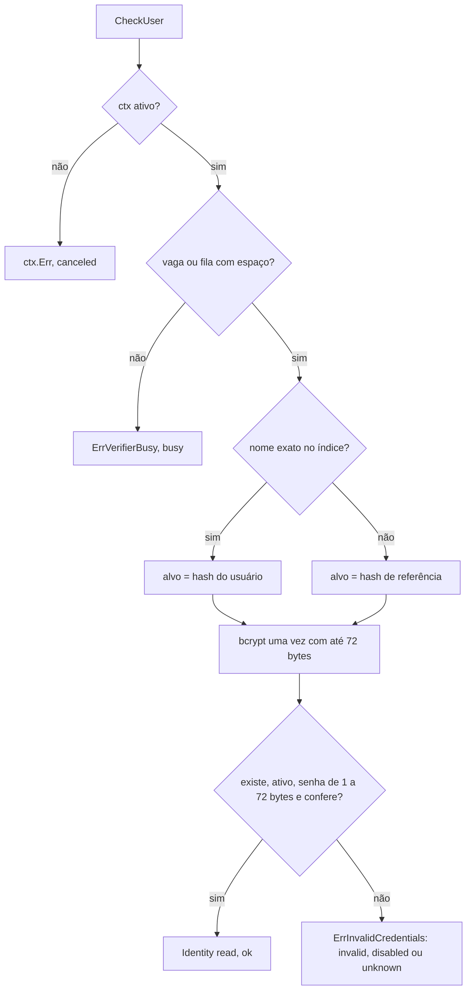

### FDD: Diretório de usuários de leitura (CORE-04)

Versão: 1.0
Data: 2026-10-21
Responsável: Guilherme Giusti

---

### 1. Contexto e motivação técnica

**Problema técnico.** O painel tem dois tipos de operador: o root, conferido pelo host contra o próprio `n3x.yaml` (FDD 30 e FDD 34), e os usuários de leitura, que são do plugin core por meio da capacidade privilegiada "diretório de usuários" (ADR-019 do `n3x-sdk`, contrato 12 da FDD 09). O ADR-003 do `n3x-plugin-core` fixou que esses usuários vêm só da seção `plugins["n3x.core"].users` do `n3x.yaml` do controller, que o diretório é só leitura e que a subida falha com nome duplicado, nome igual ao do root, hash que não é bcrypt ou custo menor que 12. A FDD 36 deixou os tipos (`types.UserConfig`, até 100 usuários, `password_hash` como `plugin.Secret`) e os códigos de regra reservados, com `Validate` e `ValidateHost` devolvendo `nil` e um `CheckUser` que sempre recusa. Faltava o comportamento verificável:

- a gramática do `name`, a sensibilidade à caixa e o que conta como "igual ao root"
- as regras bcrypt aceitas, alinhadas com as do host (L-39, FDD 30), e o que fazer com um `password_hash` selado quando a validação roda sem a chave (`n3x-controller validate --skip key`, P-01 e I-07 da FDD 30)
- a conferência de senha: identidade devolvida, erro genérico, tratamento de usuário desativado, igualdade de tempo entre usuário inexistente, senha errada e desativado (pedido da FDD 09)
- quantos bcrypt podem rodar ao mesmo tempo no login do painel, já que o limite de 2 simultâneos do host vale só para o verificador de credencial de serviço (FDD 31)
- a estrutura em memória, fora do Store (a FDD 41 deixou `User` fora da porta), e a leitura que a tela de usuários (FDD 45) consome sem ver o hash
- a porta que o host (FDD 34) usa para consultar o diretório

**Encaixe no HLD.** Esta FDD especifica o componente `controller/directory` do HLD do `n3x-plugin-core` ("Componentes e responsabilidades": diretório de usuários de leitura vindos do `n3x.yaml`, `CheckUser` com bcrypt e `ChangePassword` que devolve "não suportado"; "Fluxo de dados": seção `users` do `n3x.yaml` para a `Validate`, para o diretório em memória e para o `CheckUser` no login do painel; "Segurança", painel). Ela substitui, na versão mínima do core (contrato 8 da FDD 36), o `CheckUser` que sempre recusa e as `Validate` e `ValidateHost` vazias (só a parte dos usuários; a parte da sessão é da FDD 39). Consumidores:

- host do controller, fase de config: chama `CheckHost` do core com `root.user` (FDDs 09 e 30); as regras daqui rodam dentro dele
- host do controller, login do painel (FDD 34): chama `CheckUser` pela interface `ctrl.UserDirectory` da instância do core
- tela `/plugins/n3x/core/usuarios` (FDD 45): lê `Directory.Users()` (nome e estado)
- kit de testes do controller (FDD 12): `ctrltest` com o core real e `PanelLogin`

**Atores.** Operador (escreve a seção `users` e gera o hash com `n3x-controller hash` ou `htpasswd -B`), host do controller (valida a seção na subida e no `validate`, cria a instância do core, chama `CheckUser` no login), usuário de leitura (digita usuário e senha no painel), tela de usuários do core (FDD 45) e o próprio core (mantém o diretório).

**Limites.** O diretório não tem rede, disco, tarefa de fundo nem estado mutável depois do `New`: é uma estrutura imutável construída uma vez a partir da config decodificada. Ele não conhece o root (só recusa, na validação, um usuário com o mesmo nome), não aplica bloqueio por tentativas, não cria sessão nem cookie, não decide a regra "só o root entra" e não loga cada tentativa: tudo isso é do host (FDD 34). Não grava nada e não muda até o restart (ADR-003 do core).

**Suposições**
- SDK com as FDDs 02, 03, 06, 08 e 09 implementadas: `plugin.Secret` com `Reveal`, `plugin.FieldErrors` e `PathIndex`, `telemetry.Metrics`, `ctrl.Identity`, `ctrl.RoleRead`, `ctrl.UserDirectory`, `ctrl.HostFacts`, `ctrl.HostValidator`, `Plugin.CheckHost`, sentinelas `ctrl.ErrInvalidCredentials`, `ctrl.ErrVerifierBusy` e `ctrl.ErrUnsupported`
- Core com a FDD 36 implementada: `types.UserConfig{Name, PasswordHash, Disabled}`, `types.MaxUsers = 100`, `types.MaxUserNameLen = 64`, `controller.Config` como tipo definido com `Validate` e `ValidateHost`
- Host com a FDD 30 implementada: `CheckHost` chamado na fase de config do `run` e do `validate`, com `key.Opener(ControllerScope("n3x.core"))` ou, com `--skip key`, `secret.FormatChecker()`; `root.user` já validado com `^[A-Za-z0-9][A-Za-z0-9._@-]{0,63}$`
- bcrypt de custo 12 leva cerca de 250 ms numa vCPU (HLD do `n3x-controller` e do core); cada ponto de custo dobra o tempo (custo 16 leva cerca de 4 s)
- Uma réplica do controller (ADR-001 do `n3x-sdk`)

**Restrições**
- O core nunca importa `secret/` (HLD do core, "Gestão de segredos"; regra `forbidden_import` da FDD 24): o diretório recebe os `plugin.Secret` já abertos pelo host
- `controller/directory` importa a biblioteca padrão, `golang.org/x/crypto/bcrypt`, `plugin/`, `telemetry/` e `controller/` do SDK e `types/` do core; nunca entra no `.so` (o pacote só é importado por `controller/`)
- `Validate` e `ValidateHost` são puras: sem I/O, sem log, sem bcrypt de conferência (só leitura do formato e do custo)
- Nenhum `password_hash`, senha ou trecho deles em log, erro, métrica, rótulo ou tela (FR-009, HLD do core "Logs e erros", ADR-020 do `n3x-sdk`)
- Documentação em pt-BR; identificadores em inglês

**Rastreabilidade**
- PRD 1.5: FR-009 (usuários em `plugins.n3x.core.users` com `name`, `password_hash` bcrypt de custo mínimo 12 como segredo no schema e `disabled`; o core lê na subida e mantém em memória; mensagem genérica sem revelar se o usuário existe; nome duplicado, igual ao root, hash que não é bcrypt ou custo menor que 12 impedem a subida; lista de usuários só para o root), FR-008 (usuário de leitura vê o painel em modo leitura); segurança ("bcrypt com custo mínimo de 12 para tudo que só é conferido"); critério de aceite "root e usuários de leitura só do `n3x.yaml`, bcrypt custo 12, nome duplicado ou igual ao root impede a subida"
- ADRs do `n3x-plugin-core`: ADR-001 (memória), ADR-003 (usuários só pelo yaml, diretório só leitura, `ChangePassword` não suportado, `Revoke` sem uso), ADR-010 (prefixo `n3x_n3x_core_*`, sem tracing)
- ADRs do `n3x-sdk`: ADR-019 (capacidade "diretório de usuários"), ADR-020 (segredos fora de logs e telas); ADR-006 do `n3x-controller` (sessão do painel, contexto)
- FDDs aplicadas: 02 (formato dos erros e ordem), 03 (`plugin.Secret`, L-64), 06 (`telemetry`), 08 (`Validate`, `Identity`, papéis), 09 (contratos 12, 15 e 16), 12 (`ctrltest`, `PanelLogin`), 30 (gramática do `root.user`, regras bcrypt, `--skip key`), 36 (tipos, códigos reservados, versão mínima), 41 (usuários fora do Store)
- **Lacunas aplicadas (nenhuma é fechada só aqui):**
  - **L-39** (prefixos bcrypt, fechada na FDD 30): `$2a$`, `$2b$` e `$2y$`, 60 caracteres, custo de 12 a 16, códigos `bcrypt_format` e `bcrypt_cost`, mesma expressão e mesma tabela de vetores do host (contrato 2)
  - **L-63** (nome do root na `Validate`, fechada na FDD 09): regra `root_name` em `ValidateHost`, comparando sem diferenciar maiúsculas (contrato 1)
  - **L-64** (`plugin.Secret` sem `ENC[...]`, fechada na FDD 03): `password_hash` bcrypt em claro é o caso normal, sem aviso; `ENC[...]` é opcional
  - **L-34** (notação de caminho, fechada na FDD 01): `plugins["n3x.core"].users[0].password_hash` em erros e documentação
- Decisões aprovadas pelo responsável do produto em 2026-10-22 (resolvem as hipóteses correspondentes):
  - **D-01:** o custo do bcrypt de `password_hash` fica na faixa de 12 a 16 (o PRD só fixa o mínimo de 12; o máximo de 16 é o mesmo do host). Custo fora da faixa gera `bcrypt_cost` e impede a subida
  - **D-02:** o login de leitura roda no máximo 2 comparações bcrypt simultâneas (`MaxConcurrentChecks`), com fila de 16 (`MaxWaitingChecks`) e espera máxima de 2 s (`MaxQueueWait`); acima disso, `ctrl.ErrVerifierBusy` sem bcrypt. O root não é afetado
  - **D-03:** nome com a gramática `^[A-Za-z0-9][A-Za-z0-9._@-]{0,63}$`; `duplicate` e `root_name` comparados sem diferenciar maiúsculas; login sensível à caixa; `users: []` é válido e sem aviso (só o root entra); custos misturados geram o aviso `directory_mixed_cost`. O FR-009 do PRD precisa citar a gramática e o teto de 100 usuários (reflexo pendente)
  - **D-04 (consequência da D-01 da FDD 03/CORE-03):** esta FDD não trata a `session.hmac_key`; a recusa de chave em claro (`hmac_key_not_sealed`) é da FDD 39. A L-64 (hash em claro sem aviso) continua valendo para `password_hash`
- Pedidos de FDDs anteriores atendidos:
  - FDD 03: `password_hash` em claro aceito sem aviso, `ENC[...]` opcional (contrato 1)
  - FDD 08: `Validate` dos usuários no core (contrato 2)
  - FDD 09: regra `root_name` (contrato 2) e bcrypt de referência para usuário inexistente, com tempo parecido nos três casos de falha (contrato 4)
  - FDD 30: mesma gramática do `root.user`, mesmas regras bcrypt e mesmos códigos (contrato 2); pular o bcrypt de `password_hash` selado quando a validação roda com `--skip key` (P-01 da FDD 30, contrato 2)
  - FDD 36: regras dos usuários em `controller.Config` (contrato 2) e códigos reservados confirmados (`duplicate`, `root_name`, `name_format`, `bcrypt_format`, `bcrypt_cost`)

---

### 2. Objetivos técnicos

- **Toda seção inválida impede a subida, com todos os problemas de uma vez.** Medida: os 9 casos da tabela de regras (contrato 1) recusados em `CheckHost` e no `n3x-controller validate`, cada um com `Path` e `Rule` exatos, na ordem determinística do contrato 2; nenhum `Detail` cita nome, hash ou parte deles.
- **Regras bcrypt idênticas às do host.** Medida: a mesma tabela de vetores de L-39 (no mínimo 14 casos: os três prefixos, custos 11, 12, 16 e 17, 59 e 61 caracteres, alfabeto inválido, `$2x$`, `$2$`, hash do `htpasswd -B -C 12` e saída do `n3x-controller hash`) dá o mesmo resultado em `directory.CheckHash` e no conferidor da FDD 30, conferido por teste com o arquivo de vetores copiado byte a byte.
- **Resposta indistinguível para quem tenta adivinhar.** Invariante: usuário inexistente, senha errada, usuário desativado, senha vazia e senha acima de 72 bytes devolvem o mesmo `ctrl.ErrInvalidCredentials` e executam exatamente uma comparação bcrypt com um hash do mesmo custo. Medida: espião da comparação conta 1 chamada em cada caminho; no teste noturno com bcrypt real de custo 12, a mediana de cada caminho fica a até 10% da mediana do caminho "senha errada" (30 execuções por caminho) (hipótese de meta).
- **Custo dominado pelo bcrypt.** Medida: com a comparação trocada por uma função vazia, `CheckUser` em até 20 µs no p99 (hipótese); `Validate` da seção com 100 usuários em até 5 ms por operação (meta da FDD 36); `directory.New` com 100 usuários em até 10 ms, sem nenhum bcrypt de conferência.
- **CPU do controller protegida no login do painel.** Invariante: no máximo `MaxConcurrentChecks = 2` comparações bcrypt do diretório ao mesmo tempo e no máximo `MaxWaitingChecks = 16` à espera; quem passa disso recebe `ctrl.ErrVerifierBusy` sem bcrypt (hipótese dos valores).
- **Diretório imutável e seguro para leitura concorrente.** Invariante: depois do `New`, nenhuma escrita; `CheckUser`, `Users` e `Summary` sem trava de dados, aprovados por `-race` com 64 goroutines.
- **Nenhum segredo vaza.** Medida: canário `n3x-canary-` em `password_hash` (em claro e em `ENC[...]`) e nas senhas passadas a `CheckUser` com 0 ocorrência em logs, erros, rótulos de métrica, `Users()` e no HTML da tela (varredura do `ctrltest`, FDD 12).

---

### 3. Escopo e exclusões

**Incluído**
- Regras de validação da lista `users` dentro de `controller.Config.Validate` (gramática do nome, duplicado, bcrypt e custo) e de `controller.Config.ValidateHost` (nome igual ao do root)
- Comportamento da validação com `password_hash` selado sem a chave (`--skip key`)
- Pacote `controller/directory`: `ValidateUsers`, `ValidateRoot`, `CheckName`, `CheckHash`, `New`, `Directory`, `CheckUser`, `ChangePassword`, `Users`, `Summary`, constantes e sentinela
- Implementação de `ctrl.UserDirectory` pela instância do core (`*controller.Core`), delegando ao diretório
- Igualdade de tempo por hash de referência, limite de bcrypt simultâneos e fila curta
- Métricas `n3x_n3x_core_users`, `n3x_n3x_core_user_checks_total` e `n3x_n3x_core_user_check_duration_seconds`; logs `directory_loaded`, `directory_mixed_cost` e `directory_busy`
- Leitura para a tela de usuários (nome e estado), sem hash

**Excluído**
- Formulário de login, bloqueio de 5 tentativas por 15 minutos, sessão, cookie, CSRF, log `panel_login` e a regra "só o root entra com o core degradado ou falho": FDD 34 (CTL-05)
- Conferência do root e da gramática de `root.user`: FDDs 30 e 34
- Tela `/plugins/n3x/core/usuarios`, papel root na rota e consolidação das métricas `n3x_n3x_core_*`: FDD 45 (CORE-09)
- Regra `hmac_key_format` e avisos da `session.hmac_key` em `Validate` e `New`: FDD 39 (CORE-03); login e sessão HMAC dos sidecars também
- Verificador de credencial de serviço e o limite de 2 bcrypt do host: FDD 31 (CTL-02)
- Store em memória: FDD 41 (os usuários não entram nele)
- Gestão de usuários pelo painel, troca da própria senha e `env.Sessions().Revoke`: fora da v1 (ADR-003 do core)

---

### 4. Fluxos detalhados e diagramas

**Fluxo principal: subida do controller (fase de config e de instâncias)**
1. O host decodifica o `n3x.yaml` e chega à seção `plugins["n3x.core"]` (vale `{}` quando falta, FDD 30). Com o opener do escopo `n3x:v1:controller:n3x.core`, cada `password_hash` em `ENC[...]` é aberto; em claro, chega igual (L-64).
2. O host chama `core.CheckHost(secao, ctrl.HostFacts{RootUser: root.user}, plugin.WithSecretOpener(abrir))` (FDD 09, contrato 15).
3. `CheckHost` decodifica com `plugin.DecodeConfig[controller.Config]`. Erros de schema (`users` acima de 100 itens, `name` ausente ou acima de 64 caracteres, `password_hash` ausente, campo desconhecido) param aqui, com os códigos da FDD 02.
4. Sem erro de schema, `CheckHost` chama `Config.Validate()`, que junta, na ordem dos campos da struct, as regras da sessão (FDD 39) e as dos usuários (`directory.ValidateUsers`, contrato 2): para cada `users[i]`, em ordem de índice, `name_format`, `duplicate`, `bcrypt_format` e `bcrypt_cost`.
5. Sem erro na `Validate`, `CheckHost` chama `Config.ValidateHost(h)`, que roda `directory.ValidateRoot(c.Users, h.RootUser)` (`root_name`).
6. O host prefixa os erros com `plugins["n3x.core"]` (`plugin.PrefixErrors`) e, com qualquer problema, não sobe (saída 2, `N3X-C002`, FDD 30).
7. Fase de instâncias: o host chama `controller.New(cfg, env)`. O `New` chama `directory.New(cfg.Users, directory.Options{Metrics: env.Metrics(), Log: env.Log()})`, que confere de novo nome e hash (defesa em profundidade, sem bcrypt), copia os hashes para bytes, escolhe o hash de referência, cria o semáforo e as métricas e loga `directory_loaded`. Erro aqui faz o `New` do core falhar e o controller não sobe (core obrigatório, FDD 32).
8. O host chama `ctrl.CheckPrivileged`: o core precisa implementar `ctrl.UserDirectory` (`core_capability_missing`, FDD 09). Depois de todos os plugins, o host liga o `CheckUser` da instância ao login do painel (FDD 34).

**Fluxo principal: login de um usuário de leitura (o host é da FDD 34; aqui, o que o diretório faz)**
1. O host recebe usuário e senha no formulário, confere o bloqueio por usuário e IP e o estado do core (só `ok` passa, contrato 16 da FDD 09). Usuário exatamente igual a `root.user` é conferido pelo host e nunca chega ao core.
2. O host chama `dir.CheckUser(ctx, usuario, plugin.NewSecret(senha))` com prazo de `runtime.plugin_call_timeout` (10 s).
3. O diretório:
   1. se o `ctx` já acabou, devolve `ctx.Err()` sem bcrypt (`result="canceled"`)
   2. tenta uma vaga entre as 2 de bcrypt; sem vaga, entra na fila se houver menos de 16 à espera e espera até `min(prazo do ctx, 2 s)`; sem vaga nesse tempo, ou com a fila cheia, devolve `ctrl.ErrVerifierBusy` (`result="busy"`)
   3. procura o nome exato (sensível a maiúsculas) no índice; o alvo da comparação é o hash do usuário, ou o hash de referência quando o nome não existe
   4. compara a senha (só os primeiros 72 bytes) com o alvo, uma vez, com `bcrypt.CompareHashAndPassword`, e libera a vaga
   5. aceita só se o usuário existe, não está desativado, a senha tem de 1 a 72 bytes e a comparação conferiu; devolve `ctrl.Identity{Role: ctrl.RoleRead, User: <nome configurado>}`
   6. em qualquer outro caso devolve `ctrl.ErrInvalidCredentials`, sem distinguir o motivo
   7. se o `ctx` acabou durante o bcrypt, devolve `ctx.Err()` no lugar do resultado
   8. conta o resultado em `n3x_n3x_core_user_checks_total{result}` e o tempo em `n3x_n3x_core_user_check_duration_seconds`
4. O host cria a sessão de leitura com o sucesso, ou mostra a mensagem genérica (FDD 34).

**Fluxo: `n3x-controller validate --skip key`**
- O opener é `secret.FormatChecker()` (FDD 30): um `password_hash` em `ENC[...]` chega à `Validate` com o próprio texto do envelope, e `InClear()` verdadeiro (FDD 03)
- `ValidateUsers` reconhece o envelope pela mesma regra de `secret.IsEnvelope` (texto sem espaços nas pontas começando com `ENC[`, sem diferenciar caixa; implementada no próprio pacote, porque o core não importa `secret/`) e pula `bcrypt_format` e `bcrypt_cost` desse campo, sem problema e sem aviso; o resumo do `validate` já diz "parcial" (P-01 da FDD 30 fechado)
- Nome, duplicado e `root_name` continuam conferidos; `password_hash` em claro continua conferido inteiro
- No `run` e no `validate` com chave, o opener real abre todo envelope antes da `Validate`; um envelope que sobra só acontece se o texto cifrado for outro envelope, e esse caso é recusado pelo `directory.New` (passo 7 da subida)

**Fluxo: leitura pela tela de usuários (FDD 45)**
- O handler da página, já autorizado pelo host com papel root, chama `dir.Users()` e recebe uma cópia `[]directory.User{Name, Disabled}` na ordem do `n3x.yaml`, sem hash nem custo; `dir.Summary()` dá os totais para um cartão ou cabeçalho

**Fluxos alternativos e exceções**
- **Lista vazia ou ausente:** `users: []` é válido (só o root entra). O `New` loga `directory_loaded` em `info` com `users: 0` e `only_root: true`, sem aviso, porque é uma configuração legítima (hipótese). `CheckUser` sempre segue o caminho do usuário inexistente
- **Todos desativados:** igual à lista vazia para o login (`only_root: true`), mas a tela mostra os nomes com o estado
- **Custos misturados:** usuários com custos diferentes deixam o tempo revelar quem existe com custo diferente do hash de referência. O `New` loga `directory_mixed_cost` uma vez, em `warn`, com `min_cost` e `max_cost`; o hash de referência usa o custo mais comum (empate: o maior) (hipótese)
- **Nome com caixa diferente:** `Ana` e `ana` na mesma lista dão `duplicate`; `Admin` com root `admin` dá `root_name` (comparação sem diferenciar maiúsculas na validação). No login, a busca é exata: `ANA` não entra como `ana` (hipótese)
- **Nome igual a um serviço:** permitido; usuários e serviços são espaços de nomes separados (hipótese)
- **Usuário desativado com sessão aberta:** não existe na v1: desativar exige editar o yaml e reiniciar, e o restart derruba todas as sessões (ADR-006 do `n3x-controller`)
- **Senha vazia ou acima de 72 bytes:** nunca confere; o bcrypt roda mesmo assim com os primeiros 72 bytes, para o tempo não depender disso (hipótese, igual ao limite do `n3x-controller hash`)
- **Usuário com mais de 64 bytes ou fora da gramática:** tratado como inexistente (hash de referência), sem erro distinto
- **Prazo curto:** com `runtime.plugin_call_timeout` menor que o tempo do bcrypt, todo login de leitura acaba em `ctx.Err()`; o root não é afetado (risco 4)
- **Panic no `CheckUser`:** contido pelo host, que recusa o login com a mensagem genérica e conta `kind="auth"` (FDD 09); a vaga do semáforo é liberada por `defer`
- **`ChangePassword`:** sempre `ctrl.ErrUnsupported`, sem procurar o usuário e sem bcrypt; o host da v1 não chama
- **Versão mínima do core (FDD 36):** até esta FDD ser implementada, `CheckUser` sempre recusa; o contrato 4 substitui aquele comportamento sem mudar a assinatura

**Diagramas**

Sequência do login de um usuário de leitura:

```mermaid
sequenceDiagram
    participant U as Navegador
    participant H as host (FDD 34)
    participant C as core (Core.CheckUser)
    participant D as controller/directory
    U->>H: POST /login (usuario, senha, csrf)
    H->>H: bloqueio por usuario e IP; usuario == root.user?
    H->>H: StateCell do core == ok? senão só o root entra
    H->>C: CheckUser(ctx 10 s, usuario, NewSecret(senha))
    C->>D: CheckUser
    D->>D: vaga de bcrypt (2, fila 16, espera 2 s)
    D->>D: alvo = hash do usuario ou hash de referência
    D->>D: bcrypt.CompareHashAndPassword (uma vez)
    D-->>C: Identity{read, usuario} ou ErrInvalidCredentials ou ErrVerifierBusy
    C-->>H: mesmo resultado
    H-->>U: sessão de leitura ou mensagem genérica
```

Decisão do `CheckUser`:



---

### 5. Contratos públicos (assinaturas, endpoints, headers, exemplos)

**Contrato 1: seção `plugins["n3x.core"].users` do `n3x.yaml` do controller e regras de recusa**
- Tipo: sdk (config tipada do core, schema da FDD 36, regras desta FDD)
- Assinatura/Rota:
  ```yaml
  plugins:
    n3x.core:
      users:                              # 0 a 100 itens (types.MaxUsers)
        - name: ana                       # obrigatório; ^[A-Za-z0-9][A-Za-z0-9._@-]{0,63}$
          password_hash: "$2a$12$..."     # obrigatório; plugin.Secret; bcrypt $2a$, $2b$ ou $2y$, custo 12 a 16
          disabled: false                 # opcional; padrão false
  ```
- Método: lido pelo host na subida e no `n3x-controller validate` (`CheckHost`)
- Semântica de status/headers:
  - **Ordem:** a lista é guardada na ordem do arquivo; erros saem em ordem de índice; a tela recebe a mesma ordem
  - **Nome:** a mesma gramática do `root.user` (FDD 30): de 1 a 64 caracteres ASCII entre letras, dígitos, `.`, `_`, `@` e `-`, começando com letra ou dígito. Login sensível a maiúsculas; duplicado e `root_name` comparados sem diferenciar maiúsculas (ASCII) (hipótese)
  - **`password_hash`:** em claro é o caso normal, sem aviso (L-64); em `ENC[...]`, cifrado com `n3x-controller encrypt --plugin n3x.core` (AAD `n3x:v1:controller:n3x.core`, FDD 03). Nunca aparece em log, erro, painel ou config efetiva
  - **Limites:** 100 usuários; cada item ocupa menos de 300 bytes no diretório, fora do Store e de `memory_limit`

| # | Caminho (relativo à seção) | `Rule` | Condição | Onde |
| --- | --- | --- | --- | --- |
| 1 | `users` | `max` | mais de 100 itens | schema (FDDs 02 e 36) |
| 2 | `users[i]` | `unknown_field` | campo fora de `name`, `password_hash` e `disabled` | schema |
| 3 | `users[i].name`, `users[i].password_hash` | `required`, `type` | ausente ou com tipo errado | schema |
| 4 | `users[i].name` | `min`, `max` | vazio ou acima de 64 caracteres | schema |
| 5 | `users[i].name` | `name_format` | fora de `^[A-Za-z0-9][A-Za-z0-9._@-]{0,63}$` | `Validate` |
| 6 | `users[i].name` | `duplicate` | igual, sem diferenciar maiúsculas, a um `users[j].name` válido com `j < i` | `Validate` |
| 7 | `users[i].password_hash` | `bcrypt_format` | fora de `^\$2[aby]\$[0-9]{2}\$[./A-Za-z0-9]{53}$` ou recusado por `bcrypt.Cost`; pulado quando o texto é um envelope `ENC[...]` não aberto | `Validate` |
| 8 | `users[i].password_hash` | `bcrypt_cost` | custo fora de 12 a 16 | `Validate` |
| 9 | `users[i].name` | `root_name` | igual a `root.user`, sem diferenciar maiúsculas | `ValidateHost` |

**Exemplo de requisição** (seção com erros, `CheckHost` com root `admin`)
```yaml
plugins:
  n3x.core:
    users:
      - name: ana
        password_hash: "$2a$12$R9h/cIPz0gi.URNNX3kh2OPST9/PgBkqquzi.Ss7KIUgO2t0jWMUW"
      - name: "Ana Maria"
        password_hash: "$2a$12$R9h/cIPz0gi.URNNX3kh2OPST9/PgBkqquzi.Ss7KIUgO2t0jWMUW"
      - name: ANA
        password_hash: "$2x$12$R9h/cIPz0gi.URNNX3kh2OPST9/PgBkqquzi.Ss7KIUgO2t0jWMUW"
      - name: bruno
        password_hash: "$2b$11$R9h/cIPz0gi.URNNX3kh2OPST9/PgBkqquzi.Ss7KIUgO2t0jWMUW"
```

**Exemplo de resposta** (`err.Error()` depois do `PrefixErrors`; a `Validate` falhou, então o `ValidateHost` não roda)
```text
plugins["n3x.core"].users[1].name: use de 1 a 64 caracteres entre letras, dígitos, ".", "_", "@" e "-", começando com letra ou dígito [name_format]
plugins["n3x.core"].users[2].name: nome repetido, sem diferenciar maiúsculas; já usado em users[0] [duplicate]
plugins["n3x.core"].users[2].password_hash: não é um hash bcrypt aceito; use $2a$, $2b$ ou $2y$ (n3x-controller hash) [bcrypt_format]
plugins["n3x.core"].users[3].password_hash: custo do bcrypt fora de 12 a 16 [bcrypt_cost]
```

**Exemplo de requisição** (seção válida na `Validate`, root `Admin`)
```yaml
plugins:
  n3x.core:
    users:
      - name: ana
        password_hash: "$2b$12$R9h/cIPz0gi.URNNX3kh2OPST9/PgBkqquzi.Ss7KIUgO2t0jWMUW"
      - name: admin
        password_hash: ENC[v1:bm9uY2UxMjM0NTY3ODkwYWJjZGVm...]
        disabled: true
```

**Exemplo de resposta**
```text
plugins["n3x.core"].users[1].name: igual ao nome do root [root_name]
```

---

**Contrato 2: regras puras do pacote `controller/directory` e a composição em `controller.Config`**
- Tipo: sdk (API Go do core, usada por `controller.Config` e pelos testes)
- Assinatura/Rota:
  ```go
  package directory // github.com/giustech/n3x-plugin-core/controller/directory

  // Gramática do nome, igual à de root.user (FDD 30).
  const NamePattern = `^[A-Za-z0-9][A-Za-z0-9._@-]{0,63}$`
  // Forma do hash aceita (L-39, FDD 30).
  const HashPattern = `^\$2[aby]\$[0-9]{2}\$[./A-Za-z0-9]{53}$`

  const (
      MinCost          = 12
      MaxCost          = 16
      HashLen          = 60
      MaxPasswordBytes = 72 // limite do bcrypt
  )

  // CheckName informa se o nome segue NamePattern. Sem alocação.
  func CheckName(name string) bool

  // CheckHash confere forma e custo. rule é "", "bcrypt_format" ou "bcrypt_cost";
  // cost só vale com rule "" ou "bcrypt_cost". Nunca devolve o texto.
  func CheckHash(text string) (cost int, rule string)

  // ValidateUsers aplica as regras 5 a 8 do contrato 1. Devolve nil ou
  // plugin.FieldErrors com caminhos relativos à seção (users[i].campo).
  func ValidateUsers(users []types.UserConfig) error

  // ValidateRoot aplica a regra 9 (root_name).
  func ValidateRoot(users []types.UserConfig, rootUser string) error
  ```
  ```go
  package controller // github.com/giustech/n3x-plugin-core/controller

  func (c Config) Validate() error {
      // ordem dos campos da struct: session (FDD 39) e depois users
      return joinFieldErrors(validateSession(c.Session), directory.ValidateUsers(c.Users))
  }

  func (c Config) ValidateHost(h ctrl.HostFacts) error {
      return directory.ValidateRoot(c.Users, h.RootUser)
  }
  ```
- Método: chamada local (dentro de `CheckHost`, FDD 09)
- Semântica de status/headers:
  - **Ordem dos problemas:** por índice crescente; dentro de um item, `name_format` ou `duplicate` no `name`, depois `bcrypt_format` ou `bcrypt_cost` no `password_hash`. Nunca dois problemas no mesmo campo
  - **Sem problema derivado:** nome com `name_format` não entra na comparação de duplicados; o duplicado aponta para o primeiro índice válido (`já usado em users[0]`), sem citar o nome
  - **Hash lido só por `Reveal()`** para conferir prefixo, tamanho e custo (`bcrypt.Cost`, que só lê o cabeçalho); nenhuma comparação bcrypt na validação
  - **Envelope não aberto (P-01 da FDD 30):** se `strings.TrimSpace(v)` começa com `ENC[` sem diferenciar caixa (a mesma regra de `secret.IsEnvelope`, FDD 03), as regras 7 e 8 são puladas para aquele campo. Só acontece com `secret.FormatChecker()` (`validate --skip key`); no `run`, o opener abre todo envelope antes. Isso responde à I-07 da FDD 30: a `Validate` lê o valor aberto só para conferir formato e aceita não poder conferir sem a chave
  - **`ValidateHost`:** só roda se a decodificação e a `Validate` passaram (FDD 09, contrato 15); `rootUser` vazio não casa com nada (o host já recusou root ausente)
  - **Textos:** `Detail` em pt-BR, sem valor; os textos podem melhorar em patch, testes conferem `Path` e `Rule`
  - **Paridade com o host:** `HashPattern`, `MinCost`, `MaxCost` e os textos de `bcrypt_format` e `bcrypt_cost` são os mesmos da FDD 30; o arquivo `testdata/bcrypt_vectors.json` (formato 1, uma linha por caso com `hash`, `cost` e `rule`) é idêntico nos dois repositórios, conferido pelo hash SHA-256 do arquivo num teste de cada lado (hipótese de mecanismo)

**Exemplo de requisição**
```go
users := []types.UserConfig{
    {Name: "ana", PasswordHash: plugin.NewSecret("$2y$12$R9h/cIPz0gi.URNNX3kh2OPST9/PgBkqquzi.Ss7KIUgO2t0jWMUW")},
    {Name: "joao", PasswordHash: plugin.NewSecret("ENC[v1:bm9uY2UxMjM0NTY3ODkwYWJjZGVm...]")}, // vindo do FormatChecker
    {Name: "maria", PasswordHash: plugin.NewSecret("n3x-canary-texto-que-nao-e-hash")},
}
err := directory.ValidateUsers(users)
cost, rule := directory.CheckHash("$2b$17$R9h/cIPz0gi.URNNX3kh2OPST9/PgBkqquzi.Ss7KIUgO2t0jWMUW")
```

**Exemplo de resposta**
```json
{
  "err.Error()": "users[2].password_hash: não é um hash bcrypt aceito; use $2a$, $2b$ ou $2y$ (n3x-controller hash) [bcrypt_format]",
  "users[1]": "envelope não aberto: bcrypt não conferido, sem problema",
  "canário no erro": 0,
  "CheckHash": { "cost": 17, "rule": "bcrypt_cost" }
}
```

---

**Contrato 3: `directory.New`, `Directory` e opções**
- Tipo: sdk (API Go do core)
- Assinatura/Rota:
  ```go
  package directory

  const (
      MaxConcurrentChecks = 2               // bcrypt simultâneos do diretório (hipótese)
      MaxWaitingChecks    = 16              // à espera de vaga (hipótese)
      MaxQueueWait        = 2 * time.Second // espera máxima por vaga (hipótese)
      DefaultDummyCost    = MinCost         // custo do hash de referência com lista vazia
  )

  // ErrInvalidUsers: a lista não passou na conferência do New
  // (embrulha plugin.FieldErrors com os mesmos caminhos e regras da ValidateUsers).
  var ErrInvalidUsers = errors.New("directory: lista de usuários inválida")

  type Options struct {
      Metrics *telemetry.Metrics // env.Metrics(); nil: sem métricas (testes de unidade)
      Log     *slog.Logger       // env.Log(); nil: sem logs
  }

  // Directory é imutável depois do New e seguro para uso concorrente.
  type Directory struct{ /* índice, entradas, hash de referência, semáforo, métricas */ }

  // New confere de novo as regras 5 a 8, copia os hashes, escolhe o hash de
  // referência, cria as métricas e loga directory_loaded. Sem bcrypt.
  // Só pode ser chamado durante o New da metade de controller (regra das métricas, FDD 06).
  func New(users []types.UserConfig, opts Options) (*Directory, error)
  ```
- Método: chamada local, uma vez, em `controller.New`
- Semântica de status/headers:
  - **Estrutura:** `entries []entry{name string; hash []byte; cost int; disabled bool}` na ordem do arquivo e `byName map[string]int` com o nome exato; nenhum campo muda depois do `New`, então leitura sem trava
  - **Fora do Store e da cota:** o diretório não usa `memory.Map` (`plugin.Secret` é recusado por ele, FDD 03) nem a porta `Store` (FDD 41); cerca de 30 KiB com 100 usuários, sem contar em `memory_limit` nem em `n3x_plugin_memory_bytes`
  - **Hash de referência:** constantes geradas por `go generate` (`dummy_hashes.go`), uma por custo de 12 a 16, cada uma o bcrypt de 32 bytes aleatórios descartados; o `New` escolhe o custo mais comum entre os usuários (empate: o maior; lista vazia: 12). Não custa bcrypt na subida e não é segredo: nenhuma senha a confere, e o resultado dessa comparação é sempre descartado (hipótese)
  - **Erro:** problema nas regras 5 a 8 devolve `ErrInvalidUsers` com os `FieldErrors`; acontece só com um envelope dentro de outro (contrato 2) ou com o `New` chamado sem a `Validate` (teste). O `New` do core devolve esse erro e o controller não sobe
  - **`root_name` não é reconferido no `New`:** o `New` não recebe `HostFacts`; o host sempre chama `CheckHost` antes (FDDs 09 e 30)

**Exemplo de requisição**
```go
func New(cfg Config, env ctrl.Env) (ctrl.Instance, error) {
    cenv, ok := env.(ctrl.CoreEnv)
    if !ok {
        return nil, errors.New("core: Env sem as capacidades do core")
    }
    dir, err := directory.New(cfg.Users, directory.Options{Metrics: env.Metrics(), Log: env.Log()})
    if err != nil {
        return nil, err
    }
    return &Core{env: cenv, dir: dir /* demais componentes das FDDs 39, 41 a 45 */}, nil
}
```

**Exemplo de resposta** (log do `New` com 3 usuários, 1 desativado, custos 12 e 14)
```json
{"ts":"2026-10-21T12:00:00.120Z","level":"info","component":"plugin","msg":"directory_loaded","plugin_id":"n3x.core","users":3,"active":2,"disabled":1,"min_cost":12,"max_cost":14,"dummy_cost":12,"only_root":false}
{"ts":"2026-10-21T12:00:00.120Z","level":"warn","component":"plugin","msg":"directory_mixed_cost","plugin_id":"n3x.core","min_cost":12,"max_cost":14}
```

---

**Contrato 4: `CheckUser` (implementação de `ctrl.UserDirectory`)**
- Tipo: sdk (capacidade privilegiada do core; contrato 12 da FDD 09)
- Assinatura/Rota:
  ```go
  package directory

  func (d *Directory) CheckUser(ctx context.Context, user string, password plugin.Secret) (ctrl.Identity, error)
  ```
  ```go
  package controller

  var _ ctrl.UserDirectory = (*Core)(nil)

  func (c *Core) CheckUser(ctx context.Context, user string, password plugin.Secret) (ctrl.Identity, error) {
      return c.dir.CheckUser(ctx, user, password)
  }
  ```
- Método: chamada local pelo login do painel (FDD 34)
- Semântica de status/headers:
  - **Sucesso:** exatamente `ctrl.Identity{Role: ctrl.RoleRead, User: <nome configurado>}`; o core nunca devolve `RoleRoot` nem outro campo (FDD 09)
  - **Falha genérica:** `ctrl.ErrInvalidCredentials` (status gRPC `UNAUTHENTICATED` se algum dia atravessar o fio) para usuário inexistente, senha errada, usuário desativado, senha vazia ou acima de 72 bytes; o erro devolvido é a própria sentinela, sem embrulho, para nada distinguir os motivos (FR-009)
  - **Igualdade de tempo:** exatamente uma comparação bcrypt em todos os caminhos de falha genérica e no sucesso, contra um hash do mesmo custo quando todos os usuários têm o mesmo custo; o tempo restante (busca no mapa, contagem) fica abaixo de 20 µs
  - **Vaga ocupada:** `ctrl.ErrVerifierBusy` (`RESOURCE_EXHAUSTED`) quando não há vaga nem lugar na fila, ou quando a espera passa de `min(prazo, 2 s)`; decidido antes da busca do nome, então não revela se o usuário existe. Retorno novo em relação ao contrato 12 da FDD 09 (I-03)
  - **Prazo:** `ctx.Err()` (`context.Canceled` ou `context.DeadlineExceeded`) se o `ctx` acabou antes da vaga ou durante o bcrypt; o bcrypt em andamento não é interrompido (a biblioteca não aceita `ctx`), só o resultado é descartado
  - **Senha:** lida uma vez por `Reveal()`, convertida em bytes (até 72), comparada e zerada por melhor esforço; nunca em log ou erro
  - **Concorrência:** segura para qualquer número de goroutines; a vaga é liberada por `defer`, também em panic
  - **Sem log por tentativa:** quem loga o login é o host (`panel_login`, FDD 34); o core só conta na métrica

**Exemplo de requisição**
```go
id, err := dir.CheckUser(ctx, "ana", plugin.NewSecret("senha-certa-da-ana"))
_, errErrada := dir.CheckUser(ctx, "ana", plugin.NewSecret("errada"))
_, errNinguem := dir.CheckUser(ctx, "ninguem", plugin.NewSecret("qualquer"))
_, errDesativado := dir.CheckUser(ctx, "bruno", plugin.NewSecret("senha-certa-do-bruno"))
_, errCaixa := dir.CheckUser(ctx, "ANA", plugin.NewSecret("senha-certa-da-ana"))
```

**Exemplo de resposta**
```json
{
  "id": { "Role": "read", "User": "ana" },
  "errErrada": "ctrl: credencial inválida",
  "errNinguem": "ctrl: credencial inválida",
  "errDesativado": "ctrl: credencial inválida",
  "errCaixa": "ctrl: credencial inválida",
  "errors.Is(errNinguem, ctrl.ErrInvalidCredentials)": true,
  "comparações bcrypt por chamada": 1,
  "métrica": "n3x_n3x_core_user_checks_total{plugin=\"n3x.core\",instance=\"\",result=\"unknown\"} 1"
}
```

---

**Contrato 5: `ChangePassword`**
- Tipo: sdk (capacidade privilegiada do core; contrato 12 da FDD 09)
- Assinatura/Rota:
  ```go
  func (d *Directory) ChangePassword(ctx context.Context, user string, current, next plugin.Secret) error
  func (c *Core) ChangePassword(ctx context.Context, user string, current, next plugin.Secret) error // delega
  ```
- Método: chamada local; o host da v1 não chama
- Semântica de status/headers:
  - Sempre `ctrl.ErrUnsupported` (`UNIMPLEMENTED`), em tempo constante: não procura o usuário, não chama `Reveal()`, não roda bcrypt, não loga e não conta métrica (ADR-003 do core)
  - Muda só na v2, junto com o banco do core; até lá, trocar senha é editar o yaml e reiniciar

**Exemplo de requisição**
```go
err := dir.ChangePassword(ctx, "ana", plugin.NewSecret("atual"), plugin.NewSecret("nova"))
```

**Exemplo de resposta**
```json
{ "err": "ctrl: operação não suportada", "errors.Is(err, ctrl.ErrUnsupported)": true, "status": "Unimplemented" }
```

---

**Contrato 6: leitura para a tela de usuários (`Users` e `Summary`)**
- Tipo: sdk (API Go do core, consumida pela FDD 45)
- Assinatura/Rota:
  ```go
  package directory

  type User struct {
      Name     string
      Disabled bool
  }

  type Summary struct {
      Total, Active, Disabled int
  }

  func (d *Directory) Users() []User   // cópia nova, na ordem do n3x.yaml; nil com lista vazia
  func (d *Directory) Summary() Summary // sem alocação
  func (d *Directory) Len() int
  ```
- Método: chamada local pelo handler da página `/plugins/n3x/core/usuarios` (papel root, FDD 45)
- Semântica de status/headers:
  - Só nome e estado; nenhum acesso ao hash, ao custo nem ao `plugin.Secret` sai do pacote
  - A cópia pode ser ordenada ou filtrada pela tela sem afetar o diretório
  - O papel root da rota é conferido pelo host antes do handler (FDDs 08 e 35); o pacote não confere papel

**Exemplo de requisição**
```go
lista := c.dir.Users()
resumo := c.dir.Summary()
```

**Exemplo de resposta**
```json
{
  "lista": [ { "Name": "ana", "Disabled": false }, { "Name": "bruno", "Disabled": true }, { "Name": "carla", "Disabled": false } ],
  "resumo": { "Total": 3, "Active": 2, "Disabled": 1 }
}
```

---

**Contrato 7: porta do host para o diretório (como o login do painel consulta o core)**
- Tipo: sdk (uso da capacidade privilegiada `ctrl.UserDirectory` da FDD 09 pelo host da FDD 34)
- Assinatura/Rota:
  ```go
  // host, depois do ctrl.CheckPrivileged do core (que exige user_directory)
  dir := coreInstance.(ctrl.UserDirectory)

  // login do painel, usuário diferente de root.user (comparação exata)
  id, err := dir.CheckUser(ctxComPrazo, usuario, plugin.NewSecret(senha))
  ```
- Método: chamada local, em processo
- Semântica de status/headers:
  - **Quem expõe:** a instância do core (`*controller.Core`) implementa `ctrl.UserDirectory`; o host a obtém por type assertion depois do `CheckPrivileged`, que recusa a subida se a capacidade faltar (`core_capability_missing`). Não há serviço gRPC nem rota HTTP: o diretório nunca é alcançável de fora do processo
  - **Root:** o host compara o usuário digitado com `root.user` de forma exata e nunca passa a senha do root ao core. Como a validação recusa nomes de leitura iguais ao root sem diferenciar maiúsculas, nenhum usuário de leitura fica ambíguo com o root, seja qual for a comparação do host
  - **Ordem das checagens no host (FDD 34):** bloqueio por usuário e IP, igualdade com o root, estado do core (`StateCell` em `ok`, contrato 16 da FDD 09) e só então `CheckUser`
  - **Prazo:** `runtime.plugin_call_timeout` (padrão 10 s, FDD 09); precisa ser maior que o bcrypt do maior custo usado (cerca de 4 s no custo 16)
  - **Resultados que o host recebe:**

| Retorno | Significado | Tratamento proposto ao host (FDD 34) |
| --- | --- | --- |
| `Identity{RoleRead, usuario}` | senha certa, usuário ativo | cria a sessão de leitura |
| `ctrl.ErrInvalidCredentials` | inexistente, senha errada ou desativado | mensagem genérica; conta no bloqueio |
| `ctrl.ErrVerifierBusy` | sem vaga de bcrypt | mensagem genérica; não conta no bloqueio (proposta, P-01) |
| `ctx.Err()` | prazo ou cancelamento | mensagem genérica; não conta no bloqueio (proposta, P-01) |
| outra identidade ou outro erro | defeito do core | falha, log `privileged_misbehavior` (FDD 09) |
| panic | defeito do core | contido, mensagem genérica, `kind="auth"` (FDD 09) |

**Exemplo de requisição**
```go
// host/session (FDD 34), simplificado
if usuario == cfg.File.Root.User {
    return conferirRoot(senha)
}
if coreCell.Load().State != ctrl.StateOK {
    return recusar("usuário ou senha inválidos") // só o root entra
}
ctx, cancel := context.WithTimeout(r.Context(), cfg.File.Runtime.PluginCallTimeout)
defer cancel()
id, err := dir.CheckUser(ctx, usuario, plugin.NewSecret(senha))
```

**Exemplo de resposta**
```json
{
  "ana com a senha certa": { "Role": "read", "User": "ana" },
  "ana com a senha errada": "usuário ou senha inválidos (bloqueio: +1)",
  "rajada com 20 logins ao mesmo tempo": "2 em bcrypt, 16 na fila, 2 com ErrVerifierBusy na hora",
  "admin (root)": "conferido pelo host; o core não é chamado"
}
```

---

### 6. Erros, exceções e fallback

**Matriz de erros previstos e tratamentos**

| Condição | Tratamento | Observação |
| --- | --- | --- |
| Mais de 100 usuários, campo desconhecido, `name` ou `password_hash` ausente, `name` vazio ou acima de 64 | Erro de schema (FDD 02); controller não sobe (`N3X-C002`) | `Validate` não roda |
| Nome fora da gramática | `name_format`; não sobe | |
| Nome repetido (sem diferenciar maiúsculas) | `duplicate` no índice posterior; não sobe | aponta o primeiro índice |
| Hash fora de `$2a$`, `$2b$` ou `$2y$`, tamanho diferente de 60 ou alfabeto inválido | `bcrypt_format`; não sobe | mesmo texto da FDD 30 |
| Custo menor que 12 ou maior que 16 | `bcrypt_cost`; não sobe | |
| Nome igual ao root (sem diferenciar maiúsculas) | `root_name` por `ValidateHost`; não sobe | só depois da `Validate` sem erro |
| `password_hash` em `ENC[...]` de outro escopo ou que não abre | `secret_decrypt` do host (FDD 03); não sobe | antes da `Validate` |
| `password_hash` selado com `validate --skip key` | bcrypt não conferido; validação parcial | P-01 da FDD 30 |
| Envelope dentro de envelope (sobra um `ENC[...]` depois de aberto) | `directory.New` devolve `ErrInvalidUsers` com `bcrypt_format`; core não sobe | defesa em profundidade |
| Lista vazia ou todos desativados | Aceito; `directory_loaded` com `only_root: true` | só o root entra |
| Custos misturados | Aceito; `directory_mixed_cost` em `warn` | tempo pode revelar usuário |
| `CheckUser` com usuário inexistente, senha errada, desativado, senha vazia ou acima de 72 bytes | `ctrl.ErrInvalidCredentials`, com um bcrypt | indistinguível |
| `CheckUser` sem vaga | `ctrl.ErrVerifierBusy`, sem bcrypt | `directory_busy`, no máximo 1 por minuto |
| `CheckUser` com prazo esgotado | `ctx.Err()` | bcrypt em curso termina e é descartado |
| Panic no `CheckUser` | Contido pelo host; vaga liberada por `defer` | `kind="auth"` (FDD 09) |
| `ChangePassword` | `ctrl.ErrUnsupported` | sempre, na v1 |

**Estratégias de resiliência**
- Timeouts: o prazo é do host (`runtime.plugin_call_timeout`); a espera por vaga tem teto próprio de 2 s
- Retries: nenhum; o usuário tenta de novo pelo formulário
- Backoff: nenhum no core; o bloqueio de 5 tentativas por 15 minutos é do host (FDD 34)
- Circuit breaker: o semáforo de 2 vagas e a fila de 16 fazem o papel de limitador de carga; a rajada além disso recebe `ErrVerifierBusy` imediato, sem consumir CPU

**Política de fallback**
- Sem fallback de credencial: nenhum caminho aceita senha sem bcrypt, e nenhum erro vira sucesso
- Diretório indisponível não existe como estado próprio: se o core não está `ok`, o host deixa só o root entrar (contrato 16 da FDD 09); o root nunca depende do diretório

**Invariantes**
- Depois do `New`, o diretório não muda
- `CheckUser` só devolve `Identity{RoleRead, nome configurado}`, `ctrl.ErrInvalidCredentials`, `ctrl.ErrVerifierBusy` ou `ctx.Err()`
- No máximo 2 comparações bcrypt do diretório ao mesmo tempo
- Cada chamada que passa da vaga roda exatamente uma comparação bcrypt
- Nenhum nome de leitura é igual ao root, sem diferenciar maiúsculas
- Hash, senha e custo nunca saem do pacote, exceto o custo agregado no log `directory_loaded`

---

### 7. Observabilidade

**Métricas** (via `env.Metrics()`, prefixo `n3x_n3x_core_`, rótulos automáticos `plugin` e `instance` vazio; a FDD 45 consolida o registro)

- `n3x_n3x_core_users{state="active|disabled"}` (gauge): usuários carregados por estado, fixado no `New`
- `n3x_n3x_core_user_checks_total{result="ok|invalid|disabled|unknown|busy|canceled"}` (counter): resultado de cada `CheckUser`. Separa os motivos que o erro esconde, sem nome de usuário (cardinalidade fixa de 6 séries). `invalid` é senha errada, vazia ou longa de usuário ativo; `unknown` inclui nome fora da gramática
- `n3x_n3x_core_user_check_duration_seconds` (histogram, buckets 0,05; 0,1; 0,25; 0,5; 1; 2; 4; 8): tempo de cada `CheckUser` que passou da vaga, incluindo a espera; mostra o custo real do bcrypt e permite comparar caminhos

**Logs** (JSON do SDK, `component=plugin`, `plugin_id=n3x.core`)

- `directory_loaded` (`info`, uma vez no `New`): `users`, `active`, `disabled`, `min_cost`, `max_cost`, `dummy_cost`, `only_root`. Sem nomes
- `directory_mixed_cost` (`warn`, uma vez no `New`, só com custos diferentes): `min_cost`, `max_cost`
- `directory_busy` (`warn`, no máximo 1 por minuto): `count` de recusas por falta de vaga desde o último log, `waiting` no momento
- Nenhum log por tentativa de login no core; o host loga `panel_login` (FDD 34)
- Nunca entram: hash, senha, custo de um usuário específico, nome de usuário (nem de desativado) e texto digitado no campo de usuário

**Tracing**

- Sem spans (ADR-010 do core: sem tracing na v1). A correlação do login fica no log do host

**Dashboards e alertas** (sugestões para a FDD 45 consolidar)

- Painel: taxa de `user_checks_total` por `result` e p95 de `user_check_duration_seconds`
- Alerta "tentativa de enumeração": `rate(n3x_n3x_core_user_checks_total{result="unknown"}[5m]) > 0.2` por 15 minutos
- Alerta "login do painel saturado": `rate(n3x_n3x_core_user_checks_total{result="busy"}[5m]) > 0`
- Aviso no painel (FDD 45, opcional): `directory_mixed_cost` visível na tela de usuários como recomendação de custo único

---

### 8. Dependências e compatibilidade

| Componente | Versão mínima | Observações |
| --- | --- | --- |
| Go | 1.26 | toolchain das imagens (ADR-021 do `n3x-sdk`) |
| `github.com/giustech/n3x-sdk` | versão com as FDDs 02, 03, 06, 08 e 09 | `plugin.Secret`, `FieldErrors`, `telemetry`, `ctrl.UserDirectory`, `ctrl.HostValidator`, `ctrl.ErrVerifierBusy` |
| `golang.org/x/crypto/bcrypt` | versão estável mais recente na data do build (hipótese, igual à FDD 30) | `CompareHashAndPassword`, `Cost`, `GenerateFromPassword` (só no `go generate` dos hashes de referência) |
| `n3x-plugin-core` FDD 36 | `types.UserConfig`, `controller.Config` | schema golden inalterado |
| `n3x-controller` FDD 30 | `CheckHost` no `run` e no `validate`, `FormatChecker` com `--skip key` | mesma tabela de vetores bcrypt |
| `n3x-controller` FDD 34 | login do painel | consome o contrato 7 |
| `n3x-sdk` FDD 12 | `ctrltest.NewHostWith`, `RootName`, `PanelLogin` | testes de integração |

**Garantias de compatibilidade**

- O schema da seção não muda: as regras ficam na `Validate` e na `ValidateHost`, sem tocar no golden `types/testdata/schema/controller.json` da FDD 36
- Os códigos de regra (`name_format`, `duplicate`, `bcrypt_format`, `bcrypt_cost`, `root_name`) ficam estáveis na major do core; os textos podem melhorar em patch
- `CheckUser` e `ChangePassword` mantêm as assinaturas congeladas da FDD 09; `ErrVerifierBusy` e `ctx.Err()` como retornos são documentados como acréscimo (pedido à FDD 09)
- Apertar uma regra (por exemplo, custo máximo menor) é mudança de major, porque faz um `n3x.yaml` antes válido deixar de subir; afrouxar é minor
- Na v2, `ChangePassword` e a escrita de usuários entram com o banco; a API de leitura (`Users`, `Summary`) continua

---

### 9. Critérios de aceite técnicos

- **Regras de recusa:** teste de tabela com os 9 casos do contrato 1; os dois exemplos do contrato 1 dão exatamente as linhas mostradas, na ordem; `ValidateHost` não roda quando a `Validate` falha; seção do HLD do core e o `dev/n3x.yaml` da FDD 30 passam com root `admin`
- **Caixa:** `ana` e `Ana` dão `duplicate`; `Admin` com root `admin` dá `root_name`; `CheckUser("ANA", ...)` com o usuário `ana` dá `ErrInvalidCredentials`
- **Gramática:** `ana.silva@acme`, `a`, `A9`, `x_y-z` e 64 caracteres passam; `.ana`, `-ana`, `ana maria`, `josé`, `ana\n` e 65 caracteres falham (65 pelo schema, os demais com `name_format`)
- **bcrypt (L-39):** a tabela `testdata/bcrypt_vectors.json` passa inteira em `CheckHash`, com no mínimo 14 casos, e o SHA-256 do arquivo é igual ao da cópia no `n3x-controller`; custo 11 dá `bcrypt_cost`, 17 dá `bcrypt_cost`, `$2x$` dá `bcrypt_format`
- **`--skip key` (P-01 da FDD 30):** com `secret.FormatChecker()`, um `password_hash` `ENC[...]` válido não gera nenhum problema e um em claro com custo 11 gera `bcrypt_cost`; com o opener real, o mesmo envelope aberto é conferido
- **Envelope duplo:** um `password_hash` cujo texto aberto é outro envelope faz `directory.New` devolver `ErrInvalidUsers` com `users[i].password_hash` e `bcrypt_format`, e o `New` do core falhar
- **`CheckUser`:** senha certa dá `Identity{RoleRead, "ana"}`; senha errada, inexistente, desativado, senha vazia e senha de 73 bytes dão `ErrInvalidCredentials` (igualdade por `==` com a sentinela); o espião conta 1 comparação em cada um desses 6 casos, com hash do mesmo custo nos casos de inexistente e de usuário de custo 12
- **Tempo (noturno):** com bcrypt real de custo 12, 30 execuções por caminho, a mediana de inexistente, desativado e senha certa fica a até 10% da mediana de senha errada (hipótese de meta)
- **Concorrência:** 20 chamadas simultâneas com comparação bloqueada dão exatamente 2 em comparação, 16 à espera e 2 com `ErrVerifierBusy` imediato; na espera, `ErrVerifierBusy` sai em 2 s (relógio do teste) ou no prazo do `ctx`, o que vier antes; nenhum caminho passa de 2 comparações simultâneas (contador atômico no espião); `-race` limpo com 64 goroutines em `CheckUser`, `Users` e `Summary`
- **Prazo:** `ctx` já cancelado devolve `context.Canceled` sem comparação; `ctx` que vence durante a comparação devolve `context.DeadlineExceeded`
- **`ChangePassword`:** sempre `ErrUnsupported`, sem chamar `Reveal()` (espião no `Secret` de teste) e sem comparação
- **Desempenho:** `BenchmarkCheckUserOverhead` (comparação vazia) com p99 de até 20 µs; `Validate` com 100 usuários em até 5 ms por operação; `directory.New` com 100 usuários em até 10 ms; nenhum bcrypt de conferência na subida
- **Integração com o kit (FDD 12):** `ctrltest.NewHostWith` com o core real e `RootName("admin")`: `PanelLogin("ana", certa)` dá `RoleRead`; `PanelLogin("admin", ...)` não chama o core; com o core `degraded`, `PanelLogin("ana", certa)` é recusado com `auth_core_unavailable`; seção com `users[0].name: admin` recusa a subida com `root_name`
- **Segredos:** canário `n3x-canary-` em `password_hash` (em claro e em `ENC[...]`) e nas senhas de `CheckUser` com 0 ocorrência na varredura do `ctrltest` (logs, erros de `CheckHost` e `New`, rótulos, `Users()`)
- **Observabilidade:** `directory_loaded` sai uma vez com os 7 campos; `directory_mixed_cost` sai só com custos diferentes; `directory_busy` sai no máximo 1 vez por minuto com `count` correto; `n3x_n3x_core_user_checks_total` tem exatamente as 6 séries de `result` e soma igual ao número de chamadas
- **Hashes de referência:** `go generate` reproduz os 5 custos; teste confere que cada constante passa em `CheckHash` com o custo do nome
- **Cobertura:** no mínimo 90% de linhas em `controller/directory` (hipótese, igual às FDDs do SDK)

---

### 10. Riscos e mitigação

### Enumeração de usuários pelo tempo de resposta

- **Probabilidade:** média
- **Impacto:** um atacante na rede do painel descobre quais nomes existem e concentra a força bruta neles
- **Mitigação:**
    - exatamente um bcrypt em todo caminho, com hash de referência do custo mais comum
    - vaga decidida antes da busca, então `busy` não revela nada
    - log `directory_mixed_cost` e guia recomendando um custo único para todos (FDD 47)
    - alerta sobre `result="unknown"` e bloqueio por usuário e IP no host (FDD 34)
- **Plano de contingência:** se a medição noturna passar de 10%, trocar a escolha do custo de referência pelo maior custo configurado e documentar o custo extra de CPU

### Saturação de CPU por bcrypt no login do painel

- **Probabilidade:** média
- **Impacto:** painel lento e, somado ao login de sidecars (FDD 31), atraso na volta dos sidecars depois de um restart
- **Mitigação:**
    - semáforo de 2 vagas e fila de 16 com espera de 2 s, separado do verificador de serviço
    - `ErrVerifierBusy` imediato além disso, sem bcrypt
    - bloqueio de 5 tentativas por usuário e IP no host e regra "só o root entra" quando o core não está `ok`
    - custo máximo de 16 (cerca de 4 s por tentativa)
- **Plano de contingência:** tornar as vagas configuráveis por um campo novo na seção do core (minor do schema da FDD 36) se a medição da FDD 51 mostrar disputa

### Divergência entre as regras bcrypt do host e as do core

- **Probabilidade:** baixa
- **Impacto:** um hash aceito para o root e recusado para um usuário de leitura (ou o contrário) confunde o operador
- **Mitigação:**
    - mesma expressão, mesmas constantes e mesmos textos da FDD 30
    - arquivo de vetores idêntico nos dois repositórios, conferido por SHA-256
- **Plano de contingência:** mover `CheckHash` para um pacote do SDK usado pelos dois (pedido em aberto, P-02)

### Prazo de chamada menor que o bcrypt

- **Probabilidade:** baixa
- **Impacto:** com `runtime.plugin_call_timeout` abaixo de cerca de 250 ms (o mínimo aceito é 100 ms, FDD 30) ou com custo alto, todo login de leitura falha por prazo; o root continua entrando
- **Mitigação:**
    - pedido à FDD 34: aviso na subida quando `plugin_call_timeout` for menor que 5 s com usuários de leitura configurados
    - métrica `result="canceled"` e histograma de duração mostram a causa
- **Plano de contingência:** prazo próprio do login do painel na FDD 34, independente de `plugin_call_timeout`

### Bug no core deixa o painel só com o root

- **Probabilidade:** baixa
- **Impacto:** usuários de leitura sem acesso; tráfego e root não são afetados (HLD do `n3x-controller`)
- **Mitigação:**
    - diretório imutável, sem estado mutável nem tarefa de fundo
    - testes de tabela, de concorrência e de integração com o kit
    - panic contido pelo host com a vaga liberada por `defer`
- **Plano de contingência:** o root entra sempre; corrigir e publicar um patch do core

### Usuário não troca a própria senha

- **Probabilidade:** alta (é a regra da v1)
- **Impacto:** toda troca passa pelo operador, edição do yaml e restart (ADR-003 do core)
- **Mitigação:**
    - guia com `n3x-controller hash` e o fluxo de restart (FDD 47)
    - `password_hash` aceito em claro, sem cifrar, para simplificar a troca
- **Plano de contingência:** v2 com banco, `ChangePassword` e tela de conta
