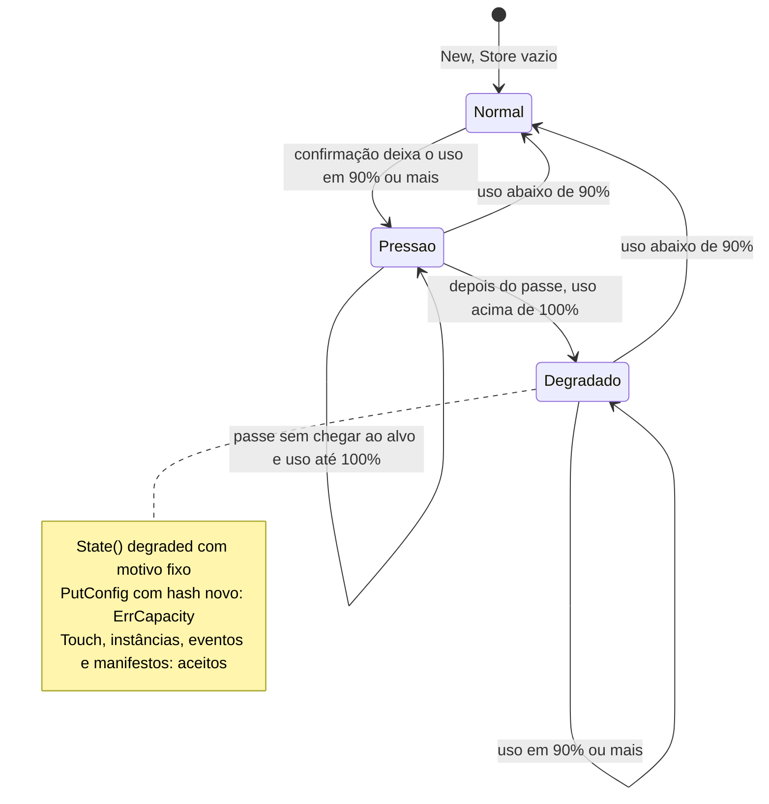
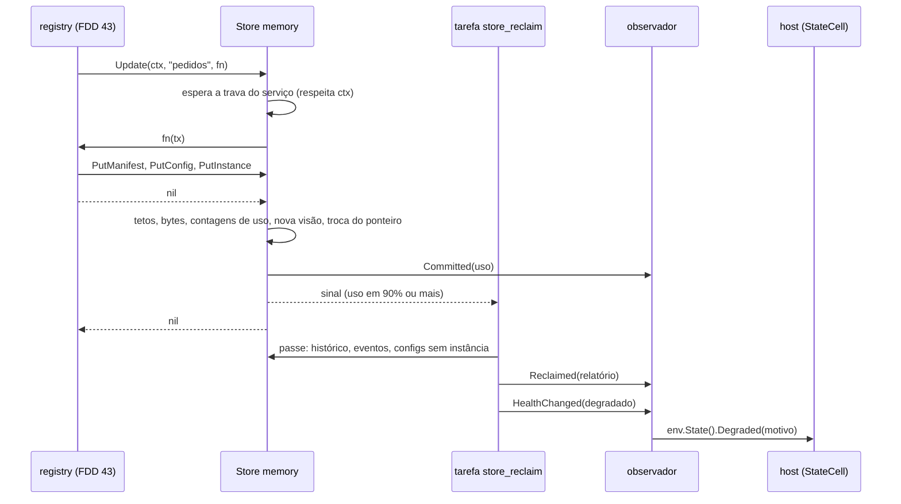
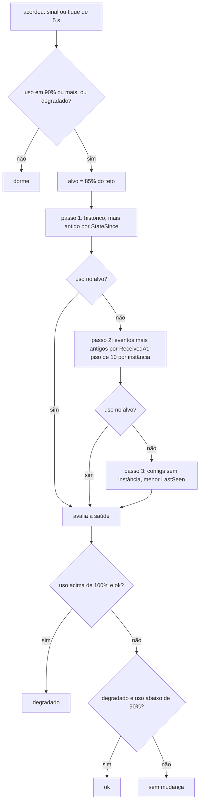
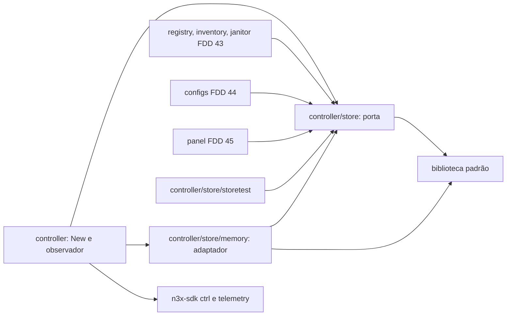

### FDD: Store em memória com teto e estado degradado (CORE-05)

Versão: 1.0
Data: 2026-10-20
Responsável: Guilherme Giusti

---

### 1. Contexto e motivação técnica

**Problema técnico.** O host do controller não tem armazenamento (ADR-002 do `n3x-controller`) e a v1 não tem banco (ADR-001 do `n3x-plugin-core`). Todo o estado observado que o painel mostra (instâncias, sessões, manifestos, versões de config e eventos) fica na memória da metade de controller do core. Sem um limite explícito, uma frota com configs grandes ou uma rajada de eventos estoura o orçamento do controller (150 MB e 0,15 vCPU para o core e os dados dele com 500 sidecars, HLD do `n3x-controller`). O ADR-009 do core fixou a regra: teto `memory_limit` de 128 MiB por contabilidade aproximada, descarte acima de 90% na ordem histórico, eventos mais antigos, configs sem instância, estado degradado que aceita heartbeats e estados e recusa config nova com `RESOURCE_EXHAUSTED`, saída sozinha abaixo de 90% e snapshots imutáveis por serviço. Faltava o comportamento verificável:

- a forma da porta `Store` que o banco da v2 vai implementar, e se os usuários de leitura entram nela
- a fórmula da contabilidade de bytes, quando ela é recalculada e a margem de erro aceita
- quem roda o descarte, quando, em que ordem dentro de cada passo e até onde vai
- o momento exato de entrar e sair do degradado, a histerese e os efeitos em cada operação
- como as escritas convivem com a leitura sem trava do painel e quanto custa copiar um serviço grande
- o custo do heartbeat (50 pings por segundo com 500 sidecars) sobre o Store
- a exceção do Store à cota de 64 MiB do SDK (L-15) e como ela aparece nas métricas

O `memory.Map` do SDK não serve aqui: ele descarta itens em silêncio ao bater a cota (ADR-017 do `n3x-sdk`), e o core precisa de descarte explícito, em ordem de menor valor, com estado declarado (ADR-001 e ADR-009 do core).

**Encaixe no HLD.** Esta FDD especifica a porta `Store` e o componente `controller/store/memory` do HLD do `n3x-plugin-core` ("Componentes e responsabilidades", "Modelo de dados", "Fonte de verdade", "Técnicas aplicadas" e o próximo passo "Implementar a porta `Store` e o adaptador `memory`, com contabilidade de bytes e o benchmark de 500 sidecars"). Consumidores:

- FDD 43 (`registry`, `inventory`, `janitor`): grava registro, sessões, eventos, saída e transições de estado por `Update`, e o ping do heartbeat por `Touch`
- FDD 44 (`configs`): grava versões de config deduplicadas pelo hash, a config atual de cada instância e o histórico de hashes, dentro do mesmo `Update`
- FDD 45 (`panel` e `metrics`): lê um `Snapshot()` por requisição, sem trava; consolida as métricas `n3x_n3x_core_*` definidas aqui
- host do controller: recebe o estado `degraded` pelo `StateCell` do core (FDD 08), mostra o banner (FDD 35) e aplica "só o root entra" (FDDs 09 e 34)
- FDD 51: mede o Store dentro do simulador de 500 sidecars

**Atores.** `registry`, `inventory`, `configs` e `janitor` (escrevem), `panel` (lê), a tarefa de fundo `store_reclaim` (descarta e decide o degradado), o host (recebe o estado e o mostra) e o operador (ajusta `memory_limit` e acompanha métricas e alertas).

**Limites.** O Store não decide regra de negócio: não valida identidade contra o token, não decide quando uma instância fica desconectada ou vai para o histórico, não detecta conflito nem divergência e não calcula diff. Ele guarda o que recebe, confere a forma dos registros, conta bytes, aplica os dois tetos numéricos do ADR-009 (200 eventos por instância e 20 versões por serviço), roda o descarte por pressão, publica snapshots e declara a própria saúde. Não faz I/O, não abre rede nem disco; a única goroutine é a tarefa `store_reclaim`. Os dados somem no restart e são reconstruídos pelos sidecars (FDDs 39 e 43).

**Suposições**
- SDK com as FDDs 02, 06 e 08 implementadas: `plugin.Size`, `telemetry` e `ctrl.Env` com `State()`, `Metrics()`, `Log()` e `Background` (tarefas começam depois da subida de todos os plugins e antes de abrir as portas, FDD 08)
- Core com a FDD 36 implementada: `controller.Config.MemoryLimit` (16 MiB a 1 GiB, padrão 128 MiB), `corev1.MaxRegisterBytes = 1 MiB` e `corev1.MaxEventDetailLen = 256`
- Uma réplica do controller (ADR-001 do `n3x-sdk`); um único Store por processo
- Carga de referência (HLD do core): 500 sidecars, heartbeat a cada 10 s (50 pings por segundo), painel com polling de 5 s
- Go 1.26: `iter.Seq`, `atomic.Pointer` e `atomic.Int64` disponíveis

**Restrições**
- ~~Estruturas Go próprias, nunca `env.Memory()` nem `memory.Map` (ADR-001 do core, premissa)~~ **Superado pela decisão D-01 abaixo:** o Store usa o `memory.Map` do SDK e fica sujeito à cota do SDK
- `controller/store` e `controller/store/memory` importam só a biblioteca padrão; métricas, logs e estado chegam pelo observador ligado em `controller.New` (arquitetura hexagonal: o adaptador não conhece o SDK)
- Leitura do painel sem trava (ADR-009 do core); heartbeat sem trava e sem alocação
- Nenhum conteúdo de config, manifesto ou detalhe de evento em log, métrica ou erro; só tamanhos, contagens e hashes
- `falho` é decidido só pelo host; o core declara `ok` ou `degradado` (HLD do `n3x-sdk`, FDD 08)
- Documentação em pt-BR; identificadores em inglês

**Rastreabilidade**
- PRD 1.5: FR-006 (teto de memória, ordem de descarte, degradado, heartbeats e estados aceitos, `RESOURCE_EXHAUSTED`), FR-007 (até 20 versões por serviço, descartando primeiro as que nenhuma instância usa), FR-008 (banner de plugin degradado com os últimos dados em memória), FR-009 (core degradado: só o root entra), FR-016 (até 200 eventos por instância, histórico de 24 h, `RESOURCE_EXHAUSTED` para config nova); confiabilidade ("tudo em memória com teto"); critério de aceite "com o teto estourado, o painel mostra o banner, os heartbeats seguem aceitos e uma nova versão de config é recusada com `RESOURCE_EXHAUSTED`"; testes do teto e do degradado
- ADRs do `n3x-plugin-core`: ADR-001 (memória, porta `Store`, estruturas próprias), ADR-009 (teto, retenções, descarte, degradado, snapshots), ADR-010 (`n3x_n3x_core_memory_bytes` e `n3x_n3x_core_degraded`)
- ADRs do `n3x-sdk`: ADR-005 e ADR-017 (memória isolada e cota de 64 MiB no controller); ADR-002 do `n3x-controller` (canal de estado por plugin, sem armazenamento no host)
- FDDs aplicadas: 04 (cota do SDK e métricas `n3x_plugin_memory_*`), 06 (`telemetry`, regras de nome e de criação no `New`), 08 (`StateReporter`, `MaxStateReasonLen`, `Background`), 09 (contrato 16, "só o root entra" pelo `StateCell` do core), 36 (`memory_limit`, `inventory_retention`, limites do proto)
- **Lacuna L-15: texto original SUPERADO pela decisão D-01 abaixo (2026-10-22).** O Store passa a usar o `memory.Map` do SDK, sujeito à cota do SDK; as partes desta FDD que descrevem estruturas próprias, contabilidade própria e a exceção à cota (contratos 3 a 5 e a seção 7) são rascunho a revisar quando a dependência externa da D-01 for confirmada. Texto original: o Store do core usa estruturas Go próprias (ADR-001 do core) e fica **fora** da cota de 64 MiB do SDK. Ele não passa pelo `memory.Map`, não conta em `n3x_plugin_memory_bytes{plugin="n3x.core"}` (que no controller mede só os `memory.Map` do core, em geral 0) e não obedece a `runtime.plugin_limits["n3x.core"].memory.max_bytes`. O teto próprio é `memory_limit` (padrão 128 MiB, FDD 36), medido pela contabilidade do contrato 4 e publicado em `n3x_n3x_core_memory_bytes` e na métrica nova `n3x_n3x_core_memory_limit_bytes`. A exceção é registrada no contrato 5 e como reflexo pendente nos ADR-005 e ADR-017 do `n3x-sdk`. Não é um privilégio de capacidade: nenhum plugin é impedido de ter estruturas próprias, mas só o core tem, por ADR, teto, contabilidade e estado declarados para elas
- Decisões aprovadas pelo responsável do produto em 2026-10-22:
  - **D-01 (L-15):** o Store do core usa o `memory.Map` do SDK de verdade e obedece à cota do SDK (`runtime.plugin_limits["n3x.core"].memory.max_bytes`, hoje 64 MiB no controller), em vez de estruturas Go próprias fora da cota. **O requisito de comportamento do PRD é mantido:** descarte na ordem do ADR-009, estado degradado com banner, heartbeats e estados aceitos e config nova recusada com `RESOURCE_EXHAUSTED` (FR-006, FR-007 e critério de aceite). Isso reverte a premissa do ADR-001 (estruturas próprias) e muda a relação entre `memory_limit` (padrão 128 MiB) e a cota de 64 MiB do SDK
  - **P-D01 atendida por confirmação do responsável (2026-10-22, não verificável neste repositório):** o `memory.Map` do `n3x-sdk` já expõe uso e cota, remoção explícita e sinal de teto atingido. O grupo do Store fica liberado; a verificação contra o código do `n3x-sdk` fica para a fase `plan`. O restante deste item é o texto original da pendência. Texto original: **Dependência externa pendente (P-D01, não verificável neste repositório):** o `n3x-sdk` precisa expor, no `memory.Map` (ADR-005 e ADR-017 do SDK), (a) o uso e a cota atuais, (b) remoção explícita de itens e (c) um sinal de que o teto foi atingido sem descarte silencioso, ou um modo sem descarte automático para o core. Sem isso, o estado degradado e a ordem de descarte não são implementáveis. Também é preciso definir qual é o teto efetivo: alinhar `memory_limit` à cota do SDK ou subir `runtime.plugin_limits["n3x.core"].memory.max_bytes`. Bloqueia o fechamento desta FDD e do grupo que a contém até ser confirmado
  - **D-02 (L-15, teto de versões):** o limite de 20 versões de config por serviço é "mole": uma versão em uso por instância viva nunca é descartada, então o serviço pode passar de 20; o `memory_limit` segue como proteção real. O FR-007 e o ADR-009 precisam dizer "até 20, exceto as em uso" (reflexo pendente)
  - **D-03:** aprovados os parâmetros de descarte e degradado: passe até 85% do teto (início em 90%), piso de 10 eventos recentes por instância, tique de 5 s e no mínimo 1 s entre passes; degradado entra se o uso passar de 100% depois de um passe e sai abaixo de 90%; degradado continua aceitando instância nova, evento e manifesto novo e recusa só config nova
- Lacunas só citadas: L-65 (janela de deduplicação de eventos) e L-66 (sentido de `inventory_retention`) continuam com a FDD 43; o Store oferece o mecanismo (contratos 1 e 6)
- Pedidos de FDDs anteriores atendidos:
  - FDD 04: registrar a exceção do Store do core (L-15, acima e contrato 5)
  - FDD 36: aplicar `memory_limit` e definir as constantes de 20 versões e 200 eventos (contratos 1 e 6)
  - FDD 08: estado declarado por `env.State()` com motivo fixo de até 200 caracteres; o exemplo `confereTeto` do contrato 9 dela vira o observador do contrato 3

---

### 2. Objetivos técnicos

- **Teto respeitado com descarte explícito.** Invariante: depois de cada passe de recuperação, ou o uso fica em até 85% do teto, ou não sobra nada descartável (histórico vazio, eventos no piso, nenhuma config sem instância). O degradado só começa quando, depois de um passe, o uso passa de 100% do teto.
- **Descarte na ordem do ADR-009.** Invariante: num passe, nenhum evento sai enquanto houver instância no histórico, e nenhuma versão de config sai enquanto houver evento acima do piso. Medida: teste de teto baixo confere a ordem pelos contadores `n3x_n3x_core_store_discards_total{kind,reason="pressure"}`.
- **Efeitos exatos do degradado.** Invariante: degradado, `PutConfig` com hash novo devolve `ErrCapacity` e não muda nada; `Touch`, `PutInstance`, `RemoveInstance`, `AppendEvent`, `PutManifest` e `PutConfig` com hash já guardado continuam aceitos. Sai sozinho quando o uso cai abaixo de 90%.
- **Heartbeat sem custo de Store.** Medida: `Touch` com 0 alocações, sem trava, média de até 300 ns com 500 instâncias num só serviço (hipótese de meta); não muda a contabilidade.
- **Leitura sem bloquear escrita.** Medida: `Snapshot()` com 0 alocações e até 50 ns; 8 leitores e 8 escritores por 10 s em `go test -race` sem corrida, e nenhuma visão lida muda durante a leitura.
- **Contabilidade exata da própria fórmula.** Invariante: `Usage().Bytes` é sempre igual à soma da fórmula do contrato 4 sobre os itens presentes, conferida por `Verify()` depois de cada operação no fuzzing e no fim do teste concorrente.
- **Estimativa honesta.** Medida: nas fixtures F1 e F2 (seção 9), o heap real ocupado pelo Store fica entre 0,8 e 1,25 vezes `Usage().Bytes` (hipótese).
- **Sem ponteiro pendurado.** Invariante: toda `ConfigHash` de instância existe nas versões do serviço; todo `ManifestHash` existe na tabela de manifestos; versão de config em uso e manifesto em uso nunca são descartados.
- **Dentro do orçamento com 500 sidecars.** Medida: fixture F1 (500 instâncias ativas, 100 no histórico, 200 eventos cada) com heap real do Store até 80 MiB e custo de CPU do Store abaixo de 0,01 vCPU na carga de referência (hipótese de meta; o orçamento total do core é 150 MB e 0,15 vCPU).
- **Porta substituível.** Medida: o adaptador `memory` passa na suíte `storetest` (no mínimo 40 casos); o banco da v2 deve passar na mesma suíte.

---

### 3. Escopo e exclusões

**Incluído**
- Pacote `controller/store` (a porta): interfaces `Store` e `Tx`, registros de escrita, visões de leitura (`Snapshot`, `Service`, `Instance`, `ConfigInfo`), `Usage`, `Health`, `Hash`, erros e as constantes do ADR-009
- Pacote `controller/store/memory` (o adaptador da v1): trava por serviço, transação tudo ou nada, deduplicação de manifestos e configs pelo hash, contabilidade incremental, tetos de 200 eventos e 20 versões, células de vida das sessões, publicação de snapshots por troca de ponteiro, tarefa `store_reclaim` com o descarte por pressão, estado degradado e `Verify`
- Observador do Store e a ligação em `controller.New` com `env.Metrics()`, `env.Log()`, `env.State()` e `env.Background()`: métricas, logs e declaração do estado ao host
- Aplicação do campo `memory_limit` (FDD 36); `inventory_retention` só repassado ao `janitor` (FDD 43)
- Fechamento da L-15 (exceção à cota do SDK)
- Suíte de conformidade `controller/store/storetest`
- Benchmarks do Store com 500 sidecars simulados (fixtures F1 e F2), teste de calibração da estimativa e fuzzing de sequências de operações

**Excluído**
- Regras de estado da instância (conectado, desconectado, histórico), três intervalos sem ping, `inventory_retention` e o sentido dele (L-66), sessões e conflito de identidade, divergência de manifesto, deduplicação de eventos além dos retidos (L-65) e janitor: FDD 43 (CORE-07)
- Semântica da config atual, alerta de config recusada, diff, divergência de config, ordem final das versões sem instância e tamanho do histórico de hashes: FDD 44 (CORE-08); aqui só o mecanismo e os padrões propostos
- Mapeamento de `ErrCapacity` para `RESOURCE_EXHAUSTED` no `Register`: FDD 43 (aqui só o contrato do erro)
- Nova tentativa do sidecar depois de `RESOURCE_EXHAUSTED`: FDD 42 (CORE-06)
- Banner no painel: host, FDD 35 (CTL-06); telas do core e registro único das métricas: FDD 45 (CORE-09)
- Regra "só o root entra" com o core degradado: FDDs 09 (SDK-09) e 34 (CTL-05), só aplicada
- Usuários de leitura: ficam fora da porta na v1, com o diretório da FDD 40 (CORE-04)
- Simulador de 500 sidecars ponta a ponta e orçamento do controller: FDD 51 (CTL-07)
- Reconstrução do inventário depois de um restart: FDDs 39 (CORE-03) e 43 (CORE-07)
- Adaptador de banco: v2, fora da v1

---

### 4. Fluxos detalhados e diagramas

**Fluxo principal: escrita de um `Register` (comportamento da FDD 43; aqui só o caminho no Store)**
1. O `registry` valida a mensagem (FDD 43) e chama `st.Update(ctx, service, fn)`.
2. O Store confere o nome do serviço (não vazio, até 63 bytes) e espera a trava do serviço. A espera respeita o `ctx`; prazo vencido devolve `ctx.Err()` sem efeito.
3. O Store monta um rascunho sobre a visão atual do serviço (nada é copiado até alguém mudar) e chama `fn(tx)`.
4. Dentro de `fn`, o `registry` chama, por exemplo:
   - `tx.PutManifest(bytes)`: calcula `sha256:` do conteúdo; se o hash já está na tabela global, não guarda de novo (`PutExisting`)
   - `tx.PutConfig(hash, bytes, agora)`: hash já guardado no serviço atualiza `LastSeen` (`PutExisting`); hash novo copia o conteúdo (`PutCreated`); degradado e hash novo devolve `ErrCapacity` sem efeito, e `fn` pode seguir com a config anterior (decisão da FDD 44)
   - `tx.Instance(nome)` e `tx.PutInstance(registro)`: upsert pela identidade; o Store confere a forma e as referências (config e manifesto existentes)
5. `fn` devolve `nil` e o Store confirma, ainda com a trava do serviço:
   - aplica o teto de 20 versões (contrato 5) e o de 200 eventos por instância
   - ajusta as contagens de uso de cada versão de config e de cada manifesto
   - calcula a diferença de bytes de cada item mudado (contrato 4)
   - monta a nova visão do serviço reaproveitando os ponteiros das instâncias que não mudaram
   - com a trava curta de publicação, troca o ponteiro do snapshot global (`atomic.Pointer`) e soma a diferença nos contadores atômicos de uso
6. O Store solta a trava do serviço, avisa o observador (`Committed`) e, se o uso ficou em 90% do teto ou mais, ou se está degradado e o uso caiu abaixo de 90%, sinaliza a tarefa `store_reclaim` (canal de 1 posição, sem bloquear).
7. `Update` devolve `nil`. Se `fn` devolveu erro, nada foi aplicado e o erro volta sem mudança.

**Fluxo do heartbeat (`Touch`)**
1. O handler do stream (FDD 43) chama `st.Touch(ref, horaDeRecebimento, seq)` a cada ping.
2. O Store lê o snapshot atual (carga atômica), acha o serviço e a instância por busca binária e a sessão pelo nonce.
3. Achou: avança, com troca atômica e só para frente, a célula de vida da sessão (`LastPing` e `LastSeq`) e devolve verdadeiro. Não achou: devolve falso (a FDD 43 decide o `resend_register`).
4. Sem trava, sem alocação, sem mudança de bytes, sem novo snapshot. A célula é compartilhada por todas as versões do snapshot daquela sessão.

**Fluxo de leitura do painel**
1. A tela (FDD 45) chama `st.Snapshot()` uma vez por requisição (carga atômica, 0 alocações).
2. Lê serviços, instâncias, versões e eventos pelas visões imutáveis; o conteúdo de config e manifesto vem como `string`, que não pode ser alterada.
3. Nenhuma escrita espera por leitores, e nenhum leitor espera por escritores. Um escritor que confirma depois da carga não muda o que a tela está lendo.
4. A tela não guarda o snapshot depois da requisição; o `Seq()` de cada serviço serve de chave de cache para dados derivados (por exemplo, diff na FDD 44).

**Fluxo do descarte por pressão (tarefa `store_reclaim`)**
1. A tarefa acorda pelo sinal de uma confirmação ou pelo tique de 5 s (hipótese).
2. Se o uso está abaixo de 90% e o Store não está degradado, volta a dormir.
3. Calcula o alvo (85% do teto, hipótese) e quanto precisa liberar. Lê um snapshot e monta os candidatos de cada passo; aplica cada passo por um `Update` interno por serviço, nunca com duas travas de serviço ao mesmo tempo, e recontrola cada candidato dentro da transação (o item pode ter mudado desde a leitura).
   - **Passo 1, histórico:** instâncias em `StateHistory`, da mais antiga para a mais nova por `StateSince`. Remover a instância libera o registro, as sessões, os eventos dela e as referências a manifesto e config.
   - **Passo 2, eventos mais antigos:** só se o passo 1 esvaziou o histórico e ainda falta liberar. Eventos de qualquer instância, do mais antigo para o mais novo por `ReceivedAt`, preservando os 10 mais recentes de cada instância (piso, hipótese).
   - **Passo 3, versões de config sem instância:** só se os eventos chegaram ao piso e ainda falta liberar. Versões que nenhuma instância retida aponta como atual, da menor para a maior `LastSeen`.
4. O passe para assim que o uso chega ao alvo.
5. Avalia a saúde: depois do passe, uso acima de 100% do teto e Store em `ok` vira degradado; degradado com uso abaixo de 90% volta a `ok`; nos outros casos, nada muda.
6. Avisa o observador (`Reclaimed` e, na transição, `HealthChanged`). O observador declara o estado ao host (`env.State().Degraded` ou `OK`), atualiza as métricas e loga.
7. Se o passe não chegou ao alvo, o próximo só começa depois de 1 s (`ReclaimMinInterval`), para uma rajada de eventos em degradado não virar um passe por confirmação.

**Fluxos alternativos e exceções**
- **Degradado e config nova:** `PutConfig` devolve `ErrCapacity`, soma em `n3x_n3x_core_store_rejections_total{kind="config"}`; o resto da transação segue. A FDD 43 responde `RESOURCE_EXHAUSTED` e o sidecar tenta de novo depois (FDD 42).
- **Degradado e manifesto novo:** aceito (hipótese). O PRD só recusa config nova; manifestos são poucos (um por imagem) e o excesso é limitado.
- **Degradado e evento novo:** aceito. Em pressão, o passo 2 remove os mais antigos; o efeito líquido tende a zero.
- **Degradado e instância nova:** aceita (é "estado", FR-006). O crescimento é limitado pelo tamanho da frota e pelo limite de conexões do host.
- **Saída do degradado:** uma remoção (janitor da FDD 43, saída de instância, passe) que deixa o uso abaixo de 90% sinaliza a tarefa; ela devolve o estado `ok` no mesmo ciclo.
- **Uso entre 90% e 100% sem nada descartável:** o Store fica em pressão e `ok`; nenhuma recusa. O passe registra `reached=false`.
- **`fn` devolve erro:** rascunho descartado, nada muda, o erro volta.
- **Panic dentro de `fn`:** o rascunho é descartado, a trava é solta por `defer` e o panic segue para cima (o recover é do host, FDDs 32 e 33). Nunca há confirmação parcial.
- **Uso do `Tx` depois que `fn` retornou:** panic com `store.ErrTxDone` (erro de programação).
- **`Update` dentro de `fn` para o mesmo serviço:** proibido (trava não reentrante, espera até o prazo do `ctx`); a revisão e o teste de conformidade conferem que as FDDs 43 e 44 não fazem isso.
- **Serviço vazio:** depois de uma confirmação sem instâncias e sem versões, o serviço sai do snapshot.
- **Restart do controller:** o Store nasce vazio e em `ok`; o estado volta pelos sidecars (FDDs 39 e 43).
- **Tarefa `store_reclaim` com panic:** o host reinicia com espera de 1 s a 60 s (FDD 08). O Store continua consistente, porque cada passo usa transações; só a decisão de degradado atrasa.

**Diagramas**

Estados do Store (o host só vê `ok` e `degraded`; a pressão é interna):



Escrita de um `Register` e o descarte assíncrono:



Ordem de um passe de recuperação:



Pacotes e dependências:



---

### 5. Contratos públicos (assinaturas, endpoints, headers, exemplos)

Os pacotes `controller/store`, `controller/store/memory` e `controller/store/storetest` são internos ao repositório do core: não fazem parte do contrato de plugin e mudam junto com as FDDs 43 a 45. São "públicos" para os outros componentes do core e para o adaptador de banco da v2.

**Contrato 1: porta `store.Store` e transação `store.Tx`**
- Tipo: sdk (API Go interna do core)
- Assinatura/Rota:
  ```go
  package store // github.com/giustech/n3x-plugin-core/controller/store

  // Store é a porta de armazenamento do core no controller (ADR-001).
  // Implementações: memory (v1) e banco (v2). Todos os métodos são seguros entre goroutines.
  type Store interface {
      // Update roda fn com a trava do serviço e confirma tudo ou nada.
      // fn não pode chamar o Store nem bloquear; o Tx só vale durante fn.
      Update(ctx context.Context, service string, fn func(tx Tx) error) error

      // Touch registra um ping da sessão. Sem trava, sem alocação, só para frente.
      // Falso quando a sessão não existe no snapshot atual.
      Touch(ref SessionRef, at time.Time, seq uint64) bool

      // Snapshot devolve a visão imutável mais recente. 0 alocações.
      Snapshot() *Snapshot

      Usage() Usage   // leitura atômica, 0 alocações
      Health() Health // leitura atômica, 0 alocações
  }

  type Tx interface {
      Service() string

      Instance(name string) (InstanceRecord, bool) // cópia mutável, já com as escritas desta transação
      InstanceNames() iter.Seq[string]             // ordem por nome
      PutInstance(r InstanceRecord) error          // upsert pela identidade (serviço, r.Name)
      RemoveInstance(name string) bool             // remove registro, sessões e eventos

      PutManifest(content []byte) (Hash, error)                     // dedup global pelo sha256 do conteúdo
      PutConfig(h Hash, content []byte, seenAt time.Time) (Put, error) // dedup no serviço pelo hash
      Config(h Hash) (ConfigInfo, bool)
      Configs() iter.Seq[ConfigInfo]
      RemoveConfig(h Hash) bool // falso se alguma instância retida aponta para ela

      AppendEvent(instance string, ev Event) (Put, error) // PutExisting = id repetido entre os retidos
  }

  type Put uint8

  const (
      PutCreated  Put = iota + 1 // item novo guardado
      PutExisting                // já existia: config ou manifesto com o mesmo hash, evento com o mesmo id
  )

  type SessionRef struct{ Service, Instance, Nonce string }

  var (
      ErrCapacity       = errors.New("store: teto de memória do core atingido")
      ErrInvalidRecord  = errors.New("store: registro inválido")
      ErrNotFound       = errors.New("store: item não encontrado")
      ErrInvalidService = errors.New("store: nome de serviço inválido")
      ErrTxDone         = errors.New("store: transação já encerrada")
  )

  // RecordError detalha um ErrInvalidRecord (errors.Is(err, ErrInvalidRecord) é verdadeiro).
  type RecordError struct {
      Field string // ex.: "sessions", "config_hash", "detail"
      Rule  string // ex.: "max_items", "dangling", "size", "required", "hash_format"
  }

  func (e *RecordError) Error() string
  func (e *RecordError) Unwrap() error // ErrInvalidRecord

  const (
      MaxEventsPerInstance        = 200     // ADR-009; o mais antigo da instância sai (reason "limit")
      MaxConfigVersionsPerService = 20      // ADR-009; teto mole: versão em uso nunca sai (hipótese)
      MaxHashHistory              = 20      // hipótese; a FDD 44 confirma
      MaxSessionsPerInstance      = 8       // hipótese; a FDD 43 poda as sessões encerradas
      MaxContentBytes             = 1 << 20 // igual a corev1.MaxRegisterBytes (teste de igualdade)
      MaxServiceLen               = 63      // limites de tamanho iguais aos do proto (FDD 36)
      MaxInstanceLen              = 253
      MaxAddressLen               = 260
      MaxTargetLen                = 32
      MaxEnvoyVersionLen          = 64
      MaxEventIDLen               = 64
      MaxEventDetailLen           = 256     // igual a corev1.MaxEventDetailLen
  )
  ```
- Método: n/a (chamada local)
- Semântica de status/headers:
  - **Unidade de trabalho por serviço (hipótese):** o serviço é o agregado. Uma transação vê as próprias escritas, confirma tudo ou nada e serializa as escritas do mesmo serviço; serviços diferentes confirmam em paralelo. No banco da v2, `Update` vira uma transação com trava da linha do serviço
  - **Retorno de `Update`:** `nil` (confirmou); o erro de `fn` sem mudança (nada aplicado); `ctx.Err()` (prazo vencido esperando a trava); `ErrInvalidService` (nome vazio ou maior que 63 bytes; a gramática é da FDD 43)
  - **`PutConfig`:** `h` precisa ser `sha256:` com 64 hex minúsculos (o Store não recalcula; a FDD 43 já recalculou, ADR-006) e `content` até 1 MiB. Hash presente no serviço: `PutExisting` e `LastSeen = max(LastSeen, seenAt)`. Hash novo: copia o conteúdo para uma `string` e devolve `PutCreated`. Degradado e hash novo: `ErrCapacity`, sem efeito; a transação segue válida
  - **`PutManifest`:** calcula `sha256:` do conteúdo (até 1 MiB); a deduplicação é global, entre serviços, porque a mesma imagem serve vários serviços. Aceito também em degradado (hipótese). Manifesto sem nenhuma instância apontando é liberado na confirmação
  - **`PutInstance`:** confere tamanhos, `State` válido, até 8 sessões com nonce único e não vazio, até 20 hashes no histórico, e as referências: `ConfigHash` vazio ou presente no serviço (depois das escritas desta transação), `ManifestHash` vazio ou guardado. Falha vira `ErrInvalidRecord` com `RecordError`, sem efeito naquela chamada. Sessão com nonce novo ganha uma célula de vida zerada; nonce que já existia mantém a célula
  - **`AppendEvent`:** instância inexistente na transação dá `ErrNotFound`; `ID` vazio ou maior que 64 bytes, ou `Detail` maior que 256 bytes, dão `ErrInvalidRecord`; `ID` já presente entre os eventos retidos da instância dá `PutExisting` (deduplicação mínima; a janela final é da FDD 43, L-65). Com 200 eventos, o mais antigo da instância sai na confirmação (`reason="limit"`)
  - **`Touch`:** use a hora de recebimento do controller, não o `sent_at` do sidecar (relógios diferentes; recomendação para a FDD 43). Só avança: `at` menor ou igual ao atual não muda nada, mas devolve verdadeiro se a sessão existe
  - **`ErrCapacity`** não conhece gRPC: a FDD 43 mapeia para `RESOURCE_EXHAUSTED` com a mensagem fixa "teto de memória do core atingido; tente de novo mais tarde" (hipótese de texto)
  - **Limites de tempo:** `Update` sem espera de trava fica abaixo de 50 µs em média com 500 instâncias no serviço (hipótese de meta, seção 9); a espera só depende de outros escritores do mesmo serviço

**Exemplo de requisição** (uso pela FDD 43 no `Register`, ilustrativo)
```go
var configRefused bool
err := st.Update(ctx, "pedidos", func(tx store.Tx) error {
    mh, err := tx.PutManifest(req.GetManifest())
    if err != nil {
        return err
    }
    rec, _ := tx.Instance("pedidos-7d9f8b-xk2lp")
    rec.Name, rec.Address = "pedidos-7d9f8b-xk2lp", "10.42.3.17:17000"
    rec.Target, rec.EnvoyVersion = "envoy-1.40", "1.40.1"
    rec.State, rec.StateSince = store.StateConnected, now
    rec.ManifestHash = mh
    switch _, err := tx.PutConfig(h, req.GetConfig(), now); {
    case errors.Is(err, store.ErrCapacity):
        configRefused = true // mantém rec.ConfigHash anterior; alerta da FDD 44
    case err != nil:
        return err
    default:
        rec.ConfigHash = h
    }
    return tx.PutInstance(rec)
})
```

**Exemplo de resposta** (Store degradado, config com hash novo)
```json
{
  "Update": null,
  "configRefused": true,
  "Health": { "Degraded": true, "Reason": "teto de memória do core atingido (memory_limit); novas versões de config recusadas", "Since": "2026-10-20T14:10:00Z" },
  "resposta gRPC da FDD 43": { "code": "RESOURCE_EXHAUSTED", "message": "teto de memória do core atingido; tente de novo mais tarde" },
  "métrica": "n3x_n3x_core_store_rejections_total{kind=\"config\"} 1"
}
```

---

**Contrato 2: tipos do Store (registros de escrita, visões de leitura e `Snapshot`)**
- Tipo: sdk (API Go interna do core)
- Assinatura/Rota:
  ```go
  type Hash string // "sha256:" + 64 hex minúsculos (71 bytes)

  const HashLen = 71

  func ParseHash(s string) (Hash, error) // ErrInvalidRecord com Rule "hash_format"
  func HashOf(content []byte) Hash       // usado pelo PutManifest

  type InstanceState uint8

  const (
      StateConnected    InstanceState = iota + 1 // "connected"
      StateDisconnected                          // "disconnected"
      StateHistory                               // "history": candidato ao passo 1 do descarte
  )

  func (s InstanceState) String() string

  // Registros de escrita: valores mutáveis, copiados pelo Store na gravação.
  type SessionRecord struct {
      Nonce             string
      IssuedAt          time.Time
      ExpiresAt         time.Time
      HeartbeatInterval time.Duration
  }

  type InstanceRecord struct {
      Name         string
      Address      string
      Target       string
      EnvoyVersion string
      State        InstanceState
      StateSince   time.Time // entrada no estado atual; ordena o passo 1
      RegisteredAt time.Time
      ManifestHash Hash      // vazio = sem manifesto
      ConfigHash   Hash      // versão atual; vazio = nenhuma aceita
      HashHistory  []Hash    // mais antigo primeiro; até MaxHashHistory
      Sessions     []SessionRecord
  }

  type Event struct {
      ID             string
      Kind           int32     // número do corev1.EventKind; o Store não interpreta
      Plugin         string
      PluginInstance string
      Detail         string    // já saneado (FDD 09)
      OccurredAt     time.Time // hora do sidecar
      ReceivedAt     time.Time // hora do controller; ordena o passo 2
      Suppressed     uint32
  }

  // Visões de leitura: imutáveis; listas só por iterador.
  type Snapshot struct{ /* imutável */ }

  func (s *Snapshot) Seq() uint64             // cresce a cada confirmação
  func (s *Snapshot) PublishedAt() time.Time
  func (s *Snapshot) NumServices() int
  func (s *Snapshot) Services() iter.Seq[*Service]           // ordem por nome
  func (s *Snapshot) Service(name string) (*Service, bool)   // busca binária
  func (s *Snapshot) Manifest(h Hash) (string, bool)          // conteúdo imutável
  func (s *Snapshot) Manifests() iter.Seq2[Hash, int]          // hash e instâncias que o usam

  type Service struct{ /* imutável */ }

  func (s *Service) Name() string
  func (s *Service) Seq() uint64 // muda só quando o serviço muda; chave de cache
  func (s *Service) Bytes() int64
  func (s *Service) NumInstances() int
  func (s *Service) Instances() iter.Seq[*Instance] // ordem por nome
  func (s *Service) Instance(name string) (*Instance, bool)
  func (s *Service) Configs() iter.Seq[ConfigInfo]  // ordem de FirstSeen
  func (s *Service) Config(h Hash) (ConfigInfo, bool)

  type Instance struct{ /* imutável, exceto as células de vida das sessões */ }

  func (i *Instance) Info() InstanceInfo              // valor, 0 alocações
  func (i *Instance) Sessions() iter.Seq[SessionInfo]
  func (i *Instance) HashHistory() iter.Seq[Hash]
  func (i *Instance) Events() iter.Seq[Event]         // mais antigo primeiro
  func (i *Instance) NumEvents() int
  func (i *Instance) Bytes() int64

  type InstanceInfo struct {
      Service, Name, Address, Target, EnvoyVersion string
      State                                        InstanceState
      StateSince, RegisteredAt                     time.Time
      ManifestHash, ConfigHash                     Hash
  }

  type SessionInfo struct {
      SessionRecord
      LastPing time.Time // da célula de vida (Touch); zero = sem ping desde o registro
      LastSeq  uint64
  }

  type ConfigInfo struct {
      Hash      Hash
      Content   string    // JSON canônico mascarado (FDD 37); imutável
      FirstSeen time.Time
      LastSeen  time.Time
      InUse     int       // instâncias retidas que apontam para ela como atual
      Bytes     int64
  }

  type Kind uint8

  const (
      KindInstance Kind = iota // instâncias conectadas e desconectadas, sessões, histórico de hashes, serviços
      KindHistory              // instâncias em StateHistory (registro, sessões e hashes)
      KindConfig
      KindManifest
      KindEvent
  )

  const NumKinds = 5

  func (k Kind) String() string // "instance", "history", "config", "manifest", "event"

  type Usage struct {
      Bytes  int64
      Limit  int64
      ByKind [NumKinds]int64
      Items  [NumKinds]int
  }

  func (u Usage) Percent() float64

  type Health struct {
      Degraded bool
      Reason   string    // DegradedReason quando Degraded; vazio em ok
      Since    time.Time // entrada no estado atual
  }
  ```
- Método: n/a
- Semântica de status/headers (contrato de snapshot):
  - **O que é imutável:** tudo o que um `*Snapshot` alcança: lista de serviços, visões de serviço e de instância, versões de config, eventos e conteúdos (guardados como `string`). Tipos de leitura não têm campo exportado mutável; listas só saem por iterador, que não expõe o slice interno
  - **Exceção controlada (hipótese):** `SessionInfo.LastPing` e `LastSeq` vêm de uma célula atômica compartilhada pelas versões do snapshot daquela sessão, para o heartbeat não gerar um snapshot por ping. Os dois só crescem e são lidos separadamente (podem vir de pings vizinhos)
  - **Por quanto tempo vale:** para sempre como valor; ele descreve o estado em `PublishedAt()`. O painel pega um snapshot por requisição e o descarta no fim (no máximo o prazo da página, 10 s). Segurar snapshots antigos mantém dados fora da contabilidade
  - **Granularidade (hipótese):** visão imutável por serviço com compartilhamento estrutural. A confirmação copia só a instância que mudou, o slice de ponteiros de instâncias do serviço (8 bytes por instância) e o slice de ponteiros de serviços do snapshot global (8 bytes por serviço). Com 500 instâncias num só serviço, uma confirmação aloca cerca de 4 KiB de ponteiros, não o serviço inteiro
  - **Consistência:** um snapshot é um corte consistente de todos os serviços (um único ponteiro). Dentro de um serviço, reflete a última transação confirmada
  - **`Seq`:** `Snapshot.Seq()` cresce a cada confirmação; `Service.Seq()` só quando aquele serviço muda, o que permite à FDD 44 guardar diffs por par de hashes e versão do serviço

**Exemplo de requisição**
```go
snap := st.Snapshot()
svc, _ := snap.Service("pedidos")
for inst := range svc.Instances() {
    info := inst.Info()
    for s := range inst.Sessions() {
        _ = s.LastPing
    }
    _ = info
}
cfg, _ := svc.Config("sha256:2c26b46b68ffc68ff99b453c1d30413413422d706483bfa0f98a5e886266e7ae")
```

**Exemplo de resposta**
```json
{
  "snapshot": { "Seq": 18233, "PublishedAt": "2026-10-20T14:09:58.412Z", "NumServices": 50 },
  "service": { "Name": "pedidos", "Seq": 911, "NumInstances": 10, "Bytes": 2961204 },
  "instance": {
    "Service": "pedidos", "Name": "pedidos-7d9f8b-xk2lp", "Address": "10.42.3.17:17000",
    "Target": "envoy-1.40", "EnvoyVersion": "1.40.1", "State": "connected",
    "StateSince": "2026-10-20T13:02:11Z", "RegisteredAt": "2026-10-20T13:02:11Z",
    "ManifestHash": "sha256:9f86d081884c7d659a2feaa0c55ad015a3bf4f1b2b0b822cd15d6c15b0f00a08",
    "ConfigHash": "sha256:2c26b46b68ffc68ff99b453c1d30413413422d706483bfa0f98a5e886266e7ae",
    "NumEvents": 37
  },
  "session": { "Nonce": "q3Jx9kLm2Vb8Tz1Rw5Yc0A", "LastPing": "2026-10-20T14:09:51Z", "LastSeq": 402 },
  "config": { "FirstSeen": "2026-10-19T09:30:00Z", "LastSeen": "2026-10-20T13:02:11Z", "InUse": 10, "Bytes": 18695 }
}
```

---

**Contrato 3: adaptador `memory` (`New`, `Run`, `Reclaim`, `Verify` e `Observer`)**
- Tipo: sdk (API Go interna do core)
- Assinatura/Rota:
  ```go
  package memory // github.com/giustech/n3x-plugin-core/controller/store/memory
                 // importe como memstore: o nome colide com github.com/giustech/n3x-sdk/memory

  type Options struct {
      Limit    int64            // memory_limit em bytes; mínimo de 64 KiB (testes usam valores baixos)
      Clock    func() time.Time // nil = time.Now; relógio falso nos testes
      Observer Observer         // nil = nenhum
  }

  const (
      PressurePercent      = 90  // ADR-009: início do descarte
      ReclaimTargetPercent = 85  // hipótese: alvo do passe
      DegradedEnterPercent = 100 // depois de um passe, uso acima do teto
      DegradedExitPercent  = 90  // ADR-009: saída com uso abaixo
      MinEventsKept        = 10  // hipótese: piso por instância no passo 2
      ReclaimMinInterval   = time.Second     // entre passes que não chegaram ao alvo
      ReclaimTick          = 5 * time.Second // rede de segurança (hipótese)
      MinLimit             = 64 << 10

      DegradedReason = "teto de memória do core atingido (memory_limit); novas versões de config recusadas"
  )

  func New(opts Options) (*Store, error) // erro se Limit < MinLimit

  type Store struct{ /* trava por serviço, snapshot atômico, contadores atômicos */ }

  var _ store.Store = (*Store)(nil)

  // Run é o corpo da tarefa store_reclaim: acorda por sinal ou tique, roda Reclaim
  // e respeita ReclaimMinInterval. Termina quando ctx é cancelado.
  func (s *Store) Run(ctx context.Context)

  // Reclaim roda um passe síncrono (testes e Run). Um passe por vez.
  func (s *Store) Reclaim(ctx context.Context) ReclaimReport

  // Verify recalcula a contabilidade e as referências do zero e compara com os contadores.
  // Testes e fuzzing; custo O(itens).
  func (s *Store) Verify() error

  type Reason uint8

  const (
      ReasonPressure Reason = iota + 1 // "pressure": descarte acima de 90%
      ReasonLimit                      // "limit": 200 eventos por instância ou 20 versões por serviço
  )

  type ReclaimReport struct {
      Before, After, Target int64
      Discarded             [store.NumKinds]int   // itens por tipo (history conta instâncias)
      Freed                 [store.NumKinds]int64 // bytes por tipo (history inclui os eventos das instâncias)
      Reached               bool                  // chegou ao alvo
      Health                store.Health          // saúde depois do passe
      Duration              time.Duration
  }

  // Observer recebe os fatos do Store fora de qualquer trava. Não pode bloquear nem dar panic.
  type Observer interface {
      Committed(u store.Usage)
      Discarded(kind store.Kind, reason Reason, n int)
      Rejected(kind store.Kind)
      Reclaimed(r ReclaimReport)
      HealthChanged(h store.Health, u store.Usage) // chamadas em ordem, uma por transição
  }
  ```
- Método: n/a
- Semântica de status/headers:
  - **Concorrência (hipótese):** uma trava por serviço, feita com canal de 1 posição para respeitar o `ctx` na espera; uma trava curta global só para publicar o snapshot e outra para a tabela de manifestos (ordem fixa: serviço, manifestos, publicação; nunca o inverso). Não há goroutine escritora única. `Touch` e `Snapshot` não usam trava
  - **Ligação em `controller.New`** (composição; métricas só podem ser criadas no `New`, FDD 06):
    ```go
    obs := newStoreObserver(env) // métricas, logs e estado (tabela abaixo)
    st, err := memstore.New(memstore.Options{Limit: int64(cfg.MemoryLimit), Observer: obs})
    if err != nil {
        return nil, err
    }
    env.Background("store_reclaim", st.Run)
    ```
  - A tarefa `store_reclaim` ocupa 1 das 8 tarefas de fundo da metade de controller do core (`runtime.plugin_limits["n3x.core"].background.max_tasks`, FDD 08)
  - **Observador do core** (`newStoreObserver`, no pacote `controller`):

| Método | Efeito |
| --- | --- |
| `Committed(u)` | `memory_bytes.Set(u.Bytes)`; `store_bytes{kind}.Set(u.ByKind[k])` para os 5 tipos |
| `Discarded(kind, reason, n)` | `store_discards_total{kind,reason}.Add(n)` |
| `Rejected(kind)` | `store_rejections_total{kind}.Inc()`; log `store_rejected` agregado, no máximo 1 por minuto |
| `Reclaimed(r)` | `store_reclaim_seconds.Observe(r.Duration)`; log `store_reclaim` agregado, no máximo 1 por minuto |
| `HealthChanged(h, u)` | degradado: `env.State().Degraded(memstore.DegradedReason)`, `degraded.Set(1)`, log `store_degraded`; ok: `env.State().OK()`, `degraded.Set(0)`, log `store_recovered` |

  - **Único emissor de estado do core na v1 (hipótese):** só o Store declara `degraded`; por isso o observador chama `OK()` direto. Se outra FDD do core precisar declarar degradado, ela cria um agregador de motivos antes (ponto P-04 do checkpoint)

**Exemplo de requisição** (teste com teto baixo)
```go
st, _ := memstore.New(memstore.Options{Limit: 1 << 20, Clock: clk.Now, Observer: rec})
carregaHistoricoEventosEConfigs(st) // uso em 960.112 bytes (91,6%)
r := st.Reclaim(context.Background())
```

**Exemplo de resposta**
```json
{
  "Before": 960112,
  "After": 889904,
  "Target": 891289,
  "Discarded": { "history": 12, "event": 140, "config": 0 },
  "Freed": { "history": 31808, "event": 38400, "config": 0 },
  "Reached": true,
  "Health": { "Degraded": false, "Reason": "", "Since": "2026-10-20T14:00:00Z" },
  "Duration": "412µs"
}
```

---

**Contrato 4: contabilidade de bytes**
- Tipo: sdk (regra do adaptador `memory`, conferida por `Verify` e pelo teste de calibração)
- Assinatura/Rota: `Usage().Bytes = soma da tabela abaixo sobre os itens presentes`
- Método: n/a
- Semântica de status/headers:
  - **Fórmula por item** (constantes não exportadas, calibradas pelo `TestAccountingCalibration` com as fixtures F1 e F2; hipótese de valores iniciais):

| Item | Estimativa em bytes | Tipo (`Kind`) |
| --- | --- | --- |
| Serviço | 256 + len(nome) | `instance` |
| Instância | 512 + len(Name) + len(Address) + len(Target) + len(EnvoyVersion) | `instance` ou `history` |
| Sessão | 96 + len(Nonce) | o da instância |
| Hash no histórico da instância | 88 (71 do hash + 17 de referência) | o da instância |
| Evento | 128 + len(ID) + len(Plugin) + len(PluginInstance) + len(Detail) | `event` |
| Versão de config | 192 + 71 + len(Content) | `config` |
| Manifesto | 192 + 71 + len(Content) | `manifest` |

  - **Quando é calculada (hipótese):** de forma incremental, na confirmação de cada transação: o Store subtrai a estimativa antiga de cada item mudado ou removido e soma a nova, só com `len` (sem percorrer estruturas). O custo é proporcional ao número de itens mudados, não ao tamanho do Store. `Touch` não muda bytes: custo zero nos 50 pings por segundo. Não há recontagem periódica em produção; `Verify()` recalcula do zero nos testes e no fuzzing
  - **Deduplicação:** uma config com o mesmo hash usada por N instâncias do serviço conta uma vez; um manifesto usado por N serviços conta uma vez. Instâncias iguais não custam memória de conteúdo
  - **Fora da conta:** snapshots antigos ainda lidos pelo painel (transitórios, até o prazo da página), folga de crescimento dos mapas do Go, pilhas de goroutine e a própria tarefa. É o "um pouco acima do teto" aceito pelo ADR-009
  - **Margem aceita (hipótese):** heap real do Store entre 0,8 e 1,25 vezes a estimativa nas fixtures F1 e F2. Fora disso, o teste de calibração falha e as constantes são recalibradas no mesmo PR (patch do core)
  - **Fora da cota do SDK (L-15):** nada aqui passa pela conta `memory.Account` do core; ver contrato 5

**Exemplo de requisição** (itens de uma instância típica)
```json
{
  "instance": { "Name": "pedidos-7d9f8b-xk2lp", "Address": "10.42.3.17:17000", "Target": "envoy-1.40", "EnvoyVersion": "1.40.1", "sessions": 1, "nonce_len": 22, "hash_history": 3 },
  "event": { "ID": "pedidos-7d9f8b-xk2lp:1842", "Plugin": "giustech.ratelimit", "PluginInstance": "rl-api", "detail_len": 80 },
  "config": { "content_len": 18432 },
  "manifest": { "content_len": 65536 },
  "service": { "name": "pedidos" }
}
```

**Exemplo de resposta**
```json
{
  "instance": 946,
  "detalhe da instância": "512 + 20 + 16 + 10 + 6 = 564; sessão 96 + 22 = 118; histórico 3 x 88 = 264",
  "event": 257,
  "config": 18695,
  "manifest": 65799,
  "service": 263
}
```

---

**Contrato 5: pressão, descarte, estado degradado e exceção à cota do SDK**
- Tipo: sdk (comportamento do adaptador `memory`; estado declarado pelo `ctrl.StateReporter` da FDD 08)
- Assinatura/Rota: limiares de `memstore` (contrato 3), `store.Health`, `env.State().Degraded(memstore.DegradedReason)` e `env.State().OK()`
- Método: n/a
- Semântica de status/headers:
  - **Limiares (com `memory_limit` padrão de 128 MiB):**

| Limiar | Percentual | Bytes com 128 MiB | Origem |
| --- | --- | --- | --- |
| Início do descarte (pressão) | 90% ou mais | 120.795.955 | ADR-009 |
| Alvo do passe | 85% | 114.085.068 | hipótese |
| Entrada no degradado | acima de 100% depois de um passe | 134.217.728 | PRD FR-006 e ADR-009 ("se ainda assim estourar") |
| Saída do degradado | abaixo de 90% | 120.795.955 | ADR-009 |

  - **Histerese (hipótese):** a faixa de 10 pontos entre entrar (acima de 100%) e sair (abaixo de 90%) é a histerese; não há tempo mínimo no estado. Para oscilar, o Store precisaria crescer e encolher cerca de 12,8 MiB entre as transições. As transições só acontecem na tarefa, uma por vez e em ordem; o host loga `plugin_state_changed` no máximo 1 vez por segundo (FDD 08), e o motivo é fixo, sem números, para não gerar troca de motivo a cada passe
  - **Ordem de descarte (ADR-009, com a ordem interna de cada passo como hipótese):** histórico por `StateSince` mais antigo; eventos por `ReceivedAt` mais antigo, preservando os 10 mais recentes de cada instância; versões de config sem instância retida apontando, por `LastSeen` mais antigo. Cada passo só começa quando o anterior esgotou o que podia descartar
  - **Teto de 20 versões (fora da pressão):** na confirmação que deixa um serviço com mais de 20 versões, sai a versão sem instância com menor `LastSeen`, nunca uma criada na própria transação. Se todas estão em uso, o serviço fica acima de 20 até alguma ficar livre (teto mole, hipótese; versão em uso nunca sai, para não haver ponteiro pendurado). O `memory_limit` continua sendo a proteção real
  - **Mínimo de uma versão por serviço (hipótese):** não há mínimo artificial. Enquanto o serviço tem alguma instância retida, a versão atual dela nunca sai, então ele sempre tem pelo menos uma versão. Serviço sem nenhuma instância sai do snapshot junto com as versões
  - **Efeitos por operação:**

| Operação | Normal ou pressão | Degradado |
| --- | --- | --- |
| `Touch` (heartbeat) | aceita | aceita |
| `PutInstance`, `RemoveInstance` (registro, estado, saída, janitor) | aceita | aceita |
| `AppendEvent` | aceita | aceita (o passo 2 remove os mais antigos) |
| `PutManifest` | aceita | aceita (hipótese) |
| `PutConfig` com hash já guardado | aceita | aceita |
| `PutConfig` com hash novo | aceita | `ErrCapacity` |
| `Snapshot`, `Usage`, `Health` | normais | normais; o painel mostra os últimos dados (FR-008) |

  - **Declaração ao host (FDD 08):** entrada no degradado chama `env.State().Degraded(memstore.DegradedReason)` (texto fixo com 82 caracteres, abaixo de `MaxStateReasonLen = 200`, sem segredo nem dado de usuário); saída chama `env.State().OK()`. O host mostra o banner com o motivo (FDD 35), publica `n3x_controller_plugin_state{plugin="n3x.core",state="degraded"} 1` e, pela regra do contrato 16 da FDD 09 e do FR-009, aceita só o root no login do painel enquanto durar o degradado. O gRPC do core segue normal (FDD 09)
  - **Exceção à cota do SDK (L-15):** o Store usa estruturas Go próprias (ADR-001 do core) e fica fora da conta `memory.Account` do core no controller. Consequências:
    - não conta em `n3x_plugin_memory_bytes{plugin="n3x.core"}` nem em `n3x_plugin_memory_evictions_total`; no controller, essas métricas medem só os `memory.Map` do core (em geral 0)
    - não obedece a `runtime.plugin_limits["n3x.core"].memory.max_bytes`, que continua valendo só para `memory.Map`
    - o teto próprio é `memory_limit` (16 MiB a 1 GiB, padrão 128 MiB), medido pelo contrato 4 e publicado em `n3x_n3x_core_memory_bytes` e `n3x_n3x_core_memory_limit_bytes`
    - memória total do core no controller = `n3x_n3x_core_memory_bytes` + `n3x_plugin_memory_bytes{plugin="n3x.core"}` + o resto do processo; o guia do operador explica (pedido à FDD 47)
    - um teste confere que `go list -deps ./controller/store/...` não lista `github.com/giustech/n3x-sdk/memory` e que, com a fixture F1 carregada, `Stats().Bytes` da conta do core no host falso continua igual

**Exemplo de requisição** (teto baixo, `Limit` de 1 MiB, só dados vivos acima do teto)
```go
st, _ := memstore.New(memstore.Options{Limit: 1 << 20, Clock: clk.Now, Observer: obs})
carregaDadosVivos(st, 1_053_500) // instâncias conectadas com configs em uso; nada descartável
r := st.Reclaim(ctx)
_, errNova := atualizaConfig(st, "pedidos", hashNovo)
_, errVelha := atualizaConfig(st, "pedidos", hashJaGuardado)
ok := st.Touch(store.SessionRef{Service: "pedidos", Instance: "pedidos-7d9f8b-xk2lp", Nonce: "q3Jx9kLm2Vb8Tz1Rw5Yc0A"}, clk.Now(), 403)
```

**Exemplo de resposta**
```json
{
  "Reclaim": { "Before": 1053500, "After": 1053500, "Reached": false, "Health": { "Degraded": true } },
  "errNova": "store: teto de memória do core atingido",
  "errVelha": null,
  "Touch": true,
  "Usage": { "Bytes": 1053500, "Limit": 1048576, "Percent": 100.47 },
  "StateCell do core no host falso": { "State": "degraded", "Reason": "teto de memória do core atingido (memory_limit); novas versões de config recusadas" },
  "métricas": [
    "n3x_n3x_core_degraded 1",
    "n3x_n3x_core_store_rejections_total{kind=\"config\"} 1",
    "n3x_plugin_memory_bytes{plugin=\"n3x.core\"} 0"
  ]
}
```

---

**Contrato 6: campos `memory_limit` e `inventory_retention` da seção `plugins["n3x.core"]`**
- Tipo: sdk (config tipada definida na FDD 36, aplicada aqui)
- Assinatura/Rota: `controller.Config.MemoryLimit` (`plugin.Size`) e `controller.Config.InventoryRetention` (`time.Duration`)
- Método: n/a (lidos no `controller.New`)
- Semântica de status/headers:
  - **`memory_limit`:** vira `memstore.Options.Limit` em bytes (`int64(cfg.MemoryLimit)`). Faixa de 16 MiB a 1 GiB e padrão de 128 MiB validados pelo schema (FDD 36); o adaptador ainda recusa menos de 64 KiB por defesa. Mudar o valor exige restart (a config só muda com redeploy). A forma canônica `128Mi` aparece no log `store_ready`
  - **`inventory_retention`:** o Store não lê este campo. O `controller.New` o entrega ao `janitor` da FDD 43, que decide quando uma instância vai para o histórico e quando sai dele (L-66, FDD 43). Para o Store, uma instância no histórico é só um registro com `State = StateHistory` e `StateSince` (candidata ao passo 1)
  - **Retenções fixas:** 200 eventos por instância e 20 versões por serviço são constantes de `store` na v1 (ADR-009), sem campo de config (FDD 36)

**Exemplo de requisição**
```yaml
plugins:
  n3x.core:
    inventory_retention: 24h
    memory_limit: 256Mi
```

**Exemplo de resposta** (log da subida da metade de controller)
```json
{"ts":"2026-10-20T14:00:00.410Z","level":"info","component":"plugin","msg":"store_ready","plugin_id":"n3x.core","memory_limit":"256Mi","limit_bytes":268435456,"pressure_bytes":241591910,"max_events_per_instance":200,"max_config_versions":20}
```

---

**Contrato 7: suíte de conformidade `storetest`**
- Tipo: sdk (pacote de teste interno do core)
- Assinatura/Rota:
  ```go
  package storetest // github.com/giustech/n3x-plugin-core/controller/store/storetest

  // Factory cria um Store vazio com teto e relógio dados. Capacity informa se o
  // adaptador tem teto (memory: sim); sem teto, os casos de capacidade são pulados.
  type Factory struct {
      New      func(t *testing.T, limit int64, clock func() time.Time) store.Store
      Reclaim  func(s store.Store) // força um passe (memory: (*memstore.Store).Reclaim)
      Capacity bool
  }

  func Run(t *testing.T, f Factory) // no mínimo 40 casos
  func Cases() []string             // nomes estáveis, para o relatório da CI
  ```
- Método: n/a
- Semântica de status/headers:
  - Casos cobrem: tudo ou nada, erro de `fn` sem efeito, panic em `fn`, `ErrTxDone`, espera da trava com prazo, upsert sem duplicar, referências penduradas recusadas, deduplicação de config e de manifesto, teto de 200 eventos, teto mole de 20 versões, `AppendEvent` com id repetido, `Touch` só para frente e em sessão inexistente, imutabilidade do snapshot depois de novas escritas, `Seq`, serviço vazio removido e, com `Capacity`, a ordem de descarte, o piso de eventos, entrada e saída do degradado e a tabela de efeitos do contrato 5
  - O banco da v2 precisa passar na mesma suíte; mudança na porta muda a suíte no mesmo PR

**Exemplo de requisição**
```go
func TestMemoryConformance(t *testing.T) {
    storetest.Run(t, storetest.Factory{
        New: func(t *testing.T, limit int64, clock func() time.Time) store.Store {
            s, err := memstore.New(memstore.Options{Limit: limit, Clock: clock})
            if err != nil {
                t.Fatal(err)
            }
            return s
        },
        Reclaim:  func(s store.Store) { s.(*memstore.Store).Reclaim(context.Background()) },
        Capacity: true,
    })
}
```

**Exemplo de resposta**
```text
--- PASS: TestMemoryConformance (0.41s)
    --- PASS: TestMemoryConformance/update_all_or_nothing (0.00s)
    --- PASS: TestMemoryConformance/snapshot_immutable_after_commit (0.00s)
    --- PASS: TestMemoryConformance/reclaim_order_history_events_configs (0.01s)
    --- PASS: TestMemoryConformance/degraded_rejects_only_new_config (0.00s)
    ... 40 casos
```

---

### 6. Erros, exceções e fallback

**Matriz de erros previstos e tratamentos**

| Condição | Tratamento | Observações |
| --- | --- | --- |
| Degradado e `PutConfig` com hash novo | `ErrCapacity`, sem efeito; `store_rejections_total{kind="config"}` | A FDD 43 responde `RESOURCE_EXHAUSTED`; a FDD 44 mantém a config anterior e marca o alerta |
| `PutConfig` com hash fora do formato ou conteúdo acima de 1 MiB | `ErrInvalidRecord` (`hash_format` ou `size`) | Erro de programação de quem chama (a FDD 43 valida antes); vira `INTERNAL` e log `store_invalid_record` |
| `PutInstance` com config ou manifesto inexistente | `ErrInvalidRecord` (`dangling`) | Nunca há ponteiro pendurado |
| `PutInstance` com mais de 8 sessões, mais de 20 hashes ou campo acima do limite | `ErrInvalidRecord` (`max_items` ou `size`) | A FDD 43 poda sessões; a FDD 44 poda o histórico |
| `AppendEvent` em instância inexistente | `ErrNotFound` | A FDD 43 decide (`resend_register` ou recusa) |
| `AppendEvent` com `id` repetido entre os retidos | `PutExisting`, nada muda | Deduplicação mínima; janela final na FDD 43 (L-65) |
| `AppendEvent` com `id` vazio, longo ou detalhe acima de 256 bytes | `ErrInvalidRecord` | |
| 201º evento de uma instância | O mais antigo da instância sai; `store_discards_total{kind="event",reason="limit"}` | Retenção do ADR-009 |
| 21ª versão de um serviço | Sai a versão sem instância com menor `LastSeen`; se todas em uso, fica acima de 20 | `reason="limit"`; teto mole (hipótese) |
| `Update` com nome vazio ou acima de 63 bytes | `ErrInvalidService` | Gramática na FDD 43 |
| Prazo do `ctx` vence esperando a trava do serviço | `ctx.Err()`, sem efeito | A FDD 43 mapeia para `DEADLINE_EXCEEDED` |
| `fn` devolve erro | Rascunho descartado; o erro volta igual | |
| Panic em `fn` | Rascunho descartado, trava solta, panic segue | O host contém e responde `INTERNAL` (FDDs 32 e 33) |
| `Tx` usado depois do retorno de `fn` | Panic `ErrTxDone` | Erro de programação |
| `Touch` em sessão inexistente | Devolve falso | A FDD 43 pede o reenvio do registro |
| Uso acima de 90% | Sinal à tarefa; passe na ordem do contrato 5 | |
| Passe esgota o descartável com uso acima de 100% | Degradado; `State().Degraded`; log `store_degraded` | Banner, `n3x_n3x_core_degraded = 1`, só o root entra |
| Degradado e uso abaixo de 90% | `ok`; `State().OK()`; log `store_recovered` | Saída sozinha (ADR-009) |
| Panic na tarefa `store_reclaim` | O host reinicia com espera de 1 s a 60 s (FDD 08) | Store consistente; decisão de degradado atrasa |
| `memstore.New` com `Limit` abaixo de 64 KiB | Erro; o `New` do core falha e o controller não sobe | Não acontece com o schema da FDD 36 (mínimo de 16 MiB) |
| Relógio voltando | `Touch` e `LastSeen` só avançam; ordens de descarte usam os horários guardados | |

**Estratégias de resiliência**
- **Timeouts:** só na espera da trava de um serviço, pelo `ctx` de quem chama. O resto é memória local, sem I/O
- **Retries:** nenhum dentro do Store; a nova tentativa depois de `RESOURCE_EXHAUSTED` é do sidecar (FDD 42)
- **Backoff:** `ReclaimMinInterval` de 1 s entre passes que não chegam ao alvo; reinício da tarefa com espera de 1 s a 60 s pelo host
- **Circuit breaker:** não há; o estado degradado é o disjuntor do Store, que corta só o crescimento de maior valor por item (config nova) e preserva o estado vivo

**Política de fallback**
- Acima de 90%: descartar o de menor valor primeiro (histórico, eventos antigos, configs sem uso)
- Acima de 100% sem nada descartável: degradar, recusar só config nova e continuar servindo leituras com os últimos dados (FR-008)
- Nunca descartar: instância conectada ou desconectada, sessão, versão de config em uso, manifesto em uso, os 10 eventos mais recentes de cada instância
- Nunca recusar: heartbeat, mudança de estado, saída, evento, instância nova, manifesto

**Invariantes**
- `Verify()` devolve `nil` depois de qualquer sequência de operações
- `Usage().Bytes` é a soma da fórmula do contrato 4 sobre os itens presentes
- Toda `ConfigHash` e todo `ManifestHash` de instância existem; `ConfigInfo.InUse` e as contagens dos manifestos batem com as instâncias retidas
- Nenhuma versão em uso e nenhum manifesto em uso são descartados
- Uma transação confirma tudo ou nada; nenhum leitor vê uma transação pela metade
- Um `*Snapshot` lido não muda depois (exceto `LastPing` e `LastSeq`, que só crescem)
- No máximo 200 eventos por instância depois de cada confirmação
- `Health().Degraded` só fica verdadeiro depois de um passe com uso acima de 100% e só volta a falso com uso abaixo de 90%
- Degradado, nenhuma versão de config nova entra
- O Store nunca chama código de quem chama com trava segurada, exceto `fn` dentro da trava do próprio serviço; o observador é chamado fora das travas

---

### 7. Observabilidade

**Métricas** (criadas no `controller.New` por `env.Metrics()`, com o prefixo `n3x_n3x_core_` e os rótulos automáticos `plugin` e `instance` vazio, FDDs 06 e 08; a FDD 45 consolida o registro único, D-08)

| Métrica | Tipo | Rótulos | Valor | Origem |
| --- | --- | --- | --- | --- |
| `n3x_n3x_core_memory_bytes` | gauge | (nenhum) | `Usage().Bytes`, a cada confirmação e passe | ADR-010 |
| `n3x_n3x_core_memory_limit_bytes` | gauge | (nenhum) | `memory_limit` em bytes, fixo na subida | nova (hipótese) |
| `n3x_n3x_core_store_bytes` | gauge | `kind` (`instance`, `history`, `config`, `manifest`, `event`) | `Usage().ByKind` | nova (hipótese) |
| `n3x_n3x_core_degraded` | gauge 0/1 | (nenhum) | 1 enquanto degradado | ADR-010 |
| `n3x_n3x_core_store_discards_total` | counter | `kind` (`history`, `event`, `config`), `reason` (`pressure`, `limit`) | itens descartados | nova (hipótese) |
| `n3x_n3x_core_store_rejections_total` | counter | `kind` (`config`) | recusas por `ErrCapacity` | nova (hipótese) |
| `n3x_n3x_core_store_reclaim_seconds` | histogram | (nenhum), buckets padrão da FDD 06 | duração de cada passe | nova (hipótese) |

- O descarte gera métrica própria (decisão pedida pelo ASSUNTO): `store_discards_total` por tipo e motivo. Remoções pedidas pelo `janitor` (tempo, FDD 43) não contam aqui; a FDD 43 tem as próprias métricas
- Cardinalidade fixa: 1 + 1 + 5 + 1 + 5 (combinações válidas de `kind` e `reason`) + 1 + 1 histograma. Nenhum rótulo com serviço, instância, hash ou motivo do estado
- O estado do plugin também aparece em `n3x_controller_plugin_state{plugin="n3x.core",state}` e `n3x_controller_plugin_state_changes_total`, publicadas pelo host (FDD 08)
- L-15: `n3x_plugin_memory_bytes{plugin="n3x.core"}` no controller não inclui o Store (contrato 5)

**Logs** (JSON por `env.Log()`, campos de base da FDD 06: `ts`, `level`, `component` = `plugin`, `msg`, `plugin_id` = `n3x.core`; nunca conteúdo de config, manifesto ou detalhe de evento)

| Evento (`msg`) | Nível | Campos | Frequência |
| --- | --- | --- | --- |
| `store_ready` | info | `memory_limit`, `limit_bytes`, `pressure_bytes`, `max_events_per_instance`, `max_config_versions` | uma vez na subida |
| `store_degraded` | warn | `usage_bytes`, `limit_bytes`, `percent`, `discarded_history`, `discarded_events`, `discarded_configs` (do último passe) | a cada entrada |
| `store_recovered` | info | `usage_bytes`, `limit_bytes`, `percent`, `degraded_seconds` | a cada saída |
| `store_reclaim` | info | `before_bytes`, `after_bytes`, `target_bytes`, `history`, `events`, `configs`, `reached`, `passes`, `duration_ms` | agregado, no máximo 1 por minuto (hipótese) |
| `store_rejected` | warn | `kind`, `count`, `services` (até 5 nomes de serviço, sem instância) | agregado, no máximo 1 por minuto (hipótese) |
| `store_config_cap_exceeded` | warn | `service`, `versions`, `in_use` | no máximo 1 por hora por serviço (hipótese) |
| `store_invalid_record` | error | `service`, `field`, `rule` | por ocorrência, no máximo 10 por minuto |

Exemplos:
```json
{"ts":"2026-10-20T14:10:00.120Z","level":"warn","component":"plugin","msg":"store_degraded","plugin_id":"n3x.core","usage_bytes":134875136,"limit_bytes":134217728,"percent":100.5,"discarded_history":41,"discarded_events":18230,"discarded_configs":96}
{"ts":"2026-10-20T14:42:13.007Z","level":"info","component":"plugin","msg":"store_recovered","plugin_id":"n3x.core","usage_bytes":120000000,"limit_bytes":134217728,"percent":89.4,"degraded_seconds":1933}
```

**Tracing**
- Sem tracing (ADR-010 do core e ADR-009 de plataforma). O Store não cria spans; a correlação de uma recusa é pelo `x-request-id` do log da FDD 43 e pelo `store_rejected`

**Dashboards e alertas**
- Painel mínimo "Store do core" no guia do operador (FDD 47): uso contra teto, bytes por tipo, descartes por tipo e motivo, recusas e duração do passe
- Alertas sugeridos (a FDD 45 consolida):
  - `n3x_n3x_core_degraded == 1` por 5 min: crítico (HLD do core)
  - `n3x_n3x_core_memory_bytes / n3x_n3x_core_memory_limit_bytes > 0.9` por 15 min: aviso, descarte ativo (hipótese)
  - `increase(n3x_n3x_core_store_discards_total{reason="pressure"}[1h]) > 0`: aviso, o painel está perdendo histórico ou eventos (hipótese)
  - `increase(n3x_n3x_core_store_rejections_total[10m]) > 0`: aviso, configs novas sem registro (hipótese)
- Cartão de alerta "degradado" na visão geral: FDD 45

---

### 8. Dependências e compatibilidade

| Componente | Versão mínima | Observações |
| --- | --- | --- |
| Go | 1.26 | `iter.Seq`, `atomic.Pointer` e `atomic.Int64`; `controller/store` e `controller/store/memory` só com a biblioteca padrão (`sync`, `sync/atomic`, `iter`, `slices`, `crypto/sha256`, `encoding/hex`, `time`, `context`, `errors`) |
| `n3x-sdk` `controller/` (`ctrl`) | FDD 08 | `Env.State()`, `Metrics()`, `Log()`, `Background`; usado só em `controller.New` e no observador |
| `n3x-sdk` `telemetry/` | FDD 06 | `Gauge`, `Counter`, `Histogram`, criação só no `New` |
| `n3x-sdk` `plugin/` | FDD 02 | `plugin.Size` de `memory_limit` |
| `n3x-plugin-core` `controller.Config` e `corev1` | FDD 36 | `MemoryLimit`, `InventoryRetention`, `MaxRegisterBytes`, `MaxEventDetailLen` (igualdade testada, sem import em `store/`) |
| Host do controller | FDDs 32, 34 e 35 | `StateCell`, banner, "só o root entra", reinício da tarefa |
| Kit `sdktest` do controller | FDD 12 | Host falso com `StateCell` e contas de memória para os testes de estado e da L-15 |
| Consumidores | FDDs 43, 44 e 45 | Usam só a porta `store`; nunca o pacote `memory` |

**Garantias de compatibilidade**
- A porta `store` é o contrato do banco da v2: o adaptador novo passa na suíte `storetest` sem mudar as FDDs 43 a 45. No banco, `Touch` pode ser aplicado em lote com atraso de até 1 s, e `Snapshot` vem de um modelo de leitura em memória (hipótese)
- `store`, `memory` e `storetest` são internos ao core: mudam junto com as FDDs 43 a 45, sem semver próprio; não fazem parte do contrato de plugin do SDK
- As constantes do ADR-009 (90%, 200 eventos, 20 versões, saída abaixo de 90%) só mudam por ADR; as hipóteses desta FDD (85%, piso de 10, `ReclaimMinInterval`) mudam em minor do core
- As constantes de custo do contrato 4 podem mudar em patch (recalibração). Isso muda `n3x_n3x_core_memory_bytes` e o momento do descarte, nunca a API
- Nomes, tipos e rótulos das métricas e dos logs ficam estáveis na major do core (ADR-010)
- Nada persiste entre restarts (ADR-001); não há formato em disco para manter compatível
- L-15: a cota de `memory.Map` do core no controller (`runtime.plugin_limits["n3x.core"].memory.max_bytes`, FDD 04) continua valendo e independente do `memory_limit`

---

### 9. Critérios de aceite técnicos

- **Conformidade:** `storetest.Run` passa com o adaptador `memory`, com no mínimo 40 casos e todos os da lista do contrato 7
- **Teto baixo, ordem de descarte** (`Limit` de 1 MiB): com 30 instâncias no histórico, 2.000 eventos e 30 versões sem uso de 8 KiB, uso em 91%: um passe remove primeiro o histórico (do mais antigo), só depois eventos (do mais antigo, nunca abaixo de 10 por instância) e só depois versões sem uso (menor `LastSeen`); termina com uso em até 85%; os contadores `store_discards_total{reason="pressure"}` batem com o relatório
- **Teto baixo, degradado:** com só dados vivos acima de 100%, depois de um passe: `Health().Degraded` verdadeiro, `StateCell` do core no host falso em `degraded` com `DegradedReason`, `n3x_n3x_core_degraded` igual a 1 e log `store_degraded`; `Touch` devolve verdadeiro; `PutInstance`, `AppendEvent`, `PutManifest` novo e `PutConfig` com hash guardado são aceitos; `PutConfig` com hash novo devolve `ErrCapacity` e soma 1 em `store_rejections_total{kind="config"}`; o teste da FDD 43 confere `RESOURCE_EXHAUSTED` no `Register`
- **Saída automática:** removendo instâncias até o uso ficar abaixo de 90%, o estado volta a `ok` no mesmo ciclo da tarefa (no máximo 5 s pelo tique, imediato pelo sinal), com `State().OK()`, gauge em 0 e log `store_recovered`
- **Histerese:** uso entre 90% e 100% não muda o estado em nenhum dos dois sentidos; uma sequência que oscila entre 92% e 99% por 1.000 confirmações gera no máximo uma transição
- **Teto de 20 versões:** a 21ª versão de um serviço descarta a sem uso de menor `LastSeen` (`reason="limit"`); com 21 versões em uso, nenhuma sai e aparece `store_config_cap_exceeded`
- **Teto de 200 eventos:** o 201º evento remove o mais antigo da instância; `AppendEvent` com `id` repetido devolve `PutExisting`
- **Contabilidade:** `FuzzStoreOps` (sequências de até 200 operações aleatórias) roda 5 minutos na CI noturna sem panic, com `Verify()` nulo depois de cada operação
- **Calibração:** nas fixtures F1 (50 serviços com 10 instâncias, 100 instâncias no histórico, 1 sessão e 3 hashes cada, 5 versões de 16 KiB por serviço, 2 manifestos de 96 KiB, 200 eventos de 120 bytes de detalhe por instância) e F2 (1 serviço com 500 instâncias, 20 versões de 64 KiB, 1 manifesto, 50 eventos por instância), o heap real do Store medido por `runtime.ReadMemStats` depois de `runtime.GC()` fica entre 0,8 e 1,25 vezes `Usage().Bytes` (hipótese)
- **Orçamento com 500 sidecars:** com F1, heap real do Store até 80 MiB; na carga de referência (50 `Touch` por segundo, 5 `Register` e 20 `Event` por segundo), o custo medido pelos benchmarks fica abaixo de 10 ms de CPU por segundo (0,01 vCPU) (hipótese; a FDD 51 confirma ponta a ponta dentro de 150 MB e 0,15 vCPU)
- **Benchmarks** (`-benchmem`, hipóteses de meta): `Touch` com 0 alocações e até 300 ns em F2; `Snapshot` com 0 alocações e até 50 ns; `Update` de um `Register` com config já guardada até 50 µs e até 16 KiB alocados em F2; `AppendEvent` até 30 µs; um passe de recuperação sobre F1 até 30 ms
- **Leitura sem trava:** 8 leitores percorrendo snapshots e 8 escritores confirmando por 10 s com `go test -race` sem corrida; a soma de verificação de cada snapshot lido é igual no início e no fim da leitura
- **Sem ponteiro pendurado:** teste de propriedade sobre o corpus do fuzzing: toda `ConfigHash` e `ManifestHash` existem, `InUse` e as contagens de manifesto batem
- **L-15:** `go list -deps ./controller/store/...` lista só a biblioteca padrão e pacotes do próprio core (nenhum `github.com/giustech/n3x-sdk/...`); com F1 carregada no host falso, `n3x_plugin_memory_bytes{plugin="n3x.core"}` não muda e `n3x_n3x_core_memory_bytes` reflete o Store
- **Sem vazamento de conteúdo:** um canário `n3x-canary-` dentro do conteúdo de config, de manifesto e do detalhe de evento não aparece em nenhum log, métrica ou erro do Store em todos os testes acima
- **Cobertura:** no mínimo 90% de linhas em `controller/store` e `controller/store/memory` (hipótese); `go vet` e `go test -race ./controller/...` passam

---

### 10. Riscos e mitigação

### Contabilidade subestima o uso real e o processo passa do orçamento

- **Probabilidade:** média
- **Impacto:** o heap real passa do `memory_limit` sem o Store perceber; com `GOMEMLIMIT` apertado, o GC trabalha mais e o painel fica lento; no extremo, OOM do controller
- **Mitigação:**
    - Fórmula calibrada com duas fixtures e janela de 0,8 a 1,25 conferida na CI (teste de calibração)
    - Constantes de custo recalibradas em patch quando a estrutura muda; `Verify` garante que a conta segue a fórmula
    - Teto de 128 MiB num processo de 512 MB: mesmo com 25% de erro, sobra folga para o host e o painel
    - A FDD 51 mede heap real e `n3x_n3x_core_memory_bytes` lado a lado com 500 sidecars
- **Plano de contingência:** baixar o `memory_limit` no `n3x.yaml` ou aumentar a memória do container; recalibrar as constantes em patch

### Cópia de snapshot cara em serviço com muitas instâncias, afetando o p95 do painel

- **Probabilidade:** baixa
- **Impacto:** cada confirmação aloca e copia muito, o GC cresce e o p95 do painel passa de 300 ms
- **Mitigação:**
    - Compartilhamento estrutural: só a instância mudada e os slices de ponteiros são copiados (cerca de 4 KiB com 500 instâncias)
    - Heartbeat fora do snapshot (células de vida), então os 50 pings por segundo não geram cópia
    - Benchmark de F2 com meta de 50 µs e 16 KiB por `Update`
- **Plano de contingência:** dividir a visão do serviço em blocos de 64 instâncias (árvore rasa), sem mudar a porta

### Rajada de eventos em degradado consumindo CPU no descarte

- **Probabilidade:** média
- **Impacto:** com o Store cheio de dados vivos, cada evento novo dispara um passe que percorre muitos eventos, gastando CPU do orçamento de 0,15 vCPU
- **Mitigação:**
    - `ReclaimMinInterval` de 1 s entre passes que não chegam ao alvo
    - Tarefa única (`store_reclaim`) fora dos handlers: a latência das RPCs não sobe
    - Teto de 200 eventos por instância limita o total de eventos
    - Histograma `store_reclaim_seconds` e meta de 30 ms por passe sobre F1
- **Plano de contingência:** manter um índice de candidatos por idade, atualizado na confirmação, para o passe não reordenar tudo

### Snapshots antigos retidos pelo painel, fora da contabilidade

- **Probabilidade:** baixa
- **Impacto:** requisições lentas ou um cache errado na FDD 44 ou 45 mantêm versões antigas vivas, e o heap real cresce além da conta
- **Mitigação:**
    - Contrato de snapshot: um por requisição, descartado no fim (prazo de página de 10 s)
    - Cache derivado por `Service.Seq()` e hash, nunca guardando o `*Snapshot`
    - Revisão das FDDs 44 e 45 contra este contrato
- **Plano de contingência:** medir o heap fora da conta na FDD 51 e, se preciso, contar no Store o tamanho dos snapshots ainda referenciados por um contador de leitores

### Degradado por memória bloqueia o login dos usuários de leitura

- **Probabilidade:** baixa
- **Impacto:** pela regra do FR-009 (contrato 16 da FDD 09), com o core degradado só o root entra no painel; um problema de memória do inventário vira indisponibilidade de leitura para a equipe
- **Mitigação:**
    - Descarte em três passos antes de degradar; degradado só com dados vivos acima do teto
    - Alerta de uso acima de 90% por 15 min antes de chegar ao degradado
    - Motivo claro no banner e logs com uso e teto, para o operador ajustar o `memory_limit`
- **Plano de contingência:** aumentar o `memory_limit` e reiniciar; rever na v2 se o degradado por memória deve continuar bloqueando a leitura (decisão do PRD, não desta FDD)

### Reentrância ou bloqueio dentro de `fn` travando um serviço

- **Probabilidade:** baixa
- **Impacto:** um `Update` dentro de outro, ou I/O dentro de `fn`, prende a trava do serviço; registros e eventos daquele serviço passam a vencer o prazo
- **Mitigação:**
    - Contrato explícito: `fn` não chama o Store nem bloqueia
    - Espera da trava sempre limitada pelo `ctx`
    - Casos de conformidade e revisão das FDDs 43 e 44
- **Plano de contingência:** detector de trava presa por mais de 1 s na tarefa `store_reclaim`, com log `store_lock_stuck` (adição em minor)

### Porta acoplada ao modelo em memória dificultando o banco da v2

- **Probabilidade:** média
- **Impacto:** a v2 precisa mudar a porta e as FDDs 43 a 45
- **Mitigação:**
    - Porta como unidade de trabalho por serviço, que mapeia para uma transação de banco
    - Suíte `storetest` como contrato executável
    - `Touch` e `Snapshot` com semântica que admite lote e modelo de leitura
- **Plano de contingência:** adaptador de banco com uma camada em memória na frente (escreve no banco e serve snapshots da memória)

### Perda de todo o estado a cada restart do controller

- **Probabilidade:** alta
- **Impacto:** o painel fica vazio até os sidecars se reapresentarem; histórico de eventos e de hashes se perde
- **Mitigação:**
    - Reconstrução pelos sidecars com `resend_register` e `session.hmac_key` fixa (FDDs 39 e 43)
    - Store nasce vazio e em `ok`, sem nada a carregar
- **Plano de contingência:** adaptador de banco na mesma porta (v2)
