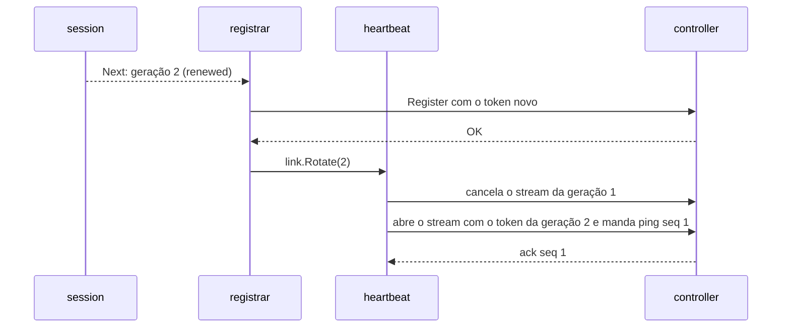
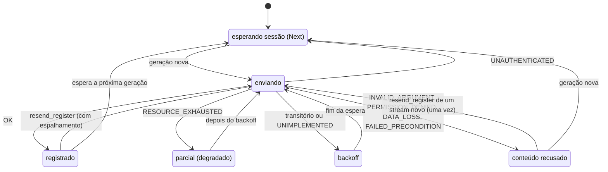

### FDD: Agente do core no sidecar: registro, heartbeat, eventos e saída (CORE-06)

Versão: 1.0
Data: 2026-10-21
Responsável: Guilherme Giusti

---

### 1. Contexto e motivação técnica

**Problema técnico.** A metade de proxy do plugin core (`agent/`, dentro do `libn3x.so`) é quem faz o sidecar aparecer no painel. Ela precisa, sem tocar no caminho da requisição: enviar o `Register` com identidade, alvo, versão do Envoy, manifesto, config efetiva mascarada e hash; manter um stream de `Heartbeat` com ping a cada `controller.heartbeat_interval`; transformar os acontecimentos do core do sidecar (panic, disjuntor, plugin desligado, erro de config, segredo em claro, início da drenagem) em `Event` com ID de idempotência; e avisar a saída com `Exit` dentro da janela de desligamento. As peças já existem em FDDs anteriores, mas faltava o comportamento que as liga: quando cada RPC sai, com que prazo, o que fazer com cada código de erro, como o heartbeat sobrevive à renovação do token, como os eventos sobrevivem à queda do controller e qual é a ordem das mensagens que o controller (FDD 43) vai receber.

**Encaixe no HLD.** O HLD do `n3x-plugin-core` põe o trabalho em quatro componentes, `agent/registrar`, `agent/heartbeat`, `agent/events` e `agent/exit`. Esta FDD especifica os quatro, mais a composição em `agent.New`, um pacote interno de coordenação (`agent/internal/link`) e o formato do ID de evento (`internal/eventid`, compartilhado com a metade de controller). Ela consome, sem redefinir:

- a visão `proxy.CoreEnv.Sidecar()` da FDD 09 (L-01): `Identity()`, `ControllerSettings()`, `Manifest()`, `NextEvent(ctx)`, `Draining()`, `ExitContext()` e `Session()`
- a identidade da instância da FDD 25 (`SidecarIdentity{Service, Instance, Address, EnvoyVersion}`, contrato 9 dela): o core nunca detecta nada
- a config efetiva da FDD 37 (`effective.Compute` devolve `effconfig.Result`, calculado uma vez em `agent.New`)
- a sessão da FDD 39 (`session.Manager`, `Next(ctx, after)`, interceptors que anexam o token)
- a conexão compartilhada da FDD 38 (`env.Controller()`, `proxy.Buffered()`, teto de 5 s nas unárias, stream sem teto, 2 streams por plugin, `ExitContext` com a conexão viva)
- os eventos da contenção de falhas da FDD 18 (`panic` com `Suppressed`, `breaker_open`, `plugin_disabled`) e da subida da FDD 17 (`config_error`, `secret_in_clear`)
- a drenagem da FDD 29 (`Draining()` e `drain_start` no mesmo instante; pelo menos `min(3 s, T)` antes do cancelamento; `stop` antes do SIGTERM ao Envoy)
- o proto `Core` da FDD 36 (mensagens, limites e `corev1.MaxRegisterBytes`)

```text
 executor (FDD 17) ─ CoreEnv ─▶ agent.New ─▶ effective.Compute (FDD 37), session.Manager (FDD 39)
                                     │
                                     ├─ registrar ──── Register (direto) ─────────────┐
                                     ├─ heartbeat + heartbeat_recv ── stream Heartbeat ┼─▶ conexão (FDD 38) ─▶ host (FDD 33) ─▶ registry (FDD 43)
                                     ├─ events ◀─ NextEvent ── Event (Buffered) ───────┤
                                     └─ exit ◀─ ctx cancelado ── Exit (direto) ────────┘
```

**Atores.** Executor e contenção de falhas do `.so` (produzem os eventos e criam a instância `core`), entrypoint e canal de controle (drenagem, FDD 29), conexão compartilhada (FDD 38), gerenciador de sessão (FDD 39), servidor gRPC do controller (FDD 33) e registry do core no controller (FDD 43, que depende desta e recebe o contrato de mensagens do contrato 8).

**Limites.** Esta FDD não define a interface do core do sidecar (FDD 09), o login, o token e a renovação (FDD 39), o formato da config efetiva (FDD 37), o buffer, o backoff da conexão e o keepalive (FDD 38), o disparo do disjuntor (FDD 18) e da drenagem (FDD 29), nem o processamento no controller (FDD 43). Daqui saem os pedidos à FDD 43 sobre como interpretar o que o agente envia.

**Suposições**
- O SDK compilado no `.so` tem `proxy.CoreEnv`, `proxy.Sidecar` com `SetConfigHash`, `proxy.EventQueue`, `proxy.ExitTimeout`, `proxy.Buffered` e `proxy.Sleep` (FDDs 06, 09, 37 e 38)
- O core é compilado com a mesma versão do SDK que o runtime (FDD 20, L-57), então todo `proxy.EventKind` que chega é conhecido
- O controller responde um `HeartbeatAck` por ping, na ordem, em menos de 50 ms (HLD do core); o servidor corta o stream que fica mais de 1 s processando uma mensagem (FDD 33)

**Restrições**
- Nenhum hook de requisição; tudo em `env.Background()` registrado durante o `New` (ADR-008 do core, FDD 06)
- As regras da análise estática valem para o core sem exceção (FDD 24): sem instrução `go`, sem `context.Background`, sem `ctx` guardado em campo, esperas por `proxy.Sleep`, canal sempre em `select` com `ctx.Done()`
- No máximo 2 streams por plugin na conexão compartilhada (FDD 38); o core usa 1
- Nenhum token, segredo ou trecho de config sem máscara em log, métrica ou evento

**Rastreabilidade**
- PRD 1.5: FR-016 (registro, heartbeat com `controller.heartbeat_interval`, eventos com ID de idempotência, saída em até 2 s, nada no caminho do tráfego, erros `INVALID_ARGUMENT`, `PERMISSION_DENIED`, `DATA_LOSS`, `RESOURCE_EXHAUSTED`, `FAILED_PRECONDITION`), FR-002 (buffer com descarte dos mais antigos, registro reenviado após novo login), FR-006 (detalhe com eventos), critério "sidecar de volta em até 30 s"
- ADRs do `n3x-plugin-core`: ADR-005, ADR-006, ADR-007, ADR-008 e ADR-010; ADRs do `n3x-sdk`: ADR-016, ADR-019 e ADR-022; ADRs do `n3x-sidecar`: ADR-004 e ADR-006
- Lacunas do README: nenhuma é fechada só aqui. Aplicadas: L-01 (interface da FDD 09), L-08 (heartbeat sem teto, FDD 38), L-12 (`n3x_controller_*` pela FDD 38 e pelo `SessionReporter`), L-18 (drenagem no Istio fica para a FDD 49), L-44 (partição do buffer), L-51 (6 tarefas no limite de 8). Proposta para a L-65 (deduplicação por último `seq`, pedido à FDD 43)
- FDDs consumidas: 06, 09, 12, 17, 18, 22, 25, 29, 33, 36, 37, 38, 39 e 41
- Decisões aprovadas pelo responsável do produto em 2026-10-22 (resolvem as hipóteses correspondentes):
  - **D-01 (registro recusado):** recusa de conteúdo no `Register` (`INVALID_ARGUMENT`, `PERMISSION_DENIED`, `DATA_LOSS`, `FAILED_PRECONDITION`) não tem nova tentativa na mesma sessão; vale o log `register_rejected` e a métrica. A nova tentativa acontece só na próxima sessão ou num `resend_register`
  - **D-02 (H-11, modo sem registro):** se a config efetiva não puder ser montada ou o `Register` passar de 1 MiB, o agente entra em modo "sem registro" (sem `Register`, heartbeat nem eventos; só log e métricas) e o tráfego segue. O sidecar fica invisível no painel nesse caso, o que é aceito
  - **D-03 (tempos):** aprovados: nenhum heartbeat antes do primeiro `Register` aceito, `AckTimeout = min(heartbeat_interval, 5 s)`, `ResendSpread` de 5 s, `ResendMinGap` de 30 s, backoff de 1 s a 60 s (multiplicador 1,6, jitter de 20%), `Exit` com `ExitContext` de 1,5 s e troca do stream do heartbeat a cada nova sessão
- Pedidos do registro atendidos: FDD 06 (tarefas do core), FDD 09 (`id` a partir de `Seq`), FDDs 09, 37 e 42 (`config_hash` pela `Compute`), FDD 12 (vetor do panic de ponta a ponta), FDD 18 (mapear `panic`, `breaker_open` e `plugin_disabled`), FDD 22 (teste de constantes e conferência antes do envio), FDD 25 (contrato 9 da identidade), FDD 29 (drenagem e `Exit`), FDD 36 (conversão do evento, `FAILED_PRECONDITION`, `register_too_large`), FDD 37 (usar o `Result` e definir o caso sem config efetiva), FDD 38 (eventos com `Buffered`, `Register` e `Exit` diretos, `ctx` por stream), FDD 39 (`Next` em laço, troca do stream na renovação, `Exit` com o token atual), FDD 41 (nova tentativa depois de `RESOURCE_EXHAUSTED`)

---

### 2. Objetivos técnicos

- **Custo zero no caminho da requisição.** Invariante: a instância `core` não declara hook (`proxy.HooksOf` vazio, `CheckPrivileged` passa com `background_only_hooks`); o p99 do sidecar com o core ativo e o controller fora do ar fica dentro de 10% do standalone (critério da FDD 38).
- **Registro rápido e completo.** Medida: com o controller no ar, o primeiro `Register` sai em até 100 ms depois do primeiro login (relógio falso); cada sessão nova (primeira, renovação ou novo login) gera exatamente um `Register` bem-sucedido; o `resend_register` gera o `Register` em até `ResendSpread` (5 s com o padrão).
- **Volta ao painel depois de queda do controller.** Medida: depois de a conexão voltar a `READY`, o heartbeat reabre em até 1 s e o `Register` pedido pelo ack chega em até 6 s; o agente soma no máximo isso ao tempo de reconexão da FDD 38.
- **Heartbeat contínuo, inclusive na renovação.** Invariante: no máximo um stream de heartbeat aberto por processo; na troca de sessão, o stream antigo fecha antes de o novo abrir e o novo manda o primeiro ping na hora; nenhum ping sai com token vencido. Medida: com TTL de 5 min por 1 h (relógio falso), 0 intervalos sem ping no controller falso.
- **Eventos sem perda evitável e sem duplicação no controller.** Medida: com o controller fora do ar por 2 min e 1.200 eventos, os mais novos que cabem na fila e no buffer chegam em ordem crescente de `seq`, cada `id` contado uma vez pelo controller falso que deduplica; as perdas aparecem em `n3x_sidecar_events_dropped_total` e `n3x_controller_buffer_dropped_total`.
- **Saída avisada.** Medida: `Exit` enviado e respondido em até 1,5 s depois do cancelamento das tarefas em 100% das paradas com o controller no ar; `reason` `drain` quando a drenagem começou, `sigterm` quando não.
- **Sem vazamento.** Medida: depois do `Stop`, 0 goroutines das tarefas do core em até 2 s; teste de 10 min (relógio falso) com 200 quedas e voltas do controller e 20 renovações termina com o número de goroutines igual ao do início, com tolerância de 2.

---

### 3. Escopo e exclusões

**Incluído**
- `agent.New`: composição das tarefas, modos de operação (inativo, sem registro, ativo) e decisão sem config efetiva
- `agent/registrar`: montagem do `RegisterRequest` uma vez por processo, conferência de tamanho (`register_too_large`), gatilhos (sessão nova por `Next`, `resend_register`, nova tentativa), classificação de cada código de erro, backoff e espalhamento
- `agent/heartbeat`: abertura do stream com `WaitForReady`, ping com `seq` e `sent_at`, espera do ack, `resend_register`, troca do stream na renovação, reabertura com backoff, `ctx` próprio por stream cancelado quando o ack não chega
- `agent/events`: consumo de `NextEvent`, conversão para `EventRequest`, ID de idempotência, envio com `proxy.Buffered()`, espera do primeiro registro
- `agent/exit`: `Exit` direto com `ExitContext()` no cancelamento, `reason` `drain` ou `sigterm`
- `agent/internal/link` (coordenação entre as tarefas) e `internal/eventid` (formato do ID de evento, usado também pela FDD 43)
- Contrato de mensagens para a FDD 43: ordem, `seq`, deduplicação, sessões, troca do stream e conflito de instância
- Métricas `n3x_n3x_core_agent_*` do sidecar e os logs do agente
- Kit de teste do agente (`agent/agenttest.FakeCore`) e os critérios de aceite com `ctrltest.Link`

**Excluído**
- Interface `proxy.Sidecar`, `EventQueue` e `ExitContext`: FDD 09 (SDK-09); aqui só consumidas
- Login, token, renovação, interceptors e `SessionReporter`: FDD 39 (CORE-03)
- Montagem, mascaramento e hash da config efetiva, `SetConfigHash`: FDD 37 (CORE-02)
- Buffer, partição, backoff da conexão, keepalive e `ExitContext` do lado da conexão: FDD 38 (SID-10)
- Validação do `Register`, inventário, sessões, conflito, deduplicação e retenções no controller: FDD 43 (CORE-07)
- Disparo do disjuntor e da drenagem: FDDs 18 (SID-04) e 29 (SID-09); fonte da drenagem no Istio: FDD 49 (SID-11)
- Métricas `n3x_controller_*` do sidecar (`connected`, `buffer_*`, `session_age_seconds`, `logins_total`): FDDs 38 e 39, publicadas pela FDD 16
- Consolidação das métricas e alertas do core: FDD 45 (CORE-09)

---

### 4. Fluxos detalhados e diagramas

**Fluxo principal: subida (`agent.New`, dentro do `Instantiate` de 5 s da FDD 17)**
1. `env.(proxy.CoreEnv)`; sem a visão, erro e o Envoy não sobe (FDD 36, contrato 8).
2. `res, effErr := effective.Compute(cenv)` (FDD 37): roda sempre, também no standalone, e já entrega o hash a `n3x_build_info` por `SetConfigHash`. O agente guarda `res` e nunca recalcula.
3. `conn, err := env.Controller()`. Com `proxy.ErrStandalone`, ou com `ControllerSettings()` falso (defensivo), o agente fica **inativo**: nenhuma tarefa, nenhuma métrica `agent_*`, log `agent_inactive` com `reason=standalone`, e `New` devolve a instância.
4. Cria o `session.Manager` (FDD 39) e registra a tarefa `session`. Ela é registrada antes de qualquer decisão de registro, porque os outros plugins dependem do token.
5. Sem config efetiva (`effErr != nil`): modo **sem registro** (hipótese H-11), log `agent_unregistered` com `reason=effective_config`; nenhuma outra tarefa. A fila de eventos não é consumida e descarta o mais antigo, contado em `n3x_sidecar_events_dropped_total` (FDD 09).
6. Monta o `RegisterRequest` uma vez (contrato 2): `proto_version = corev1.Version()`, identidade de `Sidecar().Identity()`, `target = env.Target().Name()`, `envoy_version`, `manifest = Sidecar().Manifest()`, `config = res.Document`, `config_hash = res.Hash`, `heartbeat_interval = ControllerSettings().HeartbeatInterval`. Confere os limites da FDD 36 e o tamanho serializado contra `corev1.MaxRegisterBytes`. Acima do teto: log `register_too_large` (error, com os tamanhos), modo **sem registro** com `reason=register_too_large`.
7. Modo **ativo**: cria as métricas, o `link.State`, o nonce de eventos (8 bytes de `crypto/rand`) e registra as tarefas `registrar`, `heartbeat`, `heartbeat_recv`, `events` e `exit` (6 no total com a `session`, dentro do padrão de 8 da FDD 06). Log `agent_ready` com `mode`, `tasks`, `register_bytes`, `config_hash` e `heartbeat_interval_ms`.
8. As tarefas começam depois da subida inteira (FDD 06).

**Fluxo principal: registro (tarefa `registrar`)**
1. Guarda `last = 0` (num reinício por panic também começa em 0, o que refaz o `Register` da sessão atual).
2. `info, err := session.Next(espera, last)`, em que `espera` é um `ctx` derivado da tarefa que o `Resend` cancela. Com sessão nova, `last = info.Generation` e segue para o envio.
3. Envio: `ctx` de chamada com marca de segundo plano (a da tarefa), `x-request-id` novo (`telemetry.ContextWithRequestID`) e `grpc.WaitForReady(true)`; o teto de 5 s é da visão (FDD 38). O interceptor do core anexa o token da sessão atual (FDD 39).
4. Resultado, pela tabela do contrato 3:
   - `OK`: `link.SetRegistered(gen)`, log `register_sent` (hash, geração, tipo de sessão, versão do proto do controller, bytes, duração, `request_id`), `agent_registered` em 1
   - `RESOURCE_EXHAUSTED`: registro parcial (H-09): `link.SetRegistered(gen)` com `partial`, log `register_failed` `class=exhausted`, nova tentativa com backoff até `OK`
   - transitório (`UNAVAILABLE`, `DEADLINE_EXCEEDED`, `ABORTED`, `INTERNAL`, `UNKNOWN` e outros): backoff de 1 s a 60 s, multiplicador 1,6, jitter de 20%
   - `UNAUTHENTICATED`: a sessão foi recusada; o interceptor já disparou o novo login (FDD 39); o registrador volta a esperar `Next`
   - `UNIMPLEMENTED`: controller com o core mínimo `v0.1.0` (FDD 36); espera fixa de 60 s com jitter de 20%
   - recusa do conteúdo (`INVALID_ARGUMENT`, `PERMISSION_DENIED`, `DATA_LOSS`, `FAILED_PRECONDITION`): log `register_rejected` (error); nenhuma nova tentativa nesta sessão; a próxima sai na próxima sessão ou num `resend_register` de um stream novo
5. Depois da primeira tentativa de cada sessão nova (qualquer resultado), o registrador chama `link.Rotate(gen)`: é o sinal para o heartbeat trocar de stream se já existir um (H-05).
6. Volta ao passo 2. As esperas de backoff usam `proxy.Sleep(espera, d)`; ao acordar, se `session.Current()` tem geração maior que `last`, o próximo envio já é da sessão nova.

**Fluxo principal: heartbeat (tarefas `heartbeat` e `heartbeat_recv`)**
1. A tarefa `heartbeat` (dona do stream) espera `link.WaitRegistered(ctx)`: nada de heartbeat antes do primeiro `Register` aceito (ou parcial) do processo.
2. Abre o stream: `sctx, cancel := context.WithCancel(ctx)`; `corev1.NewCoreClient(conn).Heartbeat(sctx, grpc.WaitForReady(true))`. Sem teto (FDD 38, L-08); a abertura espera a conexão ficar `READY` dentro da vida do `ctx`. Guarda a geração usada (`link.Target()`) e publica o stream para a tarefa `heartbeat_recv` com uma época nova.
3. Primeiro ping na hora: `HeartbeatPing{seq: 1, sent_at: agora UTC}`. Depois, um ping por `heartbeat_interval`, medido a partir do envio anterior, com no máximo um ping sem ack por stream.
4. A `heartbeat_recv` lê os acks do stream publicado. Ack com o `seq` pendente: marca respondido, observa o tempo de ida e volta, zera o backoff de reabertura no primeiro ack do stream. `resend_register = true` em qualquer ack: chama `registrar.Resend(época)` (contrato 3).
5. Ack que não chega: a `heartbeat` dorme `AckTimeout = min(heartbeat_interval, 5 s)` depois de cada envio; sem ack, cancela o `ctx` do stream (`reason=ack_timeout`), o que destrava o `SendMsg` e o `RecvMsg` (pedido da FDD 38), e reabre com backoff.
6. Fim do stream visto pela `heartbeat_recv` (erro de `RecvMsg`, inclusive `io.EOF`): registra o motivo e acorda a `heartbeat`, que reabre: `io.EOF` ou `UNAVAILABLE` "controller parando" com a primeira espera de 0 s; demais códigos com backoff de 1 s a 10 s, multiplicador 1,6, jitter de 20%; `UNAUTHENTICATED` espera uma sessão nova (`link.Target()` maior que a geração do stream) antes de reabrir.
7. Troca de sessão (`link.Rotate(gen)` com `gen` maior que a geração do stream): a `heartbeat` cancela o stream antigo (`reason=rotate`) e abre o novo na hora, com o token novo, antes do `exp` antigo (H-04). Não há dois streams abertos ao mesmo tempo.
8. Cancelamento do `ctx` (desligamento): o stream é cancelado (`reason=shutdown`) e as duas tarefas voltam.

**Fluxo principal: eventos (tarefa `events`)**
1. Espera `link.WaitRegistered(ctx)` (H-03). Até lá os eventos ficam na `proxy.EventQueue` do runtime (1.024 itens, descarta o mais antigo).
2. Laço: `ev, err := sc.NextEvent(ctx)`; erro só com o `ctx` terminado, e a tarefa volta.
3. Converte para `EventRequest` (contrato 5): `id = eventid.Format(nonce, ev.Seq)`, `kind` pelo mesmo número, `plugin`, `plugin_instance`, `detail`, `occurred_at = ev.At`, `suppressed = ev.Suppressed`.
4. `cli.Event(ctx, req, proxy.Buffered())`: a visão serializa e põe na fila do core no buffer, devolvendo `nil` na hora (FDD 38). A entrega é ao menos uma vez, em ordem FIFO, com uma chamada em voo por vez na fila do core.
5. Erro na entrada do buffer (`Unavailable` com a conexão encerrando, `ErrBufferTooLarge`, qualquer outro): o evento é perdido, soma em `agent_events_total{result="failed"}` e log `event_buffer_failed` amostrado. Nunca bloqueia a tarefa.

**Fluxo principal: drenagem e saída (tarefa `exit`, contrato 7 da FDD 29)**
1. SIGTERM ou `POST /drain`: o runtime fecha `Draining()` e põe `drain_start` na fila no mesmo instante. A tarefa `events` envia `DRAIN_START` pelo buffer; o heartbeat continua; o `Exit` não sai aqui.
2. Entre o `drain_start` e o cancelamento passam pelo menos `min(3 s, drain_timeout)` (FDD 29), tempo em que o `DRAIN_START` sai com a conexão normal.
3. O `stop` do canal de controle cancela o `ctx` das tarefas, com o Envoy vivo e a janela de 2 s aberta (FDD 29, H-03 dela).
4. A tarefa `exit` acorda com `ctx.Done()`. Se o processo nunca teve `Register` aceito, loga `exit_skipped` e volta (H-10). Senão: `reason = "drain"` se `Draining()` já fechou, `"sigterm"` se não; `ectx, cancel := sc.ExitContext()` (1,5 s, marca de segundo plano, conexão viva até ele terminar, FDD 38); `cli.Exit(ectx, &corev1.ExitRequest{Reason: reason})` direto, sem `Buffered`, com o token atual (o interceptor da FDD 39 continua com o estado depois do fim da tarefa `session`).
5. Log `exit_sent` (info) com `reason`, `code` e `duration_ms`, ou `exit_failed` (warn). Sem nova tentativa: é melhor esforço.
6. Ao mesmo tempo, o heartbeat cancela o stream; depois que as tarefas voltam, a conexão esvazia o buffer e fecha (FDD 38).

**Fluxos alternativos e exceções**
- **Controller fora do ar na subida:** a `session` tenta o login com backoff (FDD 39); o registrador fica em `Next`; heartbeat e eventos esperam o primeiro registro; os eventos se acumulam na fila do runtime. O tráfego segue. Quando o login funciona, `Next` acorda e o `Register` sai.
- **Queda e volta do controller com a mesma `hmac_key`:** o token continua válido. O stream cai (keepalive ou `GOAWAY`) e reabre assim que a conexão volta, porque a abertura usa `WaitForReady`. O primeiro ack traz `resend_register`; o registrador espera um tempo uniforme em `[0, ResendSpread]` e reenvia o `Register`. Os eventos do buffer seguem na ordem; os que chegam antes do novo `Register` recebem do controller o tratamento pedido no contrato 8.
- **Volta do controller sem `hmac_key`:** a primeira chamada recebe `UNAUTHENTICATED`; a FDD 39 refaz o login; `Next` acorda com `relogin`; `Register` e troca do stream.
- **Renovação da sessão (`renewed`):** `Register` com o token novo, depois `link.Rotate`; o heartbeat troca de stream na hora. Com a renovação em 80% do TTL, sobra pelo menos 12% do TTL (36 s com o TTL mínimo de 5 min) antes do `exp` antigo.
- **Renovação falhando até a expiração local:** a FDD 39 fica sem token; o servidor encerra o stream no `ExpiresAt` (pedido da FDD 39 à 43); a reabertura recebe `UNAVAILABLE` "sessão não estabelecida" e entra em backoff até haver sessão nova.
- **Store do controller degradado:** `RESOURCE_EXHAUSTED` no `Register` (FDD 41); o heartbeat começa ou continua; o registrador repete com backoff até 60 s; quando o Store sai do degradado, o `Register` passa.
- **Proto de outra major ou campo recusado:** `FAILED_PRECONDITION` é logado com `proto_major`, `proto_minor` (os do sidecar) e `accepted_major` lido do texto da mensagem (`-1` se não der para ler); `INVALID_ARGUMENT`, `PERMISSION_DENIED` e `DATA_LOSS` logam o código e o texto do status (que não traz token nem config, FDDs 33 e 36). Nenhum laço de reenvio.
- **`resend_register` repetido:** com um `Register` em voo ou em backoff, o pedido é coalescido; depois de um `Register` aceito por causa de um pedido, outro pedido do mesmo stream só vale depois de `ResendMinGap` (30 s); em recusa do conteúdo, vale um pedido por stream.
- **Panic numa tarefa do core:** a FDD 18 põe `panic` com `task=<nome>` na fila e a FDD 06 reinicia a tarefa com espera de 1 s a 60 s. O estado fica nas structs: o registrador refaz o `Register` da sessão atual; o heartbeat abre um stream novo (o antigo foi cancelado pelo `defer`); a tarefa `events` perde no máximo o evento que tinha tirado da fila e ainda não tinha posto no buffer.
- **Rajada de panics:** a fila do runtime aceita no máximo 1 `panic` por instância por segundo e soma o resto em `Suppressed` (FDD 09); o agente não coalesce mais nada. A fila do core no buffer tem pelo menos a metade de `max_items` (FDD 38). `Register` e `Exit` nunca passam pelo buffer, então uma rajada não os descarta.
- **Limite de tarefas abaixo de 6** (`runtime.plugin_limits["n3x.core"].background.max_tasks`): `env.Background` dá panic com `ErrTooManyTasks` no `New`, a instância do core falha e o Envoy não sobe com a mensagem que cita o campo (FDD 06); o `validate` deve recusar antes (pedido à FDD 15).
- **Modo Istio:** `Draining()` não fecha até a FDD 49 ligar a fonte; o `Exit` sai com `sigterm` (L-18).
- **Validação do bootstrap (`N3X_ENVOY_VALIDATE=1`):** o `.so` não chama `New` (FDD 26); nada roda.
- **Standalone:** agente inativo; `NextEvent` daria `ErrStandalone`, mas nenhuma tarefa existe.
- **Envoy cria a config do filtro mais de uma vez:** a instância `core` continua única (FDDs 16, 17 e 38); um único agente por processo.

**Diagramas**

Subida, registro e heartbeat:

```mermaid
sequenceDiagram
    participant X as executor (FDD 17)
    participant A as agent.New
    participant S as session (FDD 39)
    participant R as registrar
    participant H as heartbeat
    participant E as events
    participant K as controller (FDD 43)
    X->>A: Instantiate("{}", CoreEnv)
    A->>A: effective.Compute (FDD 37), Build do Register, tamanho
    A->>X: Background: session, registrar, heartbeat, heartbeat_recv, events, exit
    S->>K: Login (FDD 39)
    K-->>S: token; geração 1
    R->>S: Next(ctx, 0)
    S-->>R: geração 1 (first)
    R->>K: Register (direto, WaitForReady, teto 5 s)
    K-->>R: OK com proto_version
    R->>H: link.SetRegistered(1)
    H->>K: abre Heartbeat (WaitForReady), ping seq 1
    K-->>H: ack seq 1
    E->>E: NextEvent liberado
    loop a cada heartbeat_interval
        H->>K: ping seq n
        K-->>H: ack seq n
    end
```

Renovação e troca do stream (sem dois streams abertos):



Queda e volta do controller com a mesma chave:

```mermaid
sequenceDiagram
    participant H as heartbeat
    participant R as registrar
    participant B as buffer (FDD 38)
    participant K as controller novo
    Note over H,K: conexão cai; o stream termina com UNAVAILABLE
    H->>H: reabre com WaitForReady (espera READY)
    B->>K: eventos guardados, em ordem (podem chegar antes do Register)
    H->>K: ping seq 1 no stream novo
    K-->>H: ack com resend_register
    H->>R: Resend(época)
    R->>R: espera uniforme em [0, ResendSpread]
    R->>K: Register
    K-->>R: OK
```

Estados da tarefa `registrar` numa sessão:



Saída:

```mermaid
sequenceDiagram
    participant D as core/drain (FDD 29)
    participant E as events
    participant X as exit
    participant K as controller
    D->>D: Draining() fecha; drain_start na fila
    E->>K: Event DRAIN_START (Buffered); heartbeat segue
    Note over D: pelo menos min(3 s, T)
    D->>X: stop: ctx das tarefas cancelado (Envoy vivo)
    X->>X: reason = drain; ExitContext() com 1,5 s
    X->>K: Exit(reason=drain), direto, token atual
    K-->>X: OK
```

---

### 5. Contratos públicos (assinaturas, endpoints, headers, exemplos)

**Contrato 1: `agent.New`, tarefas e modos**
- Tipo: sdk (API Go da metade de proxy do core; instância criada só pelo executor)
- Assinatura/Rota:
  ```go
  package agent // github.com/giustech/n3x-plugin-core/agent

  func Plugin() proxy.Plugin { return proxy.Define[types.ProxyConfig](New) }

  // New monta o agente. Nunca falha por causa do controller ou da config efetiva;
  // falha só sem proxy.CoreEnv ou por panic de Background (limite de tarefas).
  func New(_ types.ProxyConfig, env proxy.Env) (proxy.Instance, error)

  type Mode uint8

  const (
      ModeInactive     Mode = iota + 1 // "inactive": standalone, nenhuma tarefa
      ModeUnregistered                 // "unregistered": só a tarefa session (sem config efetiva ou Register grande demais)
      ModeActive                       // "active": as 6 tarefas
  )

  func (m Mode) String() string
  func (c *Core) Mode() Mode // para testes e logs

  const (
      TaskSession       = "session"        // FDD 39
      TaskRegistrar     = "registrar"
      TaskHeartbeat     = "heartbeat"      // dono do stream: abre, pinga, confere o ack, troca, reabre
      TaskHeartbeatRecv = "heartbeat_recv" // lê os acks do stream atual
      TaskEvents        = "events"
      TaskExit          = "exit"
      NumTasks          = 6 // cabe no padrão de 8 da FDD 06 (proxy.DefaultMaxTasks)
  )
  ```
- Método: n/a (chamada local pelo `Instantiate` da FDD 17)
- Semântica de status/headers:
  - **Modos:** o modo é decidido no `New` e não muda no processo. `ModeInactive` sem controller; `ModeUnregistered` quando `effective.Compute` falha ou o `Register` passa de `corev1.MaxRegisterBytes`; `ModeActive` nos demais casos
  - **Sem config efetiva (pedido da FDD 37, H-11):** sem `Register` não há instância no controller, então heartbeat, eventos e `Exit` também não saem; a `session` continua, porque os outros plugins usam o token. O alerta é o da FDD 16 (`config_hash=""` por 5 min) mais o log `agent_unregistered`
  - **Por que 6 tarefas (H-01):** o `RecvMsg` do stream não recebe `ctx` e a análise estática proíbe a instrução `go`; com uma tarefa só, o agente não conseguiria esperar o ack com prazo controlado por `proxy.Sleep` (relógio falso no kit). A `heartbeat` envia e vigia; a `heartbeat_recv` só lê. A FDD 09 e a FDD 06 contavam 5 (pedido de ajuste)
  - **Ordem de registro das tarefas:** `session` primeiro; as demais só em `ModeActive`. Os nomes casam com `^[a-z][a-z0-9_]{0,31}$` (FDD 06)
  - **Sem hook:** `Core` não implementa nenhum método de hook; só `ConnInterceptors` (FDD 39)
  - **Métricas:** criadas no `New` (FDD 06), só em `ModeActive` e `ModeUnregistered`; no `ModeInactive` nenhuma série `agent_*` existe

**Exemplo de requisição**
```go
inst, err := agent.Plugin().Instantiate([]byte("{}"), coreEnv) // feito pelo executor (FDD 17)
core := inst.(*agent.Core)
```

**Exemplo de resposta** (logs do `New` em três sidecars)
```text
{"ts":"2026-10-21T14:00:00.130Z","level":"info","component":"plugin","service":"pedidos","msg":"agent_ready","plugin_id":"n3x.core","instance":"core","mode":"active","tasks":6,"register_bytes":21874,"config_hash":"sha256:573ea08dfcea466c12a4eaf03609ef12bc2b3fea4d4d5502b7b8cd7f7077ff3b","heartbeat_interval_ms":10000}
{"ts":"2026-10-21T14:00:00.131Z","level":"info","component":"plugin","service":"local","msg":"agent_inactive","plugin_id":"n3x.core","instance":"core","reason":"standalone"}
{"ts":"2026-10-21T14:00:00.140Z","level":"error","component":"plugin","service":"grande","msg":"agent_unregistered","plugin_id":"n3x.core","instance":"core","reason":"register_too_large","tasks":1}
```

---

**Contrato 2: `agent/registrar.Build` (montagem e teto do `Register`)**
- Tipo: sdk (função pura do pacote `agent/registrar`)
- Assinatura/Rota:
  ```go
  package registrar // github.com/giustech/n3x-plugin-core/agent/registrar

  type Input struct {
      Identity          proxy.SidecarIdentity // Sidecar().Identity() (FDD 25, contrato 9)
      Target            string                // env.Target().Name()
      Manifest          []byte                // Sidecar().Manifest(), bytes exatos (FDD 09)
      Effective         effconfig.Result      // de effective.Compute, sem recalcular (FDD 37)
      HeartbeatInterval time.Duration         // ControllerSettings().HeartbeatInterval
  }

  // Build monta a mensagem usada em todo Register do processo e devolve o tamanho serializado.
  func Build(in Input) (*corev1.RegisterRequest, int, error)

  type SizeError struct {
      Bytes, Limit, ManifestBytes, ConfigBytes int
  }

  func (e *SizeError) Error() string

  var (
      ErrInvalidInput = errors.New("registrar: entrada do Register fora dos limites do proto")
      ErrTooLarge     = errors.New("registrar: Register acima de corev1.MaxRegisterBytes") // embrulhado com *SizeError
  )

  // Teto conferido por teste de constantes (pedido da FDD 22):
  //   effconfig.MaxSize + artifact.MaxManifestSize + 32<<10 <= corev1.MaxRegisterBytes
  const ReserveBytes = 32 << 10
  ```
- Método: n/a (uma chamada por processo, no `New`)
- Semântica de status/headers:
  - **Campos:** `proto_version = corev1.Version()`; `identity = {Service, Instance, Address}`; `target`; `envoy_version` (`unknown` é válido, FDD 25); `manifest`; `config = Effective.Document`; `config_hash = Effective.Hash`; `heartbeat_interval` como `durationpb`
  - **Limites (FDD 36):** serviço de 1 a 63 bytes, instância de 1 a 253, endereço de 1 a 260, alvo de 1 a 32, versão do Envoy de 1 a 64, hash com 71 bytes, intervalo de 1 s a 5 min. A FDD 25 garante a identidade; a conferência aqui é defensiva e falha com `ErrInvalidInput` (log `register_invalid_input` com o campo, sem o valor), que leva ao `ModeUnregistered` com `reason=invalid_input`
  - **Teto:** `proto.Size(msg) > corev1.MaxRegisterBytes` devolve `ErrTooLarge` com `SizeError`; o `New` loga `register_too_large` e não envia nada (pedidos das FDDs 22 e 36). Com um manifesto de builder conforme (até 480 KiB) e a config efetiva no teto (512 KiB), a mensagem cabe: o teste monta os dois no máximo com a identidade no tamanho máximo e confere `proto.Size` abaixo de 1 MiB. Só um `.so` com manifesto acima de 480 KiB (o leitor aceita até 1 MiB, FDD 22) chega ao `register_too_large`
  - **Imutável:** a mensagem é só lida depois do `New`; todo `Register` do processo envia os mesmos bytes (mesmo `config_hash`), o que torna o `Register` idempotente para o controller
  - **Custo:** uma cópia do manifesto e do documento, até cerca de 1 MiB fora das cotas de memória do plugin (é a mensagem, não um `memory.Map`)

**Exemplo de requisição**
```go
msg, size, err := registrar.Build(registrar.Input{
    Identity:          sc.Identity(),
    Target:            env.Target().Name(),
    Manifest:          sc.Manifest(),
    Effective:         res,
    HeartbeatInterval: cs.HeartbeatInterval,
})
```

**Exemplo de resposta** (protojson de `msg`, bytes encurtados; e o erro de um `.so` com manifesto de 600 KiB)
```json
{
  "size": 21874,
  "msg": {
    "protoVersion": { "major": 1, "minor": 0 },
    "identity": { "service": "pedidos", "instance": "pedidos-7d9f8b-xk2lp", "address": "10.42.3.17:17000" },
    "target": "envoy-1.40",
    "envoyVersion": "1.40.1",
    "manifest": "eyJmb3JtYXQiOjEsInRhcmdldCI6ImVudm95LTEuNDAi...",
    "config": "eyJmb3JtYXQiOjEsInBsdWdpbnMiOlsuLi5dfQ==",
    "configHash": "sha256:573ea08dfcea466c12a4eaf03609ef12bc2b3fea4d4d5502b7b8cd7f7077ff3b",
    "heartbeatInterval": "10s"
  },
  "erro do .so grande": "registrar: Register acima de corev1.MaxRegisterBytes: 1139211 bytes (limite 1048576; manifesto 614400, config 524288)",
  "log": "{\"level\":\"error\",\"component\":\"plugin\",\"msg\":\"register_too_large\",\"plugin_id\":\"n3x.core\",\"instance\":\"core\",\"bytes\":1139211,\"limit\":1048576,\"manifest_bytes\":614400,\"config_bytes\":524288}"
}
```

---

**Contrato 3: tarefa `registrar` (gatilhos, códigos e esperas)**
- Tipo: stream de chamadas unárias `/n3x.plugins.n3x.core.v1.Core/Register` (cliente) e API Go interna
- Assinatura/Rota:
  ```go
  package registrar

  type Sessions interface { // satisfeita por *session.Manager (FDD 39)
      Next(ctx context.Context, after uint64) (session.Info, error)
      Current() (session.Info, bool)
  }

  type Options struct {
      Conn     grpc.ClientConnInterface // env.Controller()
      Sessions Sessions
      Message  *corev1.RegisterRequest  // de Build
      Link     *link.State
      Interval time.Duration            // heartbeat_interval, para o ResendSpread
      Metrics  *telemetry.Metrics
      Log      *slog.Logger
      Rand     func() float64           // nil = math/rand/v2 (jitter)
  }

  func New(o Options) (*Registrar, error)
  func (r *Registrar) Run(ctx context.Context)            // tarefa "registrar"
  func (r *Registrar) Resend(epoch uint64) ResendResult    // chamado pela heartbeat_recv

  type ResendResult uint8

  const (
      ResendHonored   ResendResult = iota + 1 // "honored": vai sair um Register
      ResendCoalesced                         // "coalesced": já há Register em voo, em espera ou em backoff
      ResendLimited                           // "limited": ResendMinGap ou um por stream na recusa
  )

  const (
      RetryBase       = time.Second      // igual à FDD 39
      RetryMax        = 60 * time.Second
      RetryMultiplier = 1.6
      RetryJitter     = 0.2
      ProtocolWait    = 60 * time.Second // UNIMPLEMENTED
      ResendMinGap    = 30 * time.Second // hipótese
      MaxResendSpread = 5 * time.Second  // ResendSpread = min(Interval/2, MaxResendSpread) (hipótese)
  )
  ```
- Método: `Register` unário, direto (nunca `proxy.Buffered`), com `grpc.WaitForReady(true)` dentro do teto de `controller.timeouts.call` (5 s) da visão (FDD 38)
- Semântica de status/headers:

| Código do `Register` | Classe (`result`) | Ação | Log |
| --- | --- | --- | --- |
| `OK` | `ok` | `link.SetRegistered(gen)`; espera a próxima sessão ou um `resend_register` | `register_sent` (info) |
| `RESOURCE_EXHAUSTED` | `exhausted` | registro parcial (H-09): `link.SetRegistered(gen, partial)`; backoff até `OK` | `register_failed` (warn, 1 por minuto) |
| `UNAVAILABLE`, `DEADLINE_EXCEEDED`, `ABORTED`, `INTERNAL`, `UNKNOWN`, `NOT_FOUND`, `ALREADY_EXISTS`, `OUT_OF_RANGE` | `unavailable` ou `error` | backoff de 1 s a 60 s (multiplicador 1,6, jitter de 20%) | `register_failed` (warn, 1 por minuto, com a contagem) |
| `UNAUTHENTICATED` | `unauthenticated` | volta para `Next`; o novo login é da FDD 39 | `register_failed` `class=session` |
| `UNIMPLEMENTED` | `incompatible` | espera `ProtocolWait` com jitter de 20% | `register_rejected` (error, 1 por 10 min) |
| `FAILED_PRECONDITION` | `incompatible` | recusa do conteúdo | `register_rejected` com `proto_major`, `proto_minor`, `accepted_major` |
| `INVALID_ARGUMENT`, `PERMISSION_DENIED`, `DATA_LOSS` | `refused` | recusa do conteúdo | `register_rejected` com `code` e `detail` (texto do status, até 256 bytes) |
| `CANCELED` pelo desligamento | não conta | fim da tarefa | nenhum |

  - **Gatilhos:** (1) sessão nova por `Next` (primeira, renovação e novo login: um `Register` por geração, pedido da FDD 39); (2) `resend_register` vindo do heartbeat, com espera uniforme em `[0, ResendSpread]` (espalha a rajada de 500 sidecars depois de um restart do controller); (3) nova tentativa pela tabela; (4) reinício da tarefa por panic (refaz a geração atual)
  - **Recusa do conteúdo:** a mensagem é a mesma em todo o processo, então repetir não adianta; a próxima tentativa sai na próxima sessão (renovação em cerca de 48 min com o TTL padrão) ou num `resend_register` de um stream aberto depois da recusa (o controller pode ter sido trocado), no máximo um por stream
  - **Coalescência:** no máximo um `Register` em voo; `Resend` durante um envio, uma espera ou um backoff devolve `ResendCoalesced`; depois de um `Register` aceito por causa de um `Resend`, outro `Resend` do mesmo stream antes de `ResendMinGap` devolve `ResendLimited`
  - **Rotação:** depois da primeira tentativa de cada geração nova, qualquer resultado, `link.Rotate(gen)` (H-05). Assim, quando o `Register` passa, o controller vê o `Register` da sessão nova antes do primeiro ping dela; quando falha, a troca do stream não espera mais que o teto da chamada (5 s)
  - **Esperas:** por `proxy.Sleep` sobre um `ctx` derivado que o `Resend` cancela; ao acordar, `Current()` com geração maior vira o próximo envio. Nenhuma instrução `go`, nenhum timer fora do `proxy.Sleep`
  - **`RegisterResponse.proto_version`:** logado como `controller_proto` (`major.minor`); ausente vira `controller_proto="unknown"` com aviso `register_response_invalid` (o `Register` conta como aceito)
  - **`FAILED_PRECONDITION`:** `accepted_major` é lido do texto fixo "este controller aceita a major <M>" (FDD 36) por expressão regular; texto diferente dá `-1`

**Exemplo de requisição** (sequência no relógio falso)
```json
[
  { "t": "14:00:01.000", "evento": "Next: geração 1 (first)" },
  { "t": "14:00:01.002", "Register": "UNAVAILABLE (conexão em TRANSIENT_FAILURE)" },
  { "t": "14:00:02.010", "Register": "RESOURCE_EXHAUSTED (Store degradado)" },
  { "t": "14:00:03.640", "Register": "OK" },
  { "t": "14:12:00.000", "evento": "ack com resend_register (controller reiniciado), época 4" },
  { "t": "14:12:00.000", "evento": "ack com resend_register de novo, época 4" }
]
```

**Exemplo de resposta**
```json
{
  "tentativas": [
    { "t": "14:00:01.002", "result": "unavailable", "proxima_espera": "1s" },
    { "t": "14:00:02.010", "result": "exhausted", "link": "registrado (parcial)", "proxima_espera": "1,6s" },
    { "t": "14:00:03.640", "result": "ok" },
    { "t": "14:12:02.310", "result": "ok", "gatilho": "resend", "espera_espalhada": "2,31s" }
  ],
  "Resend": ["honored", "coalesced"],
  "n3x_n3x_core_agent_registers_total": { "unavailable": 1, "exhausted": 1, "ok": 2 },
  "log": "{\"level\":\"info\",\"component\":\"plugin\",\"msg\":\"register_sent\",\"plugin_id\":\"n3x.core\",\"instance\":\"core\",\"trigger\":\"session\",\"generation\":1,\"session_kind\":\"first\",\"config_hash\":\"sha256:573ea08dfcea466c12a4eaf03609ef12bc2b3fea4d4d5502b7b8cd7f7077ff3b\",\"bytes\":21874,\"controller_proto\":\"1.0\",\"attempt\":3,\"duration_ms\":4,\"request_id\":\"5b0e1c2d-7a3f-4e19-8c6d-2f4a9b1e7c30\"}"
}
```

---

**Contrato 4: tarefas `heartbeat` e `heartbeat_recv` (protocolo do stream)**
- Tipo: stream bidirecional `/n3x.plugins.n3x.core.v1.Core/Heartbeat` (cliente)
- Assinatura/Rota:
  ```go
  package heartbeat // github.com/giustech/n3x-plugin-core/agent/heartbeat

  type Options struct {
      Conn     grpc.ClientConnInterface
      Interval time.Duration                        // controller.heartbeat_interval (1 s a 5 min)
      Link     *link.State
      Resend   func(epoch uint64) registrar.ResendResult
      Metrics  *telemetry.Metrics
      Log      *slog.Logger
      Now      func() time.Time                     // nil = time.Now (sent_at)
      Rand     func() float64
  }

  func New(o Options) (*Heartbeat, error)
  func (h *Heartbeat) RunSender(ctx context.Context)   // tarefa "heartbeat"
  func (h *Heartbeat) RunReceiver(ctx context.Context) // tarefa "heartbeat_recv"

  const (
      MaxAckTimeout   = 5 * time.Second  // AckTimeout = min(Interval, MaxAckTimeout) (hipótese)
      ReopenBase      = time.Second
      ReopenMax       = 10 * time.Second // reabertura mais curta que o login: a abertura já espera o READY (hipótese)
      ReopenMultiplier = 1.6
      ReopenJitter    = 0.2
  )
  ```
- Método: `Heartbeat` com `grpc.WaitForReady(true)`, sem teto (FDD 38, L-08), vida igual à de um `ctx` próprio por stream
- Semântica de status/headers:
  - **Quando abre:** só depois de `link.WaitRegistered` (primeiro `Register` aceito ou parcial do processo). Antes disso o controller não conhece a instância e cada ack pediria `resend_register`
  - **Um stream por processo:** o core usa 1 dos 2 streams por plugin (FDD 38) e 1 dos 16 por conexão do host (FDD 33). Nenhuma outra parte do core abre stream
  - **Ping:** `seq` começa em 1 em cada stream e cresce de 1 em 1; `sent_at` é a hora de parede do sidecar em UTC. Primeiro ping na abertura; depois um por `Interval`, medido do envio anterior. No máximo um ping sem ack: o próximo só sai depois do ack do anterior
  - **Ack:** esperado com o mesmo `seq`, na ordem. Ack com `seq` diferente do pendente é ignorado com log `heartbeat_ack_unexpected` (warn, 1 por minuto); `resend_register = true` em qualquer ack chama `Resend(época do stream)`
  - **`AckTimeout`:** `min(Interval, 5 s)` depois de cada envio; sem ack, a `heartbeat` cancela o `ctx` do stream (`reason=ack_timeout`, pedido da FDD 38). O servidor tem 1 s por mensagem (FDD 33) e alvo de 50 ms (HLD)
  - **Troca na renovação (H-04, pedido da FDD 39):** quebra antes de abrir: cancela o stream antigo e abre o novo na hora, com o token da geração alvo. Motivos: não existem duas sessões com ping no mesmo intervalo (a regra de conflito do HLD e do ADR-005 não dispara por renovação), o core continua com 1 stream e o servidor recebe o fim do stream antigo antes da abertura do novo quando os dois estão na mesma conexão HTTP/2 (ordem dos quadros). A lacuna sem stream é de milissegundos, muito abaixo dos 3 intervalos que desconectam
  - **Reabertura:**

| Fim do stream | `reason` | Espera antes de reabrir |
| --- | --- | --- |
| `io.EOF` (servidor encerrou) | `server_closed` | 0 s na primeira, depois backoff |
| `UNAVAILABLE` (inclusive "controller parando" e conexão perdida) | `unavailable` | 0 s na primeira, depois backoff; a abertura espera o `READY` |
| `UNAUTHENTICATED` | `rejected` | espera geração nova em `link.Target()` |
| `RESOURCE_EXHAUSTED` (17º stream no servidor) | `exhausted` | backoff |
| `PERMISSION_DENIED`, `INVALID_ARGUMENT`, `FAILED_PRECONDITION`, `UNIMPLEMENTED` | `refused` | `ReopenMax` fixo (10 s), log `heartbeat_rejected` (error, 1 por 10 min) |
| sem ack no prazo | `ack_timeout` | backoff |
| troca de sessão | `rotate` | 0 s |
| `ctx` cancelado | `shutdown` | não reabre |

  - **Backoff:** `min(10 s, 1 s x 1,6^(n-1)) x (1 + v)`, `v` uniforme em [-0,2; +0,2]; o primeiro ack de um stream zera `n`
  - **Tarefa `heartbeat_recv`:** espera um stream com época maior que a última lida (canal da `link` em `select` com `ctx.Done()`), lê com `RecvMsg` até erro, registra o motivo e acorda a `heartbeat` cancelando o `ctx` de espera dela. Nunca abre nem fecha stream
  - **Sem teto e sem `Buffered`:** `Heartbeat(ctx, proxy.Buffered())` daria `ErrBufferedStream` (FDD 38); o agente nunca passa a opção
  - **Logs:** abertura depois de queda e fim com motivo em `info` e `warn`; cada ping e ack só em `debug` (HLD do core)

**Exemplo de requisição** (protojson das mensagens de um stream)
```json
[
  { "enviado": { "seq": 1, "sentAt": "2026-10-21T14:00:03.645Z" } },
  { "enviado": { "seq": 2, "sentAt": "2026-10-21T14:00:13.645Z" } },
  { "enviado": { "seq": 3, "sentAt": "2026-10-21T14:00:23.645Z" } }
]
```

**Exemplo de resposta**
```json
{
  "acks": [
    { "seq": 1, "resendRegister": false },
    { "seq": 2, "resendRegister": false },
    { "seq": 3, "resendRegister": true }
  ],
  "efeito do ack 3": "Resend(época 1) = honored; Register em até 5 s",
  "n3x_n3x_core_agent_heartbeat_rtt_seconds_count": 3,
  "log (debug)": "{\"level\":\"debug\",\"component\":\"plugin\",\"msg\":\"heartbeat_ack\",\"plugin_id\":\"n3x.core\",\"instance\":\"core\",\"epoch\":1,\"seq\":3,\"rtt_ms\":2,\"resend_register\":true}",
  "log (queda)": "{\"level\":\"warn\",\"component\":\"plugin\",\"msg\":\"heartbeat_stream_closed\",\"plugin_id\":\"n3x.core\",\"instance\":\"core\",\"epoch\":1,\"reason\":\"unavailable\",\"code\":\"Unavailable\",\"pings\":42,\"lived_ms\":420310,\"next_ms\":0}"
}
```

---

**Contrato 5: tarefa `events` e o ID de idempotência**
- Tipo: queue (consumo de `proxy.EventQueue` por `Sidecar().NextEvent`) e chamada unária `/n3x.plugins.n3x.core.v1.Core/Event` pelo buffer
- Assinatura/Rota:
  ```go
  package eventid // github.com/giustech/n3x-plugin-core/internal/eventid (agent e controller)

  const Len = 33 // 16 hex, ":", 16 hex

  // Format devolve "<nonce em 16 hex>:<seq em 16 hex>", minúsculo e de largura fixa.
  func Format(nonce [8]byte, seq uint64) string
  // Parse aceita só a forma de Format; seq 0 é inválido.
  func Parse(id string) (nonce [8]byte, seq uint64, err error)

  var ErrFormat = errors.New("eventid: id fora do formato")
  ```
  ```go
  package events // github.com/giustech/n3x-plugin-core/agent/events

  type Options struct {
      Conn    grpc.ClientConnInterface
      Sidecar proxy.Sidecar // NextEvent
      Link    *link.State
      Nonce   [8]byte       // crypto/rand no New; um por processo
      Metrics *telemetry.Metrics
      Log     *slog.Logger
  }

  func New(o Options) (*Events, error)
  func (e *Events) Run(ctx context.Context) // tarefa "events"

  // ToProto converte um proxy.Event (FDD 09) no EventRequest (FDD 36). Pura.
  func ToProto(ev proxy.Event, nonce [8]byte) *corev1.EventRequest
  ```
- Método: `Event` unário com `proxy.Buffered()` (pedido das FDDs 29 e 38)
- Semântica de status/headers:
  - **ID (pedido da FDD 09, H-02):** `nonce:seq` com o nonce aleatório de 8 bytes do processo e o `Seq` da fila do runtime. Único entre restarts (processo novo, nonce novo; colisão com probabilidade de 2^-64 por par de processos) e entre réplicas; casa com a regra da FDD 36 (`[A-Za-z0-9._:-]`, até 64 bytes). A largura fixa deixa a ordem de texto igual à ordem de `seq` dentro do mesmo nonce. Não usa UUID nem ULID porque o `Seq` já é a ordem e o nonce já é a origem
  - **Conversão (pedidos das FDDs 18 e 36):**

| `proxy.Event` | `EventRequest` | Regra |
| --- | --- | --- |
| `Seq` | `id` | `eventid.Format(nonce, Seq)` |
| `Kind` | `kind` | mesmo número (`EventPanic` 1 vira `EVENT_KIND_PANIC` 1, até `EventSecretInClear` 6); valor fora de 1 a 6 sai com o número, e o controller trata como `unknown` |
| `Plugin` | `plugin` | `Plugin.String()`; vazio em `drain_start` e em eventos do processo (`controller.secret` em claro) |
| `Instance` | `plugin_instance` | como veio; vazio quando não se aplica |
| `Detail` | `detail` | como veio (já saneado e cortado em 256 bytes pela fila; `corev1.MaxEventDetailLen == proxy.MaxEventDetail` conferido por teste) |
| `At` | `occurred_at` | `timestamppb.New(At)`, UTC |
| `Suppressed` | `suppressed` | panics da mesma instância suprimidos desde o último aceito (só em `panic`) |

| Acontecimento | `Kind` | Produtor | `Detail` |
| --- | --- | --- | --- |
| panic de hook, do `Go()` ou de tarefa | `panic` | FDD 18 | `hook=<nome>` ou `task=<nome>`, com `suppressed` |
| disjuntor aberto por panics ou por zumbis | `breaker_open` | FDD 18 | `reason=panics` ou `reason=zombies` |
| última instância com fase do plugin aberta | `plugin_disabled` | FDD 18 | `reason=breaker instances=<n>` |
| aviso não fatal da config na subida | `config_error` | FDD 17 | `<caminho> [<código>]` |
| segredo sem `ENC[...]` | `secret_in_clear` | FDD 17 | `plugins[1].config.tokens[0]` ou `controller.secret` |
| início da drenagem | `drain_start` | FDD 29 | `drain_timeout=<duração>` |

  - **Quando consome:** só depois do primeiro registro do processo (H-03); até lá a fila do runtime guarda até 1.024 eventos e descarta o mais antigo (contado pela FDD 09). Assim nenhum `Event` de um processo chega antes do primeiro `Register` aceito dele
  - **Sem coalescência própria:** a fila já amostra `panic` em 1 por instância por segundo com `Suppressed`; os outros tipos são raros e saem um a um
  - **Entrega:** ao menos uma vez, FIFO na fila do core do buffer, uma chamada em voo; código transitório deixa o item e espera de 1 s a 10 s; código definitivo (por exemplo `INVALID_ARGUMENT`) tira o item com `controller_buffer_failed` (FDD 38). O agente não vê o resultado
  - **Falha na entrada do buffer:** `Unavailable` (conexão encerrando), `ErrBufferTooLarge` (impossível com 256 bytes de detalhe) ou outro: o evento é perdido, `agent_events_total{result="failed"}`, log `event_buffer_failed` (warn, 1 por minuto)

**Exemplo de requisição** (o que a tarefa lê com `NextEvent`)
```json
[
  { "Seq": 41, "Kind": "panic", "Plugin": "giustech.ratelimit", "Instance": "rl-api", "Detail": "hook=request_headers", "At": "2026-10-21T14:00:03.120Z", "Suppressed": 0 },
  { "Seq": 42, "Kind": "panic", "Plugin": "giustech.ratelimit", "Instance": "rl-api", "Detail": "hook=request_headers", "At": "2026-10-21T14:00:04.130Z", "Suppressed": 9 },
  { "Seq": 43, "Kind": "drain_start", "Plugin": "", "Instance": "", "Detail": "drain_timeout=20s", "At": "2026-10-21T15:00:00.004Z" }
]
```

**Exemplo de resposta** (protojson enviado pelo buffer, nonce `4f1c2e9a7b3d5c60`)
```json
[
  { "id": "4f1c2e9a7b3d5c60:0000000000000029", "kind": "EVENT_KIND_PANIC", "plugin": "giustech.ratelimit", "pluginInstance": "rl-api", "detail": "hook=request_headers", "occurredAt": "2026-10-21T14:00:03.120Z" },
  { "id": "4f1c2e9a7b3d5c60:000000000000002a", "kind": "EVENT_KIND_PANIC", "plugin": "giustech.ratelimit", "pluginInstance": "rl-api", "detail": "hook=request_headers", "occurredAt": "2026-10-21T14:00:04.130Z", "suppressed": 9 },
  { "id": "4f1c2e9a7b3d5c60:000000000000002b", "kind": "EVENT_KIND_DRAIN_START", "detail": "drain_timeout=20s", "occurredAt": "2026-10-21T15:00:00.004Z" }
]
```

---

**Contrato 6: tarefa `exit`**
- Tipo: chamada unária `/n3x.plugins.n3x.core.v1.Core/Exit` (cliente)
- Assinatura/Rota:
  ```go
  package exit // github.com/giustech/n3x-plugin-core/agent/exit

  type Options struct {
      Conn    grpc.ClientConnInterface
      Sidecar proxy.Sidecar // Draining e ExitContext
      Link    *link.State
      Metrics *telemetry.Metrics
      Log     *slog.Logger
  }

  func New(o Options) (*Exit, error)
  func (x *Exit) Run(ctx context.Context) // tarefa "exit": espera ctx.Done() e envia

  // Reason devolve corev1.ExitReasonDrain se draining já fechou, senão corev1.ExitReasonSigterm.
  func Reason(draining <-chan struct{}) string
  ```
- Método: `Exit` unário, direto, com o `ctx` de `Sidecar().ExitContext()` (prazo de `proxy.ExitTimeout`, 1,5 s; marca de segundo plano; conexão viva até ele terminar, FDDs 09 e 38)
- Semântica de status/headers:
  - **Momento (pedido da FDD 29):** só no cancelamento do `ctx` das tarefas, causado pelo `stop` do canal de controle, com o Envoy vivo; nunca no início da drenagem
  - **`reason`:** texto `drain` ou `sigterm` (`corev1.ExitReasonDrain` e `corev1.ExitReasonSigterm`, FDD 36); `drain` quando `Draining()` fechou antes, inclusive pelo `POST /drain` da aplicação
  - **Token:** o atual, anexado pelo interceptor da FDD 39 (o estado sobrevive ao fim da tarefa `session`); sem token, `UNAVAILABLE` na hora e `exit_failed`
  - **Só depois de registrar (H-10):** se o processo nunca teve `Register` aceito ou parcial, não envia (`exit_skipped`, `result="skipped"`); um `Exit` de um processo que o controller nunca viu não marca nada e poderia afetar outro processo com a mesma identidade
  - **Uma vez por processo; sem nova tentativa;** qualquer erro só vira log e métrica
  - **Ordem com o resto:** o heartbeat cancela o stream no mesmo instante; os eventos que ainda estão no buffer são esvaziados depois do `Exit` (a conexão espera as saídas abertas antes de esvaziar, FDD 38), então podem chegar ao controller depois do `Exit` (contrato 8)

**Exemplo de requisição**
```go
// dentro de (*Exit).Run, depois de <-ctx.Done() e com o processo já registrado
ectx, cancel := x.sc.ExitContext()
defer cancel()
_, err := x.cli.Exit(ectx, &corev1.ExitRequest{Reason: exit.Reason(x.sc.Draining())})
```

**Exemplo de resposta** (logs de três paradas)
```text
{"ts":"2026-10-21T15:00:03.051Z","level":"info","component":"plugin","service":"pedidos","msg":"exit_sent","plugin_id":"n3x.core","instance":"core","reason":"drain","code":"OK","duration_ms":39}
{"ts":"2026-10-21T15:10:00.012Z","level":"warn","component":"plugin","service":"pedidos","msg":"exit_failed","plugin_id":"n3x.core","instance":"core","reason":"sigterm","code":"DeadlineExceeded","duration_ms":1500}
{"ts":"2026-10-21T15:20:00.002Z","level":"info","component":"plugin","service":"pedidos","msg":"exit_skipped","plugin_id":"n3x.core","instance":"core","reason":"not_registered"}
```

---

**Contrato 7: coordenação interna (`agent/internal/link`)**
- Tipo: sdk (pacote interno do agente; hipótese de nome e de forma, H-15)
- Assinatura/Rota:
  ```go
  package link // github.com/giustech/n3x-plugin-core/agent/internal/link

  type State struct{ /* atômicos e um canal de mudança trocado a cada alteração */ }

  func New() *State
  func (s *State) SetRegistered(gen uint64, partial bool) // registrar
  func (s *State) RegisteredOnce() bool
  func (s *State) WaitRegistered(ctx context.Context) error // heartbeat e events
  func (s *State) Rotate(gen uint64)                       // registrar: geração que o heartbeat deve usar
  func (s *State) Target() uint64
  func (s *State) Changed() <-chan struct{}                // fechado a cada mudança; sempre em select com ctx.Done()
  ```
- Método: n/a
- Semântica de status/headers:
  - Nada de I/O, log ou métrica; só estado compartilhado entre as tarefas, seguro entre goroutines
  - `RegisteredOnce` nunca volta a falso no processo (a queda do controller não desfaz o "já registrei uma vez"; quem refaz o registro no controller novo é o `resend_register`)
  - `Target` só cresce; o heartbeat compara com a geração do stream aberto
  - Nenhum `context.Context` em campo (regra `ctx_field`, FDD 24): os `ctx` de espera são criados nas próprias tarefas e só as funções de cancelamento ficam guardadas

**Exemplo de requisição**
```go
l := link.New()
l.SetRegistered(1, false)
l.Rotate(2)
```

**Exemplo de resposta**
```json
{ "RegisteredOnce": true, "Target": 2, "Changed": "fechado duas vezes; o heartbeat acorda e troca o stream da geração 1 para a 2" }
```

---

**Contrato 8: o que o controller recebe (contrato de mensagens para a FDD 43)**
- Tipo: stream e chamadas gRPC do serviço `n3x.plugins.n3x.core.v1.Core`, do ponto de vista do servidor
- Assinatura/Rota: `Core/Register`, `Core/Heartbeat`, `Core/Event` e `Core/Exit`, todas com `authorization` (sessão da FDD 39) e `x-request-id`
- Método: o que um processo do sidecar garante e o que espera do controller
- Semântica de status/headers:

| # | Garantia do agente (por processo do `.so`) |
| --- | --- |
| G1 | Nada do serviço `Core` sai antes do primeiro `Register` aceito ou parcial do processo, salvo depois de o controller perder o estado (G8) |
| G2 | Todo `Register` do processo tem os mesmos bytes de `manifest` e `config` e o mesmo `config_hash`; muda só o token (nonce da sessão). Um `Register` por sessão nova (primeira, renovação, novo login), mais os pedidos por `resend_register` e as novas tentativas |
| G3 | No máximo um stream de heartbeat aberto. Na troca de sessão, o stream antigo é cancelado antes de o novo abrir, e o primeiro ping da sessão nova vem depois do `Register` dela quando ele é aceito |
| G4 | Em cada stream, `seq` começa em 1 e cresce de 1 em 1, com no máximo um ping sem ack; o próximo ping só sai depois do ack do anterior (ou o stream é cancelado) |
| G5 | `Event.id` = `<nonce do processo>:<seq>` em largura fixa; o nonce é o mesmo em todos os eventos do processo e diferente entre processos |
| G6 | Dentro do mesmo nonce, os eventos chegam em ordem não decrescente de `seq`: a fila do core no buffer é FIFO com uma chamada em voo, então uma repetição (entrega ao menos uma vez) é sempre o mesmo item reenviado logo em seguida. Pode haver lacunas de `seq` (descarte na fila do runtime ou no buffer) |
| G7 | `Exit` no máximo uma vez por processo, só depois de um registro, com o token da sessão atual. Eventos do buffer podem chegar depois dele |
| G8 | Depois de um restart do controller com a mesma chave, eventos do buffer e o heartbeat reaberto podem chegar antes do `Register` pedido pelo `resend_register` |
| G9 | Identidade do `Register` igual à do token (as duas vêm de `Sidecar().Identity()`); `heartbeat_interval` igual ao do `n3x.yaml` |

| # | O que o agente espera do controller (pedido à FDD 43) |
| --- | --- |
| E1 | Um `HeartbeatAck` por ping, com o mesmo `seq`, em até 1 s; `resend_register = true` quando a instância não é conhecida (ou só tem registro parcial sem config), e falso nos demais casos |
| E2 | `Event` de instância sem `Register` vigente responde `ABORTED` (código transitório do buffer, FDD 38), para o item esperar o `Register` sem ser descartado (hipótese H-16); a alternativa de guardar o evento órfão fica com a FDD 43 |
| E3 | Deduplicação por último `seq` por nonce (G5 e G6): `seq` menor ou igual ao último aceito daquele nonce é repetido; memória O(1) por nonce, com alguns nonces recentes por instância (proposta para a L-65) |
| E4 | Renovação não é conflito: um processo nunca tem dois streams abertos (G3); conflito de identidade = dois streams abertos ao mesmo tempo com nonces de sessão diferentes, os dois com ping no mesmo intervalo, por pelo menos 2 intervalos (pedido da FDD 39) |
| E5 | `Exit` vale para a sessão do token: se a instância já tem uma sessão mais nova de outro processo com ping, o `Exit` da antiga não desconecta a nova; `Event` depois do `Exit` não revive a instância (pedido da FDD 38) |
| E6 | `RESOURCE_EXHAUSTED` no `Register` só por config nova recusada pelo Store degradado, com a instância e a sessão já gravadas (registro parcial, H-09); outros recursos esgotados (limite de conexões do host) chegam pela FDD 33 e o agente trata igual |
| E7 | `Register` repetido com o mesmo `config_hash` é idempotente (upsert sem duplicar); o stream de heartbeat é encerrado no `ExpiresAt` da sessão (pedido da FDD 39) |
| E8 | Status de recusa sem token, segredo ou trecho de config no texto (FDDs 33 e 36), porque o agente loga o texto em `register_rejected` |

**Exemplo de requisição** (o que o controller recebe de um processo, em ordem de chegada, com o controller reiniciado no meio)
```json
[
  { "rpc": "Register", "nonce_sessao": "Qk9...22", "config_hash": "sha256:573e...ff3b" },
  { "rpc": "Heartbeat", "stream": 1, "nonce_sessao": "Qk9...22", "pings": "seq 1..42" },
  { "rpc": "Event", "id": "4f1c2e9a7b3d5c60:0000000000000029" },
  { "rpc": "Event", "id": "4f1c2e9a7b3d5c60:0000000000000029", "nota": "repetição imediata (resposta perdida)" },
  { "controller": "reinicia com a mesma hmac_key" },
  { "rpc": "Event", "id": "4f1c2e9a7b3d5c60:000000000000002a", "nota": "antes do Register (G8)" },
  { "rpc": "Heartbeat", "stream": 2, "nonce_sessao": "Qk9...22", "pings": "seq 1" },
  { "rpc": "Register", "gatilho": "resend_register" },
  { "rpc": "Exit", "reason": "drain" },
  { "rpc": "Event", "id": "4f1c2e9a7b3d5c60:000000000000002b", "kind": "EVENT_KIND_CONFIG_ERROR", "nota": "esvaziado do buffer depois do Exit" }
]
```

**Exemplo de resposta** (o esperado do controller)
```json
[
  { "rpc": "Register", "status": "OK" },
  { "rpc": "Heartbeat", "acks": "seq 1..42, resend_register false" },
  { "rpc": "Event", "id": "...0029", "status": "OK", "guardado": true },
  { "rpc": "Event", "id": "...0029", "status": "OK", "guardado": false, "motivo": "seq <= último do nonce" },
  { "rpc": "Event", "id": "...002a", "status": "ABORTED", "efeito no sidecar": "item fica no buffer e repete em 1 s" },
  { "rpc": "Heartbeat", "ack": { "seq": 1, "resend_register": true } },
  { "rpc": "Register", "status": "OK", "depois": "Event ...002a aceito na repetição" },
  { "rpc": "Exit", "status": "OK", "estado": "desconectado" },
  { "rpc": "Event", "id": "...002b", "status": "OK", "estado": "continua desconectado" }
]
```

---

**Contrato 9: kit de teste do agente (`agent/agenttest`)**
- Tipo: sdk (API Go só de teste, no repositório `n3x-plugin-core`; hipótese de forma, H-14)
- Assinatura/Rota:
  ```go
  package agenttest // github.com/giustech/n3x-plugin-core/agent/agenttest

  // FakeCore é um corev1.CoreServer programável que grava tudo e deduplica eventos por id.
  type FakeCore struct{ /* ... */ }

  func NewFakeCore() *FakeCore
  func (f *FakeCore) Script(method string, codes ...codes.Code) // próximas respostas daquele RPC
  func (f *FakeCore) ResendOnNextAck()
  func (f *FakeCore) HoldAcks(hold bool)                         // para o ack_timeout
  func (f *FakeCore) Registers() []Recorded
  func (f *FakeCore) Streams() []StreamRecord                    // nonce da sessão, pings, abertura e fim
  func (f *FakeCore) Events() []*corev1.EventRequest             // únicos, na ordem de chegada
  func (f *FakeCore) Duplicates() int
  func (f *FakeCore) Exits() []Recorded

  // ControllerPlugin devolve a metade de controller do core (login e Authenticate reais, FDD 39)
  // com o serviço Core trocado pelo FakeCore, para ctrltest.NewHost.
  func ControllerPlugin(f *FakeCore) ctrl.Plugin
  ```
- Método: n/a (usado com `ctrltest.NewHost`, `ctrltest.Link` e `sdktest.NewProxy` das FDDs 07 e 12)
- Semântica de status/headers:
  - Até a FDD 43 existir, os critérios desta FDD rodam contra o `FakeCore`; depois, os mesmos testes rodam também contra o registry real
  - A troca do servidor `Core` é feita por um gancho em `internal/` do repositório (fora da API pública); nenhum código de produção lê o gancho
  - O relógio é o do agendador compartilhado (`ctrltest.Link`), inclusive `proxy.Sleep`, `ExitContext` e o prazo da visão

**Exemplo de requisição** (vetor do panic de ponta a ponta, pedido da FDD 12)
```go
func TestPanicDePontaAPonta(t *testing.T) {
    f := agenttest.NewFakeCore()
    h := ctrltest.NewHost(t, agenttest.ControllerPlugin(f), `{}`)
    p := sdktest.NewProxy(t, agent.Plugin(), `{}`, sdktest.AsCore(),
        sdktest.Service("pedidos"), ctrltest.Link(h, ctrltest.As(ctrltest.Sidecar("pedidos", "pedidos-0"))))
    p.Scheduler().Settle() // login, Register e primeiro ping
    p.PushEvent(proxy.Event{Kind: proxy.EventPanic, Plugin: rl, Instance: "rl-api", Detail: "hook=request_headers"})
    p.Scheduler().Advance(100 * time.Millisecond)
    if got := f.Events(); len(got) != 1 { t.Fatalf("eventos = %d", len(got)) }
}
```

**Exemplo de resposta**
```json
{
  "f.Registers()": 1,
  "f.Events()": [{ "id": "<nonce>:0000000000000001", "kind": "EVENT_KIND_PANIC", "plugin": "giustech.ratelimit", "pluginInstance": "rl-api", "detail": "hook=request_headers" }],
  "f.Duplicates()": 0,
  "goroutines opacas": 0
}
```

---

### 6. Erros, exceções e fallback

**Matriz de erros previstos e tratamentos**

| Condição | Tratamento | Observações |
| --- | --- | --- |
| `New` sem `proxy.CoreEnv` | Erro; o Envoy não sobe | Runtime errado (FDD 36) |
| Standalone | `ModeInactive`, nenhuma tarefa | Log `agent_inactive` |
| `effective.Compute` falha | `ModeUnregistered`; só a `session` | Pedido da FDD 37; alerta da FDD 16 |
| Identidade fora dos limites (defensivo) | `ModeUnregistered`, `register_invalid_input` | A FDD 25 garante que não acontece |
| `Register` acima de 1 MiB | `ModeUnregistered`, `register_too_large` | Só com manifesto acima de 480 KiB |
| `max_tasks` do core abaixo de 6 | Panic `ErrTooManyTasks` no `New`; o Envoy não sobe | Pedido à FDD 15 para recusar no `validate` |
| `Register` `UNAVAILABLE`, `DEADLINE_EXCEEDED`, `ABORTED`, `INTERNAL`, outros transitórios | Backoff de 1 s a 60 s | Contrato 3 |
| `Register` `RESOURCE_EXHAUSTED` | Registro parcial; heartbeat segue; backoff até `OK` | Pedido da FDD 41; H-09 |
| `Register` `UNAUTHENTICATED` | Espera a sessão nova (FDD 39) | Um `Register` por geração |
| `Register` `UNIMPLEMENTED` | 60 s com jitter | Controller com o core mínimo |
| `Register` `FAILED_PRECONDITION` | Recusa do conteúdo; log com `proto_major`, `proto_minor`, `accepted_major` | Pedido da FDD 36 |
| `Register` `INVALID_ARGUMENT`, `PERMISSION_DENIED`, `DATA_LOSS` | Recusa do conteúdo até a próxima sessão ou um `resend_register` de stream novo | FR-016: "o sidecar loga o motivo" |
| `RegisterResponse` sem `proto_version` | Aceito; `register_response_invalid` | |
| `resend_register` em rajada | Coalescido; `ResendMinGap` de 30 s; espalhamento de até 5 s | Contrato 3 |
| Heartbeat sem ack em `AckTimeout` | Cancela o `ctx` do stream; reabre com backoff | Pedido da FDD 38 |
| Fim do stream (`EOF`, `UNAVAILABLE`) | Reabre com `WaitForReady`; primeira espera 0 s | Volta rápida ao painel |
| Heartbeat `UNAUTHENTICATED` | Espera sessão nova e reabre | FDD 39 refaz o login |
| Heartbeat `RESOURCE_EXHAUSTED` | Backoff até 10 s | 17º stream no servidor (FDD 33) |
| Heartbeat recusado (`PERMISSION_DENIED`, `INVALID_ARGUMENT`, `FAILED_PRECONDITION`, `UNIMPLEMENTED`) | 10 s fixos; `heartbeat_rejected` | |
| Ack com `seq` inesperado | Ignorado; `heartbeat_ack_unexpected` | |
| Entrada no buffer falha | Evento perdido; `event_buffer_failed` | Raro: conexão encerrando |
| Controller descarta um evento com código definitivo | Item sai do buffer (`controller_buffer_failed`, FDD 38) | O agente não vê |
| Fila do runtime cheia antes do primeiro registro | Descarta o mais antigo; `n3x_sidecar_events_dropped_total` | FDD 09 |
| `Exit` sem registro no processo | Não envia; `exit_skipped` | H-10 |
| `Exit` falha ou passa de 1,5 s | `exit_failed`; sem nova tentativa | Melhor esforço |
| Panic numa tarefa do core | Contido e reiniciado pela FDD 06; evento `panic` `task=<nome>` | Estado nas structs |

**Estratégias de resiliência**
- **Timeouts:** unárias com o teto da visão (5 s, FDD 38) e `WaitForReady` dentro dele; `Exit` com 1,5 s do `ExitContext`; stream sem teto, vigiado pelo `AckTimeout` (até 5 s) e pelo keepalive da conexão (30 s mais 10 s)
- **Retries:** `Register` com backoff exponencial de 1 s a 60 s (1,6, 20% de jitter), espera de 60 s para `UNIMPLEMENTED`, nenhuma repetição para recusa do conteúdo; heartbeat com reabertura de 0 s na primeira e backoff até 10 s; eventos com as tentativas do buffer (1 s a 10 s, FDD 38); `Exit` sem repetição
- **Backoff e jitter:** espalhamento uniforme de até 5 s nos `Register` pedidos por `resend_register`, para 500 sidecars não reenviarem juntos depois de um restart do controller
- **Circuit breaker:** não há disjuntor próprio; a recusa do conteúdo funciona como corte (para de reenviar a mesma mensagem recusada)

**Política de fallback**
- O tráfego nunca depende do agente: nenhuma falha do controller, da sessão ou da config efetiva derruba o Envoy; só a falta de `CoreEnv` e o limite de tarefas abaixo de 6 impedem a subida, e os dois são erro de montagem ou de config
- Sem config efetiva, o sidecar some do painel (não manda `Register` incompleto), mas continua servindo e com a sessão para os outros plugins
- Eventos são sinal, não contagem: a perda por capacidade é medida e aceita; as contagens exatas ficam nas métricas do sidecar (FDD 18)

**Invariantes**
- Nenhum hook na instância `core`; nenhuma instrução `go`; nenhuma espera fora de `proxy.Sleep`, `select` com `ctx.Done()` ou chamada gRPC com `ctx`
- No máximo 6 tarefas, 1 stream de heartbeat e 1 `Register` em voo por processo
- `Register` e `Exit` nunca passam pelo buffer; `Event` sempre passa
- Todo `Register` do processo tem o mesmo `config_hash` e é feito com o `Result` calculado uma vez no `New`
- `Event.id` único no processo e entre processos (com a probabilidade do nonce de 64 bits)
- `Exit` no máximo uma vez, só depois de um registro
- Nenhum token, segredo, nonce de sessão ou config sem máscara em log, métrica ou evento

---

### 7. Observabilidade

**Métricas** (registradas pelo `env.Metrics()` da instância `core`, com prefixo `n3x_n3x_core_` e rótulos automáticos `plugin="n3x.core"` e `instance="core"`; nomes com `agent_` para não colidir com as do controller, que a FDD 45 consolida; hipótese H-13)

| Métrica | Tipo | Rótulos | Significado |
| --- | --- | --- | --- |
| `n3x_n3x_core_agent_registers_total` | counter | `result` (`ok`, `exhausted`, `unavailable`, `unauthenticated`, `incompatible`, `refused`, `error`) | tentativas de `Register` por classe |
| `n3x_n3x_core_agent_registered` | gauge 0 ou 1 | (nenhum) | 1 depois de um `Register` `OK` e até o próximo `resend_register` ou recusa; 0 nos outros casos e no `ModeUnregistered` |
| `n3x_n3x_core_agent_register_bytes` | gauge | (nenhum) | tamanho serializado da mensagem (0 sem mensagem) |
| `n3x_n3x_core_agent_heartbeat_streams_total` | counter | `reason` (`first`, `rotate`, `reopen`) | aberturas do stream |
| `n3x_n3x_core_agent_heartbeat_stream_ends_total` | counter | `reason` (`server_closed`, `unavailable`, `rejected`, `exhausted`, `refused`, `ack_timeout`, `rotate`, `shutdown`) | fins do stream |
| `n3x_n3x_core_agent_heartbeat_rtt_seconds` | histogram | (nenhum) | do envio do ping ao ack (buckets padrão da FDD 06) |
| `n3x_n3x_core_agent_resend_requests_total` | counter | `result` (`honored`, `coalesced`, `limited`) | pedidos de `resend_register` |
| `n3x_n3x_core_agent_events_total` | counter | `kind` (6 valores e `unknown`), `result` (`buffered`, `failed`) | eventos entregues ao buffer ou perdidos na entrada |
| `n3x_n3x_core_agent_exits_total` | counter | `reason` (`drain`, `sigterm`), `result` (`ok`, `failed`, `skipped`) | avisos de saída |

- **Cardinalidade:** no máximo 7 + 1 + 1 + 3 + 8 + 1 + 3 + 14 + 6 séries por sidecar; nenhum rótulo com identidade, nonce, `id` de evento, hash ou plugin de origem do evento
- **L-12 aplicada:** o agente não registra nenhuma `n3x_controller_*`. `n3x_controller_connected`, `n3x_controller_buffer_items` e `n3x_controller_buffer_dropped_total` vêm da conexão (FDD 38); `n3x_controller_session_age_seconds` e `n3x_controller_logins_total` vêm do `SessionReporter` (FDDs 09 e 39); `n3x_sidecar_events_*` vêm da fila (FDD 09)
- **Leitura combinada:** `n3x_sidecar_events_total - n3x_sidecar_events_dropped_total` é o que o agente recebeu; `agent_events_total{result="buffered"}` é o que entrou no buffer; a diferença para `n3x_n3x_core_events_total` no controller (FDD 43) é a perda no buffer

**Logs** (JSON do SDK, FDD 06; `component=plugin`, `plugin_id=n3x.core`, `instance=core`)

| Evento (`msg`) | Nível | Campos | Amostragem |
| --- | --- | --- | --- |
| `agent_ready` | info | `mode`, `tasks`, `register_bytes`, `config_hash`, `heartbeat_interval_ms` | uma vez |
| `agent_inactive` | info | `reason` | uma vez |
| `agent_unregistered` | error | `reason` (`effective_config`, `register_too_large`, `invalid_input`), `tasks` | uma vez |
| `register_too_large` | error | `bytes`, `limit`, `manifest_bytes`, `config_bytes` | uma vez |
| `register_invalid_input` | error | `field` | uma vez |
| `register_sent` | info | `trigger` (`session`, `resend`, `retry`, `restart`), `generation`, `session_kind`, `config_hash`, `bytes`, `controller_proto`, `attempt`, `duration_ms`, `request_id` | toda vez |
| `register_failed` | warn | `class`, `code`, `attempt`, `next_ms`, `request_id`, `count` | 1 por minuto |
| `register_rejected` | error | `code`, `detail`, `proto_major`, `proto_minor`, `accepted_major` (em `FAILED_PRECONDITION`), `request_id` | 1 por 10 min por código |
| `register_response_invalid` | warn | `field` | 1 por processo |
| `heartbeat_stream_opened` | info | `epoch`, `reason` (`first`, `rotate`, `reopen`), `generation` | `first` e `reopen` depois de queda; `rotate` em debug |
| `heartbeat_stream_closed` | warn | `epoch`, `reason`, `code`, `pings`, `lived_ms`, `next_ms` | 1 por minuto (com a contagem); `rotate` e `shutdown` em debug |
| `heartbeat_rejected` | error | `code`, `detail` | 1 por 10 min |
| `heartbeat_ack_unexpected` | warn | `epoch`, `seq`, `pending_seq` | 1 por minuto |
| `heartbeat_resend_requested` | info | `epoch`, `result` | 1 por minuto |
| `heartbeat_ping` e `heartbeat_ack` | debug | `epoch`, `seq`, `rtt_ms`, `resend_register` | sem amostragem em debug |
| `event_buffered` | debug | `seq`, `kind`, `source_plugin`, `source_instance` | em debug |
| `event_buffer_failed` | warn | `seq`, `kind`, `code`, `count` | 1 por minuto |
| `exit_sent` | info | `reason`, `code`, `duration_ms` | uma vez |
| `exit_failed` | warn | `reason`, `code`, `duration_ms` | uma vez |
| `exit_skipped` | info | `reason` (`not_registered`) | uma vez |

- **Proteção de dados:** nunca aparecem token, `authorization`, `controller.secret`, nonce de sessão, `kid`, bytes do manifesto ou da config. `detail` de `register_rejected` é o texto do status do controller, cortado em 256 bytes; as FDDs 33 e 36 garantem que ele não leva dado sensível. O canário (`secrettest.CanaryPrefix`) no `controller.secret` e numa config de plugin não aparece em nenhum log, métrica ou mensagem gravada pelo `FakeCore` além dos marcadores mascarados (critério da seção 9)
- **`secret_in_clear`:** o log `warn` é do executor (FDD 17); o agente só envia o evento

**Tracing**
- Sem tracing distribuído na v1 (ADR-010 do core). Correlação pelo `request_id` de cada `Register` (o mesmo valor vai como `x-request-id`, L-13), pelo `seq` do evento (que aparece no `id` no controller) e pela época do stream nos logs do heartbeat

**Dashboards e alertas** (para a FDD 45 consolidar e a FDD 47 documentar)
- Painel "Agente do core" por instância: `agent_registered`, `rate(agent_registers_total[5m])` por `result`, `rate(agent_heartbeat_stream_ends_total[5m])` por `reason`, p99 de `agent_heartbeat_rtt_seconds`, `rate(agent_events_total[5m])` por `kind`, `agent_exits_total` por `result`
- Alertas sugeridos:
  - `n3x_n3x_core_agent_registered == 0 and n3x_controller_connected == 1` por mais de 5 min (aviso: conectado e sem registro)
  - `increase(n3x_n3x_core_agent_registers_total{result=~"refused|incompatible"}[15m]) > 0` (crítico: o controller recusa o conteúdo)
  - `increase(n3x_n3x_core_agent_heartbeat_stream_ends_total{reason=~"ack_timeout|refused"}[15m]) > 3` (aviso)
  - `increase(n3x_n3x_core_agent_exits_total{result="failed"}[1h]) > 0` em muitos sidecars (aviso: saídas sem aviso viram desconexão por timeout)

---

### 8. Dependências e compatibilidade

| Componente | Versão mínima | Observações |
| --- | --- | --- |
| Go | 1.26 | toolchain das imagens (ADR-021 do `n3x-sdk`) |
| `n3x-sdk` (`proxy`, `telemetry`, `plugin`) | primeira pré-release com `proxy.CoreEnv`, `Sidecar.SetConfigHash`, `EventQueue`, `ExitTimeout`, `Buffered` e `Sleep` (FDDs 06, 09, 37 e 38) | o core é compilado com a mesma versão do runtime (L-57) |
| `n3x-sdk/artifact` | `v0.2.0` | só no teste de constantes (`artifact.MaxManifestSize`, FDD 22) |
| `n3x-sidecar` `core/` | versão com as FDDs 17, 18, 25, 29 e 38 | `ExitContext` ligado à conexão, `Draining` ligado ao canal de controle, identidade do pré-voo |
| `n3x-plugin-core` `corev1` | proto `1.0` (FDD 36) | `MaxRegisterBytes`, `ExitReasonDrain`, `ExitReasonSigterm` |
| `n3x-plugin-core` `effconfig` e `agent/effective` | FDD 37 | `Result{Document, Hash}` |
| `n3x-plugin-core` `agent/session` | FDD 39 | `Manager.Next`, `Current`, interceptors |
| `google.golang.org/grpc` e `google.golang.org/protobuf` | as do `go.mod` do core | `WaitForReady`, `durationpb`, `timestamppb` |
| Controller (`n3x-controller` e metade de controller do core) | FDD 33 (keepalive `MinTime` 20 s, 16 streams por conexão, 1 s por mensagem) e FDD 43 | antes da 43, os testes usam o `FakeCore`; o core mínimo `v0.1.0` responde `UNIMPLEMENTED` |

**Garantias de compatibilidade**
- **Proto:** o agente envia `proto_version = corev1.Version()` e aceita qualquer minor do controller; campos novos de uma minor mais nova nos acks e respostas são ignorados pelo proto3
- **Keepalive:** o heartbeat de aplicação não muda o keepalive da conexão (30 s com prazo de 10 s, FDD 38), que respeita o `MinTime` de 20 s do servidor (FDD 33)
- **Formato do `id`:** `nonce:seq` com 33 caracteres fica estável na major 1 do proto; o controller só depende dele pela `internal/eventid` do mesmo repositório (as duas metades vêm da mesma versão do core numa imagem coerente, ou de versões diferentes que mantêm o formato)
- **Tarefas:** os nomes das 6 tarefas viram o rótulo `task` de pprof, logs e `n3x_plugin_background_restarts_total` e ficam estáveis na major do core
- **Métricas e logs:** nomes e valores de rótulo novos entram por minor; nenhum é renomeado na major
- **Istio:** o mesmo agente roda no alvo `istio-1.31`; só o `reason` do `Exit` muda (`sigterm`) até a FDD 49 ligar a fonte da drenagem

---

### 9. Critérios de aceite técnicos

- **Sem hook:** `proxy.HooksOf` da instância `core` vazio; `proxy.CheckPrivileged` passa; `go test` de `conformance.RunCore` (FDD 07) com o core real passa
- **Tarefas:** em `ModeActive`, exatamente 6 tarefas com os nomes do contrato 1; em `ModeUnregistered`, 1 (`session`); em `ModeInactive`, 0; com `background.max_tasks: 5` para o `n3x.core`, o `New` falha com `ErrTooManyTasks`
- **Constantes (pedido da FDD 22):** teste `effconfig.MaxSize + artifact.MaxManifestSize + registrar.ReserveBytes <= corev1.MaxRegisterBytes`; `Register` montado com config de 512 KiB, manifesto de 480 KiB e identidade no tamanho máximo tem `proto.Size` menor que 1 MiB
- **`register_too_large`:** com manifesto de 600 KiB e config de 512 KiB, nenhum `Register` chega ao `FakeCore`, 1 log `register_too_large` com os quatro tamanhos, `agent_unregistered` com `reason=register_too_large`, só a tarefa `session`
- **Sem config efetiva (pedido da FDD 37):** com `effective.Compute` falhando, 0 chamadas ao serviço `Core` em 10 min (relógio falso) e o login da FDD 39 continua acontecendo
- **Primeiro registro:** com `Link`, o primeiro `Register` chega em até 100 ms depois do primeiro login (relógio falso) com todos os campos do contrato 2 e o `config_hash` igual a `res.Hash`; o primeiro ping chega em até 100 ms depois do `OK`
- **Um `Register` por sessão (pedido da FDD 39):** com TTL de 5 min por 1 h, o `FakeCore` recebe um `Register` aceito por geração (first, renewed e relogin) e o `config_hash` é o mesmo em todos
- **Troca do stream:** no mesmo teste, em toda renovação o stream antigo termina antes de o novo abrir, o novo manda o ping `seq` 1 em até 10 ms (relógio falso), nenhum ping sai depois do `exp` da sessão que o carrega e não há intervalo de `heartbeat_interval` sem ping no `FakeCore`
- **`resend_register`:** com `ResendOnNextAck`, um `Register` chega em até `ResendSpread` (5 s); dez acks seguidos com o pedido geram 1 `Register` e `agent_resend_requests_total{result="coalesced"}` ou `"limited"` nos outros 9
- **Códigos do `Register`:** teste de tabela com cada código da tabela do contrato 3, conferindo classe, próxima espera (1; 1,6; 2,6 s... até 60 s com `Rand` fixo), ausência de reenvio na recusa do conteúdo e reenvio na sessão seguinte; `FAILED_PRECONDITION` com a mensagem da FDD 36 loga `accepted_major=1`
- **`RESOURCE_EXHAUSTED` (pedido da FDD 41):** três respostas `RESOURCE_EXHAUSTED` seguidas de `OK` geram 4 tentativas com esperas de backoff, e o heartbeat abre depois da primeira
- **Queda e volta (`SetDown`, FDD 12):** com o host em `SetDown(true)` por 2 min e de volta, o stream reabre em até 1 s depois do fim do `SetDown` e o `Register` pedido pelo ack chega em até 6 s; nenhuma requisição do `sdktest` falha durante a queda
- **`ack_timeout` (pedido da FDD 38):** com `HoldAcks(true)`, o stream é cancelado em `AckTimeout` (5 s com intervalo de 10 s) e reaberto com backoff; nenhuma goroutine fica presa em `SendMsg` ou `RecvMsg`
- **Panic de ponta a ponta (pedido da FDD 12):** depois do registro, `PushEvent` de um `panic` e `Advance(100 ms)` fazem o `FakeCore` receber exatamente 1 evento com `id` `<nonce>:0000000000000001` (ou o `Seq` correspondente) e `suppressed` igual ao da fila
- **Conversão (pedidos das FDDs 18 e 36):** teste de tabela com os 6 tipos mais um número desconhecido, conferindo cada campo do contrato 5; `corev1.MaxEventDetailLen == proxy.MaxEventDetail`
- **Eventos sem duplicar:** com o controller fora do ar por 2 min e 1.200 eventos empurrados, ao voltar o `FakeCore` recebe os mais novos em ordem crescente de `seq`, `Events()` sem repetidos e `Duplicates()` igual ao número de respostas perdidas injetadas; perdas somadas em `n3x_sidecar_events_dropped_total` mais `n3x_controller_buffer_dropped_total` iguais a 1.200 menos os recebidos
- **Eventos depois do registro:** com o controller fora do ar desde a subida, 0 eventos chegam antes do primeiro `Register` aceito
- **Saída:** com `StartDrain(20s)` e depois o `stop`, o `FakeCore` recebe `DRAIN_START` pelo buffer antes do cancelamento e um `Exit` com `reason=drain` em até 1,5 s depois dele; sem drenagem, `reason=sigterm`; sem registro no processo, nenhum `Exit` e `exit_skipped`; com o host respondendo em 3 s, `exit_failed` com `DeadlineExceeded` em 1,5 s e o processo para dentro dos 2 s
- **Sem vazamento:** depois do `Stop`, 0 goroutines com rótulo de tarefa do core em até 2 s; teste de 10 min (relógio falso) com 200 ciclos de `SetDown` e 20 renovações termina com o número de goroutines do processo igual ao do início, tolerância de 2
- **Segredos:** canário no `controller.secret` e numa config de plugin; `secrettest.Leaks` sobre logs, métricas, mensagens gravadas pelo `FakeCore` e status devolvidos dá 0
- **Análise estática:** o pacote `agent/...` passa nas 18 regras da FDD 24 sem nenhum `//n3x:allow`
- **`go test -race ./agent/... ./internal/eventid/...`** sem falhas; cobertura de linhas de pelo menos 85% em `agent/registrar`, `agent/heartbeat`, `agent/events` e `agent/exit` (hipótese)

---

### 10. Riscos e mitigação

### Rajada de eventos enche o buffer e descarta o que importa

- **Probabilidade:** média
- **Impacto:** eventos de panic de um plugin com bug expulsam eventos raros (`drain_start`, `plugin_disabled`) da fila do core no buffer durante uma queda longa do controller
- **Mitigação:**
    - amostragem de `panic` em 1 por instância por segundo com `Suppressed` na fila do runtime (FDD 09)
    - o disjuntor abre depois de poucos panics e corta a fonte (FDD 18)
    - fila do core com pelo menos metade de `max_items` e sem expulsão por outro plugin (FDD 38)
    - `Register` e `Exit` fora do buffer
- **Plano de contingência:** se a medida da FDD 48 mostrar perda de `plugin_disabled`, adicionar prioridade por tipo na fila do core do buffer numa minor da FDD 38

### Conflito de identidade falso na renovação ou no restart do pod

- **Probabilidade:** média
- **Impacto:** o painel mostra conflito sem haver dois processos, e o operador perde a confiança no alerta
- **Mitigação:**
    - quebra antes de abrir na troca do stream: um processo nunca tem dois streams (G3)
    - `Register` da sessão nova antes do primeiro ping dela
    - `Exit` em até 1,5 s no desligamento, ligado à sessão do token (E5)
    - regra de conflito proposta à FDD 43 com dois streams abertos ao mesmo tempo por 2 intervalos (E4)
- **Plano de contingência:** acrescentar ao proto, numa minor, um `boot_id` no `Register` e no `HeartbeatPing` (o mesmo nonce dos eventos), para o controller separar processos sem heurística (P-01)

### Goroutines ou streams vazando dentro do Envoy

- **Probabilidade:** baixa
- **Impacto:** memória crescendo no worker do Envoy ao longo de dias, até o limite do container
- **Mitigação:**
    - `ctx` próprio por stream com `defer cancel()`, inclusive no panic
    - um stream e seis tarefas fixas, sem instrução `go`
    - teste de longa duração com quedas e renovações e contagem de goroutines (seção 9)
- **Plano de contingência:** perfil de goroutines com o rótulo das tarefas do core na FDD 50; reinício controlado do processo pelo orquestrador enquanto a correção não sai

### Tempestade de `Register` depois de restart do controller

- **Probabilidade:** média
- **Impacto:** 500 sidecars reenviando até 1 MiB cada no mesmo segundo pesam na CPU e na memória do controller recém-subido
- **Mitigação:**
    - espalhamento uniforme de até 5 s nos reenvios pedidos por `resend_register`
    - a reconexão da FDD 38 já tem jitter de 20%
    - `Register` típico de 20 a 30 KiB (manifesto e config reais), não 1 MiB
- **Plano de contingência:** a FDD 51 mede com 500 sidecars; se passar do orçamento, aumentar `MaxResendSpread` ou fazer o controller responder `resend_register` em lotes

### Store degradado recebendo `Register` em laço

- **Probabilidade:** baixa
- **Impacto:** tráfego e CPU desperdiçados enquanto o Store não sai do degradado
- **Mitigação:**
    - backoff até 60 s depois de `RESOURCE_EXHAUSTED`
    - registro parcial mantém o heartbeat e a instância visível
- **Plano de contingência:** a FDD 43 pode devolver um intervalo sugerido no texto do status ou num campo novo numa minor

### Recusa do conteúdo esconde o sidecar do painel

- **Probabilidade:** baixa
- **Impacto:** um bug de canonicalização ou de limite faz o controller recusar com `DATA_LOSS` ou `INVALID_ARGUMENT`, e o sidecar some do inventário até a próxima sessão
- **Mitigação:**
    - log `register_rejected` em `error` com o código e o alerta crítico da seção 7
    - nova tentativa a cada sessão nova (cerca de 48 min) e em `resend_register` de stream novo
    - teste cruzado `effconfig` entre as duas metades na CI (FDDs 37 e 48)
- **Plano de contingência:** restart do sidecar depois da correção do controller; não há reenvio em laço que agrave o problema

### Limite de tarefas configurado abaixo de 6 derruba a subida

- **Probabilidade:** baixa
- **Impacto:** o Envoy não sobe por um ajuste de `runtime.plugin_limits["n3x.core"]`
- **Mitigação:**
    - mensagem do `ErrTooManyTasks` cita o campo (FDD 06)
    - pedido à FDD 15 para recusar no `validate` valor abaixo de `agent.NumTasks`
    - guia do operador (FDD 47)
- **Plano de contingência:** juntar `heartbeat_recv` e `exit` numa tarefa só numa minor, se surgir caso real de limite apertado

### Controller vivo que não responde ack

- **Probabilidade:** baixa
- **Impacto:** o heartbeat parece aberto, mas o controller marca a instância como desconectada
- **Mitigação:**
    - `AckTimeout` de até 5 s cancela o stream e reabre
    - o servidor corta o stream que passa de 1 s numa mensagem (FDD 33)
- **Plano de contingência:** o alerta de `ack_timeout` da seção 7 aponta o controller para investigação
