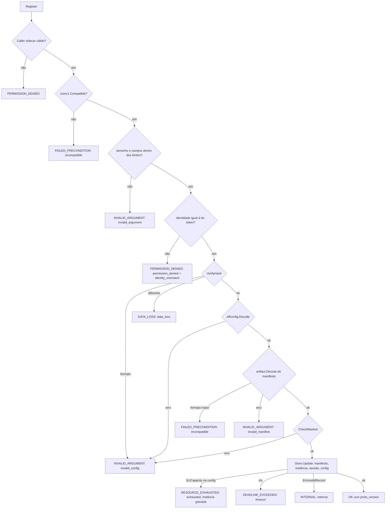
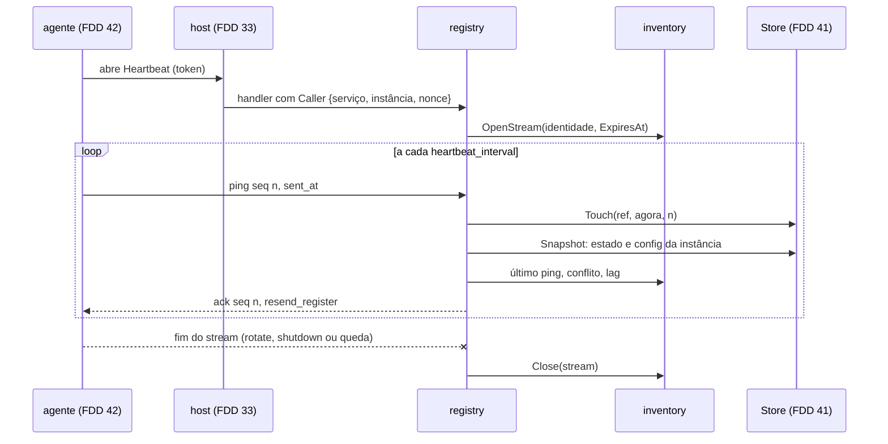
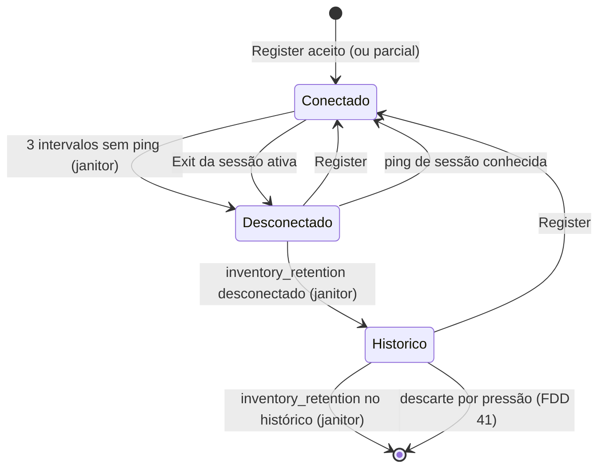
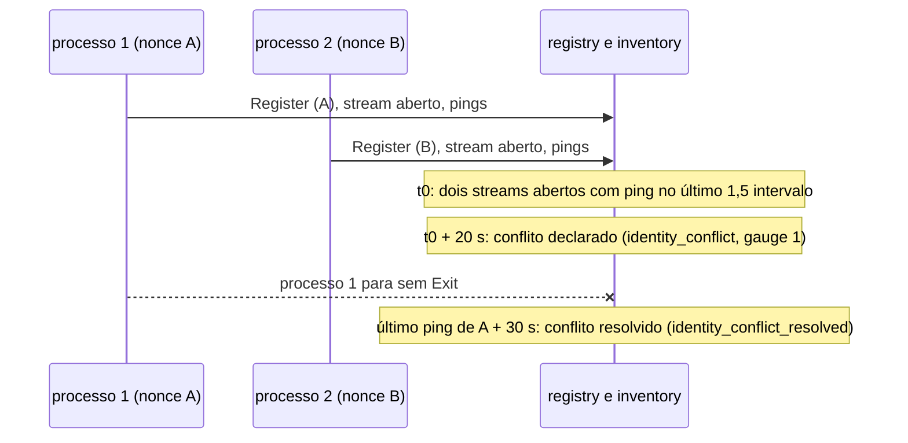
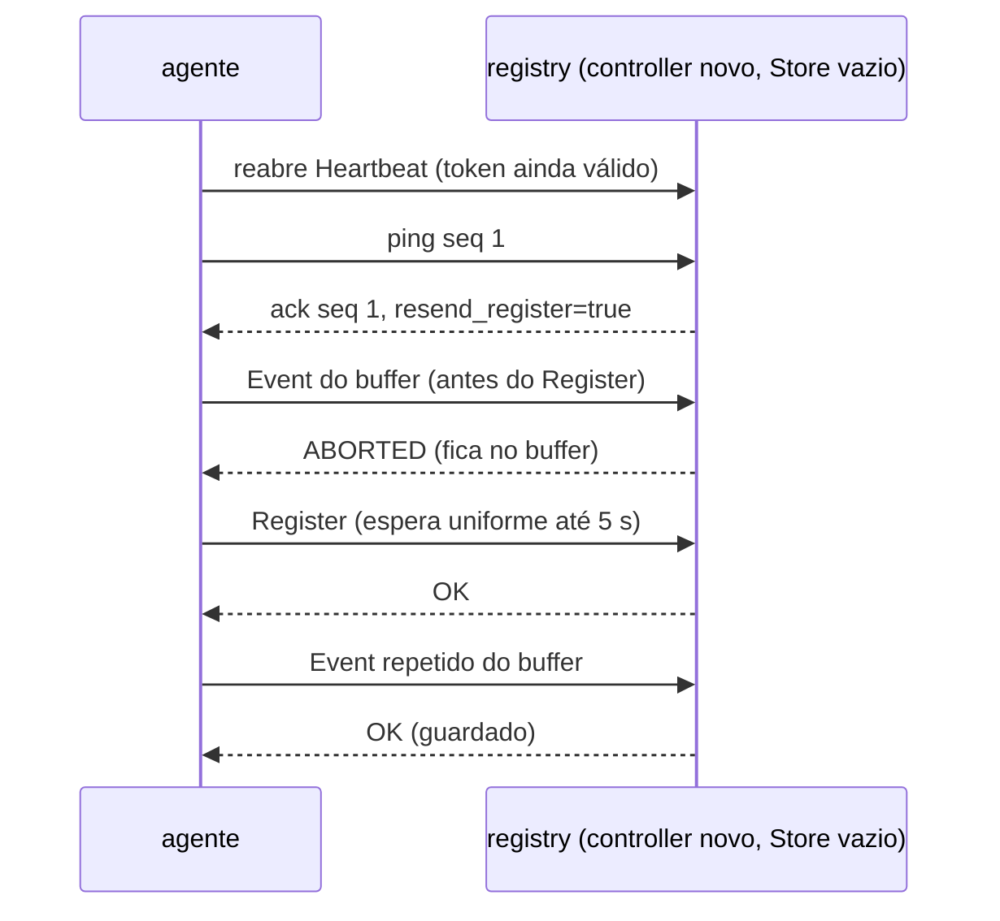

### FDD: Registry e inventário de sidecars (CORE-07)

Versão: 1.0
Data: 2026-10-21
Responsável: Guilherme Giusti

---

### 1. Contexto e motivação técnica

**Problema técnico.** A metade de controller do plugin core recebe, pelo serviço `n3x.plugins.n3x.core.v1.Core`, o que cada sidecar envia (FDD 42): `Register` com identidade, alvo, versão do Envoy, manifesto e config efetiva mascarada; um stream de `Heartbeat` com ping a cada `controller.heartbeat_interval`; `Event` com ID de idempotência; e `Exit` no desligamento. Ela precisa transformar isso no inventário que o painel mostra (FR-006): quem está conectado, quem foi visto por último e quando, o que cada instância roda, onde as instâncias de um serviço divergem e onde o sidecar difere do controller. As peças já existem: o Store com teto e snapshots (FDD 41), a sessão e o índice de nonces (FDD 39), o canonicalizador e as conferências da config (FDD 37), o leitor do manifesto (FDD 22), o host com a autenticação e os prazos (FDDs 32 e 33) e o contrato de mensagens do agente (contrato 8 da FDD 42). Faltava o comportamento verificável que as liga:

- a ordem exata das conferências de cada RPC, o código e a mensagem de cada recusa, sem dado sensível
- o que fica gravado em cada caso (upsert sem duplicar, registro parcial com o Store degradado, recusa sem efeito)
- a máquina de estados da instância (conectado, desconectado, histórico) e quem dispara cada transição
- a detecção de ausência por heartbeat, a regra de conflito de identidade que não dispara na renovação do token e a resolução automática
- a deduplicação de eventos com memória limitada (L-65) e o que fazer com evento que chega antes do `Register`
- o sentido de `inventory_retention` e quanto tempo o histórico dura (L-66)
- a divergência de manifesto entre instâncias e entre sidecar e controller
- a reconstrução do inventário depois de um restart do controller, com e sem `session.hmac_key`
- as consultas que as telas (FDD 45) e as configs (FDD 44) usam

**Encaixe no HLD.** O HLD do `n3x-plugin-core` põe o trabalho em três componentes: `controller/registry` (serviço `Core`, validação e repasse), `controller/inventory` (instâncias, sessões, estados, conflito, divergência de manifesto e eventos) e `controller/janitor` (desconexão por falta de heartbeat, histórico e retenções). Esta FDD especifica os três. Ela consome, sem redefinir:

- a porta `store.Store` e o adaptador `memstore` da FDD 41 (`Update` por serviço, `Touch`, `Snapshot`, `ErrCapacity`, `ErrInvalidRecord`, tetos de 200 eventos e 8 sessões)
- `auth.Authority.Session(nonce)` e `Authenticate` da FDD 39 (identidade do token em `ctrl.Caller(ctx)`, com `Session` igual ao nonce)
- `effconfig.VerifyHash`, `Decode` e `Document.CheckMasked` da FDD 37
- `artifact.Decode`, `Manifest.Lookup` e `PluginsHash` da FDD 22, e `ctrl.CoreEnv.ControllerManifest()` da FDD 09 (L-02)
- o host do controller: registro do serviço na tabela `sidecar` (FDD 08), papel `sidecar` conferido antes do handler, prazo unário `min(cliente, plugin_call_timeout)`, teto de 1 s por mensagem de stream, `UNAVAILABLE` "controller parando" no desligamento (FDDs 32 e 33)
- o proto `Core` e os limites de `corev1` da FDD 36
- as garantias G1 a G9 do agente e as expectativas E1 a E8 (contrato 8 da FDD 42)

```text
 sidecar (FDD 42) ── TLS 1.3 ──▶ host (FDDs 32 e 33): limites, Authenticate (FDD 39), papel sidecar, prazos
                                      │ ctrl.Caller = {sidecar, serviço, instância, nonce}
                                      ▼
                      controller/registry (Register, Heartbeat, Event, Exit)
                        │ VerifyHash, Decode, CheckMasked (FDD 37); artifact.Decode (FDD 22)
                        ▼
                      controller/inventory ──▶ Store (FDD 41): Update por serviço, Touch, Snapshot
                        │  estado vivo: streams abertos, conflitos, divergências, órfãos
                        │  ConfigApplier ──▶ controller/configs (FDD 44)
                        ▼
                      View (consultas) ──▶ panel e cartões (FDD 45), configs (FDD 44)
                      controller/janitor (tarefa inventory_janitor, a cada 1 s)
```

**Atores.** Sidecars (por meio do agente da FDD 42), host do controller (FDDs 32 e 33, entrega a identidade e aplica limites e prazos), autoridade de sessão (FDD 39), Store (FDD 41), configs (FDD 44, recebe a config validada e mantém a divergência de config), painel do core (FDD 45, lê as consultas), operador (lê o painel, as métricas e os alertas) e simulador de 500 sidecars (FDD 51, mede).

**Limites.** Esta FDD não guarda versões de config, não calcula diff nem divergência de config (FDD 44), não desenha telas nem consolida o registro das métricas (FDD 45), não descarta por pressão de memória (FDD 41), não autentica nem confere o papel (FDDs 33 e 39) e não mede a carga de 500 sidecars de ponta a ponta (FDD 51). O que é dessas FDDs aparece aqui como porta ou como pedido.

**Suposições**
- Uma réplica do controller por ambiente; o nome do serviço é chave única no ambiente (ADR-001 do `n3x-sdk`)
- O host só entrega ao handler chamadas com `ctrl.Caller(ctx).Role == RoleSidecar` e identidade válida (FDD 33, ADR-007 do `n3x-controller`); a conferência aqui é defensiva
- O agente cumpre G1 a G9 (FDD 42); um agente que não cumpre (versão futura ou cliente hostil com token válido) recebe as recusas da seção 6, nunca corrompe o Store
- Carga de referência: 500 sidecars em 50 serviços, heartbeat de 10 s (50 pings por segundo), 20 eventos por segundo, painel com polling de 5 s (HLD do core)
- Go 1.26; o core segue as regras da análise estática nas duas metades (FDD 24): sem instrução `go`, esperas por `ctrl.Sleep`, nenhum `ctx` guardado em campo

**Restrições**
- Nenhum token, nonce de sessão, segredo, trecho de config ou de manifesto em log, métrica, status gRPC ou tela; o nonce só existe dentro do controller (FDD 39)
- Nenhuma chamada ao Store dentro da função de um `Update` (FDD 41); nada que bloqueie dentro dela
- O heartbeat não gera snapshot nem `Update` no caso comum (só `Touch`)
- Tarefas de fundo: só `inventory_janitor` (mais a `store_reclaim` da FDD 41), dentro do padrão de 8 da metade de controller (FDD 08)

**Rastreabilidade**
- PRD 1.5: FR-006 (registro e atualização sem duplicar, conectado e desconectado com "visto por último", filtros, detalhe com idade da sessão, manifesto e eventos, desconectado por mais de 24 h vai para o histórico, divergência de manifesto, lista de plugins diferente do controller, reconstrução depois do restart em cerca de 10 s, conflito de identidade com resolução automática, teto de memória), FR-016 (três intervalos sem ping, `INVALID_ARGUMENT`, `PERMISSION_DENIED` com alerta, `DATA_LOSS`, `RESOURCE_EXHAUSTED`, `FAILED_PRECONDITION`, `Exit` marca desconectado, eventos com ID de idempotência, 200 eventos por instância), FR-007 (hash recalculado, `INVALID_ARGUMENT` sem hash, `DATA_LOSS`, última config válida com alerta), FR-005 (identidade da sessão); critérios de aceite "o painel mostra serviço, instância, alvo, versão do Envoy, plugins e hash da config de cada sidecar" e "sidecar de volta ao painel em até 30 s depois de o controller voltar"
- ADRs do `n3x-plugin-core`: ADR-001 (memória, porta `Store`), ADR-005 (identidade amarrada ao token, nonce identifica a sessão, conflito), ADR-006 (hash recalculado), ADR-007 (proto, `resend_register`, 3 intervalos, `Exit`, prazos), ADR-009 (retenções), ADR-010 (métricas); ADR-001 do `n3x-sdk` (serviço como chave, um controller); ADR-007 do `n3x-controller` (só o papel `sidecar` no gRPC)
- **Lacuna L-65 fechada aqui (hipótese):** deduplicação por último `seq` de cada nonce de evento (o `id` da FDD 42 é `<nonce>:<seq>`), com até 4 nonces por instância guardados no Store junto da instância; a deduplicação entre os 200 eventos retidos (FDD 41) continua como segunda camada. Memória O(1) por instância, sem janela de tempo (contrato 4)
- **Lacuna L-66: texto original SUPERADO pela decisão D-01 abaixo (2026-10-22).** Texto original (hipótese, não vale mais): `inventory_retention` é o tempo que uma instância fica desconectada na lista ativa antes de ir para o histórico, e também o tempo que ela fica no histórico antes de sair do inventário (até 48 h com o padrão)
- Lacunas aplicadas: L-02 (manifesto do controller por `ControllerManifest()`, FDD 09), L-08 (stream sem teto total, 1 s por mensagem, FDD 33), L-11 (serviço `Core` separado do `Login`), L-13 (`x-request-id` no `request_id` dos logs), L-15 (estado vivo fora do `memory_limit`, como o índice da FDD 39 e o diretório da FDD 40), L-34 (caminhos de campo nas mensagens), L-68 e L-69 (endereço e versão do Envoy anunciados, FDD 25)
- FDDs consumidas: 08, 09, 12, 18, 22, 24, 25, 32, 33, 36, 37, 39, 41 e 42
- Decisões aprovadas pelo responsável do produto em 2026-10-22:
  - **D-01 (L-66, sem fase de histórico):** `inventory_retention` (padrão 24 h) é o tempo **total** que um sidecar desconectado permanece em memória. A instância tem só dois estados, `connected` e `disconnected`; o estado `history` deixa de existir. Desconectada há mais de `inventory_retention`, ela sai da lista e do inventário de uma vez (`RemoveInstance`). Um `Register` ou ping de instância que já saiu cria uma instância nova. Sob pressão de memória, o primeiro passo de descarte passa a ser "desconectadas mais antigas" no lugar de "histórico". **Efeito em cascata a reconciliar no WF3 (conflito C-RET):** PRD FR-006 e FR-008 ("fica só no histórico", filtros), HLD (histórico de 24 h, `inventory_retention`), ADR-009 (passo 1 do descarte), FDD 05 (passo 1, `StateHistory`, `ClassHistory`, métricas de bytes por `history`), FDD 07 (estados, janitor, contratos 6 e 7, H-04 e os diagramas desta seção 4 que citam `history`), FDD 08 e FDD 09 (estados e filtros de tela). Enquanto isso não for reconciliado, as passagens destas FDDs que citam `history` estão superadas por esta decisão
  - **D-02 (manifesto em formato mais novo):** `FAILED_PRECONDITION` e o sidecar não aparece no painel até o controller ser atualizado; sem modo permissivo. Ordem de atualização recomendada: controller primeiro, sidecars depois (guia, FDD 47)
  - **D-03 (parâmetros):** aprovados: conflito de identidade declarado após 2 intervalos (`ConflictIntervals`), janela de 1,5 intervalo (`ActiveWindow`), até 4 streams de heartbeat por instância, deduplicação de eventos por último `seq` com até 4 nonces por instância, espera de 2 min para evento sem `Register` (`OrphanEventGrace`), janitor a cada 1 s e as métricas novas do inventário (`events_rejected_total`, `heartbeat_ack_seconds`, `heartbeats_total`, `heartbeat_streams`, `exits_total`, `state_transitions_total`, valor `controller_manifest` em `divergences`). O ADR-010 e o HLD precisam listá-las (reflexo pendente)
- Pedidos do registro atendidos:
  - FDD 36: `Compatible` primeiro, limites aplicados, `core_proto_rejected` e `registers_total{result="incompatible"}`; L-66 fechada
  - FDD 37: `VerifyHash`, depois `Decode`, depois `CheckMasked`; `registers_total{result="data_loss"}` e `{result="invalid_config"}`; `effective_config_format_newer`
  - FDD 38: `Event` depois do `Exit` não revive a instância
  - FDD 39: `SessionRecord` com `Authority.Session(nonce)` e a hora do `Register` como reserva; stream encerrado no `ExpiresAt` da sessão; troca de nonce da renovação não é conflito
  - FDD 41: `Update` por serviço e `Touch` com a hora do controller; `ErrCapacity` vira `RESOURCE_EXHAUSTED` e `ErrInvalidRecord` vira `INTERNAL`; sessões podadas até 8; L-65 e L-66 fechadas; nenhuma chamada ao Store dentro de `fn`; o core não declara outro motivo de degradado (P-04 da FDD 41 respondido)
  - FDD 22: `artifact.Decode`, `Lookup` e `PluginsHash` no controller
  - FDD 42: G1 a G9 aplicadas e E1 a E8 atendidas (contrato 12); P-02 dela respondido (`ABORTED` com prazo de 2 min); P-01 (`boot_id`) continua aberto, sem ser necessário na v1
  - FDD 09: `n3x_n3x_core_events_total{kind}` contado aqui
  - FDD 12: testes com `ctrltest`, `Link` e `hostconformance.Run(t, ctrltest.Harness(), hostconformance.WithCore(...))`

---

### 2. Objetivos técnicos

- **Ordem de validação determinística.** Invariante: cada RPC confere na ordem do contrato correspondente e para no primeiro grupo que falha; uma recusa não grava nada, exceto o registro parcial do `RESOURCE_EXHAUSTED` (E6) e a marca de config recusada numa instância que já existe. Medida: teste de tabela com uma linha por código e por regra, conferindo código, mensagem, `result` e o Store antes e depois.
- **Upsert sem duplicar.** Invariante: o par (serviço, instância) identifica uma única instância; `Register` repetido com o mesmo `config_hash` e o mesmo nonce não muda nada além de `RegisteredAt` (E7). Medida: 1.000 `Register` repetidos e 100 reconexões com a mesma identidade deixam exatamente 1 instância e 1 sessão por nonce.
- **Heartbeat barato.** Medida: o caminho de um ping no handler (consulta ao snapshot, `Touch`, estado vivo e ack) custa até 5 µs de CPU e 0 alocações fora do grpc-go (hipótese); com 500 streams e 50 pings por segundo, o registry e o inventário somam menos de 0,005 vCPU (hipótese; a FDD 51 confirma de ponta a ponta). Ack em p99 abaixo de 50 ms medido no servidor (HLD), sempre abaixo de 1 s (E1).
- **Unárias rápidas.** Medida: `Register` com manifesto de 64 KiB e config de 32 KiB em p95 abaixo de 5 ms no servidor e abaixo de 20 ms com a cadeia do host (HLD); com config de 512 KiB e manifesto de 480 KiB, até 30 ms (hipótese); `Event` e `Exit` em p95 abaixo de 1 ms no handler.
- **Ausência detectada a tempo.** Invariante: uma instância conectada sem nenhum ping há mais de 3 intervalos fica desconectada em até 3 intervalos mais 1 s depois do último sinal (janitor de 1 s); `Exit` da sessão ativa desconecta na hora.
- **Conflito sem alarme falso.** Invariante: renovação de token, novo login e restart do pod antes do `Exit` nunca declaram conflito; dois processos com a mesma identidade, ambos com stream aberto e ping, declaram conflito depois de 2 intervalos e o conflito some sozinho 3 intervalos depois do último ping de um deles. Medida: teste de 1 h com TTL de 5 min sem nenhum conflito; teste com dois agentes iguais com conflito declarado em 20 a 21 s (intervalo de 10 s) e resolvido em até 31 s depois da parada de um deles.
- **Eventos sem duplicar, com memória limitada.** Invariante: um `id` aceito não é guardado de novo enquanto a instância existir; a memória de deduplicação é de no máximo 4 entradas por instância. Medida: 1.200 eventos com repetições imediatas injetadas resultam em `events_total` igual aos únicos.
- **Reconstrução depois do restart.** Medida: com `session.hmac_key`, depois que o host volta, todas as instâncias de 50 agentes simulados (FDD 12) estão conectadas no inventário em até 7 s no relógio falso (abertura do stream, `resend_register` no primeiro ack e `Register` espalhado em até 5 s); sem a chave, o tempo é o do novo login (FDD 39) mais 1 s.
- **Consultas prontas para o painel.** Medida: `View()` com 0 alocações; a lista de 500 instâncias de um serviço em até 2 ms; o detalhe de uma instância com 200 eventos em até 200 µs (hipótese; a FDD 51 mede o p95 da tela).

---

### 3. Escopo e exclusões

**Incluído**
- `controller/registry`: implementação de `corev1.CoreServer` (`Register`, `Heartbeat`, `Event`, `Exit`), ordem de validação, mapeamento de erros para status gRPC com mensagens fixas, contagem em `registers_total{result}` e logs
- `controller/inventory`: escrita no Store por `Update` e `Touch` (upsert, sessões, estados, eventos com deduplicação, saída), estado vivo em memória (streams abertos, conflitos, divergências de manifesto, eventos órfãos), cache dos manifestos decodificados, comparação com o manifesto do controller, consultas `View` para as FDDs 44 e 45, porta `ConfigApplier` para a FDD 44 e a implementação mínima usada até ela
- `controller/janitor`: tarefa `inventory_janitor` com desconexão por 3 intervalos sem ping, histórico e saída do histórico por `inventory_retention`, poda de sessões e resolução de conflitos
- Ligação em `controller.New`, `Start` e `GRPC` do core
- Fechamento das lacunas L-65 e L-66
- Métricas e logs do inventário no controller
- Critérios de aceite com `ctrltest`, o agente real da FDD 42 e o kit `agenttest` contra o registry real

**Excluído**
- Versões de config, histórico de hashes, alerta de config recusada, divergência de config e diff: FDD 44 (CORE-08); aqui só a porta `ConfigApplier` e o momento em que ela é chamada
- Telas, cartões, filtros e paginação na tela, registro único das métricas e alertas consolidados: FDD 45 (CORE-09)
- Teto de memória, contabilidade, descarte por pressão e estado degradado: FDD 41 (CORE-05)
- Autenticação, papel `sidecar`, limites de conexão e de stream, prazo unário e teto por mensagem: FDDs 33 (CTL-04) e 39 (CORE-03)
- Lado do sidecar: FDD 42 (CORE-06)
- Teste de ponta a ponta de restart medindo 30 s com sidecars reais: FDD 48 (SDK-16)
- Carga de 500 sidecars, orçamento do controller e p95 do painel: FDD 51 (CTL-07), que mede o que esta FDD constrói (seção 9)
- `boot_id` no proto (P-01 da FDD 42): minor futura da FDD 36, se a heurística de conflito falhar

---

### 4. Fluxos detalhados e diagramas

**Fluxo principal: subida da metade de controller**
1. `controller.New(cfg, env)`: com `env.(ctrl.CoreEnv)`, cria o Store (FDD 41), a autoridade (FDD 39), o diretório (FDD 40) e, nesta ordem, o inventário e o registry.
2. `inventory.New` decodifica uma vez `cenv.ControllerManifest()` com `artifact.Decode` (L-02). Sem bytes ou com erro (binário de desenvolvimento, FDD 30), a comparação com o controller fica desligada e sai `controller_manifest_unavailable` (warn, uma vez).
3. Cria as métricas (só no `New`, FDD 06) e registra a tarefa `inventory_janitor` com `env.Background`.
4. `GRPC(r)` registra `corev1.RegisterCoreServer(r, registry)` na tabela `sidecar` (FDDs 08 e 36). O `Login` vai por `PublicGRPC` (FDD 39).
5. Log `inventory_ready` com `retention`, `controller_manifest` (`ok` ou `unavailable`), `plugins_hash` do controller e os limites.

**Fluxo principal: `Register`** (handler unário; prazo do host)
1. Lê `id := ctrl.Caller(ctx)` e `request_id`. Confere, na ordem do contrato 2: chamador, `proto_version` (`corev1.Compatible`), tamanho, campos e limites, identidade contra o token, `effconfig.VerifyHash`, `effconfig.Decode`, manifesto (`artifact.Decode` pelo cache), `doc.CheckMasked` com o schema de proxy de cada plugin do manifesto recebido.
2. Fora do `Update`: resolve a sessão com `auth.Session(id.Session)`; sem o nonce no índice, `IssuedAt` é a hora do `Register` e `ExpiresAt` é essa hora mais `session.ttl` (pedido da FDD 39, hipótese H-05). Lê do estado vivo quais nonces da instância têm stream aberto (para a poda).
3. `st.Update(ctx, serviço, fn)`. Dentro de `fn`, sem chamar o Store nem bloquear:
   - `tx.PutManifest(manifest)` (deduplicação global pelo hash)
   - `rec, existe := tx.Instance(instância)`; atualiza endereço, alvo, versão do Envoy, `ManifestHash`, `RegisteredAt = agora`; estado `connected` (se mudou, `StateSince = agora`)
   - sessão: nonce novo entra; nonce existente mantém a célula de vida e atualiza `ExpiresAt` e o intervalo; poda até 8 (contrato 6)
   - `cfgs.Apply(tx, &rec, entrada)` (FDD 44; até lá a implementação mínima): com `ErrCapacity`, devolve `ConfigRefusedCapacity`, a config anterior continua a atual
   - `tx.PutInstance(rec)`
4. Depois da confirmação: recalcula a divergência de manifesto do serviço e a comparação com o controller; chama `cfgs.Committed(serviço)`; atualiza métricas; log `register_accepted` (ou `register_partial`).
5. Resposta: `RegisterResponse{proto_version: corev1.Version()}`; com a config recusada pelo degradado, `RESOURCE_EXHAUSTED` com a instância e a sessão já gravadas (E6).

**Fluxo principal: `Heartbeat`** (stream; sem teto total; 1 s por mensagem processada, FDD 33)
1. Abertura: lê o `Caller`, copia serviço, instância e nonce (as strings do token não ficam presas ao cabeçalho), resolve `ExpiresAt` por `auth.Session` (reserva: sessão do Store, depois agora mais `session.ttl`) e registra o stream no estado vivo. Mais de 4 streams abertos da mesma instância: `RESOURCE_EXHAUSTED` (H-12).
2. Laço: `RecvMsg` num `HeartbeatPing` reaproveitado. Erro (fim do cliente, `ctx` cancelado, corte do host): remove o stream do estado vivo e volta.
3. Cada ping, com `agora` do relógio do controller:
   - `seq` zero, `seq` que não cresce no stream ou `sent_at` ausente: `INVALID_ARGUMENT` e fim do stream
   - `agora` maior ou igual a `ExpiresAt`: fim do stream com `UNAUTHENTICATED` e o texto genérico do host (pedido da FDD 39); o ping não conta
   - `ok := st.Touch({serviço, instância, nonce}, agora, seq)`
   - lê a instância no snapshot (busca binária); `resend_register` verdadeiro se a instância não existe, se está no histórico, se `ok` é falso (sessão desconhecida) ou se a instância não tem config (registro parcial sem config) (E1)
   - instância `disconnected` com `ok` verdadeiro: `Update` que volta a `connected` (raro; motivo `heartbeat`)
   - atualiza o estado vivo do stream (último ping, contagem) e avalia o conflito (contrato 6)
   - observa `heartbeat_lag_seconds` (atraso do ping em relação ao intervalo, contrato 3) e responde `HeartbeatAck{seq, resend_register}` com `SendMsg`
4. Nenhum ping gera log em `info`; só `debug`.

**Fluxo principal: `Event`** (unário; chega pelo buffer do sidecar)
1. Confere os campos (contrato 4); falha é `INVALID_ARGUMENT`, que o buffer trata como definitivo e descarta (FDD 38).
2. `eventid.Parse(id)` dá o nonce do processo e o `seq`; `id` fora do formato segue só com a deduplicação do Store (H-09).
3. `st.Update`: instância inexistente devolve um erro interno de órfão sem efeito; existente confere a tabela de nonces da instância (`seq` menor ou igual ao último daquele nonce é repetição), chama `tx.AppendEvent` (segunda camada: `PutExisting` entre os 200 retidos), atualiza a tabela e grava. O estado da instância nunca muda por evento (E5).
4. Órfão (instância sem `Register` vigente, G8): `ABORTED` enquanto não passam 2 min desde o primeiro órfão daquela instância, para o item esperar no buffer (E2); depois disso, `OK` e o evento é descartado, contado em `events_rejected_total{reason="orphan_dropped"}` (H-08).
5. Aceito: `events_total{kind}` soma 1; repetido: `OK` sem guardar.

**Fluxo principal: `Exit`** (unário; até 1,5 s no cliente)
1. Confere `reason` (`^[a-z][a-z_]{0,15}$`); valor desconhecido no formato vale `sigterm` (FDD 36).
2. `st.Update`: instância inexistente ou no histórico, nada muda (`exit_unknown` em debug). Nonce do token que não é sessão da instância: nada muda (é outro processo, E5). Nonce que é sessão: se nenhuma outra sessão da instância teve ping no último 1,5 intervalo, a instância fica `disconnected` com `StateSince = agora` (motivo `exit`); senão continua `connected` (`exit_superseded`).
3. Fora do `Update`: conflito que envolve o nonce é encerrado (motivo `exit`); o stream do processo termina sozinho (o agente cancela no mesmo instante, FDD 42).
4. `OK`. Eventos que chegam depois do `Exit` são guardados sem mudar o estado (E5, pedido da FDD 38).

**Fluxo principal: janitor (tarefa `inventory_janitor`, a cada 1 s)**
1. Lê um snapshot. Para cada instância calcula `visto por último = max(LastPing das sessões, RegisteredAt)` e o intervalo da sessão mais recente.
2. Decide as transições: `connected` sem sinal há mais de 3 intervalos vira `disconnected` com `StateSince = visto por último`; `disconnected` há mais de `inventory_retention` vira `history`; `history` há mais de `inventory_retention` sai do inventário (`RemoveInstance`); sessões vencidas ou paradas são podadas, mantendo a mais recente.
3. Aplica por serviço, com um `Update` só para os serviços com mudança, conferindo de novo dentro de `fn` o estado e os campos lidos (a instância pode ter mudado desde o snapshot).
4. Resolve conflitos cujo lado mais antigo passou 3 intervalos sem ping; recalcula divergências dos serviços que mudaram; recalcula os gauges de estado; limpa órfãos vencidos.
5. Dorme com `ctrl.Sleep(ctx, 1 s)`; termina com o `ctx`.

**Fluxos alternativos e exceções**
- **Restart do controller com `session.hmac_key`:** o Store nasce vazio. Os tokens continuam válidos; cada agente reabre o stream assim que a conexão volta (G8); o primeiro ping encontra a instância desconhecida e o ack leva `resend_register`; o agente reenvia o `Register` em até 5 s (espalhado). A FDD 39 alimenta o índice na primeira autenticação de cada nonce, então `IssuedAt` sai exato. Eventos do buffer que chegam antes do `Register` recebem `ABORTED` e repetem em 1 a 10 s. Meta: inventário de volta em cerca de 1 intervalo (contrato 7).
- **Restart sem `session.hmac_key`:** a chave aleatória nova recusa os tokens antigos (`UNAUTHENTICATED`, motivo `key`); os agentes refazem o login (FDD 39) e enviam o `Register` da sessão nova; o heartbeat troca de stream. O tempo é dominado pelo bcrypt por serviço (FDD 31).
- **Renovação do token:** o agente envia o `Register` da sessão nova e só então troca o stream, fechando o antigo antes de abrir o novo (G3). O inventário ganha uma sessão nova; a antiga deixa de ter ping e é podada depois. Nunca há dois streams abertos ao mesmo tempo, então não há conflito (E4).
- **Restart do pod com o mesmo nome antes do `Exit`:** o stream do processo morto pode seguir aberto no servidor até o keepalive derrubar a conexão (até 40 s, FDD 38), mas não manda ping; o processo novo registra outro nonce. Sem ping dos dois no mesmo intervalo, não há conflito.
- **Dois processos com a mesma identidade de verdade:** os dois registram (o último `Register` vence nos campos da instância), os dois mantêm stream e ping; depois de 2 intervalos o conflito é declarado; as duas sessões continuam aceitas; o conflito some 3 intervalos depois do último ping de uma delas ou no `Exit` de uma delas (FR-006).
- **`Register` de instância no histórico:** volta para `connected` com `StateSince = agora`, mantendo o histórico de hashes, os eventos que restam e a tabela de deduplicação (H-04).
- **`Register` de instância desconectada:** volta para `connected`; se a sessão é a mesma (o mesmo processo depois de uma partição de rede), a célula de vida continua.
- **Heartbeat antes do `Register` na mesma sessão:** `resend_register` só quando a sessão ou a instância é desconhecida ou a instância não tem config; nunca em todo ping (E1).
- **`Register` e ping fora de ordem:** um ping processado antes de o `Register` em voo confirmar recebe `resend_register`; o agente coalesce o pedido com o envio em voo (FDD 42, `ResendCoalesced`). Escritas do mesmo serviço são serializadas pelo Store; o janitor confere de novo dentro de `fn`.
- **Store degradado:** `Register` com config nova grava instância e sessão e responde `RESOURCE_EXHAUSTED` (E6); `Touch`, eventos, `Exit` e transições continuam (FDD 41).
- **Config recusada (`DATA_LOSS` ou config inválida) numa instância que já existe:** a resposta é a recusa; num `Update` separado, `cfgs.Refused` marca o alerta e a config anterior continua a atual (FR-007; a forma da marca é da FDD 44). Instância nova com config recusada não é criada.
- **Identidade trocada no `Register`:** `PERMISSION_DENIED` sem gravar nada e log `identity_mismatch` (warn, alerta), com o serviço e a instância do token e os do pedido; os valores são identificadores, não segredos (ADR-005).
- **Manifesto em formato maior que o do leitor:** `FAILED_PRECONDITION` (sem modo permissivo, FDD 22); o sidecar não aparece até o controller ser atualizado; a ordem de atualização recomendada (controller primeiro) vai para o guia (FDD 47).
- **Sessão vencida com stream aberto:** o primeiro ping em ou depois de `ExpiresAt` encerra o stream com `UNAUTHENTICATED`; o atraso máximo é de um intervalo e nenhum ping vencido conta (H-06, P-03).
- **Desligamento do controller:** o host corta os streams com `UNAVAILABLE` "controller parando" (FDD 33); os handlers voltam; nada é persistido (ADR-001).
- **Panic num handler ou no janitor:** o host contém (FDD 32); 5 panics de entrada em 60 s deixariam o core `falho` (L-36), por isso os handlers têm fuzzing (seção 9).

**Diagramas**

Validação do `Register`:



Heartbeat no servidor:



Estados da instância:



Conflito de identidade (intervalo de 10 s):



Reconstrução depois do restart com a mesma chave:



---

### 5. Contratos públicos (assinaturas, endpoints, headers, exemplos)

Os pacotes `controller/registry`, `controller/inventory` e `controller/janitor` são internos ao repositório do core (como os da FDD 41): mudam junto com as FDDs 44 e 45, sem semver próprio. O contrato de fio é o proto da FDD 36; os contratos abaixo dizem como o controller o interpreta.

**Contrato 1: `registry.Server` e as mensagens de status**
- Tipo: endpoint gRPC (`corev1.CoreServer`) e API Go interna
- Assinatura/Rota:
  ```go
  package registry // github.com/giustech/n3x-plugin-core/controller/registry

  // Sessions é satisfeita por *auth.Authority (FDD 39).
  type Sessions interface {
      Session(nonce string) (auth.SessionInfo, bool)
  }

  type Options struct {
      Inventory  *inventory.Inventory
      Sessions   Sessions
      SessionTTL time.Duration      // plugins["n3x.core"].session.ttl; reserva do ExpiresAt
      Metrics    *telemetry.Metrics // env.Metrics()
      Log        *slog.Logger       // env.Log()
      Now        func() time.Time   // nil = time.Now (relógio de parede do controller)
  }

  func New(o Options) (*Server, error)

  type Server struct {
      corev1.UnimplementedCoreServer
      // sem estado próprio além das métricas: o estado fica no inventory
  }

  var _ corev1.CoreServer = (*Server)(nil)

  func (s *Server) Register(ctx context.Context, req *corev1.RegisterRequest) (*corev1.RegisterResponse, error)
  func (s *Server) Heartbeat(stream corev1.Core_HeartbeatServer) error
  func (s *Server) Event(ctx context.Context, req *corev1.EventRequest) (*corev1.EventResponse, error)
  func (s *Server) Exit(ctx context.Context, req *corev1.ExitRequest) (*corev1.ExitResponse, error)
  ```
  ```go
  package controller // github.com/giustech/n3x-plugin-core/controller

  func (c *Core) GRPC(r ctrl.GRPCRegistrar) { corev1.RegisterCoreServer(r, c.registry) }
  ```
- Método: `/n3x.plugins.n3x.core.v1.Core/Register`, `/Event` e `/Exit` unários; `/Heartbeat` bidirecional; todos com `authorization` (retirado pelo host antes do handler) e `x-request-id`
- Semântica de status/headers:
  - **Papel e identidade:** só chega ao handler o papel `sidecar` (FDD 33); `ctrl.Caller(ctx)` traz `Service`, `Instance` e `Session` (o nonce, FDD 39). `Heartbeat`, `Event` e `Exit` não têm campo de identidade no proto: a identidade deles é a do token, por construção (I-02). Só o `Register` tem identidade a comparar
  - **Mensagens fixas (E8):** nenhum status leva token, nonce, segredo, valor de config ou trecho de manifesto; caminhos de campo pela convenção da L-34, sem o valor

| Situação | Código | Mensagem |
| --- | --- | --- |
| `Caller` sem papel `sidecar` ou inválido (defesa) | `PERMISSION_DENIED` | chamador sem identidade de sidecar |
| `proto_version` de outra major ou ausente | `FAILED_PRECONDITION` | texto de `corev1.IncompatibleError` (FDD 36) |
| manifesto em formato maior que o do leitor | `FAILED_PRECONDITION` | manifesto do sidecar no formato <N>; este controller lê até o formato <M>: atualize o controller |
| `Register` acima de 1 MiB | `INVALID_ARGUMENT` | registro acima de 1 MiB |
| campo ausente ou fora do limite | `INVALID_ARGUMENT` | campo inválido: <caminho> [<regra>] |
| identidade diferente da do token | `PERMISSION_DENIED` | identidade do registro diferente da sessão |
| `config_hash` ausente ou fora do formato | `INVALID_ARGUMENT` | config_hash ausente ou fora do formato sha256:<64 hex> |
| hash diferente do conteúdo | `DATA_LOSS` | hash da config não confere com o conteúdo recebido |
| documento fora da forma canônica ou inválido | `INVALID_ARGUMENT` | config efetiva inválida: <caminho> [<regra>] |
| segredo sem máscara | `INVALID_ARGUMENT` | config efetiva com segredo sem máscara: <caminho> [secret_unmasked] |
| manifesto inválido | `INVALID_ARGUMENT` | manifesto inválido: <caminho> [<regra>] |
| config nova com o Store degradado | `RESOURCE_EXHAUSTED` | teto de memória do core atingido; tente de novo mais tarde |
| prazo vencido esperando o Store | `DEADLINE_EXCEEDED` ou `CANCELED` | o do `ctx` |
| `ErrInvalidRecord` ou erro inesperado | `INTERNAL` | erro interno do core |
| evento de instância sem `Register` vigente | `ABORTED` | instância sem registro vigente; reenvie depois do Register |
| quinto stream aberto da mesma instância | `RESOURCE_EXHAUSTED` | streams de heartbeat demais para a instância |
| ping com sessão vencida | `UNAUTHENTICATED` | sessão ausente, inválida ou expirada (o mesmo texto do host, FDD 33) |
| ping com `seq` fora de ordem ou sem `sent_at` | `INVALID_ARGUMENT` | heartbeat inválido: <campo> [<regra>] |
| evento com campo inválido | `INVALID_ARGUMENT` | evento inválido: <campo> [<regra>] |
| `reason` fora da gramática | `INVALID_ARGUMENT` | motivo de saída inválido |

  - **Texto do `UNAUTHENTICATED`:** igual ao do host para que o interceptor do agente reconheça a recusa e refaça o login uma vez (`RejectedMessage`, FDD 39)
  - **Corte do texto:** o host corta em 1 KiB (FDD 33); as mensagens daqui têm até 160 bytes mais um caminho de até 256

**Exemplo de requisição** (três `Register` em protojson, `manifest` e `config` encurtados)
```json
[
  { "protoVersion": { "major": 2, "minor": 0 }, "identity": { "service": "pedidos", "instance": "pedidos-7d9f8b-xk2lp", "address": "10.42.3.17:17000" } },
  { "protoVersion": { "major": 1, "minor": 0 }, "identity": { "service": "estoque", "instance": "pedidos-7d9f8b-xk2lp", "address": "10.42.3.17:17000" }, "target": "envoy-1.40", "envoyVersion": "1.40.1", "manifest": "eyJmb3Jt...", "config": "eyJmb3Jt...", "configHash": "sha256:573ea08dfcea466c12a4eaf03609ef12bc2b3fea4d4d5502b7b8cd7f7077ff3b", "heartbeatInterval": "10s" },
  { "protoVersion": { "major": 1, "minor": 0 }, "identity": { "service": "pedidos", "instance": "pedidos-7d9f8b-xk2lp", "address": "10.42.3.17:17000" }, "target": "envoy-1.40", "envoyVersion": "1.40.1", "manifest": "eyJmb3Jt...", "config": "eyJmb3Jt...", "configHash": "sha256:0000000000000000000000000000000000000000000000000000000000000000", "heartbeatInterval": "10s" }
]
```

**Exemplo de resposta** (token de `pedidos/pedidos-7d9f8b-xk2lp`)
```text
rpc error: code = FailedPrecondition desc = proto do core 2.0 não suportado; este controller aceita a major 1
rpc error: code = PermissionDenied desc = identidade do registro diferente da sessão
rpc error: code = DataLoss desc = hash da config não confere com o conteúdo recebido
```

---

**Contrato 2: `Register` (ordem, efeitos e resultado)**
- Tipo: endpoint gRPC unário
- Assinatura/Rota: `/n3x.plugins.n3x.core.v1.Core/Register`
- Método: unário; prazo `min(cliente, plugin_call_timeout)` do host (5 s do agente, FDD 38)
- Semântica de status/headers:

| # | Conferência | Falha | Código | `result` |
| --- | --- | --- | --- | --- |
| 0 | `Caller` válido com `RoleSidecar` (defesa) | | `PERMISSION_DENIED` | `permission_denied` |
| 1 | `corev1.Compatible(req.ProtoVersion)` (pedido da FDD 36) | major diferente de 1 ou ausente | `FAILED_PRECONDITION`, log `core_proto_rejected` | `incompatible` |
| 2 | `proto.Size(req) <= corev1.MaxRegisterBytes` | acima de 1 MiB | `INVALID_ARGUMENT` | `invalid_argument` |
| 3 | campos e limites (tabela abaixo) | primeiro campo na ordem | `INVALID_ARGUMENT` | `invalid_argument` |
| 4 | `identity.service == Caller.Service` e `identity.instance == Caller.Instance` | diferente | `PERMISSION_DENIED`, log `identity_mismatch` | `permission_denied` |
| 5 | `effconfig.VerifyHash(config, config_hash)` | `ErrHashFormat` / `ErrHashMismatch` | `INVALID_ARGUMENT` / `DATA_LOSS` | `invalid_config` / `data_loss` |
| 6 | `effconfig.Decode(config)` | `ErrNotCanonical`, `ErrInvalidDocument` | `INVALID_ARGUMENT` | `invalid_config` |
| 7 | `artifact.Decode(manifest)` pelo cache e `Kind == sidecar` | `ErrUnsupportedFormat` / outro | `FAILED_PRECONDITION` / `INVALID_ARGUMENT` | `incompatible` / `invalid_manifest` |
| 8 | `doc.CheckMasked(info.SchemaLookup())` | `ErrUnmaskedSecret` | `INVALID_ARGUMENT` | `invalid_config` |
| 9 | `Store.Update` | `ctx` / `ErrInvalidRecord` ou outro | `DEADLINE_EXCEEDED` ou `CANCELED` / `INTERNAL` | `timeout` / `internal` |
| 10 | `ConfigApplier.Apply` devolve `ConfigRefusedCapacity` | Store degradado e hash novo | `RESOURCE_EXHAUSTED`, instância gravada | `exhausted` |
| | tudo certo | | `OK` | `ok` |

| Campo (caminho) | Regra | Limite |
| --- | --- | --- |
| `identity` | `required` | presente |
| `identity.service` | `required`, `size`, `format` | 1 a 63 bytes, `^[a-z0-9]([a-z0-9_-]{0,61}[a-z0-9])?$` (FDD 15) |
| `identity.instance` | `required`, `size`, `format` | 1 a 253 bytes de ASCII visível, sem espaço (FDD 36) |
| `identity.address` | `required`, `size`, `format` | 1 a 260 bytes de ASCII visível (L-68, FDD 25) |
| `target` | `required`, `size`, `format` | 1 a 32 bytes de `[a-z0-9.-]` (hipótese) |
| `envoy_version` | `required`, `size`, `format` | 1 a 64 bytes de ASCII visível; `unknown` vale (FDD 25) |
| `manifest` | `required` | não vazio (o tamanho já passou no passo 2) |
| `config` | `required` | não vazio |
| `heartbeat_interval` | `required`, `range` | de 1 s a 5 min (`corev1.MinHeartbeatInterval` e `MaxHeartbeatInterval`) |

  - **Ordem dos passos 5 a 8 (pedido da FDD 37):** `VerifyHash` antes de `Decode`, e os dois antes de `CheckMasked`; o manifesto é decodificado entre `Decode` e `CheckMasked` porque o `lookup` vem dele. `config_hash` ausente é `ErrHashFormat` (FR-007, "config sem hash")
  - **Manifesto (FDD 22):** decodificado pelo cache do inventário, com chave no SHA-256 dos bytes (contrato 8); `Decode` é tolerante a campo desconhecido e recusa formato maior (`format_unsupported`), que aqui vira `FAILED_PRECONDITION` porque formato novo só sobe com quebra (FDD 22, sem modo permissivo, I-15). `Kind` diferente de `sidecar` é `INVALID_ARGUMENT` com a regra `manifest_kind`; `Target` diferente de `req.target` é aceito com log `manifest_target_mismatch` (warn) (hipótese)
  - **`CheckMasked`:** o `lookup` faz `plugin.ParseSchema` do `Schemas.Proxy` de cada plugin do manifesto, com o resultado guardado no cache; plugin sem schema de proxy (só a metade de controller) não é conferido e sai `effective_config_unchecked` (debug); `Document.Newer` verdadeiro gera `effective_config_format_newer` (info, uma vez por hash) (FDD 37)
  - **Efeito no Store** (um `Update` do serviço; nenhuma chamada ao Store dentro de `fn`):
    - `ManifestHash = tx.PutManifest(manifest)`
    - instância nova ou existente pelo par (serviço, instância): `Address`, `Target`, `EnvoyVersion` e `ManifestHash` atualizados; `RegisteredAt` = hora deste `Register` (último registro aceito, hipótese); `State = connected`, com `StateSince = agora` só quando o estado muda
    - sessão do nonce do token: `IssuedAt` e `ExpiresAt` de `auth.Session(nonce)` ou, sem o nonce no índice, a hora do `Register` e essa hora mais `session.ttl` (H-05); `HeartbeatInterval` do pedido; nonce existente mantém a célula de vida (FDD 41); poda até 8 (contrato 6)
    - `cfgs.Apply(tx, &rec, ConfigInput{...})` (contrato 10)
    - `tx.PutInstance(rec)`
  - **Idempotência (G2, E7):** o mesmo `Register` repetido só muda `RegisteredAt`; a config com o mesmo hash dá `ConfigKept`; o nonce existente não cria sessão
  - **Depois da confirmação:** divergência de manifesto, comparação com o controller e `cfgs.Committed`, fora do `Update`; log `register_accepted` (info) ou `register_partial` (warn)
  - **Resposta:** `RegisterResponse{proto_version: corev1.Version()}`, sempre preenchido (FDD 36)
  - **Endereço (ponto da entrevista):** vale o `identity.address` anunciado (L-68); o IP do par (`CallerIP`) não é guardado nem comparado, porque atrás de NAT ou balanceador ele é o do intermediário (hipótese H-10)

**Exemplo de requisição**
```json
{
  "protoVersion": { "major": 1, "minor": 0 },
  "identity": { "service": "pedidos", "instance": "pedidos-7d9f8b-xk2lp", "address": "10.42.3.17:17000" },
  "target": "envoy-1.40",
  "envoyVersion": "1.40.1",
  "manifest": "eyJmb3JtYXQiOjEsImtpbmQiOiJzaWRlY2FyIiwidGFyZ2V0IjoiZW52b3ktMS40MCIs...",
  "config": "eyJmb3JtYXQiOjEsInBsdWdpbnMiOlsuLi5dLCJzaWRlY2FyIjp7Li4ufX0=",
  "configHash": "sha256:573ea08dfcea466c12a4eaf03609ef12bc2b3fea4d4d5502b7b8cd7f7077ff3b",
  "heartbeatInterval": "10s"
}
```

**Exemplo de resposta**
```json
{
  "resposta": { "protoVersion": { "major": 1, "minor": 0 } },
  "n3x_n3x_core_registers_total": { "ok": 1 },
  "log": "{\"ts\":\"2026-10-21T14:00:03.640Z\",\"level\":\"info\",\"component\":\"plugin\",\"msg\":\"register_accepted\",\"plugin_id\":\"n3x.core\",\"sidecar_service\":\"pedidos\",\"sidecar_instance\":\"pedidos-7d9f8b-xk2lp\",\"created\":true,\"state_from\":\"none\",\"target\":\"envoy-1.40\",\"envoy_version\":\"1.40.1\",\"config_hash\":\"sha256:573ea08dfcea466c12a4eaf03609ef12bc2b3fea4d4d5502b7b8cd7f7077ff3b\",\"config\":\"stored\",\"plugins_hash\":\"8175a20a2029\",\"proto\":\"1.0\",\"session_issued_from\":\"index\",\"bytes\":21874,\"duration_ms\":2,\"request_id\":\"5b0e1c2d-7a3f-4e19-8c6d-2f4a9b1e7c30\"}",
  "Store degradado, hash novo": { "code": "RESOURCE_EXHAUSTED", "instância": "gravada com a config anterior", "result": "exhausted" }
}
```

---

**Contrato 3: `Heartbeat` (protocolo do servidor)**
- Tipo: stream bidirecional
- Assinatura/Rota: `/n3x.plugins.n3x.core.v1.Core/Heartbeat`
- Método: sem teto total (L-08); 1 s entre o `RecvMsg` que entrega um ping e o próximo `RecvMsg`, `SendMsg` ou o retorno, imposto pelo host (FDD 33); 1 dos 16 streams da conexão
- Semântica de status/headers:
  - **Abertura:** não exige instância conhecida (G8). Registra o stream no estado vivo com o nonce, a abertura e `ExpiresAt`; mais de `MaxStreamsPerInstance` (4) streams abertos da mesma instância recebem `RESOURCE_EXHAUSTED` (H-12); o agente faz backoff (FDD 42)
  - **Um ack por ping (E1):** com o mesmo `seq`, na ordem, logo depois do processamento; o handler não tem fila nem goroutine
  - **Conferência do ping:** `seq` maior que zero e maior que o anterior do stream (G4); `sent_at` presente. Falha: `INVALID_ARGUMENT` e fim do stream (regras `seq_order` e `required`). `sent_at` não entra em nenhuma decisão (relógio do sidecar)
  - **Sessão vencida (pedido da FDD 39, H-06):** `ExpiresAt` vem de `auth.Session(nonce)` na abertura, ou da sessão do Store, ou de agora mais `session.ttl`. O primeiro ping em ou depois de `ExpiresAt` encerra o stream com `UNAUTHENTICATED` e não chama `Touch`. Sem instrução `go` (FDD 24) e com o `RecvMsg` bloqueado, o corte acontece no ping seguinte ao vencimento, no máximo um intervalo depois (P-03); como o agente troca o stream em 80% do TTL (FDD 39), o caso só acontece com a renovação falhando
  - **`Touch`:** `st.Touch({serviço, instância, nonce}, agora, seq)` com a hora do controller (pedido da FDD 41); a guarda "só para frente" é por `agora`; `LastSeq` acompanha o ping que avançou a hora, mesmo quando o `seq` recomeça em 1 num stream novo (I-06)
  - **`resend_register` (E1):** verdadeiro quando a instância não existe no snapshot, está no histórico, `Touch` devolve falso (sessão desconhecida) ou a instância não tem `ConfigHash` (registro parcial sem config); falso nos demais casos
  - **Volta de desconectado:** ping de sessão conhecida numa instância `disconnected` faz um `Update` que volta a `connected` (motivo `heartbeat`); no histórico, só o `Register` traz de volta
  - **Atraso (ponto da entrevista, H-07):** `heartbeat_lag_seconds = max(0, (recebido - ping anterior recebido no mesmo stream) - intervalo)`; não usa `sent_at`, então diferença de relógio não conta; o primeiro ping do stream não é observado
  - **Tempo de processamento:** `heartbeat_ack_seconds` do retorno do `RecvMsg` ao fim do `SendMsg`; meta p99 abaixo de 50 ms (HLD); custo do handler sem o grpc-go até 5 µs e 0 alocações (`HeartbeatPing` reaproveitado com `proto.Reset`, ack reaproveitado)
  - **Fim:** qualquer erro de `RecvMsg` (inclusive `io.EOF` e o corte de desligamento do host) remove o stream do estado vivo; o stream não muda o estado da instância ao fechar (quem desconecta é o janitor ou o `Exit`)
  - **Logs:** abertura e fim em `debug` (`heartbeat_stream_opened`, `heartbeat_stream_closed`); `heartbeat_session_expired` em `info`, no máximo 1 por minuto por serviço; nenhum log por ping em `info`

**Exemplo de requisição** (mensagens de um stream depois de um restart do controller)
```json
[
  { "seq": 1, "sentAt": "2026-10-21T14:12:00.010Z" },
  { "seq": 2, "sentAt": "2026-10-21T14:12:10.010Z" },
  { "seq": 2, "sentAt": "2026-10-21T14:12:20.010Z" }
]
```

**Exemplo de resposta**
```json
{
  "acks": [
    { "seq": 1, "resendRegister": true, "motivo": "instância desconhecida (Store vazio)" },
    { "seq": 2, "resendRegister": false, "motivo": "Register chegou em 14:12:02.310" }
  ],
  "terceiro ping": "rpc error: code = InvalidArgument desc = heartbeat inválido: seq [seq_order]",
  "n3x_n3x_core_heartbeats_total": { "ok": 1, "resend": 1, "invalid": 1 },
  "log (debug)": "{\"level\":\"debug\",\"component\":\"plugin\",\"msg\":\"heartbeat_stream_closed\",\"plugin_id\":\"n3x.core\",\"sidecar_service\":\"pedidos\",\"sidecar_instance\":\"pedidos-7d9f8b-xk2lp\",\"reason\":\"invalid\",\"pings\":2,\"lived_ms\":20004}"
}
```

---

**Contrato 4: `Event` (deduplicação, L-65, e eventos órfãos)**
- Tipo: endpoint gRPC unário, idempotente por `id`
- Assinatura/Rota: `/n3x.plugins.n3x.core.v1.Core/Event`
- Método: unário; chega pelo buffer do sidecar (FDD 38), que repete códigos transitórios (`UNAVAILABLE`, `DEADLINE_EXCEEDED`, `RESOURCE_EXHAUSTED`, `ABORTED`, `UNAUTHENTICATED`) e descarta os demais
- Semântica de status/headers:

| Campo | Regra | Limite (FDD 36) |
| --- | --- | --- |
| `id` | `required`, `size`, `format` | 1 a 64 bytes de `[A-Za-z0-9._:-]` |
| `kind` | `required` | diferente de `EVENT_KIND_UNSPECIFIED`; número desconhecido aceito com rótulo `unknown` |
| `plugin` | `format` | vazio ou `plugin.ParseID` válido |
| `plugin_instance` | `size`, `format` | vazio ou gramática da FDD 15, até 63 bytes |
| `detail` | `size`, `format` | até 256 bytes de UTF-8 válido |
| `occurred_at` | `required` | presente |

  - **Deduplicação (L-65 fechada, H-02):** o `id` da FDD 42 é `<nonce do processo em 16 hex>:<seq em 16 hex>` (`eventid.Parse`). Cada instância guarda até `MaxEventSources` (4) pares `{nonce, último seq, última chegada}` no Store, junto da instância (campo novo pedido à FDD 41). Evento com nonce conhecido e `seq` menor ou igual ao último é repetição: `OK` sem guardar. Nonce novo entra no lugar do par com chegada mais antiga. Isso vale porque o agente entrega cada nonce em ordem não decrescente, com repetição só do item imediatamente anterior (G5 e G6)
  - **Segunda camada:** `tx.AppendEvent` devolve `PutExisting` para `id` igual a um dos 200 retidos (FDD 41); cobre `id` fora do formato (`eventid.ErrFormat`), que segue sem a tabela e gera `event_id_unparsed` (warn, 1 por minuto) (H-09)
  - **Memória:** O(1) por instância (4 pares de cerca de 56 bytes, contados pelo Store); sem janela de tempo; a tabela some com a instância
  - **Órfão (E2, P-02 da FDD 42 respondido, H-08):** instância inexistente no Store (antes do `Register` depois de um restart, G8, ou `Register` recusado): `ABORTED` enquanto não passaram `OrphanEventGrace` (2 min) desde o primeiro órfão daquela instância; depois, `OK` e descarte (`events_rejected_total{reason="orphan_dropped"}`, log `event_orphan_dropped` warn, 1 por minuto por serviço). A tabela de órfãos fica no estado vivo, com até `MaxOrphans` (4.096) entradas; cheia, o órfão novo é descartado na hora. Não há guarda do evento órfão: com o `ABORTED`, o próprio buffer do sidecar segura o item e a ordem por nonce se mantém (a fila do core tem uma chamada em voo)
  - **Instância existente em qualquer estado:** o evento é guardado e o estado não muda (E5); instância no histórico também guarda
  - **Gravação:** `store.Event{ID, Kind (número), Plugin, PluginInstance, Detail, OccurredAt, ReceivedAt = agora, Suppressed}`; o 201º evento remove o mais antigo da instância (FDD 41)
  - **Store degradado:** eventos continuam aceitos (FDD 41)
  - **Contagem:** `events_total{kind}` só para eventos guardados (pedido da FDD 09); repetidos, órfãos e inválidos em `events_rejected_total{reason}`

**Exemplo de requisição**
```json
[
  { "id": "4f1c2e9a7b3d5c60:0000000000000029", "kind": "EVENT_KIND_PANIC", "plugin": "giustech.ratelimit", "pluginInstance": "rl-api", "detail": "hook=request_headers", "occurredAt": "2026-10-21T14:00:03.120Z" },
  { "id": "4f1c2e9a7b3d5c60:0000000000000029", "kind": "EVENT_KIND_PANIC", "plugin": "giustech.ratelimit", "pluginInstance": "rl-api", "detail": "hook=request_headers", "occurredAt": "2026-10-21T14:00:03.120Z" },
  { "id": "9a0b1c2d3e4f5061:0000000000000001", "kind": "EVENT_KIND_DRAIN_START", "detail": "drain_timeout=20s", "occurredAt": "2026-10-21T14:05:00.004Z" }
]
```

**Exemplo de resposta** (a terceira de uma instância que não existe no Store)
```json
[
  { "status": "OK", "guardado": true, "fontes": [{ "nonce": "4f1c2e9a7b3d5c60", "ultimo_seq": 41 }] },
  { "status": "OK", "guardado": false, "motivo": "seq <= último do nonce" },
  { "status": "ABORTED", "mensagem": "instância sem registro vigente; reenvie depois do Register", "órfão desde": "2026-10-21T14:05:00.020Z" },
  { "métricas": ["n3x_n3x_core_events_total{kind=\"panic\"} 1", "n3x_n3x_core_events_rejected_total{reason=\"duplicate\"} 1", "n3x_n3x_core_events_rejected_total{reason=\"orphan_retry\"} 1"] }
]
```

---

**Contrato 5: `Exit`**
- Tipo: endpoint gRPC unário, melhor esforço
- Assinatura/Rota: `/n3x.plugins.n3x.core.v1.Core/Exit`
- Método: unário; o agente usa 1,5 s (`ExitContext`, FDD 42)
- Semântica de status/headers:
  - **`reason`:** `^[a-z][a-z_]{0,15}$`; `drain` e `sigterm` na v1; outro valor válido vale `sigterm` (FDD 36); fora da gramática, `INVALID_ARGUMENT`
  - **Ligado à sessão do token (E5):** só desconecta se o nonce do token é uma sessão da instância e nenhuma outra sessão dela teve ping no último 1,5 intervalo (`ActiveWindow`, H-11). Com outra sessão ativa (processo novo com o mesmo nome), a instância continua `connected` e sai `exit_superseded` (info)
  - **Instância inexistente ou no histórico:** `OK`, nada muda (`exit_unknown` em debug)
  - **Efeito:** `State = disconnected`, `StateSince = agora`, motivo `exit`; a sessão fica no registro até a poda; o conflito que envolve o nonce é encerrado
  - **Eventos depois do `Exit` (G7, pedido da FDD 38):** guardados; o estado não volta a `connected` por evento; só por `Register` ou ping de sessão conhecida
  - **Nunca falha por estado:** qualquer combinação válida responde `OK`; só `INVALID_ARGUMENT`, prazo ou erro interno saem com outro código

**Exemplo de requisição**
```json
{ "reason": "drain" }
```

**Exemplo de resposta**
```json
{
  "resposta": {},
  "efeito": { "sidecar_instance": "pedidos-7d9f8b-xk2lp", "state": "disconnected", "state_since": "2026-10-21T15:00:03.051Z" },
  "n3x_n3x_core_exits_total": { "reason=\"drain\",result=\"disconnected\"": 1 },
  "log": "{\"level\":\"info\",\"component\":\"plugin\",\"msg\":\"instance_state_changed\",\"plugin_id\":\"n3x.core\",\"sidecar_service\":\"pedidos\",\"sidecar_instance\":\"pedidos-7d9f8b-xk2lp\",\"from\":\"connected\",\"to\":\"disconnected\",\"reason\":\"exit\",\"exit_reason\":\"drain\"}"
}
```

---

**Contrato 6: `inventory` (escrita, sessões, estado vivo e conflito)**
- Tipo: sdk (API Go interna do core)
- Assinatura/Rota:
  ```go
  package inventory // github.com/giustech/n3x-plugin-core/controller/inventory

  type Options struct {
      Store              store.Store
      Configs            ConfigApplier      // nil = MinimalConfigs (até a FDD 44, contrato 10)
      ControllerManifest []byte             // ctrl.CoreEnv.ControllerManifest() (L-02)
      Retention          time.Duration      // inventory_retention (contrato 7)
      Metrics            *telemetry.Metrics
      Log                *slog.Logger
      Now                func() time.Time   // nil = time.Now
  }

  func New(o Options) (*Inventory, error)

  type Identity struct{ Service, Instance, Nonce string } // do ctrl.Caller, copiadas

  type Registration struct {
      Identity                      Identity
      Address, Target, EnvoyVersion string
      Session                       store.SessionRecord // IssuedAt, ExpiresAt e intervalo já resolvidos
      SessionFromIndex              bool
      Manifest                      []byte
      ManifestInfo                  *ManifestInfo       // do cache (contrato 8)
      Config                        ConfigInput         // contrato 10
  }

  type RegisterResult struct {
      Created       bool
      From          store.InstanceState // zero = instância nova
      ConfigOutcome ConfigOutcome
  }

  func (inv *Inventory) Register(ctx context.Context, r Registration) (RegisterResult, error)
  func (inv *Inventory) RefuseConfig(ctx context.Context, id Identity, r ConfigRefusal) error

  func (inv *Inventory) OpenStream(id Identity, expiresAt time.Time) (*Stream, error) // ErrTooManyStreams
  func (s *Stream) Ping(ctx context.Context, seq uint64, at time.Time) (PingResult, error)
  func (s *Stream) Close(reason string)

  type PingResult struct {
      Resend  bool
      Expired bool
      Lag     time.Duration // -1 no primeiro ping do stream
  }

  type EventResult uint8

  const (
      EventStored EventResult = iota + 1
      EventDuplicate
      EventOrphanRetry   // vira ABORTED
      EventOrphanDropped // vira OK sem guardar
  )

  func (inv *Inventory) AppendEvent(ctx context.Context, id Identity, ev store.Event) (EventResult, error)

  type ExitResult uint8

  const (
      ExitDisconnected ExitResult = iota + 1
      ExitSuperseded
      ExitUnknown
  )

  func (inv *Inventory) Exit(ctx context.Context, id Identity, reason string) (ExitResult, error)

  func (inv *Inventory) Sweep(ctx context.Context) SweepReport // contrato 7
  func (inv *Inventory) View() View                            // contrato 9

  var ErrTooManyStreams = errors.New("inventory: streams de heartbeat demais para a instância")

  const (
      DisconnectIntervals   = 3                // ADR-007
      ConflictIntervals     = 2                // E4 e pedido da FDD 39 (hipótese)
      ConflictClearIntervals = 3               // FR-006
      ActiveWindow          = 1.5              // "ping no mesmo intervalo", em intervalos (hipótese)
      MaxStreamsPerInstance = 4                // hipótese
      MaxEventSources       = 4                // L-65 (hipótese)
      OrphanEventGrace      = 2 * time.Minute  // E2 (hipótese)
      MaxOrphans            = 4096             // hipótese
  )
  ```
- Método: n/a (chamada local pelo registry e pelo janitor)
- Semântica de status/headers:
  - **Estados (FDD 41):** `connected`, `disconnected`, `history`. Transições e quem as dispara:

| De | Para | Gatilho | `StateSince` | Motivo (`reason`) |
| --- | --- | --- | --- | --- |
| (nenhum) | `connected` | `Register` aceito ou parcial | agora | `register` |
| `connected` | `disconnected` | janitor: sem sinal há mais de 3 intervalos | visto por último | `heartbeat_timeout` |
| `connected` | `disconnected` | `Exit` da sessão ativa | agora | `exit` |
| `disconnected` | `connected` | `Register` | agora | `register` |
| `disconnected` | `connected` | ping de sessão conhecida | agora | `heartbeat` |
| `disconnected` | `history` | janitor: `inventory_retention` desconectado | `StateSince + retention` | `retention` |
| `history` | `connected` | `Register` | agora | `register` |
| `history` | (removida) | janitor: `inventory_retention` no histórico | | `retention` |
| `history` | (removida) | descarte por pressão (FDD 41) | | `pressure` (métrica da FDD 41) |

  - **Visto por último:** `max(LastPing das sessões, RegisteredAt)`; o painel mostra esse valor para `connected` e `StateSince` para `disconnected` (é o mesmo instante quando a saída foi por tempo)
  - **Sessões (pedido da FDD 41, H-03):** até `store.MaxSessionsPerInstance` (8). No `Register` com nonce novo e a lista cheia, sai, nesta ordem: sessão vencida (`ExpiresAt` passado), depois a de atividade mais antiga (último ping ou `IssuedAt`), nunca uma com stream aberto nem uma do par em conflito; se todas estão protegidas, sai a de atividade mais antiga mesmo assim. O janitor poda sessões vencidas ou sem ping há mais de 3 intervalos, mantendo sempre a mais recente (para o painel mostrar a idade da última sessão)
  - **Estado vivo (fora do Store, H-13):** streams abertos (por instância: nonce, abertura, último ping, `ExpiresAt`), conflitos, divergências de manifesto, comparação com o controller e órfãos. É derivado e efêmero: some no restart e se reconstrói pelos streams e registros. Fica em mapas divididos em 16 partes por serviço, com trava curta por parte; a visão de leitura é publicada por `atomic.Pointer` a cada mudança (rara). Cerca de 256 bytes por stream; fora do `memory_limit`, como o índice da FDD 39 e o diretório da FDD 40 (L-15)
  - **Conflito de identidade (E4, pedido da FDD 39, H-01):**
    - **condição:** dois streams abertos da mesma instância com nonces de sessão diferentes, os dois com ping nos últimos `ActiveWindow` intervalos (o maior dos dois intervalos)
    - **declaração:** a condição vale continuamente por `ConflictIntervals` intervalos (avaliada a cada ping e a cada passada do janitor); log `identity_conflict` (warn), gauge `identity_conflicts` sobe; as duas sessões continuam aceitas (FR-006)
    - **resolução:** um dos dois nonces fica `ConflictClearIntervals` intervalos sem ping, ou recebe `Exit`; log `identity_conflict_resolved` (info) com `reason` (`heartbeat_timeout` ou `exit`)
    - **renovação nunca é conflito:** o agente fecha o stream antigo antes de abrir o novo (G3); a condição exige os dois abertos. Restart do pod antes do `Exit`: o stream do processo morto pode ficar aberto até o keepalive, mas sem ping
  - **Escritas do mesmo serviço:** sempre por `Update`; a função não chama o Store, não lê o estado vivo e não bloqueia (as entradas são lidas antes)

**Exemplo de requisição** (dois agentes com a mesma identidade, relógio falso, intervalo de 10 s)
```go
s1, _ := inv.OpenStream(inventory.Identity{"pedidos", "pedidos-0", nonceA}, expA)
s2, _ := inv.OpenStream(inventory.Identity{"pedidos", "pedidos-0", nonceB}, expB)
for t := 0; t <= 40; t += 10 {
    s1.Ping(ctx, uint64(t/10+1), t0.Add(time.Duration(t)*time.Second))
    if t <= 10 {
        s2.Ping(ctx, uint64(t/10+1), t0.Add(time.Duration(t)*time.Second+300*time.Millisecond))
    }
}
inv.Sweep(ctx) // em t0 + 41 s
```

**Exemplo de resposta**
```json
{
  "t0 + 0,3 s": "condição verdadeira (dois streams com ping no último 1,5 intervalo)",
  "t0 + 20,3 s a 21 s": "conflito declarado na primeira avaliação depois de 2 intervalos (passada do janitor); n3x_n3x_core_identity_conflicts 1",
  "t0 + 40,3 s": "nonce B sem ping há 30 s; conflito resolvido; identity_conflicts 0",
  "log": "{\"level\":\"warn\",\"component\":\"plugin\",\"msg\":\"identity_conflict\",\"plugin_id\":\"n3x.core\",\"sidecar_service\":\"pedidos\",\"sidecar_instance\":\"pedidos-0\",\"sessions\":2,\"issued_at\":[\"2026-10-21T13:58:01Z\",\"2026-10-21T13:59:40Z\"],\"since\":\"2026-10-21T14:00:00.300Z\"}"
}
```

---

**Contrato 7: janitor e retenção (L-66)**
- Tipo: tarefa de fundo (`env.Background`) e API Go interna
- Assinatura/Rota:
  ```go
  package janitor // github.com/giustech/n3x-plugin-core/controller/janitor

  type Sweeper interface {
      Sweep(ctx context.Context) inventory.SweepReport // *inventory.Inventory
  }

  type Options struct {
      Inventory Sweeper
      Interval  time.Duration // 0 = DefaultInterval
      Log       *slog.Logger
  }

  const (
      TaskName        = "inventory_janitor"
      DefaultInterval = time.Second // hipótese
  )

  func New(o Options) (*Janitor, error)
  func (j *Janitor) Run(ctx context.Context) // corpo da tarefa: Sweep e ctrl.Sleep até o ctx terminar
  ```
  ```go
  package inventory

  type SweepReport struct {
      Disconnected, ToHistory, Removed int // transições aplicadas
      SessionsPruned                    int
      ConflictsResolved                 int
      OrphansExpired                    int
      Services                          int // serviços com Update
      Duration                          time.Duration
  }
  ```
- Método: n/a
- Semântica de status/headers:
  - **`inventory_retention` (L-66 fechada, H-14):** o mesmo valor (padrão 24 h, de 1 min a 168 h, FDD 36) vale para duas fases: tempo desconectado na lista ativa antes do histórico e tempo no histórico antes de sair. Com o padrão, um sidecar parado aparece como desconectado por 24 h, fica mais 24 h só no histórico e some; o IP anunciado fica no máximo 48 h na memória depois do último sinal (LGPD, HLD do core). Um campo próprio para o histórico (`history_retention`) fica como adição em minor se o operador pedir (P-05)
  - **Desconexão por tempo:** `connected` com `agora - visto por último > 3 x intervalo` vira `disconnected` com `StateSince = visto por último`; com o janitor de 1 s, a transição acontece entre 3 intervalos e 3 intervalos mais 1 s depois do último sinal. O intervalo é o da sessão mais recente da instância
  - **Corrida com ping:** o janitor decide pelo snapshot e confere de novo dentro de `fn` o estado e o `RegisteredAt`; um ping que chega entre a leitura e a confirmação devolve a instância a `connected` no próprio ping (motivo `heartbeat`). A janela é de microssegundos e fica visível em `state_transitions_total`
  - **Custo:** uma passada lê o snapshot e as células de vida (sem trava); faz `Update` só nos serviços com mudança. Meta: até 2 ms com 600 instâncias e nenhuma mudança, sem alocação por instância (hipótese)
  - **Também na passada:** resolução de conflitos, órfãos vencidos (mais de 2 x `OrphanEventGrace`), recálculo das divergências dos serviços que mudaram e dos gauges `sidecars{state}`
  - **Descarte por pressão:** é da FDD 41 (`store_reclaim`); o janitor não descarta por memória (I-03)
  - **Restart:** o Store nasce vazio; nada a carregar; o janitor começa junto com as tarefas do core (FDD 08)

**Exemplo de requisição** (relógio falso, `inventory_retention: 24h`, intervalo de 10 s)
```json
[
  { "t": "14:00:00", "evento": "último ping de pedidos-0" },
  { "t": "14:00:31", "evento": "passada do janitor" },
  { "t": "dia seguinte 14:00:01", "evento": "passada do janitor" },
  { "t": "dois dias depois 14:00:01", "evento": "passada do janitor" }
]
```

**Exemplo de resposta**
```json
[
  { "t": "14:00:31", "pedidos-0": "disconnected", "StateSince": "14:00:00", "reason": "heartbeat_timeout" },
  { "t": "dia seguinte 14:00:01", "pedidos-0": "history", "StateSince": "dia seguinte 14:00:00", "reason": "retention" },
  { "t": "dois dias depois 14:00:01", "pedidos-0": "removida", "reason": "retention" },
  { "log": "{\"level\":\"info\",\"component\":\"plugin\",\"msg\":\"inventory_janitor\",\"plugin_id\":\"n3x.core\",\"disconnected\":12,\"to_history\":3,\"removed\":1,\"sessions_pruned\":20,\"conflicts_resolved\":0,\"duration_ms\":1,\"window_s\":60}" }
]
```

---

**Contrato 8: manifestos (cache, divergência entre instâncias e comparação com o controller)**
- Tipo: sdk (API Go interna do core)
- Assinatura/Rota:
  ```go
  package inventory

  type PluginInfo struct {
      ID      plugin.ID
      Module  string
      Version plugin.Version
      Halves  []plugin.Half
  }

  type ManifestInfo struct {
      Hash        store.Hash // sha256 dos bytes, igual ao PutManifest
      Target      string
      Runtime     plugin.Version // versão do core/ do sidecar (runtime.version)
      PluginsHash string         // artifact.Manifest.PluginsHash(), 12 hex
      Plugins     []PluginInfo   // na ordem do manifesto (por ID)
      Warnings    int
  }

  func (m *ManifestInfo) Lookup(id plugin.ID) (PluginInfo, bool)
  func (m *ManifestInfo) SchemaLookup() effconfig.SchemaLookup // schema de proxy, parseado uma vez

  func (inv *Inventory) DecodeManifest(b []byte) (*ManifestInfo, error) // cache pelo hash
  func (inv *Inventory) ManifestInfo(h store.Hash) (*ManifestInfo, bool) // do cache ou do Snapshot

  type PluginDiffKind uint8

  const (
      DiffMissingInController PluginDiffKind = iota + 1 // "missing_in_controller"
      DiffMissingInSidecar                              // "missing_in_sidecar"
      DiffVersion                                       // "version_mismatch"
      DiffModule                                        // "module_mismatch"
  )

  type PluginDiff struct {
      ID                  plugin.ID
      Kind                PluginDiffKind
      Sidecar, Controller string // "módulo@versão" de cada lado, vazio quando falta
  }

  type ManifestGroup struct {
      PluginsHash string
      Instances   int
      Runtime     plugin.Version
  }

  type ManifestDivergence struct {
      Groups []ManifestGroup // vazio ou um só = sem divergência
      Since  time.Time
  }

  const (
      MaxManifestCache    = 64      // hipótese
      MaxSchemaCacheBytes = 8 << 20 // bytes de schema parseado guardados (hipótese)
  )
  ```
- Método: n/a
- Semântica de status/headers:
  - **Cache (H-15):** chave = `store.HashOf(bytes)`; guarda o resumo e os schemas de proxy parseados; LRU com até 64 manifestos e 8 MiB de schema; na falta, decodifica de novo do `Snapshot().Manifest(h)` (o Store guarda os bytes). Numa rajada depois do restart, 500 `Register` do mesmo manifesto decodificam e parseiam uma vez
  - **Divergência entre instâncias (FR-006, H-16):** só instâncias `connected` do serviço; grupos por `PluginsHash` (a lista de plugins com módulo e versão). Mais de um grupo é divergência (`kind="manifest"`). Rebuild com a mesma lista (outro `built_at` ou outra integridade) não é divergência: aparece só no detalhe como manifestos diferentes com a mesma lista (P-06). Recalculada depois de cada escrita que muda o serviço e na passada do janitor; logs `manifest_divergence` (warn) ao surgir e `manifest_divergence_resolved` (info) ao sumir, com os `PluginsHash` e as contagens
  - **Comparação com o controller (L-02 aplicada, H-17):** o manifesto do controller (`ControllerManifest()`, decodificado uma vez) e o do sidecar trazem todos os plugins do Dockerfile, com ou sem a metade daquele artefato (FDD 22); `PluginsHash` igual quer dizer listas iguais. Diferente: diferença por ID, com os quatro tipos acima; `missing_in_controller` de um plugin com metade de controller é o caso grave (os dados dele não têm quem os receba). Serviço com alguma instância conectada diferente do controller marca `kind="controller_manifest"` e loga `controller_manifest_mismatch` (warn, uma vez por par de `PluginsHash`). Sem manifesto do controller, a comparação fica desligada
  - **Versões do core:** o `n3x.core` entra na lista; sidecar e controller com versões diferentes do core aparecem como `version_mismatch` (a FDD 36 permite, mesma major do proto). A tela (FDD 45) pode mostrar esse caso com menos destaque

**Exemplo de requisição**
```json
{
  "controlador": { "plugins_hash": "8175a20a2029", "plugins": ["giustech.ratelimit@1.2.0", "n3x.core@1.0.0"] },
  "pedidos-0": { "plugins_hash": "8175a20a2029" },
  "pedidos-1": { "plugins_hash": "3c0d9e11b7a4", "plugins": ["giustech.jwt@0.4.0", "giustech.ratelimit@1.3.0", "n3x.core@1.0.0"] }
}
```

**Exemplo de resposta**
```json
{
  "divergência (manifest)": { "Groups": [{ "PluginsHash": "8175a20a2029", "Instances": 1 }, { "PluginsHash": "3c0d9e11b7a4", "Instances": 1 }], "Since": "2026-10-21T14:20:00Z" },
  "comparação com o controller (pedidos-1)": [
    { "ID": "giustech.jwt", "Kind": "missing_in_controller", "Sidecar": "github.com/giustech/n3x-plugin-jwt@0.4.0", "Controller": "" },
    { "ID": "giustech.ratelimit", "Kind": "version_mismatch", "Sidecar": "github.com/giustech/n3x-plugin-ratelimit@1.3.0", "Controller": "github.com/giustech/n3x-plugin-ratelimit@1.2.0" }
  ],
  "métricas": ["n3x_n3x_core_divergences{service=\"pedidos\",kind=\"manifest\"} 1", "n3x_n3x_core_divergences{service=\"pedidos\",kind=\"controller_manifest\"} 1"]
}
```

---

**Contrato 9: consultas `View` (para as FDDs 44 e 45)**
- Tipo: sdk (API Go interna do core; só leitura)
- Assinatura/Rota:
  ```go
  package inventory

  // View junta um Snapshot do Store e a visão publicada do estado vivo. Uma por requisição; não guardar.
  type View struct{ /* snapshot, estado vivo, agora */ }

  func (v View) At() time.Time
  func (v View) Snapshot() *store.Snapshot // a FDD 44 lê as configs daqui
  func (v View) Counts() Counts
  func (v View) Services() iter.Seq[ServiceSummary]           // ordem por nome
  func (v View) Service(name string) (ServiceSummary, bool)
  func (v View) Instances(service string, f Filter) iter.Seq[InstanceRow] // ordem por nome
  func (v View) AllInstances(f Filter) iter.Seq[InstanceRow]               // ordem por serviço e nome
  func (v View) Instance(service, name string) (InstanceDetail, bool)
  func (v View) Conflicts() iter.Seq[Conflict]
  func (v View) ControllerPlugins() ([]PluginInfo, bool) // falso sem manifesto do controller

  type Counts struct {
      Connected, Disconnected, History int
      Conflicts                        int
      ServicesManifestDivergent        int
      ServicesControllerMismatch       int
  }

  type Filter struct {
      States       []store.InstanceState // vazio = todos
      Target       string
      EnvoyVersion string
      ConfigHash   store.Hash
      PluginsHash  string
      NamePrefix   string
      OnlyAlerts   bool // conflito, divergência ou diferença com o controller
  }

  type ServiceSummary struct {
      Name                             string
      Connected, Disconnected, History int
      Targets, EnvoyVersions           []string
      Manifest                         ManifestDivergence
      ControllerMismatch               bool
      Conflicts                        int
      Seq                              uint64 // Service.Seq() do Store: chave de cache
  }

  type InstanceRow struct {
      Service, Name, Address, Target, EnvoyVersion string
      State                                        store.InstanceState
      StateSince, LastSeen, RegisteredAt           time.Time
      SessionIssuedAt                              time.Time // da sessão mais recente: idade da sessão
      ConfigHash, ManifestHash                     store.Hash
      PluginsHash                                  string
      Conflict, ControllerMismatch, StreamOpen     bool
      Events                                       int
      LastEventAt                                  time.Time
  }

  type SessionView struct { // sem o nonce
      IssuedAt, ExpiresAt, LastPing time.Time
      Interval                      time.Duration
      StreamOpen, Current, Expired  bool
  }

  type EventView struct {
      Kind                     string // corev1.EventKindLabel
      Plugin, PluginInstance   string
      Detail                   string
      OccurredAt, ReceivedAt   time.Time
      Suppressed               uint32
  }

  type InstanceDetail struct {
      InstanceRow
      Sessions       []SessionView  // mais recente primeiro
      Manifest       *ManifestInfo  // nil se o resumo não pôde ser montado
      ControllerDiff []PluginDiff
      HashHistory    []store.Hash
      Events         []EventView    // mais novo primeiro, até 200
  }

  type Conflict struct {
      Service, Instance string
      Since             time.Time
      IssuedAt          [2]time.Time
  }
  ```
- Método: n/a
- Semântica de status/headers:
  - **Custo:** `View()` com 0 alocações (carga atômica dos dois ponteiros); iteradores sem copiar o Store; `Instance` monta o detalhe com até 200 eventos. Metas (hipótese): 500 linhas de um serviço em até 2 ms; detalhe em até 200 µs; `Counts` em até 50 µs (contadores mantidos pelo janitor)
  - **Consistência:** o snapshot é um corte do Store (FDD 41); o estado vivo pode estar até uma publicação à frente ou atrás; `LastPing` vem das células atômicas e só cresce
  - **Dados pessoais:** `Address` é o IP anunciado; a decisão de exportar o inventário com IP é da FDD 45 (pedido da FDD 11); nonce e token nunca saem por aqui
  - **Filtros e paginação:** os filtros do `Filter` são os do FR-006 (estado, alvo, versão e hash) mais o de manifesto; a paginação, a ordenação e os filtros de texto da tela são do renderizador sobre as linhas entregues (FDD 10, até 10.000 linhas) e ficam com a FDD 45
  - **Uso pela FDD 44:** `Snapshot()` para as versões e o histórico de hashes; `ManifestInfo(h)` para os schemas que rotulam os campos; `ServiceSummary.Seq` como chave de cache do diff

**Exemplo de requisição**
```go
v := inv.View()
for row := range v.Instances("pedidos", inventory.Filter{States: []store.InstanceState{store.StateConnected}}) {
    _ = row
}
d, _ := v.Instance("pedidos", "pedidos-7d9f8b-xk2lp")
```

**Exemplo de resposta**
```json
{
  "Counts": { "Connected": 487, "Disconnected": 9, "History": 31, "Conflicts": 0, "ServicesManifestDivergent": 1, "ServicesControllerMismatch": 1 },
  "linha": { "Service": "pedidos", "Name": "pedidos-7d9f8b-xk2lp", "Address": "10.42.3.17:17000", "Target": "envoy-1.40", "EnvoyVersion": "1.40.1", "State": "connected", "LastSeen": "2026-10-21T14:09:51Z", "SessionIssuedAt": "2026-10-21T13:48:13Z", "ConfigHash": "sha256:573ea08dfcea466c12a4eaf03609ef12bc2b3fea4d4d5502b7b8cd7f7077ff3b", "PluginsHash": "8175a20a2029", "Conflict": false, "StreamOpen": true, "Events": 37 },
  "detalhe.Sessions": [{ "IssuedAt": "2026-10-21T13:48:13Z", "ExpiresAt": "2026-10-21T14:48:13Z", "LastPing": "2026-10-21T14:09:51Z", "Interval": "10s", "StreamOpen": true, "Current": true }],
  "detalhe.Events[0]": { "Kind": "panic", "Plugin": "giustech.ratelimit", "PluginInstance": "rl-api", "Detail": "hook=request_headers", "Suppressed": 9 }
}
```

---

**Contrato 10: porta `ConfigApplier` (para a FDD 44)**
- Tipo: sdk (interface Go interna; implementada por `controller/configs`)
- Assinatura/Rota:
  ```go
  package inventory

  type ConfigInput struct {
      Hash     store.Hash
      Content  []byte             // bytes recebidos, já conferidos (VerifyHash, Decode, CheckMasked)
      Document effconfig.Document
      Manifest *ManifestInfo
      At       time.Time
  }

  type ConfigOutcome uint8

  const (
      ConfigStored          ConfigOutcome = iota + 1 // hash novo na instância, guardado
      ConfigKept                                     // hash igual ao atual da instância
      ConfigRefusedCapacity                          // ErrCapacity: a anterior continua a atual
  )

  type ConfigRefusal struct {
      Reason       string // "data_loss" ou "invalid_config"
      ReceivedHash string // como veio, se tiver o formato; senão vazio
      At           time.Time
  }

  type ConfigApplier interface {
      // Apply roda dentro do Update do Register. Não chama o Store nem bloqueia.
      Apply(tx store.Tx, rec *store.InstanceRecord, in ConfigInput) (ConfigOutcome, error)
      // Refused roda dentro de um Update próprio, só se a instância já existe.
      Refused(tx store.Tx, rec *store.InstanceRecord, r ConfigRefusal) error
      // Committed roda depois da confirmação, fora de trava, para recalcular a divergência de config.
      Committed(service string, snap *store.Snapshot)
  }

  // MinimalConfigs é a implementação usada até a FDD 44: PutConfig, troca do ConfigHash
  // e ErrCapacity como ConfigRefusedCapacity; Refused e Committed não fazem nada.
  type MinimalConfigs struct{}
  ```
- Método: n/a
- Semântica de status/headers:
  - **Momento:** `Apply` é a única escrita de config no `Register`; o registry não chama `PutConfig` direto. Erro de `Apply` diferente de `ErrCapacity` desfaz o `Update` inteiro e vira `INTERNAL`
  - **Recusa de config (FR-007):** `DATA_LOSS` e `invalid_config` numa instância que já existe chamam `RefuseConfig`, que roda `Refused` num `Update` separado, depois da resposta montada e antes de devolvê-la; a forma da marca de alerta e onde ela fica no Store são da FDD 44; instância nova com config recusada não é criada
  - **`ErrCapacity` (FDD 41, P-05 dela respondido):** a instância e a sessão são gravadas com a config anterior (ou sem config, se for a primeira) e o `Register` responde `RESOURCE_EXHAUSTED`; a FDD 44 marca o alerta dentro do mesmo `Apply`
  - **Troca para a FDD 44:** a FDD 44 entrega `configs.New(...)` que satisfaz a interface e é passada em `inventory.Options.Configs`; os testes do registry rodam com as duas implementações
  - **Hipótese H-18:** a porta é desta FDD porque o registry precisa dela para compilar e testar antes da FDD 44, que depende desta

**Exemplo de requisição**
```go
inv, _ := inventory.New(inventory.Options{Store: st, Configs: configs.New(configs.Options{...}), Retention: cfg.InventoryRetention})
```

**Exemplo de resposta**
```json
{ "Register com Store degradado e hash novo": { "Apply": "ConfigRefusedCapacity", "instância": "gravada, ConfigHash anterior", "status": "RESOURCE_EXHAUSTED" } }
```

---

**Contrato 11: ligação na metade de controller e tarefas**
- Tipo: sdk (composição em `controller.New`, `Start` e `GRPC`)
- Assinatura/Rota:
  ```go
  package controller

  func New(cfg Config, env ctrl.Env) (ctrl.Instance, error) {
      cenv := env.(ctrl.CoreEnv)
      // Store (FDD 41), auth (FDD 39), directory (FDD 40) ...
      inv, err := inventory.New(inventory.Options{
          Store:              st,
          Configs:            cfgs, // FDD 44; nil até ela
          ControllerManifest: cenv.ControllerManifest(),
          Retention:          cfg.InventoryRetention,
          Metrics:            env.Metrics(),
          Log:                env.Log(),
      })
      if err != nil {
          return nil, err
      }
      reg, err := registry.New(registry.Options{
          Inventory: inv, Sessions: a, SessionTTL: cfg.Session.TTL,
          Metrics: env.Metrics(), Log: env.Log(),
      })
      if err != nil {
          return nil, err
      }
      j, _ := janitor.New(janitor.Options{Inventory: inv, Log: env.Log()})
      env.Background(janitor.TaskName, j.Run)
      // ...
  }
  ```
- Método: n/a
- Semântica de status/headers:
  - **Tarefas da metade de controller:** `store_reclaim` (FDD 41) e `inventory_janitor` (esta); 2 das 8 do padrão (FDD 08)
  - **Erros de montagem:** `inventory.New` falha só com opções inválidas (Store nulo, `Retention` fora de 1 min a 168 h); manifesto do controller ilegível não é erro (comparação desligada); o `New` do core falha e o controller não sobe (saída 5, FDD 30)
  - **Estado do core:** esta FDD não declara `degraded`; o único emissor continua o Store (FDD 41, P-04 dela)
  - **Relógio:** `Options.Now` em `inventory` e `registry`; nos testes com `ctrltest`, o relógio falso do agendador (FDD 12); o `ctrl.Now(ctx)` pedido pela FDD 39 à 12 simplificaria a ligação (P-04 da FDD 39)

**Exemplo de requisição**
```yaml
plugins:
  n3x.core:
    inventory_retention: 24h
    memory_limit: 128Mi
```

**Exemplo de resposta** (log do `New`)
```json
{"ts":"2026-10-21T14:00:00.420Z","level":"info","component":"plugin","msg":"inventory_ready","plugin_id":"n3x.core","retention":"24h0m0s","controller_manifest":"ok","plugins_hash":"8175a20a2029","max_streams_per_instance":4,"max_event_sources":4,"orphan_event_grace":"2m0s","janitor_interval":"1s"}
```

---

**Contrato 12: atendimento do contrato 8 da FDD 42**
- Tipo: contrato de mensagens (servidor)
- Assinatura/Rota: serviço `n3x.plugins.n3x.core.v1.Core`
- Método: como o controller usa cada garantia e responde cada expectativa
- Semântica de status/headers:

| Item da FDD 42 | Como esta FDD atende |
| --- | --- |
| G1, G8 | Heartbeat e evento antes do `Register` são esperados depois de restart: `resend_register` e `ABORTED` com prazo de 2 min |
| G2 | `Register` repetido é idempotente; o hash igual dá `ConfigKept` |
| G3 | Base da regra de conflito: dois streams abertos ao mesmo tempo |
| G4 | `seq` conferido por stream (`seq_order`) |
| G5, G6 | Deduplicação por último `seq` de cada nonce (L-65) |
| G7 | `Exit` ligado à sessão; eventos posteriores não revivem |
| G9 | Identidade do `Register` comparada com a do token; o intervalo do pedido vira o da sessão |
| E1 | Um ack por ping, mesmo `seq`, p99 abaixo de 50 ms; `resend_register` pela regra do contrato 3 |
| E2 | Atendida: `ABORTED` para evento sem `Register` vigente, com prazo de 2 min e descarte depois (P-02 da FDD 42 respondido; H-16 dela confirmada com o prazo) |
| E3 | Atendida (L-65, contrato 4), com até 4 nonces por instância |
| E4 | Atendida: dois streams abertos com ping por 2 intervalos (contrato 6) |
| E5 | Atendida (contrato 5) |
| E6 | Atendida: `RESOURCE_EXHAUSTED` só pela config, com a instância gravada; os limites do host continuam com a FDD 33 |
| E7 | Atendida: idempotência e fim do stream no primeiro ping depois do `ExpiresAt` (atraso de até um intervalo, P-03) |
| E8 | Atendida: tabela de mensagens fixas do contrato 1 |
| P-01 (`boot_id`) | Não é necessário com G3 e E4; continua aberto para uma minor do proto (FDD 36) se a FDD 48 medir conflito falso |

**Exemplo de requisição**
```json
{ "cenário": "agente real da FDD 42 com ctrltest.Link, renovação a cada 4 min por 1 h, restart do host no minuto 30" }
```

**Exemplo de resposta**
```json
{ "conflitos": 0, "instâncias": 1, "sessões guardadas no fim": 2, "eventos duplicados guardados": 0, "intervalos sem ping no inventário": 0 }
```

---

### 6. Erros, exceções e fallback

**Matriz de erros previstos e tratamentos**

| Condição | Tratamento | Observações |
| --- | --- | --- |
| `proto_version` de outra major ou ausente | `FAILED_PRECONDITION`; `core_proto_rejected`; nada gravado | FDD 36; `result="incompatible"` |
| `Register` acima de 1 MiB | `INVALID_ARGUMENT`; nada gravado | O host aceita até 4 MiB (FDD 33) |
| Campo ausente ou fora do limite | `INVALID_ARGUMENT` com caminho e regra | FR-016 "o sidecar loga o motivo" |
| Identidade do `Register` diferente do token | `PERMISSION_DENIED`; `identity_mismatch` (warn); nada gravado | ADR-005; alerta sugerido |
| `config_hash` ausente ou fora do formato | `INVALID_ARGUMENT` (`invalid_config`) | FR-007 |
| Hash diferente do conteúdo | `DATA_LOSS`; `register_rejected` com os dois hashes; marca na instância existente | FR-007; FDD 44 marca |
| Config fora da forma canônica, inválida ou com segredo sem máscara | `INVALID_ARGUMENT` (`invalid_config`); marca na instância existente | FDD 37; nada da config guardado |
| `Document.Newer` | Aceito; `effective_config_format_newer` | FDD 37 |
| Manifesto inválido | `INVALID_ARGUMENT` (`invalid_manifest`) | FDD 22 |
| Manifesto em formato maior | `FAILED_PRECONDITION` (`incompatible`) | I-15 |
| Manifesto de outro alvo que o pedido | Aceito; `manifest_target_mismatch` | Hipótese |
| Store degradado e config nova | `RESOURCE_EXHAUSTED`; instância e sessão gravadas | E6, FDD 41 |
| Prazo vencido esperando a trava do serviço | `DEADLINE_EXCEEDED` ou `CANCELED`; nada gravado | `result="timeout"` |
| `ErrInvalidRecord` | `INTERNAL`; log `store_invalid_record` com campo e regra | Erro de programação; pedido da FDD 41 |
| Panic num handler | O host contém e responde `INTERNAL` (FDD 32) | 5 em 60 s deixam o core `falho`: fuzzing obrigatório |
| Quinto stream da mesma instância | `RESOURCE_EXHAUSTED` | Agente faz backoff |
| Ping com `seq` fora de ordem ou sem `sent_at` | `INVALID_ARGUMENT`; fim do stream | G4 |
| Ping depois do `ExpiresAt` | `UNAUTHENTICATED` com o texto do host; fim do stream; ping não conta | FDD 39 |
| Ping de sessão desconhecida | `resend_register = true` | E1 |
| Ping numa instância desconectada | `Update` para `connected` | Raro |
| Evento com campo inválido | `INVALID_ARGUMENT`; o buffer descarta | FDD 38 |
| Evento repetido | `OK` sem guardar | L-65 |
| Evento de instância inexistente | `ABORTED` por até 2 min; depois `OK` e descarte | E2 |
| Tabela de órfãos cheia | `OK` e descarte imediato | `orphan_dropped` |
| `id` fora do formato `nonce:seq` | Aceito com deduplicação só entre os retidos | H-09 |
| `Exit` com `reason` inválido | `INVALID_ARGUMENT` | FDD 36 |
| `Exit` de instância inexistente ou de outro processo | `OK`, nada muda | E5 |
| Manifesto do controller indisponível | Comparação desligada; `controller_manifest_unavailable` | Binário de desenvolvimento |
| Índice de sessões sem o nonce | `IssuedAt` = hora do `Register`; `ExpiresAt` = mais `session.ttl` | FDD 39 |
| Panic na tarefa do janitor | O host reinicia com espera de 1 s a 60 s (FDD 08) | Transições atrasam; Store consistente |
| Restart do controller | Store e estado vivo vazios; reconstrução por `resend_register` ou novo login | FR-006 |

**Estratégias de resiliência**
- **Timeouts:** unárias com o prazo do host (`min(cliente, plugin_call_timeout)`), respeitado pela espera da trava do Store; stream sem teto total, com 1 s por mensagem (FDD 33) e corte no `ExpiresAt` da sessão
- **Retries:** nenhum no controller; o sidecar repete o `Register` com backoff (FDD 42) e o buffer repete os eventos com `ABORTED` (FDD 38)
- **Backoff:** o espalhamento de até 5 s do `resend_register` é do agente; o controller não responde `resend_register` em lote na v1 (contingência da FDD 42)
- **Circuit breaker:** não há; o prazo de órfão corta o laço de `ABORTED` e o limite de streams por instância corta abuso de uma identidade

**Política de fallback**
- Recusa nunca grava dado de identidade errada nem config não conferida; a única gravação numa recusa é o registro parcial (`RESOURCE_EXHAUSTED`) e a marca de config recusada numa instância já existente
- Sem manifesto do controller, o inventário funciona sem a comparação
- Sem o nonce no índice da FDD 39, a sessão usa a hora do `Register`
- Com o Store degradado, o inventário continua vivo (heartbeats, estados, eventos e saída)
- Estado vivo perdido (restart) é reconstruído; nada dele é necessário para a correção do Store

**Invariantes**
- No máximo uma instância por par (serviço, instância); no máximo 8 sessões por instância, sempre com a mais recente
- Nenhuma escrita com identidade diferente da do token
- `RegisteredAt` só avança; `StateSince` muda só em transição
- Instância `connected` sem nenhum sinal há mais de 3 intervalos mais 1 s não existe depois de uma passada do janitor
- Evento aceito não é guardado de novo enquanto a instância existe (dentro dos 4 nonces mais recentes)
- Evento nunca muda o estado da instância
- Conflito só existe com dois streams abertos de nonces diferentes que tiveram ping juntos por 2 intervalos
- Nenhuma função de `Update` chama o Store, lê o estado vivo ou bloqueia
- Nenhum nonce, token, segredo, conteúdo de config ou de manifesto em log, métrica, status ou `View`

---

### 7. Observabilidade

**Métricas** (criadas no `controller.New` por `env.Metrics()`, prefixo `n3x_n3x_core_`, rótulos automáticos `plugin="n3x.core"` e `instance` vazio; a FDD 45 consolida o registro único, D-08)

| Métrica | Tipo | Rótulos | Significado | Origem |
| --- | --- | --- | --- | --- |
| `n3x_n3x_core_sidecars` | gauge | `state` (`connected`, `disconnected`, `history`) | instâncias por estado, recalculado a cada passada do janitor (1 s) | ADR-010 |
| `n3x_n3x_core_identity_conflicts` | gauge | (nenhum) | instâncias em conflito | ADR-010 |
| `n3x_n3x_core_registers_total` | counter | `result` (`ok`, `exhausted`, `incompatible`, `invalid_argument`, `permission_denied`, `data_loss`, `invalid_config`, `invalid_manifest`, `timeout`, `internal`) | `Register` por resultado | ADR-010; valores das FDDs 36 e 37 |
| `n3x_n3x_core_events_total` | counter | `kind` (6 tipos e `unknown`) | eventos guardados | ADR-010, FDD 09 |
| `n3x_n3x_core_events_rejected_total` | counter | `reason` (`duplicate`, `orphan_retry`, `orphan_dropped`, `invalid`) | eventos não guardados | nova (hipótese) |
| `n3x_n3x_core_heartbeat_lag_seconds` | histogram | (nenhum); buckets 0,01, 0,05, 0,1, 0,25, 0,5, 1, 2,5, 5, 10, 30 | atraso do ping em relação ao intervalo (contrato 3) | ADR-010; definição H-07 |
| `n3x_n3x_core_heartbeat_ack_seconds` | histogram | (nenhum); buckets padrão da FDD 06 | processamento do ping até o ack | nova (hipótese) |
| `n3x_n3x_core_heartbeats_total` | counter | `result` (`ok`, `resend`, `expired`, `invalid`) | pings processados | nova (hipótese) |
| `n3x_n3x_core_heartbeat_streams` | gauge | (nenhum) | streams abertos | nova (hipótese) |
| `n3x_n3x_core_exits_total` | counter | `reason` (`drain`, `sigterm`), `result` (`disconnected`, `superseded`, `unknown`) | saídas recebidas | nova (hipótese) |
| `n3x_n3x_core_state_transitions_total` | counter | `from`, `to`, `reason` (9 combinações do contrato 6) | transições de estado | nova (hipótese) |
| `n3x_n3x_core_divergences` | gauge | `service`, `kind` (`manifest`, `controller_manifest`; `config` é da FDD 44) | grupos de manifesto menos 1, ou 1 com diferença do controller | ADR-010; valor `controller_manifest` novo (hipótese) |

- **Cardinalidade:** só `divergences` tem `service`, e a série só nasce quando o serviço diverge pela primeira vez no processo (o `telemetry` não remove séries na v1, FDD 06; depois ela fica em 0); limite prático de 1.024 serviços x 2 tipos. Nenhum rótulo com instância, nonce, hash, endereço ou `id` de evento (confirmação pedida pelo ASSUNTO)
- **Latência por RPC:** `n3x_controller_grpc_calls_total{method,code}` e `grpc_duration_seconds{method}` do host (FDD 33); aqui não se repete
- **Leitura combinada:** `agent_events_total{result="buffered"}` dos sidecars (FDD 42) menos `events_total` mais `events_rejected_total{reason="duplicate"}` é a perda no caminho

**Logs** (JSON do SDK, `component=plugin`, `plugin_id=n3x.core`; identidade nos campos `sidecar_service` e `sidecar_instance`, porque `service` e `instance` são campos de base do SDK (H-19); `request_id` do `x-request-id`)

| Evento (`msg`) | Nível | Campos | Amostragem |
| --- | --- | --- | --- |
| `inventory_ready` | info | `retention`, `controller_manifest`, `plugins_hash`, limites | uma vez |
| `controller_manifest_unavailable` | warn | `reason` | uma vez |
| `register_accepted` | info | `created`, `state_from`, `target`, `envoy_version`, `config_hash`, `config` (`stored`, `kept`), `plugins_hash`, `proto`, `session_issued_from` (`index`, `register`), `bytes`, `duration_ms`, `request_id` | toda vez |
| `register_partial` | warn | os de `register_accepted` mais `config_hash_refused` | 1 por minuto por serviço, com contagem |
| `register_rejected` | warn | `result`, `code`, `path`, `rule`, `config_hash` (recebido, se tiver o formato), `config_hash_computed` (no `DATA_LOSS`), `request_id` | 1 por minuto por serviço e `result`, com contagem |
| `core_proto_rejected` | warn | `proto_major` (sem a minor, FDD 33) | 1 por minuto |
| `identity_mismatch` | warn | `token_service`, `token_instance`, `register_service`, `register_instance`, `request_id` | 1 por minuto por par |
| `store_invalid_record` | error | `field`, `rule`, `rpc` | 10 por minuto |
| `effective_config_format_newer` | info | `format`, `config_hash` | 1 por hash |
| `effective_config_unchecked` | debug | `plugin` | em debug |
| `manifest_target_mismatch` | warn | `target`, `manifest_target` | 1 por hora por serviço |
| `instance_state_changed` | info | `from`, `to`, `reason`, `exit_reason` (no `exit`) | toda vez; agregado em `inventory_janitor` acima de 20 por passada |
| `identity_conflict` | warn | `sessions`, `issued_at`, `since` | toda declaração |
| `identity_conflict_resolved` | info | `reason`, `lasted_s` | toda resolução |
| `manifest_divergence` / `manifest_divergence_resolved` | warn / info | `groups` (`PluginsHash` e contagem) | toda mudança |
| `controller_manifest_mismatch` | warn | `sidecar_plugins_hash`, `controller_plugins_hash`, `missing_in_controller`, `version_mismatch` (IDs) | 1 por par de hashes |
| `exit_superseded` | info | `exit_reason` | toda vez |
| `event_orphan_dropped` | warn | `count`, `waited_s` | 1 por minuto por serviço |
| `event_id_unparsed` | warn | `count` | 1 por minuto |
| `heartbeat_session_expired` | info | `count` | 1 por minuto por serviço |
| `heartbeat_stream_opened` / `heartbeat_stream_closed` / `heartbeat_ping` | debug | `reason`, `pings`, `lived_ms`, `seq`, `resend_register` | em debug |
| `inventory_janitor` | info | campos do `SweepReport`, `window_s` | agregado, 1 por minuto quando houve mudança |

- **Proteção de dados:** nunca nonce, token, `kid`, segredo, conteúdo de config ou de manifesto, nem detalhe de evento (o detalhe vai só para a tela); o endereço anunciado aparece só em `debug`; o canário (`secrettest.CanaryPrefix`) numa config de plugin e no `controller.secret` não aparece em log, métrica, status nem `View` além dos marcadores mascarados
- **Heartbeat:** só em `debug` (HLD do core)

**Tracing**
- Sem tracing distribuído na v1 (ADR-010). Correlação pelo `request_id` de cada unária (o mesmo do log `register_sent` do agente, FDD 42), pelo par `sidecar_service` e `sidecar_instance` e pelo `seq` do evento

**Dashboards e alertas** (para a FDD 45 consolidar e a FDD 47 documentar)
- Painel "Inventário do core": `sidecars{state}`, taxa de `registers_total` por `result`, `identity_conflicts`, p99 de `heartbeat_ack_seconds` e de `heartbeat_lag_seconds`, `heartbeat_streams`, taxa de `events_total` por `kind` e de `events_rejected_total` por `reason`, `divergences` por serviço
- Alertas sugeridos:
  - `n3x_n3x_core_identity_conflicts > 0` por 1 min: aviso (HLD)
  - `sum(n3x_n3x_core_sidecars{state="disconnected"}) / sum(n3x_n3x_core_sidecars{state=~"connected|disconnected"}) > 0.1` por 5 min: aviso (HLD)
  - `increase(n3x_n3x_core_registers_total{result=~"permission_denied|data_loss|invalid_config|invalid_manifest|incompatible"}[15m]) > 0`: crítico para `permission_denied` (credencial usada por outro serviço), aviso para os demais
  - `histogram_quantile(0.99, rate(n3x_n3x_core_heartbeat_ack_seconds_bucket[5m])) > 0.05` por 10 min: aviso
  - `increase(n3x_n3x_core_events_rejected_total{reason="orphan_dropped"}[1h]) > 0`: aviso (eventos perdidos depois de restart ou recusa)
  - `n3x_n3x_core_divergences{kind="controller_manifest"} > 0` por 30 min: aviso (listas de plugins diferentes)

---

### 8. Dependências e compatibilidade

| Componente | Versão mínima | Observações |
| --- | --- | --- |
| Go | 1.26 | `iter.Seq`, `atomic.Pointer` |
| `n3x-sdk` `controller/` (`ctrl`), `telemetry/`, `plugin/` | FDDs 06, 08 e 09 | `Caller`, `CoreEnv.ControllerManifest`, `Background`, `Sleep`, métricas só no `New` |
| `n3x-sdk/artifact` | `v0.2.0` (FDD 22) | `Decode`, `Lookup`, `PluginsHash`, `ErrUnsupportedFormat` |
| `n3x-plugin-core` `corev1` | proto 1.0 (FDD 36) | `Compatible`, `IncompatibleError`, `EventKindLabel`, limites |
| `n3x-plugin-core` `controller/store` | FDD 41, com o campo novo de fontes de evento (pedido) | `Update`, `Touch`, `Snapshot`, `ErrCapacity`, `ErrInvalidRecord` |
| `n3x-plugin-core` `effconfig` | FDD 37 | `VerifyHash`, `Decode`, `CheckMasked` |
| `n3x-plugin-core` `controller/auth` | FDD 39 | `Authority.Session(nonce)`, texto do `UNAUTHENTICATED` |
| `n3x-plugin-core` `internal/eventid` | FDD 42 | `Parse`, `Len` |
| `n3x-controller` | FDDs 32 e 33 | papel `sidecar`, prazo unário, 1 s por mensagem, corte no desligamento, `UNAVAILABLE` para plugin `falho` |
| `n3x-sdk` `sdktest/ctrltest` e `hostconformance` | FDD 12 | `NewHost`, `Link`, `SetDown`, dois hosts em sequência, relógio falso |
| `controller/configs` | FDD 44 | implementa `ConfigApplier`; até lá `MinimalConfigs` |

**Garantias de compatibilidade**
- **Proto:** aceita qualquer minor da major 1 (FDD 36); campo novo de uma minor mais nova é ignorado; valor de enum desconhecido vira `unknown`; um `reason` de `Exit` novo no formato vale `sigterm`
- **Formato do `id`:** a deduplicação por nonce depende do formato de `internal/eventid` (estável na major 1 do proto, FDD 42); `id` em outro formato continua aceito, com deduplicação só entre os retidos
- **Códigos novos para o agente:** `ABORTED` em `Event` e `UNAUTHENTICATED` no ping vencido já são tratados pelo buffer (FDD 38) e pelo heartbeat (FDD 42); são acréscimos ao quadro de códigos da FDD 36 (I-05)
- **Pacotes internos:** `registry`, `inventory` e `janitor` mudam junto com as FDDs 44 e 45, sem semver próprio; `View` e `ConfigApplier` ganham campos e métodos por adição
- **Constantes:** as do ADR-007 (3 intervalos) e do ADR-009 só mudam por ADR; as hipóteses desta FDD (2 intervalos para declarar, 1,5 de janela, 4 streams, 4 nonces, 2 min de órfão, 1 s de janitor) mudam em minor do core
- **Métricas e logs:** nomes e rótulos estáveis na major do core (ADR-010); valores de rótulo novos por minor
- **Banco da v2:** tudo passa pela porta do Store; o estado vivo continua em memória mesmo com banco

---

### 9. Critérios de aceite técnicos

- **Ordem do `Register`:** teste de tabela com no mínimo 30 casos, um por linha do contrato 2 e por regra de campo, conferindo código, mensagem exata, `result`, log e que o Store não muda (exceto `exhausted` e a marca de recusa); um pedido com dois problemas sai com o do passo mais baixo
- **Pedidos das FDDs 36 e 37:** `proto_version` 2.0 e ausente dão `FAILED_PRECONDITION` com o texto de `IncompatibleError` e `registers_total{result="incompatible"}`; hash trocado em 1 byte dá `DATA_LOSS` e `{result="data_loss"}`; espaço extra no JSON, `format` 0 e segredo sem máscara dão `INVALID_ARGUMENT` e `{result="invalid_config"}`; `VerifyHash` roda antes de `Decode` e `Decode` antes de `CheckMasked` (conferido por um falso que registra a ordem)
- **Identidade:** `Register` com serviço ou instância diferente do token dá `PERMISSION_DENIED`, `identity_mismatch` e 0 escritas
- **Upsert:** 1.000 `Register` iguais e 100 reconexões da mesma identidade deixam 1 instância; o mesmo nonce não cria sessão; `RegisteredAt` avança
- **Degradado (pedidos das FDDs 41 e 42):** com o Store degradado, `Register` com hash novo responde `RESOURCE_EXHAUSTED`, a instância e a sessão existem com a config anterior, o primeiro ping recebe `resend_register` falso se havia config e verdadeiro se não havia
- **Heartbeat:** um ack por ping com o mesmo `seq`; `seq` repetido dá `INVALID_ARGUMENT`; instância desconhecida, no histórico ou sem config dá `resend_register` verdadeiro, e só nesses casos; o quinto stream da mesma instância dá `RESOURCE_EXHAUSTED`
- **Fim no `ExpiresAt` (pedido da FDD 39):** com TTL de 5 min e renovação desligada, o primeiro ping em ou depois do `ExpiresAt` encerra o stream com `UNAUTHENTICATED` e o texto do host, e esse ping não chama `Touch`
- **Sessões:** com o nonce no índice, `IssuedAt` e `ExpiresAt` iguais aos da FDD 39; sem ele (índice cheio), `IssuedAt` igual à hora do `Register`; com 9 nonces registrados, ficam 8, nunca o com stream aberto nem o mais recente
- **Desconexão:** relógio falso, intervalo de 10 s: sem ping, a instância fica `disconnected` entre 30 s e 31 s depois do último ping, com `StateSince` igual ao último ping; um ping depois disso volta a `connected`
- **Retenção (L-66):** `inventory_retention: 1m`: desconectada vai para o histórico em 60 a 61 s e sai do inventário 60 a 61 s depois; `Register` no histórico volta a `connected` mantendo os eventos e o histórico de hashes
- **`Exit` (pedido da FDD 38):** `Exit` da sessão ativa desconecta na hora; `Exit` de um processo antigo com outro processo pingando não desconecta (`exit_superseded`); evento depois do `Exit` é guardado e a instância continua `disconnected`
- **Conflito:** dois agentes reais (FDD 42) com a mesma identidade: conflito declarado entre 20 s e 21 s depois de os dois pingarem juntos, `identity_conflicts` igual a 1; parando um deles sem `Exit`, resolvido entre 30 s e 31 s depois do último ping dele; com `Exit`, resolvido na hora
- **Renovação sem conflito (pedido da FDD 39):** agente real com TTL de 5 min por 1 h (relógio falso) e restart do pod com o mesmo nome antes do `Exit`: 0 conflitos, 0 intervalos de 10 s sem ping no inventário
- **Eventos (L-65):** 1.200 eventos com 10% de repetições imediatas injetadas e dois processos alternando nonces: `events_total` igual aos únicos; 5 nonces numa instância deixam 4 na tabela; `id` fora do formato é aceito e deduplicado entre os retidos
- **Órfãos (E2):** evento antes do `Register` recebe `ABORTED`; depois do `Register` a repetição é guardada; sem `Register` por 2 min, a resposta passa a `OK` com `orphan_dropped`; a tabela nunca passa de 4.096
- **Reconstrução (critério do PRD, FDD 12):** 50 agentes em 10 serviços com `ctrltest.Link`; restart do host com a mesma `hmac_key` (dois hosts em sequência): todas as instâncias `connected` em até 7 s de relógio falso depois de o host voltar, sem nenhum `Login`; sem a chave, em até o tempo de login da FDD 39 mais 1 s
- **Manifesto:** duas instâncias com `PluginsHash` diferentes dão `divergences{kind="manifest"}` 1 e o log; voltando a uma lista, 0 e `manifest_divergence_resolved`; sidecar com um plugin a mais que o controller dá `missing_in_controller` no detalhe e `divergences{kind="controller_manifest"}` 1; sem manifesto do controller, nenhuma série `controller_manifest`; manifesto com `format` 2 dá `FAILED_PRECONDITION`
- **Contrato 8 da FDD 42:** a suíte do agente que roda contra o `agenttest.FakeCore` roda também contra o registry real e passa
- **Conformidade do host (pedido da FDD 12):** `hostconformance.Run(t, ctrltest.Harness(), hostconformance.WithCore(...))` com o core real passa
- **Benchmarks** (`-benchmem`, hipóteses de meta): ping no handler até 5 µs e 0 alocações fora do grpc-go com 500 instâncias num serviço; `Register` com manifesto de 64 KiB e config de 32 KiB em p95 até 5 ms (cache quente) e até 30 ms no tamanho máximo; `Event` até 50 µs; `Exit` até 50 µs; passada do janitor sobre 600 instâncias sem mudança até 2 ms; `View().Instances` de 500 linhas até 2 ms; `Instance` com 200 eventos até 200 µs
- **Concorrência:** `go test -race` com 50 streams pingando, 10 `Register` por segundo, 20 eventos por segundo, o janitor e 8 leitores de `View` por 30 s: sem corrida, `Verify()` do Store nulo no fim, nenhuma instância duplicada
- **Fuzzing:** `FuzzRegister`, `FuzzEvent` e `FuzzHeartbeat` 5 minutos cada na CI noturna, sem panic (um panic contaria para o `falho` do core, L-36)
- **Segredos:** canário numa config de plugin e no `controller.secret` do sidecar; `secrettest.Leaks` sobre logs, métricas, status gRPC e `View` dá 0; nenhum log em `info` ou acima contém nonce, token ou endereço
- **Análise estática:** `controller/registry`, `controller/inventory` e `controller/janitor` passam nas regras da FDD 24 sem `//n3x:allow`; nenhuma instrução `go`
- **Cobertura:** no mínimo 85% de linhas nos três pacotes (hipótese); `go vet` e `go test -race ./controller/...` passam
- **O que a FDD 51 mede com 500 sidecars simulados (não é critério desta FDD):** p99 do ack no cliente abaixo de 50 ms; CPU e memória do core com 50 pings, 20 eventos e 5 `Register` por segundo dentro de 150 MB e 0,15 vCPU; a rajada de 500 `Register` depois de um restart com a chave (tempo até todos voltarem, alvo de cerca de 10 s) e sem a chave (até 30 s); o p95 das telas que usam `View` abaixo de 300 ms; o tamanho do estado vivo fora do `memory_limit`; a razão entre heap real e `n3x_n3x_core_memory_bytes` com o inventário cheio

---

### 10. Riscos e mitigação

### Conflito de identidade falso ou não detectado

- **Probabilidade:** média
- **Impacto:** alerta falso tira a confiança do operador; conflito real sem alerta deixa dois processos sobrescrevendo a mesma instância
- **Mitigação:**
    - regra com dois streams abertos ao mesmo tempo e ping dos dois por 2 intervalos (E4), que a renovação nunca satisfaz (G3)
    - teste de 1 h com renovação e restart do pod, e teste com dois agentes iguais (seção 9)
    - resolução automática em 3 intervalos ou no `Exit`
- **Plano de contingência:** `boot_id` numa minor do proto (P-01 da FDD 42) para separar processos sem heurística

### Laço de `ABORTED` segurando a fila de eventos do sidecar

- **Probabilidade:** baixa
- **Impacto:** com o `Register` recusado (por exemplo `DATA_LOSS`), os eventos do processo ficam repetindo e a fila do core no buffer não anda
- **Mitigação:**
    - prazo de 2 min por instância, depois `OK` com descarte contado
    - tabela de órfãos limitada a 4.096
    - alerta de `orphan_dropped`
- **Plano de contingência:** encurtar `OrphanEventGrace` numa minor, ou guardar órfãos num balde pequeno por instância (alternativa do P-02 da FDD 42)

### Heartbeat caro com 500 sidecars

- **Probabilidade:** baixa
- **Impacto:** ack lento, conexões sobrando no host, CPU fora do orçamento de 0,15 vCPU
- **Mitigação:**
    - ping só com `Touch` e leitura do snapshot, sem `Update` nem snapshot novo
    - mensagens reaproveitadas, 0 alocações no handler
    - benchmark de 5 µs e medida da FDD 51
- **Plano de contingência:** guardar a referência da célula da sessão por stream (I-07 da FDD 41), tirando as duas buscas binárias

### Tempestade de `Register` depois de restart do controller

- **Probabilidade:** média
- **Impacto:** 500 decodificações de config e manifesto em poucos segundos, com pico de CPU e de alocação
- **Mitigação:**
    - espalhamento de até 5 s no agente (FDD 42)
    - cache de manifesto e de schemas: uma decodificação por manifesto distinto
    - `Register` típico de 20 a 90 KiB
- **Plano de contingência:** responder `resend_register` em lotes por stream (contingência da FDD 42) se a FDD 51 medir acima do orçamento

### Sessão vencida segue com stream aberto

- **Probabilidade:** baixa
- **Impacto:** até um intervalo de stream depois do `exp`, sem nenhum ping contado
- **Mitigação:**
    - corte no primeiro ping em ou depois do `ExpiresAt`
    - renovação do agente em 80% do TTL troca o stream antes (FDD 39)
- **Plano de contingência:** pedir ao host (FDDs 32 e 33) um gancho que cancele o `ctx` de um stream num instante dado (P-03)

### Credencial vazada usada para envenenar o inventário

- **Probabilidade:** baixa
- **Impacto:** dados falsos no painel para um serviço
- **Mitigação:**
    - identidade do `Register` amarrada ao token, `PERMISSION_DENIED` e alerta crítico
    - limite de 4 streams por instância
    - conflito declarado quando dois processos usam a mesma identidade
- **Plano de contingência:** trocar o segredo do serviço e a `hmac_key` e reiniciar (FDD 39)

### Deduplicação de eventos perdendo um nonce antigo

- **Probabilidade:** baixa
- **Impacto:** com mais de 4 processos da mesma instância enviando ao mesmo tempo (restarts em sequência com buffers cheios), um evento repetido de um nonce já esquecido é guardado de novo
- **Mitigação:**
    - segunda camada pelos 200 retidos (FDD 41)
    - os buffers de processos mortos não enviam
- **Plano de contingência:** subir `MaxEventSources` em minor; o custo é de 56 bytes por nonce

### Retenção dupla guardando IP por mais tempo do que o operador espera

- **Probabilidade:** média
- **Impacto:** com o padrão de 24 h, o endereço anunciado fica até 48 h na memória
- **Mitigação:**
    - comportamento documentado no guia (FDD 47) e no texto do schema
    - histórico também sai por pressão de memória (FDD 41)
- **Plano de contingência:** campo `history_retention` em minor (P-05)

### Panic num handler deixando o core `falho`

- **Probabilidade:** baixa
- **Impacto:** com 5 panics em 60 s, o host marca o core `falho` e todo o serviço `Core` responde `UNAVAILABLE` (L-36)
- **Mitigação:**
    - fuzzing dos três handlers e teste de tabela de cada recusa
    - conversão defensiva de todo campo, sem índice fora de faixa nem ponteiro nulo de mensagem
- **Plano de contingência:** restart do controller; os sidecars reconstroem o inventário
