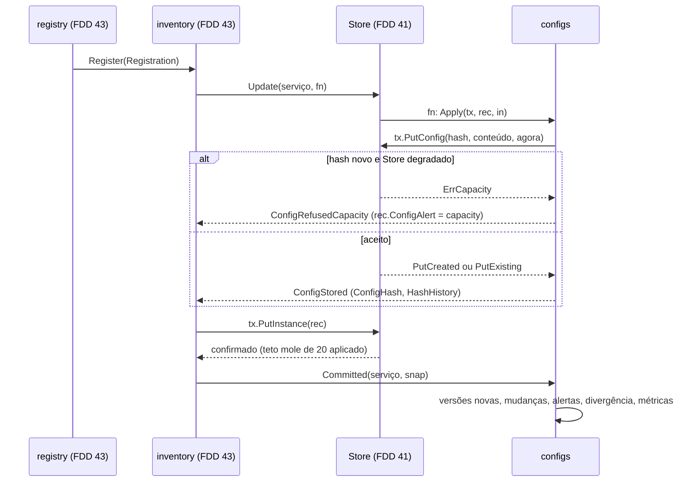
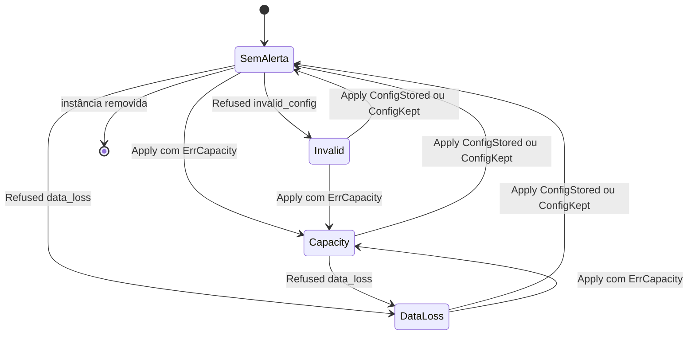
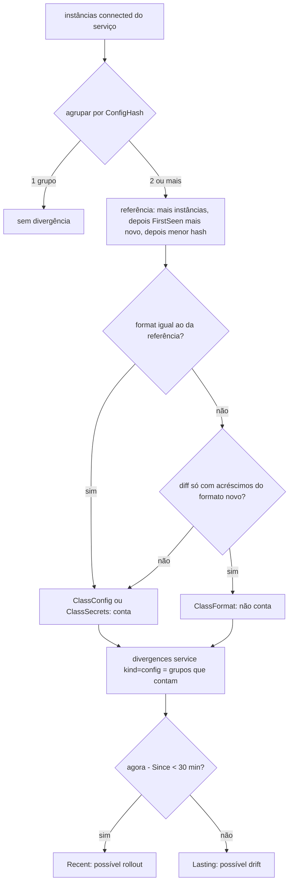

### FDD: Configs versionadas, divergência e diff (CORE-08)

Versão: 1.0
Data: 2026-10-21
Responsável: Guilherme Giusti

---

### 1. Contexto e motivação técnica

**Problema técnico.** No N3X, mudar comportamento é redeployar o `n3x.yaml` do serviço. O operador precisa ver no painel o que cada instância está rodando, onde as instâncias do mesmo serviço divergem (rollout em andamento ou drift) e o que mudou de uma versão para a outra (FR-007 e FR-006). A config efetiva já chega ao controller canônica, mascarada e com o hash conferido (FDD 37), dentro do `Register` validado pelo registry (FDD 43), e o Store guarda bytes por hash com teto de memória (FDD 41). Faltava o comportamento verificável que transforma isso em informação para o painel:

- o que é uma "versão" de config, como ela é deduplicada, quando nasce, quando some e qual é a "atual" de cada instância
- a manutenção da última config válida e a marca de alerta quando uma config nova é recusada (`DATA_LOSS`, config inválida ou `RESOURCE_EXHAUSTED`), gravadas na mesma transação do Store
- o histórico de hashes de cada instância e a detecção de mudança de hash, com o hash anterior e o novo
- a divergência de config num serviço: como agrupar as instâncias, qual grupo é a referência ("maioria"), como separar diferença real de diferença só de formato do core (FDD 37) e de troca de segredo
- o diff estrutural entre duas versões e entre duas instâncias, sobre o JSON mascarado, com algoritmo, limites de tamanho e custo conhecidos, e a representação em YAML e em diff unificado para o widget `Code` (FDDs 10 e 11)
- a extração da cadeia por serviço e do trecho de cada instância de plugin, com o schema do manifesto para rotular os campos
- o trecho YAML de um plugin para reaproveitar em outro serviço sem levar segredo nem marcador perigoso

**Encaixe no HLD.** O HLD do `n3x-plugin-core` põe o trabalho no componente `controller/configs` ("versões de config por hash, a config atual de cada instância, a divergência de config no serviço e o diff entre versões e entre instâncias"), na entidade `ConfigVersion` do modelo de dados (hash, JSON canônico mascarado, visto pela primeira e pela última vez, deduplicada entre instâncias) e no fluxo "`ConfigVersion` deduplicada em memória, diff e divergência, telas do painel". Esta FDD especifica o pacote e consome, sem redefinir:

- a porta `inventory.ConfigApplier` (`Apply`, `Refused`, `Committed`), a `inventory.View` e o cache de manifestos `inventory.ManifestInfo(h)` com `SchemaLookup()` (contratos 8 a 10 da FDD 43)
- a porta `store.Tx` (`PutConfig`, `Config`, `Configs`, `PutInstance`) e o `store.Snapshot` imutável com `Service.Seq()` e `Service.Configs()` (FDD 41), com o teto mole de 20 versões por serviço e o descarte por `LastSeen`
- `effconfig.Decode`, `Document`, `Entry`, `ParseMarker` e os marcadores `***:<12 hex>`, `***:plain`, `***:opaque` e `***:omitted:<12 hex>` (FDD 37)
- `plugin.Schema`, `plugin.ParseSchema`, `Schema.Walk` e `Node` (FDD 02), e o tipo de segredo da FDD 03
- `artifact.Decode` e `Manifest.Lookup` para o manifesto do binário do controller (FDD 22, L-02 pela FDD 09)
- os widgets `ui.Code` com `CodeYAML` e `CodeDiff`, `ui.ConfigDetail` (FDD 10) e `Code.Download` (FDD 11), que a FDD 45 monta

```text
 Register (FDD 43) ── VerifyHash, Decode, CheckMasked ──▶ inventory.Register
                                                          │ Store.Update(serviço)
                                                          ▼
                                       configs.Apply ──▶ tx.PutConfig, rec.ConfigHash, rec.HashHistory, rec.ConfigAlert
                   recusa (DATA_LOSS, invalid_config) ──▶ configs.Refused ──▶ rec.ConfigAlert
                                                          │ confirmação
                                                          ▼
                                       configs.Committed(serviço, snap) ──▶ estado derivado: grupos, mudanças,
                                                          │                  versões novas, alertas, métricas, logs
                                                          ▼
          painel (FDD 45) ──▶ configs.Read(View, inventory) ──▶ Versions, Divergence, Diff, Chain, PluginConfig, Snippet, Alerts
```

**Atores.** `registry` e `inventory` (FDD 43, chamam a porta dentro e depois do `Update`), `janitor` (FDD 43, muda estados e pede o recálculo), Store (FDD 41), painel do core (FDD 45, só lê), operador (lê e compara; nunca edita, FR-007) e simulador de 500 sidecars (FDD 51, mede).

**Limites.** Esta FDD não valida o `Register` nem escolhe códigos gRPC (FDD 43), não define formato, máscara nem hash (FDD 37), não decide teto, contabilidade, descarte por pressão nem degradado (FDD 41), não desenha telas nem consolida o registro das métricas (FDD 45) e não grava auditoria da mudança de config (FR-010, v2). Nenhuma edição de config pelo painel (FR-007).

**Suposições**
- Uma réplica do controller; tudo em memória e perdido no restart (ADR-001 do core); as versões se reconstroem com os `Register` seguintes
- A config recebida já passou por `VerifyHash`, `Decode` e `CheckMasked` (ordem do contrato 2 da FDD 43): nenhum valor de segredo chega aqui
- O conteúdo guardado é o JSON canônico da RFC 8785, com chaves em ordem de unidades UTF-16 e `{"format":` como prefixo fixo (a chave `format` é sempre a primeira, FDD 37)
- Carga de referência: 500 sidecars em 50 serviços, até 20 versões por serviço, config típica de 2 a 90 KiB e máxima de 512 KiB gerada (1 MiB lida), painel com polling de 5 s (HLD do core)
- Go 1.26; regras da análise estática nas duas metades (FDD 24): sem instrução `go`, nenhum `ctx` guardado em campo

**Restrições**
- `Apply` e `Refused` rodam dentro da função de `Store.Update`: não chamam o Store fora do `Tx`, não leem nem escrevem estado derivado e não bloqueiam (FDD 41)
- Nenhum valor de segredo, texto `ENC[...]`, token ou nonce em log, métrica, diff, YAML ou trecho copiado; só os marcadores da FDD 37
- Nenhuma tarefa de fundo nova: o recálculo roda no `Committed`, chamado pelo registry e pelo janitor (FDD 43)
- Estado derivado e cache de diff fora do `memory_limit`, com teto próprio e medido (padrão do estado vivo da FDD 43 e do índice da FDD 39, L-15)

**Rastreabilidade**
- PRD 1.5: FR-007 (versões por hash, até 20 por serviço descartando primeiro as sem instância, cadeia por serviço com fase, ordem e política, config de cada instância de plugin só leitura, diff na mudança de hash, grupos lado a lado com diff em rollout ou drift, campos com nome e descrição pelo schema ou YAML bruto, cópia do trecho YAML, última config válida com alerta, `INVALID_ARGUMENT` sem hash, `DATA_LOSS`, `RESOURCE_EXHAUSTED`), FR-006 (divergência entre instâncias, teto de memória); critérios de aceite "o painel destaca com o diff as instâncias do mesmo serviço com configs diferentes" e "config com hash que não bate é recusada e o painel mantém a última válida, com alerta"
- HLD do `n3x-plugin-core`: componente `controller/configs`, "Modelo de dados" (`ConfigVersion`, relações, retenção), "Fluxo de dados", "Técnicas aplicadas" (deduplicação), "Observabilidade" (log de mudança de hash e de divergência, `divergences{service,kind=config}`, alerta de 30 min)
- ADRs do `n3x-plugin-core`: ADR-001 (memória), ADR-006 (formato, impressão digital, hash, última válida com alerta, 20 versões), ADR-009 (teto, ordem de descarte, degradado recusa versão nova), ADR-010 (métricas); ADR-020 do `n3x-sdk` (schema gerado da struct, `plugin.Secret`)
- **Lacunas:** nenhuma lacuna do README é atribuída a esta FDD. Aplicadas: L-02 (manifesto do controller por `ControllerManifest()`), L-07 (marcadores da FDD 37), L-15 (estado derivado fora do `memory_limit`), L-34 (caminhos de campo), L-46 (YAML conferido com `yamlconv` nos testes)
- FDDs consumidas: 02, 03, 10, 11, 22, 24, 36, 37, 41 e 43
- Pedidos do registro atendidos:
  - FDD 43: `ConfigApplier` implementada por `configs.New` (contrato 2); marca de config recusada e alerta de `ErrCapacity` no campo novo `InstanceRecord.ConfigAlert` do Store (pedido à FDD 41, contrato 3); `divergences{service,kind="config"}` emitida (contrato 5)
  - FDD 41: ordem de descarte por `LastSeen` confirmada; teto mole de 20 versões confirmado; histórico de 20 hashes confirmado, contando o atual; com `ErrCapacity`, a config anterior continua a atual e o alerta é marcado na mesma transação (contratos 2 e 3)
  - FDD 37: marcadores tratados (contratos 6 e 7); diff em que só mudam impressões digitais classificado como "troca de segredo ou recifragem" (`ClassSecrets`); diferença de `format` classificada como "versões do core diferentes" (`ClassFormat`) e fora da contagem de divergência (contrato 6)
  - FDD 02: `Schema.Walk` e `Node` para rotular e conferir os campos (contrato 9)
  - FDD 22: `artifact.Decode` e `Lookup` no manifesto do controller, como fonte de reserva dos schemas (contrato 9)
  - FDD 10: diff entregue como texto unificado pronto para `CodeDiff` e config convertida de JSON para YAML (contratos 6 e 7)
  - FDD 11: trecho YAML pronto para `Code{Lang: CodeYAML, Download: true}` (contrato 8)

---

### 2. Objetivos técnicos

- **Uma versão por hash.** Invariante: no máximo uma `ConfigVersion` por par (serviço, hash); N instâncias com o mesmo hash consomem uma versão só. Medida: 500 instâncias de um serviço com o mesmo hash deixam `Service.Configs()` com 1 item e `n3x_n3x_core_store_bytes{kind="config"}` igual ao de uma instância.
- **Última válida preservada.** Invariante: uma recusa (`DATA_LOSS`, `invalid_config` ou `ErrCapacity`) nunca muda `ConfigHash` nem `HashHistory` da instância; a marca de alerta é gravada na mesma transação da recusa por capacidade e num `Update` próprio nas demais. Medida: teste de tabela com as três recusas conferindo o Store antes e depois.
- **Histórico limitado e coerente.** Invariante: `HashHistory` tem de 0 a 20 hashes, termina no `ConfigHash` atual, sem dois iguais seguidos; nunca compartilha o array com o snapshot. Medida: 25 trocas seguidas deixam 20 hashes, o último igual ao atual; teste com `-race` e leitores do snapshot durante as trocas.
- **Teto de 20 versões por serviço.** Invariante: a 21ª versão faz sair a versão sem instância de menor `LastSeen`; versão em uso nunca sai (teto mole da FDD 41). Medida: teste com 21 versões, 1 delas em uso.
- **Divergência determinística.** Invariante: para o mesmo snapshot, o mesmo agrupamento, a mesma referência e a mesma contagem; diferença só de `format` não conta. Medida: teste de propriedade com permutação da ordem das instâncias.
- **Diff sem segredo e com custo limitado.** Invariante: o diff só contém valores dos documentos mascarados; nenhum diff passa de 1.000 mudanças, 4.000 linhas ou 192 KiB. Medida (hipótese de meta): diff de duas configs de 32 KiB com até 10 mudanças em até 2 ms; de duas de 512 KiB com 1.000 mudanças em até 80 ms; resposta do cache em até 10 µs.
- **Polling barato.** Medida: com 500 sidecars e o painel a cada 5 s, `Read(...).Divergence(serviço)` responde do resumo publicado em até 20 µs e 0 alocações no caminho quente; o diff de um par só é calculado uma vez enquanto estiver no cache (hipótese de meta; a FDD 51 mede o p95 de 300 ms da tela).
- **Escrita barata.** Medida: `Apply` em até 5 µs, alocando só o novo `HashHistory` quando o hash muda; `Committed` de um serviço com 500 instâncias em até 200 µs quando não há diff a calcular (hipótese de meta).

---

### 3. Escopo e exclusões

**Incluído**
- Pacote `controller/configs`: `New`, implementação de `inventory.ConfigApplier` (`Apply`, `Refused`, `Committed`), leitura `Read` para o painel, funções puras `DiffDocuments`, `ToYAML` e `PluginSnippet`
- Definição de versão, config atual, histórico de hashes e marca de alerta (com o campo novo pedido ao Store)
- Detecção de mudança de hash por instância e de versão nova por serviço, com logs e métricas
- Divergência de config por serviço: grupos, referência, classe de cada grupo, fase "recente" ou "persistente", métrica e logs
- Diff estrutural por chave sobre o JSON, alinhado por instância de plugin, e diff unificado por linha sobre o YAML, com limites e cache por par de hashes
- Conversão determinística de JSON canônico para YAML
- Cadeia por serviço (fase, ordem, política, grupo paralelo) e config de cada instância de plugin com o schema resolvido
- Trecho YAML de um plugin para outro `n3x.yaml`, com segredos substituídos por um texto que falha na validação
- Lista de alertas de config e resumo para os cartões

**Excluído**
- Validação do `Register`, códigos `INVALID_ARGUMENT`, `DATA_LOSS` e `RESOURCE_EXHAUSTED` e contagem em `registers_total`: FDD 43 (CORE-07)
- Formato, mascaramento, hash e marcadores: FDD 37 (CORE-02)
- Teto, contabilidade, descarte por pressão e degradado: FDD 41 (CORE-05)
- Telas `/configs` e `/fluxo`, cartões, layout dos grupos lado a lado, registro único das métricas e regras de alerta consolidadas: FDD 45 (CORE-09)
- Inventário, estados das instâncias, divergência de manifesto: FDD 43
- Auditoria da mudança de config: v2 (FR-010)
- Edição de config, "aplicar a referência" ou qualquer ação pelo painel (FR-007)
- Diff de três vias, diff entre serviços diferentes (hipótese: fora da v1; o trecho YAML cobre o reaproveitamento)

---

### 4. Fluxos detalhados e diagramas

**Fluxo principal: subida**
1. `controller.New` cria o Store (FDD 41), depois `configs.New(Options{ControllerManifest: cenv.ControllerManifest(), Metrics, Log, Now})`, depois `inventory.New(Options{Configs: cfgs, ...})` (FDD 43).
2. `configs.New` decodifica uma vez o manifesto do controller com `artifact.Decode`; sem bytes ou com erro, a reserva de schema do controller fica desligada e sai `configs_controller_manifest_unavailable` (debug, porque a FDD 43 já avisa).
3. Cria as métricas (só no `New`, FDD 06) e loga `configs_ready` com os limites.

**Fluxo principal: `Register` com config (dentro do `Update` do serviço, FDD 43)**
1. O inventário monta `rec` (cópia mutável) e chama `cfgs.Apply(tx, &rec, in)` com `in.Hash`, `in.Content`, `in.Document` e `in.At`.
2. `Apply`:
   - `in.Hash` igual a `rec.ConfigHash`: `tx.PutConfig` (só atualiza `LastSeen`), apaga a marca de alerta, devolve `ConfigKept`
   - hash diferente: `tx.PutConfig(in.Hash, in.Content, in.At)`
     - `ErrCapacity` (Store degradado e hash novo no serviço): `ConfigHash` e `HashHistory` ficam como estavam; `rec.ConfigAlert` recebe `capacity` com o hash recusado; devolve `ConfigRefusedCapacity` sem erro (a FDD 43 responde `RESOURCE_EXHAUSTED` com a instância gravada)
     - outro erro: devolve o erro (a FDD 43 desfaz o `Update` e responde `INTERNAL`)
     - aceito (`PutCreated` ou `PutExisting`): `rec.ConfigHash = in.Hash`; `rec.HashHistory` vira um slice novo com o hash no fim, sem repetir o último e cortado nos 20 mais recentes; apaga a marca de alerta; devolve `ConfigStored`
3. O inventário grava `tx.PutInstance(rec)`; o Store confirma. Na confirmação, a FDD 41 aplica o teto mole: com mais de 20 versões no serviço, sai a sem instância de menor `LastSeen` (`store_discards_total{kind="config",reason="limit"}`).
4. Depois da confirmação, o inventário chama `cfgs.Committed(serviço, snap)`.

**Fluxo principal: `Committed` (fora de trava do Store; por serviço)**
1. Pega o serviço no snapshot. Ausente (serviço removido): apaga o estado derivado dele e zera a série de divergência, se existir.
2. Se `svc.Seq()` não passou do último processado, sai (chamadas fora de ordem do registry e do janitor não regridem o estado).
3. Sob a trava curta do estado derivado do serviço:
   - **versões novas:** compara `svc.Configs()` com o conjunto conhecido; cada hash novo gera `config_version_stored` (info) e entra no conjunto; os que sumiram saem (o Store já contou o descarte)
   - **mudanças de hash:** compara o `ConfigHash` de cada instância com o último conhecido; instância conhecida com hash diferente e anterior não vazio gera uma `HashChange{Instance, From, To, At = RegisteredAt, Class}` no anel do serviço (32 mais recentes), `config_hash_changed` (info) e `config_changes_total{class}`; a classe vem do diff do par (cache)
   - **manifesto de cada versão:** para cada versão em uso, guarda o `ManifestHash` da instância mais recente que aponta para ela (fonte do schema quando a versão ficar sem instância)
   - **alertas:** conta as marcas `ConfigAlert` por motivo; aparecimento e sumiço geram `config_alert_set` (warn) e `config_alert_cleared` (info); atualiza `config_alerts{reason}`
   - **divergência:** recalcula os grupos (fluxo abaixo), publica o resumo por `atomic.Pointer` e atualiza `divergences{service,kind="config"}`; transição de 0 para mais de 0 gera `config_divergence` (warn) e marca `Since`; de mais de 0 para 0 gera `config_divergence_resolved` (info)
4. Instâncias que saíram do snapshot saem dos mapas derivados.

**Fluxo principal: cálculo da divergência**
1. Considera só instâncias `connected` do serviço (mesma regra da divergência de manifesto, H-16 da FDD 43). Conectadas sem config aceita contam em `NoConfig` e não formam grupo.
2. Agrupa por `ConfigHash`. Um grupo só: sem divergência.
3. Referência ("maioria"): o grupo com mais instâncias; empate, a versão de `FirstSeen` mais recente (a config mais nova é o alvo provável do rollout); empate, o menor hash em ordem de bytes.
4. Classe de cada outro grupo em relação à referência:
   - `format` da referência igual ao do grupo: `ClassConfig` ou `ClassSecrets` (para a métrica não é preciso calcular o diff; a classe exata vem do diff em cache, calculado no primeiro pedido)
   - `format` diferente: diff do par; só acréscimos de caminhos ausentes no documento de `format` menor (e a própria chave `format`) dão `ClassFormat`; qualquer outra mudança dá `ClassConfig`
5. Contagem da métrica: número de grupos com classe diferente de `ClassFormat`. Fase: `Recent` enquanto `agora - Since` for menor que `RecentWindow` (30 min, igual ao alerta do HLD), depois `Lasting`.

**Fluxo principal: diff de um par (pedido do painel ou do `Committed`)**
1. Chave de cache `(serviço, de, para)`; acerto devolve o mesmo `*Diff` (imutável).
2. Falta: lê os dois conteúdos do snapshot (`svc.Config(h)`); versão ausente dá `ErrUnknownVersion` (descartada).
3. `DiffDocuments(de, para)`: decodifica os dois JSON numa árvore leve; percorre a raiz, `sidecar` e `plugins[]`. Os itens de `plugins[]` são alinhados por `instance` (único no documento, FDD 37), não pelo índice; objetos são comparados por fusão das chaves em ordem canônica; listas comuns, pela LCS dos elementos (canônicos); escalares, pelos bytes canônicos. Cada diferença vira uma `Change` com caminho, operação, valores antigo e novo e tipo (`value`, `secret`, `hidden`, `format`).
4. Gera o YAML dos dois documentos (contrato 7) e o diff unificado por linha, bloco a bloco: só os blocos que mudaram (o objeto `sidecar` e cada item de `plugins[]`) passam pelo Myers; blocos acima dos limites viram troca inteira; contexto de 3 linhas; cabeçalho `@@` com o caminho do bloco.
5. Classifica (`ClassConfig`, `ClassSecrets`, `ClassFormat`), aplica os limites (corte com `Truncated`), guarda no cache (LRU de 128 entradas e 8 MiB) e observa `config_diff_seconds`.

**Fluxo principal: recusa de config numa instância existente (FDD 43)**
1. `VerifyHash` dá `DATA_LOSS` ou a conferência dá `invalid_config`; o registry chama `inventory.RefuseConfig`.
2. Num `Update` próprio, `cfgs.Refused(tx, &rec, r)`: `ConfigHash` e `HashHistory` ficam; `rec.ConfigAlert` recebe o motivo e o hash recebido (se tiver o formato); mesma marca repetida soma `Count` e atualiza `Last`.
3. O inventário grava `tx.PutInstance(rec)`; depois da confirmação, chama `Committed` (pedido à FDD 43), que gera `config_alert_set`.

**Fluxo principal: leitura pelo painel (FDD 45)**
1. Uma vez por requisição: `v := inv.View()` e `r := cfgs.Read(v, inv)`.
2. A tela pede `r.Versions(serviço)`, `r.Divergence(serviço)`, `r.Diff(...)`, `r.Chain(...)`, `r.PluginConfig(...)`, `r.PluginSnippet(...)`, `r.Instance(...)`, `r.Changes(serviço)`, `r.Alerts()` ou `r.Summary()`.
3. O resumo publicado pelo `Committed` é usado quando o `Seq` dele é igual ao do serviço no snapshot; senão o `Reader` recalcula na hora, sem logs nem métricas (o painel nunca fica com divergência atrasada se algum caminho de escrita não chamar `Committed`).

**Fluxos alternativos e exceções**
- **Mesmo hash em várias instâncias:** `PutConfig` devolve `PutExisting`; a versão é compartilhada; `InUse` sobe na confirmação (FDD 41).
- **Instância muda para um hash que o serviço já tem** (rollback): `PutExisting`, `ConfigStored` na instância, `HashChange` registrada; nenhuma versão nova.
- **Primeira config da instância:** `HashHistory` com um hash; nenhuma `HashChange` (não há anterior).
- **Registro parcial sem config** (`ErrCapacity` na primeira config): instância sem `ConfigHash`, com a marca `capacity`; o heartbeat pede `resend_register` (FDD 43) e o próximo `Register` aceito apaga a marca.
- **Restart do pod com config nova:** o processo novo registra outro hash na mesma instância; é uma `HashChange` comum.
- **Versão anterior descartada:** a `HashChange` continua no anel com `Available` falso; o diff responde `ErrUnknownVersion` e a tela mostra só os dois hashes.
- **Instâncias com `format` diferente** (upgrade do core): grupos aparecem, mas classe `ClassFormat` não conta na métrica; o diff mostra os acréscimos do formato novo.
- **Controller mais antigo que o sidecar** (`Document.Newer`, FDD 37): o diff e o YAML trabalham sobre o JSON, então mostram também os campos desconhecidos; a tela marca "fora do schema" pelo `ConfigDetail`.
- **Config inteira mascarada** (`***:opaque` ou `***:omitted:<12 hex>`): a mudança aparece como uma `Change` de tipo `hidden` no caminho `plugins["<instância>"].config`; `PluginConfig` devolve `ErrConfigHidden` para o detalhe; o diff de `omitted` com digests diferentes conta como `ClassConfig`.
- **Recifragem do mesmo segredo:** só impressões digitais mudam; classe `ClassSecrets` ("troca de segredo ou recifragem"); conta como divergência, porque o texto cifrado é diferente (ADR-006).
- **Schema indisponível:** a config aparece em YAML bruto (contrato 9); o diff não depende de schema.
- **Store degradado:** `Apply` devolve `ConfigRefusedCapacity`; leitura e diff seguem normais; versões existentes continuam aceitas (`PutExisting` não recusa).
- **Restart do controller:** Store, estado derivado e cache nascem vazios; os `Register` reconstroem as versões; `Since` das divergências recomeça; as `HashChange` anteriores ao restart se perdem (HLD do core, risco "perda do inventário e das configs").
- **Panic dentro de `Apply`:** é bug; o host contém (FDD 32) e o `Update` não confirma; por isso `Apply` tem fuzzing (seção 9).

**Diagramas**

Escrita no `Register`:



Estados da marca de alerta de uma instância:



Divergência de um serviço:



---

### 5. Contratos públicos (assinaturas, endpoints, headers, exemplos)

O pacote `controller/configs` é interno ao repositório do core, como os das FDDs 41 e 43: muda junto com a FDD 45, sem semver próprio. Não há endpoint gRPC nem HTTP próprio; as telas são da FDD 45. Os contratos abaixo são a API Go que a FDD 43 chama e que a FDD 45 lê.

**Contrato 1: `configs.New` e a ligação na metade de controller**
- Tipo: sdk (API Go interna do core)
- Assinatura/Rota:
  ```go
  package configs // github.com/giustech/n3x-plugin-core/controller/configs

  type Options struct {
      ControllerManifest []byte             // ctrl.CoreEnv.ControllerManifest() (L-02); vazio desliga a reserva de schema
      Metrics            *telemetry.Metrics // env.Metrics()
      Log                *slog.Logger       // env.Log()
      Now                func() time.Time   // nil = time.Now
      DiffCacheEntries   int                // 0 = DefaultDiffCacheEntries
      DiffCacheBytes     int64              // 0 = DefaultDiffCacheBytes
  }

  func New(o Options) (*Configs, error) // erro só com opções inválidas (limites negativos ou acima do máximo)

  type Configs struct{ /* estado derivado por serviço, cache de diff, schemas do controller */ }

  var _ inventory.ConfigApplier = (*Configs)(nil)

  const (
      DefaultDiffCacheEntries = 128     // hipótese
      DefaultDiffCacheBytes   = 8 << 20 // hipótese
      MaxDiffCacheBytes       = 64 << 20
      RecentWindow            = 30 * time.Minute // fase "recente" da divergência; igual ao alerta do HLD (hipótese)
      MaxRecentChanges        = 32               // HashChange guardadas por serviço (hipótese)
  )
  ```
  ```go
  package controller

  func New(cfg Config, env ctrl.Env) (ctrl.Instance, error) {
      cenv := env.(ctrl.CoreEnv)
      // Store (FDD 41), auth (FDD 39), directory (FDD 40) ...
      cfgs, err := configs.New(configs.Options{
          ControllerManifest: cenv.ControllerManifest(),
          Metrics:            env.Metrics(),
          Log:                env.Log(),
      })
      if err != nil {
          return nil, err
      }
      inv, err := inventory.New(inventory.Options{Store: st, Configs: cfgs /* ... FDD 43 */})
      // registry, janitor (FDD 43); panel recebe inv e cfgs (FDD 45)
  }
  ```
- Método: n/a (chamada local)
- Semântica de status/headers:
  - **Sem campo novo no `n3x.yaml`** (hipótese): os limites são constantes; mudam em minor do core
  - **Sem tarefa de fundo:** o recálculo depende do `Committed` (contrato 2); o core continua com 2 das 8 tarefas da metade de controller (FDD 43)
  - **Manifesto do controller:** decodificado uma vez; os schemas de proxy dele são lidos com `plugin.ParseSchema` sob demanda e guardados (até 256 plugins, `artifact.MaxPlugins`)
  - **Substitui** o `inventory.MinimalConfigs` da FDD 43; os testes do registry rodam com as duas implementações até a troca (FDD 43, contrato 10)

**Exemplo de requisição**
```go
cfgs, err := configs.New(configs.Options{ControllerManifest: cenv.ControllerManifest(), Metrics: env.Metrics(), Log: env.Log()})
```

**Exemplo de resposta** (log do `New`)
```json
{"ts":"2026-10-21T14:00:00.418Z","level":"info","component":"plugin","msg":"configs_ready","plugin_id":"n3x.core","controller_schemas":3,"diff_cache_entries":128,"diff_cache_bytes":8388608,"recent_window":"30m0s","max_hash_history":20,"max_versions_per_service":20}
```

---

**Contrato 2: implementação de `inventory.ConfigApplier` (`Apply`, `Refused`, `Committed`)**
- Tipo: sdk (interface Go da FDD 43, implementada aqui)
- Assinatura/Rota:
  ```go
  // Apply roda dentro do Update do Register. Só usa o Tx e o rec; não lê estado derivado; não bloqueia.
  func (c *Configs) Apply(tx store.Tx, rec *store.InstanceRecord, in inventory.ConfigInput) (inventory.ConfigOutcome, error)

  // Refused roda dentro de um Update próprio, só para instância existente. Só muda rec.ConfigAlert.
  func (c *Configs) Refused(tx store.Tx, rec *store.InstanceRecord, r inventory.ConfigRefusal) error

  // Committed roda depois da confirmação, fora de trava do Store. Idempotente por Service.Seq().
  func (c *Configs) Committed(service string, snap *store.Snapshot)
  ```
- Método: n/a
- Semântica de status/headers:

| Situação em `Apply` | Efeito no `rec` | `PutConfig` | Retorno | Resposta da FDD 43 |
| --- | --- | --- | --- | --- |
| `in.Hash == rec.ConfigHash` | apaga `ConfigAlert` | `PutExisting` (atualiza `LastSeen`) | `ConfigKept` | `OK` |
| hash novo na instância, já guardado no serviço | `ConfigHash = in.Hash`, histórico, apaga `ConfigAlert` | `PutExisting` | `ConfigStored` | `OK` |
| hash novo no serviço | idem | `PutCreated` | `ConfigStored` | `OK` |
| hash novo no serviço com o Store degradado | `ConfigAlert = capacity`; `ConfigHash` e `HashHistory` iguais | `ErrCapacity` | `ConfigRefusedCapacity`, erro `nil` | `RESOURCE_EXHAUSTED`, instância gravada |
| `PutConfig` com `ErrInvalidRecord` | nenhum | erro | o erro | `INTERNAL`, `Update` desfeito |

  - **Histórico (pedido da FDD 41, H-03):** `HashHistory` guarda os hashes que a instância teve como atual, do mais antigo para o mais novo, terminando no atual; um hash igual ao último não entra de novo; com 21, sai o mais antigo (`store.MaxHashHistory = 20` confirmado). O slice é sempre novo (`slices.Clone` e acréscimo), nunca `append` sobre o array lido do `Tx`, que pode ser o do snapshot publicado. Os 20 hashes contam na contabilidade do Store (88 bytes cada, FDD 41); não seguram a versão, que só fica viva enquanto alguma instância a tem como atual
  - **`Refused`:** `r.Reason` é `data_loss` ou `invalid_config` (FDD 43); `r.ReceivedHash` só vem com o formato `sha256:<64 hex>`; não toca em `ConfigHash`, `HashHistory` nem versões. Marca igual à atual (mesmo motivo e mesmo hash) soma `Count` e atualiza `Last`; diferente recomeça com `Count = 1` e `Since = r.At`
  - **`Committed`:** recalcula o estado derivado do serviço (fluxo da seção 4); nunca escreve no Store; nunca falha (problema interno vira log `configs_committed_failed` e o resumo antigo continua); chamadas com `Seq` antigo são ignoradas
  - **Quem chama `Committed` (pedido à FDD 43, I-04):** o registry depois do `Register` (já previsto) e também depois de `RefuseConfig`, `Exit`, volta a `connected` por ping e de cada `Update` do janitor (desconexão, histórico e remoção mudam os grupos). Até a consolidação, o `Reader` recalcula na leitura (seção 4) e só a métrica e os logs podem atrasar
  - **Custo:** `Apply` sem alocação no caso `ConfigKept`; uma alocação (o novo `HashHistory`) quando o hash muda

**Exemplo de requisição** (relógio falso; `pedidos-0` com `A` atual, Store degradado ao receber `C`)
```go
st.Update(ctx, "pedidos", func(tx store.Tx) error {
    rec, _ := tx.Instance("pedidos-0") // ConfigHash A, HashHistory [B, A]
    out, err := cfgs.Apply(tx, &rec, inventory.ConfigInput{Hash: hashC, Content: docC, Document: dC, At: t0})
    _ = out // ConfigRefusedCapacity
    return errors.Join(err, tx.PutInstance(rec))
})
cfgs.Committed("pedidos", st.Snapshot())
```

**Exemplo de resposta**
```json
{
  "outcome": "ConfigRefusedCapacity",
  "rec": {
    "ConfigHash": "sha256:573ea08dfcea466c12a4eaf03609ef12bc2b3fea4d4d5502b7b8cd7f7077ff3b",
    "HashHistory": ["sha256:0d4be1f2a9c3...", "sha256:573ea08dfcea..."],
    "ConfigAlert": { "Reason": "capacity", "Hash": "sha256:9b71c0e44f2d...", "Since": "2026-10-21T14:10:00Z", "Last": "2026-10-21T14:10:00Z", "Count": 1 }
  },
  "resposta gRPC (FDD 43)": "RESOURCE_EXHAUSTED: teto de memória do core atingido; tente de novo mais tarde",
  "log": "{\"level\":\"warn\",\"component\":\"plugin\",\"msg\":\"config_alert_set\",\"plugin_id\":\"n3x.core\",\"sidecar_service\":\"pedidos\",\"sidecar_instance\":\"pedidos-0\",\"reason\":\"capacity\",\"config_hash\":\"sha256:9b71c0e44f2d...\",\"config_hash_kept\":\"sha256:573ea08dfcea...\",\"count\":1}",
  "métrica": "n3x_n3x_core_config_alerts{reason=\"capacity\"} 1"
}
```

---

**Contrato 3: marca de alerta no Store (`store.ConfigAlert`, pedido à FDD 41)**
- Tipo: sdk (acréscimo aos tipos do contrato 2 da FDD 41)
- Assinatura/Rota:
  ```go
  package store

  type ConfigAlertReason uint8

  const (
      AlertNone          ConfigAlertReason = iota
      AlertDataLoss                         // "data_loss": hash não confere (FR-007)
      AlertInvalidConfig                    // "invalid_config": forma canônica, documento ou máscara (FDD 37)
      AlertCapacity                         // "capacity": Store degradado recusou a versão nova (ADR-009)
  )

  func (r ConfigAlertReason) String() string

  type ConfigAlert struct {
      Reason ConfigAlertReason
      Hash   Hash      // hash recusado; vazio quando o recebido não tinha o formato
      Since  time.Time // primeira recusa da sequência atual
      Last   time.Time
      Count  uint32
  }

  // InstanceRecord ganha:   ConfigAlert ConfigAlert // zero = sem alerta
  // InstanceInfo ganha:     ConfigAlert ConfigAlert
  ```
- Método: n/a
- Semântica de status/headers:
  - **Por que no Store:** a marca descreve o estado da instância ("o painel mantém a última válida e marca o sidecar com alerta", FR-007 e ADR-006) e precisa ser gravada na mesma transação da recusa por capacidade (pedido da FDD 41); fica junto do registro e some com a instância
  - **Validação em `PutInstance`** (regra nova `config_alert`, `RecordError{Field: "config_alert"}`): `Reason` conhecido; com `AlertNone`, todos os outros campos zero; `Hash` vazio ou no formato; `Count` maior que zero e `Last` maior ou igual a `Since` quando há motivo
  - **Contabilidade:** tamanho fixo somado ao da instância (hipótese: 112 bytes, dentro do `KindInstance` ou `KindHistory`)
  - **Degradado:** gravar a marca é `PutInstance`, que o degradado aceita (FDD 41)
  - **Quem apaga:** `Apply` com `ConfigStored` ou `ConfigKept`; nada mais apaga (a marca segue no histórico até a instância sair)

**Exemplo de requisição**
```go
rec.ConfigAlert = store.ConfigAlert{Reason: store.AlertDataLoss, Hash: received, Since: now, Last: now, Count: 1}
err := tx.PutInstance(rec)
```

**Exemplo de resposta**
```json
{ "err": null, "InstanceInfo.ConfigAlert": { "Reason": "data_loss", "Hash": "sha256:0000000000000000000000000000000000000000000000000000000000000000", "Count": 1 }, "com Reason none e Count 3": "store: registro inválido: config_alert [config_alert]" }
```

---

**Contrato 4: versões e instância (`Read`, `Versions`, `Version`, `Instance`, `Changes`)**
- Tipo: sdk (API Go interna do core; só leitura)
- Assinatura/Rota:
  ```go
  // ManifestSource é satisfeita por *inventory.Inventory (cache de manifestos, contrato 8 da FDD 43).
  type ManifestSource interface {
      ManifestInfo(h store.Hash) (*inventory.ManifestInfo, bool)
  }

  // Read monta a leitura de uma requisição. 0 alocações; não guardar depois da requisição.
  func (c *Configs) Read(v inventory.View, ms ManifestSource) Reader

  type Reader struct{ /* View, snapshot, estado derivado publicado, cache */ }

  type Version struct {
      Hash      store.Hash
      Short     string     // 12 primeiros hex, para rótulo
      Format    int        // lido do prefixo {"format":N
      Bytes     int64
      FirstSeen time.Time
      LastSeen  time.Time
      InUse     int        // instâncias retidas com ela como atual (FDD 41)
      Connected int        // dessas, quantas estão connected
      Previous  store.Hash // versão do serviço com o maior FirstSeen menor que o desta; vazio na mais antiga
  }

  func (r Reader) Versions(service string) ([]Version, error)   // FirstSeen mais novo primeiro; até 20 (teto mole)
  func (r Reader) Version(service string, h store.Hash) (Version, error)

  type HashChange struct {
      Instance  string
      From, To  store.Hash
      At        time.Time // RegisteredAt do Register que trouxe o hash novo
      Class     Class     // ClassUnknown se o diff ainda não saiu (versão descartada ou corte)
      Available bool      // as duas versões ainda existem no serviço
  }

  func (r Reader) Changes(service string) []HashChange // mais nova primeiro; até MaxRecentChanges

  type InstanceConfig struct {
      Service, Instance string
      State             store.InstanceState
      Current           store.Hash          // vazio = nenhuma config aceita
      History           []store.Hash        // mais antigo primeiro, termina em Current
      Alert             store.ConfigAlert   // zero = sem alerta
      LastChange        *HashChange         // nil sem mudança conhecida
      Group             int                 // índice em Divergence.Groups; -1 sem divergência ou não conectada
  }

  func (r Reader) Instance(service, instance string) (InstanceConfig, error)

  var (
      ErrUnknownService  = errors.New("configs: serviço desconhecido")
      ErrUnknownVersion  = errors.New("configs: versão não guardada no serviço")
      ErrUnknownInstance = errors.New("configs: instância desconhecida")
      ErrUnknownPlugin   = errors.New("configs: instância de plugin ausente na versão")
      ErrConfigHidden    = errors.New("configs: config do plugin não exibida")
      ErrInvalidHash     = errors.New("configs: hash fora do formato sha256:<64 hex>")
  )
  ```
- Método: n/a
- Semântica de status/headers:
  - **O que é uma versão:** a `ConfigVersion` do HLD é a `store.ConfigInfo` do par (serviço, hash): conteúdo canônico mascarado, `FirstSeen`, `LastSeen` e `InUse`. Não há número sequencial (ele mudaria com o descarte); o rótulo é o hash curto com o `FirstSeen` (hipótese)
  - **Versão atual:** de uma instância, o `ConfigHash`; do serviço, não existe uma só: a tela mostra a referência da divergência (contrato 5) e as versões em uso
  - **Previous:** dá a mudança "no serviço" do FR-007 ("hash diferente do anterior do serviço"); `HashChange` dá a mudança "na instância". A tela usa as duas (I-08)
  - **Descarte (FDD 41 confirmada):** sai primeiro a versão sem instância retida com menor `LastSeen`; `LastSeen` sobe a cada `Register` com aquele hash, inclusive `ConfigKept`, então a versão usada há menos tempo sai primeiro; versão em uso nunca sai e o serviço pode passar de 20 enquanto todas estiverem em uso (`store_config_cap_exceeded`, FDD 41)
  - **Erros:** `ErrUnknownService` quando o serviço não está no snapshot; `ErrUnknownVersion` quando o hash não está nas versões do serviço; `ErrInvalidHash` para texto fora do formato vindo da URL (a FDD 45 traduz em 404)
  - **Custo:** `Versions` até 20 itens sem decodificar conteúdo (o `format` sai do prefixo); `Instance` sem diff (o `LastChange.Class` vem do cache)

**Exemplo de requisição**
```go
r := cfgs.Read(inv.View(), inv)
vs, _ := r.Versions("pedidos")
ic, _ := r.Instance("pedidos", "pedidos-7d9f8b-xk2lp")
```

**Exemplo de resposta**
```json
{
  "Versions": [
    { "Short": "0d4be1f2a9c3", "Format": 1, "Bytes": 1578, "FirstSeen": "2026-10-21T14:05:12Z", "LastSeen": "2026-10-21T14:09:40Z", "InUse": 3, "Connected": 3, "Previous": "sha256:573ea08dfcea..." },
    { "Short": "573ea08dfcea", "Format": 1, "Bytes": 1578, "FirstSeen": "2026-10-20T09:30:00Z", "LastSeen": "2026-10-21T14:08:55Z", "InUse": 7, "Connected": 7, "Previous": "" }
  ],
  "Instance": {
    "Service": "pedidos", "Instance": "pedidos-7d9f8b-xk2lp", "State": "connected",
    "Current": "sha256:0d4be1f2a9c3...", "History": ["sha256:573ea08dfcea...", "sha256:0d4be1f2a9c3..."],
    "Alert": null,
    "LastChange": { "From": "sha256:573ea08dfcea...", "To": "sha256:0d4be1f2a9c3...", "At": "2026-10-21T14:05:12Z", "Class": "config", "Available": true },
    "Group": 1
  }
}
```

---

**Contrato 5: divergência de config por serviço (`Divergence`)**
- Tipo: sdk (API Go interna do core; só leitura) e métrica
- Assinatura/Rota:
  ```go
  type Class uint8

  const (
      ClassUnknown Class = iota // "unknown": diff ainda não calculado ou indisponível
      ClassConfig               // "config": valor de config diferente (inclui config inteira mascarada que mudou)
      ClassSecrets              // "secrets": só impressões digitais ou estado de segredo ("troca de segredo ou recifragem")
      ClassFormat               // "format": só acréscimos do formato mais novo ("versões do core diferentes")
  )

  func (c Class) String() string
  func (c Class) Counts() bool // verdadeiro para ClassConfig, ClassSecrets e ClassUnknown

  type Phase uint8

  const (
      PhaseNone    Phase = iota // sem divergência
      PhaseRecent               // "recent": menos de RecentWindow; possível rollout
      PhaseLasting              // "lasting": RecentWindow ou mais; possível drift
  )

  type Group struct {
      Hash      store.Hash
      Format    int
      FirstSeen time.Time
      Instances []string // nomes das conectadas, em ordem; strings do snapshot, sem cópia
      Reference bool
      Class     Class    // em relação à referência; ClassUnknown na referência
  }

  type Divergence struct {
      Service   string
      Groups    []Group   // referência primeiro; depois por tamanho, FirstSeen mais novo e hash
      Count     int       // grupos que contam (valor da métrica)
      Since     time.Time // início da divergência atual (estado derivado; zera no restart)
      Phase     Phase
      NoConfig  int       // conectadas sem config aceita
      Seq       uint64    // Service.Seq() usado; chave de cache para a FDD 45
  }

  func (r Reader) Divergence(service string) (Divergence, error)
  func (r Reader) Divergent() iter.Seq[Divergence] // serviços com Count > 0, por nome
  ```
- Método: n/a
- Semântica de status/headers:
  - **Escopo:** só instâncias `connected`; desconectadas e histórico ficam de fora porque a config delas pode ser antiga; a tela as mostra com o hash pela `View` (FDD 43)
  - **Referência ("maioria"):** maior grupo; empate, `FirstSeen` mais novo; empate, menor hash. Os diffs de grupo sempre vão da referência para o grupo (`---` referência, `+++` grupo)
  - **Rollout ou drift (H-06):** o N3X não sabe se há um deploy em andamento; mostra "divergente" sempre e, como dica, a fase: `PhaseRecent` com menos de 30 min desde `Since`, `PhaseLasting` depois. O operador vê também o tamanho de cada grupo e o `FirstSeen` de cada versão. A regra por proporção foi descartada porque um rollout com `maxSurge` pequeno e um drift de um pod têm a mesma proporção
  - **`format` diferente (pedido da FDD 37):** `ClassFormat` não conta na métrica nem dispara o log de divergência; aparece na tela como "versões do core diferentes"
  - **`ClassUnknown` conta:** grupo de mesmo `format` ainda sem diff no cache conta como divergência (o valor da métrica não depende do diff)
  - **Métrica `n3x_n3x_core_divergences{service,kind="config"}`** (ADR-010): gauge com `Count`; a série nasce no primeiro valor maior que zero do serviço e depois fica em 0 (o `telemetry` não remove séries na v1, FDD 06; mesma regra da FDD 43)
  - **Logs:** `config_divergence` (warn) na transição para `Count > 0`, com `groups` (hash curto, `format`, contagem e classe), `reference` e `since`; `config_divergence_resolved` (info) na volta a 0, com `lasted_s`; mudança de grupos sem mudar de 0 para mais de 0 não loga em `info` (só `debug`), para um rollout de 50 pods não gerar 50 linhas
  - **Custo:** O(instâncias conectadas) por `Committed`; leitura do resumo publicado em até 20 µs

**Exemplo de requisição** (10 instâncias conectadas; 7 com `A`, 3 com `B`, `B` mais nova)
```go
d, _ := cfgs.Read(inv.View(), inv).Divergence("pedidos")
```

**Exemplo de resposta**
```json
{
  "Service": "pedidos",
  "Groups": [
    { "Hash": "sha256:573ea08dfcea...", "Format": 1, "FirstSeen": "2026-10-20T09:30:00Z", "Instances": ["pedidos-0", "pedidos-1", "pedidos-2", "pedidos-3", "pedidos-4", "pedidos-5", "pedidos-6"], "Reference": true, "Class": "unknown" },
    { "Hash": "sha256:0d4be1f2a9c3...", "Format": 1, "FirstSeen": "2026-10-21T14:05:12Z", "Instances": ["pedidos-7", "pedidos-8", "pedidos-9"], "Reference": false, "Class": "config" }
  ],
  "Count": 1, "Since": "2026-10-21T14:05:13Z", "Phase": "recent", "NoConfig": 0, "Seq": 912,
  "métrica": "n3x_n3x_core_divergences{plugin=\"n3x.core\",service=\"pedidos\",kind=\"config\"} 1",
  "log": "{\"level\":\"warn\",\"component\":\"plugin\",\"msg\":\"config_divergence\",\"plugin_id\":\"n3x.core\",\"sidecar_service\":\"pedidos\",\"reference\":\"573ea08dfcea\",\"groups\":[{\"hash\":\"573ea08dfcea\",\"format\":1,\"instances\":7},{\"hash\":\"0d4be1f2a9c3\",\"format\":1,\"instances\":3,\"class\":\"config\"}],\"since\":\"2026-10-21T14:05:13Z\"}"
}
```

---

**Contrato 6: diff estrutural e unificado (`DiffDocuments`, `Reader.Diff`)**
- Tipo: sdk (função pura e leitura com cache)
- Assinatura/Rota:
  ```go
  type Op uint8

  const (
      OpAdded Op = iota + 1 // "added"
      OpRemoved             // "removed"
      OpChanged             // "changed"
  )

  type ChangeKind uint8

  const (
      KindValue  ChangeKind = iota + 1 // valor comum
      KindSecret                       // os dois lados são "", ***:plain ou ***:<12 hex>, com pelo menos um marcador
      KindHidden                       // config inteira ***:opaque ou ***:omitted:<12 hex> de um dos lados
      KindFormat                       // a chave format da raiz
  )

  type Change struct {
      Path string          // L-34; item de plugins pela instância: plugins["rl-api"].config.limit
      Op   Op
      Kind ChangeKind
      Old  json.RawMessage // canônico; nil em OpAdded; só marcadores em segredo
      New  json.RawMessage // nil em OpRemoved
  }

  type Counts struct{ Added, Removed, Changed, Secrets, Hidden int }

  type Diff struct {
      From, To             store.Hash // vazios em DiffDocuments
      FromFormat, ToFormat int
      Class                Class
      Changes              []Change   // ordem do documento: format, plugins (ordem do "para", removidos no lugar do "de"), sidecar
      Counts               Counts     // contadas antes do corte
      Unified              string     // diff unificado sobre o YAML, pronto para ui.Code{Lang: ui.CodeDiff}
      Lines                int        // linhas de Unified
      Truncated            bool       // algum limite foi atingido
  }

  type DiffOptions struct {
      Context int // linhas de contexto; 0 = DiffContext
  }

  // DiffDocuments compara dois documentos da config efetiva (FDD 37) já guardados. Pura.
  func DiffDocuments(from, to []byte, o DiffOptions) (*Diff, error)

  // Diff compara duas versões de um serviço, com cache por (serviço, de, para).
  func (r Reader) Diff(service string, from, to store.Hash) (*Diff, error)

  // DiffInstances compara as configs atuais de duas instâncias do mesmo serviço.
  func (r Reader) DiffInstances(service, a, b string) (*Diff, error)

  // DiffPrevious compara uma versão com a Previous dela (contrato 4).
  func (r Reader) DiffPrevious(service string, h store.Hash) (*Diff, error)

  const (
      DiffContext     = 3
      MaxDiffChanges  = 1000      // hipótese
      MaxDiffLines    = 4000      // abaixo de ui.MaxCodeLines (5.000)
      MaxDiffBytes    = 192 << 10 // abaixo de ui.MaxCodeBytes (256 KiB)
      MaxBlockLines   = 10000     // bloco maior vira troca inteira
      MaxEditDistance = 1000      // Myers por bloco para acima disso e vira troca inteira
      MaxListLCS      = 4096      // listas maiores são comparadas por índice
  )

  var ErrInvalidDocument = errors.New("configs: documento guardado ilegível") // não deve acontecer: o registry já conferiu
  ```
- Método: n/a
- Semântica de status/headers:
  - **Granularidade (ponto da entrevista):** as duas. O diff por chave sobre o JSON é a verdade (classe, contagens, lista de campos); o diff por linha sobre o YAML é a apresentação para o `Code`. O texto é gerado a partir do alinhamento estrutural, então os dois nunca discordam sobre o que mudou
  - **Alinhamento de `plugins[]`:** por `instance`, porque a ordem dos itens muda quando `phase` ou `order` mudam (FDD 37); mudar a fase de `rl-api` dá uma `Change` em `plugins["rl-api"].phase`, não a lista inteira trocada. Instância só no "de" é `OpRemoved` do item; só no "para", `OpAdded`. Mudar o `id` de uma instância é `OpChanged` em `plugins["x"].id`
  - **Objetos:** fusão das chaves em ordem canônica (`jcs.Less`); **listas** (por exemplo `match.paths`): LCS sobre os elementos canônicos até `MaxListLCS` elementos de cada lado, com caminho `[i]` do lado de cada operação; acima, por índice; **escalares:** bytes canônicos diferentes
  - **Segredos (pedido da FDD 37):** a `Change` é `KindSecret` quando os dois valores são `""`, `***:plain` ou `***:<12 hex>` e pelo menos um é marcador (`effconfig.ParseMarker`); não depende de schema
  - **Classe:** `ClassFormat` se os `format` diferem e todas as outras mudanças são `OpAdded` de caminhos ausentes no documento de `format` menor (direção do menor para o maior) ou `OpRemoved` na direção inversa; senão `ClassSecrets` se todas as mudanças são `KindSecret`; senão `ClassConfig`. `KindHidden` conta como `ClassConfig` (o digest muda quando a config muda)
  - **Texto unificado:** cabeçalhos `--- <hash curto> <FirstSeen>` e `+++ <hash curto> <FirstSeen>` (vazios em `DiffDocuments`: `--- de` e `+++ para`); um hunk `@@ -l,n +l,n @@ <caminho do bloco>` por trecho, com 3 linhas de contexto e números de linha do YAML inteiro (contrato 7); linhas que começam com espaço, `+` ou `-`, como o `CodeDiff` espera (FDD 10). Só os blocos que mudaram (o objeto `sidecar` e cada item de `plugins[]`) passam pelo Myers; bloco acima de `MaxBlockLines` ou com distância acima de `MaxEditDistance` vira troca inteira do bloco (todas as linhas `-` e depois `+`)
  - **Limites e corte:** ao passar de `MaxDiffChanges` mudanças, `MaxDiffLines` linhas ou `MaxDiffBytes`, o resto é omitido, `Truncated` fica verdadeiro, `Counts` continua com o total e o texto termina na linha de contexto ` ... diff cortado: mais <N> mudanças não exibidas` (começa com espaço, vira contexto no `CodeDiff`); log `config_diff_truncated` (warn, 1 por hora por serviço)
  - **Custo (hipótese de meta):** O(n) na árvore mais O((N + M) D) por bloco alterado; 32 KiB com até 10 mudanças em até 2 ms; 512 KiB com 1.000 mudanças em até 80 ms; o pior caso de bloco fica preso por `MaxBlockLines` e `MaxEditDistance` (cerca de 20 milhões de passos)
  - **Cache:** LRU com `DiffCacheEntries` (128) e `DiffCacheBytes` (8 MiB, tamanho de `Unified` mais as `Change`); chave `(serviço, de, para)`; o valor não muda nunca, porque as versões são imutáveis pelo hash, então não há invalidação, só despejo; versão descartada deixa de ser pedida e sai pelo LRU. O cache guarda só o `*Diff`, nunca snapshot nem conteúdo, para não segurar memória fora da contagem (risco da FDD 41)
  - **Sem segredo:** a entrada já passou pelo `CheckMasked` (FDD 43); o diff copia só valores dela; um teste com canário confere que nenhum `ENC[` nem valor do canário aparece
  - **Erros:** `ErrUnknownVersion` se um dos hashes não está no serviço; `ErrInvalidDocument` só com conteúdo guardado ilegível (log `config_diff_failed`, error); hashes iguais devolvem um `Diff` vazio sem calcular

**Exemplo de requisição** (de `573ea08dfcea` para `0d4be1f2a9c3`: `limit` de 100 para 200 e a senha do Redis cifrada de novo)
```go
d, err := cfgs.Read(inv.View(), inv).Diff("pedidos", hashA, hashB)
```

**Exemplo de resposta**
```json
{
  "Class": "config",
  "Counts": { "Added": 0, "Removed": 0, "Changed": 2, "Secrets": 1, "Hidden": 0 },
  "Changes": [
    { "Path": "plugins[\"rl-api\"].config.limit", "Op": "changed", "Kind": "value", "Old": 100, "New": 200 },
    { "Path": "plugins[\"rl-api\"].config.redis.password", "Op": "changed", "Kind": "secret", "Old": "***:5403f82244f0", "New": "***:9c1e77a0b2d4" }
  ],
  "Lines": 19, "Truncated": false
}
```
`Unified` desse diff:
```diff
--- 573ea08dfcea 2026-10-20 09:30:00 UTC
+++ 0d4be1f2a9c3 2026-10-21 14:05:12 UTC
@@ -14,14 +14,14 @@ plugins["rl-api"]
       max_inflight: 1000
       timeout: 200ms
     config:
-      limit: 100
+      limit: 200
       max_body: 1Mi
       mode: local
       paths: []
       per_route: {}
       redis:
         address: "redis:6379"
-        password: "***:5403f82244f0"
+        password: "***:9c1e77a0b2d4"
         timeout: 50ms
       window: 1m0s
   - id: n3x.example
```

---

**Contrato 7: conversão para YAML (`ToYAML`)**
- Tipo: sdk (função pura)
- Assinatura/Rota:
  ```go
  // ToYAML converte um documento JSON canônico (a config efetiva inteira ou um trecho) em YAML 1.2
  // determinístico. Não interpreta marcadores; nunca muda um valor.
  func ToYAML(doc []byte) (string, error)

  // VersionYAML devolve o YAML da versão inteira (para Code com CodeYAML e Download).
  func (r Reader) VersionYAML(service string, h store.Hash) (string, error)
  ```
- Método: n/a
- Semântica de status/headers:
  - **Ordem das chaves:** a do documento canônico (RFC 8785), exceto nos itens de `plugins[]` do documento inteiro, que saem na ordem do `n3x.yaml`: `id`, `instance`, `phase`, `order`, `failure`, `match`, `async`, `config` e depois os campos desconhecidos em ordem canônica (hipótese: assim cada bloco começa pelo nome do plugin e da instância). Dentro de `config`, ordem canônica; o `ConfigDetail` (FDD 10) mostra a ordem de declaração do schema
  - **Estilo:** bloco, indentação de 2 espaços, item de lista com `- `; objeto vazio `{}` e lista vazia `[]`; sem âncoras, tags nem documentos múltiplos; termina em `\n`
  - **Escalares:** números, `true`, `false` e `null` como no JSON; texto sem aspas só se casar `^[A-Za-z0-9_][A-Za-z0-9_./-]*$`, não for palavra reservada do YAML 1.1 ou 1.2 (`true`, `false`, `null`, `yes`, `no`, `on`, `off`, `y`, `n`, `~`, sem diferenciar maiúsculas) e não for número em nenhuma das duas versões (inteiro, decimal, hexadecimal, octal, binário, sexagesimal, `_` entre dígitos, `.inf`, `.nan`); senão, aspas duplas com o escape do JSON. Marcadores (`***:...`) sempre vão entre aspas, porque `*` abre alias no YAML; inteiros grandes que a FDD 37 já mandou como texto continuam texto entre aspas
  - **Ida e volta:** `yamlconv.ToJSON(ToYAML(doc))` canonicalizado é igual a `doc` (FDD 01, L-46), conferido por teste de propriedade e fuzzing
  - **Uso:** config de plugin sem schema (FR-007, "YAML bruto"), objeto `sidecar` (não há schema dele no manifesto), versão inteira para download e base do diff unificado
  - **Custo:** linear; 32 KiB em até 1 ms (hipótese de meta)

**Exemplo de requisição**
```json
{"format":1,"plugins":[{"async":{"max_inflight":1000,"timeout":"200ms"},"config":{"limit":100,"max_body":"1Mi","mode":"local","paths":[],"per_route":{},"redis":{"address":"redis:6379","password":"***:5403f82244f0","timeout":"50ms"},"window":"1m0s"},"failure":"closed","id":"giustech.ratelimit","instance":"rl-api","match":{"grpc_services":["pedidos.v1.Pedidos"],"methods":[],"paths":[]},"order":20,"phase":"traffic"}],"sidecar":{"listener":{"port":17000},"service":"pedidos"}}
```

**Exemplo de resposta**
```yaml
format: 1
plugins:
  - id: giustech.ratelimit
    instance: rl-api
    phase: traffic
    order: 20
    failure: closed
    match:
      grpc_services:
        - pedidos.v1.Pedidos
      methods: []
      paths: []
    async:
      max_inflight: 1000
      timeout: 200ms
    config:
      limit: 100
      max_body: 1Mi
      mode: local
      paths: []
      per_route: {}
      redis:
        address: "redis:6379"
        password: "***:5403f82244f0"
        timeout: 50ms
      window: 1m0s
sidecar:
  listener:
    port: 17000
  service: pedidos
```

---

**Contrato 8: trecho YAML de um plugin para outro `n3x.yaml` (`PluginSnippet`)**
- Tipo: sdk (função pura e leitura)
- Assinatura/Rota:
  ```go
  type Snippet struct {
      Text      string // item da lista plugins do n3x.yaml, pronto para colar
      Secrets   int    // segredos substituídos
      InClear   int    // dessas, quantos estavam em claro na origem (***:plain)
  }

  // SecretPlaceholder falha de propósito no n3x validate (secret_format, FDD 03).
  const SecretPlaceholder = "ENC[...]"

  func PluginSnippet(entry effconfig.Entry, schema *plugin.Schema) (Snippet, error)
  func (r Reader) PluginSnippet(service string, h store.Hash, instance string) (Snippet, error)
  ```
- Método: n/a
- Semântica de status/headers:
  - **Conteúdo:** um item de `plugins` com `id`, `instance`, `phase`, `order`, `failure`, `match`, `async` e `config` com os valores efetivos (os padrões ficam explícitos; continuam válidos no `n3x.yaml`, FDD 15) (hipótese)
  - **Segredos (ponto da entrevista, H-08):** nem o marcador nem vazio. Todo valor `***:<12 hex>` e `***:plain` vira `"ENC[...]"`, com o comentário `# segredo: cifre de novo com n3x encrypt --service <destino>`. Motivos: o marcador colado viraria um segredo em claro com o valor `***:...` (o sidecar subiria com uma senha errada e só emitiria `secret_in_clear`); vazio passaria na validação; um envelope copiado também não serviria, porque a AAD é `n3x:v1:<serviço>` (L-05) e outro serviço não o decifra. `ENC[...]` faz o `n3x validate` falhar com `secret_format` no caminho certo. Segredo vazio na origem continua `""`
  - **Localização dos segredos:** pelo schema (`Walk` e `Node.Secret()`); sem schema, todo texto que casa a gramática de marcador de segredo; a contagem sai em `Secrets`
  - **Config não exibida:** `***:opaque` ou `***:omitted` dá `ErrConfigHidden` (não há o que copiar)
  - **Cabeçalho:** `# trecho gerado pelo painel do N3X a partir de <serviço> <hash curto>; revise antes de usar` e, com segredo, `# <N> segredo(s) substituído(s) por ENC[...]`
  - **Entrega (FDD 11):** a FDD 45 põe o texto num `ui.Code{ID, Label, Lang: ui.CodeYAML, Text, Download: true}`; "copiar" vira "baixar" sem JavaScript (hipótese da FDD 11; I-02 aqui)

**Exemplo de requisição**
```go
sn, _ := cfgs.Read(inv.View(), inv).PluginSnippet("pedidos", hashA, "rl-api")
```

**Exemplo de resposta**
```yaml
# trecho gerado pelo painel do N3X a partir de pedidos 573ea08dfcea; revise antes de usar
# 1 segredo(s) substituído(s) por ENC[...]
- id: giustech.ratelimit
  instance: rl-api
  phase: traffic
  order: 20
  failure: closed
  match:
    grpc_services:
      - pedidos.v1.Pedidos
    methods: []
    paths: []
  async:
    max_inflight: 1000
    timeout: 200ms
  config:
    limit: 100
    max_body: 1Mi
    mode: local
    paths: []
    per_route: {}
    redis:
      address: "redis:6379"
      password: "ENC[...]" # segredo: cifre de novo com n3x encrypt --service <destino>
      timeout: 50ms
    window: 1m0s
```
(`Secrets: 1`, `InClear: 0`.)

---

**Contrato 9: cadeia por serviço e config de cada instância de plugin (`Chain`, `PluginConfig`)**
- Tipo: sdk (leitura)
- Assinatura/Rota:
  ```go
  type SchemaSource uint8

  const (
      SchemaNone       SchemaSource = iota // "none": YAML bruto
      SchemaInstance                       // "instance": manifesto de uma instância que usa a versão
      SchemaRemembered                     // "remembered": último manifesto visto com a versão (estado derivado)
      SchemaController                     // "controller": manifesto do binário do controller (L-02)
  )

  type ChainItem struct {
      ID       plugin.ID
      Instance string
      Order    int
      Failure  plugin.FailurePolicy
      Parallel bool                 // outra instância na mesma fase com a mesma ordem (grupo paralelo, FDD 05)
      Async    json.RawMessage
      Match    json.RawMessage
      State    effconfig.ConfigState // shown, opaque ou omitted
  }

  type Stage struct {
      Phase plugin.Phase
      Items []ChainItem // ordem do documento: order, depois instance
  }

  type Chain struct {
      Service string
      Hash    store.Hash
      Stages  []Stage // só fases com item, na ordem access até observe
      Sidecar string  // YAML do objeto sidecar (sem schema no manifesto)
  }

  type PluginConfig struct {
      Service      string
      Hash         store.Hash
      Entry        effconfig.Entry
      Schema       *plugin.Schema // nil com SchemaNone
      SchemaSource SchemaSource
      Version      plugin.Version // versão do plugin no manifesto usado; zero com SchemaNone
      YAML         string         // config do plugin em YAML (sempre)
  }

  func (r Reader) Chain(service string, h store.Hash) (Chain, error)
  func (r Reader) ServiceChain(service string) (Chain, error) // cadeia da referência da divergência ou da única versão em uso
  func (r Reader) PluginConfig(service string, h store.Hash, instance string) (PluginConfig, error)
  ```
- Método: n/a
- Semântica de status/headers:
  - **Cadeia:** sai do `effconfig.Decode` da versão (decodificado uma vez por hash e guardado junto do diff no LRU, hipótese); a FDD 45 desenha com `ui.Pipeline` (L-67), uma etapa por fase; `Parallel` marca o grupo paralelo
  - **Origem do schema (ponto da entrevista, H-09), em ordem:** (1) `ManifestInfo(ManifestHash)` de uma instância conectada que usa a versão, a de `RegisteredAt` mais recente; (2) o manifesto lembrado pelo `Committed` para aquela versão, se ainda estiver no cache ou no Store; (3) o schema de proxy do mesmo plugin no manifesto do controller (`artifact.Decode`, `Lookup`, `plugin.ParseSchema`); (4) nenhum. O schema do próprio manifesto da instância é o que gerou a config (FDD 37) e é o preferido; o do controller pode ser de outra versão do plugin, e o `Walk` é tolerante (campo desconhecido sai "fora do schema", FDD 02)
  - **Quando falta schema (ponto da entrevista, I-03):** todo plugin com metade de proxy tem schema gerado no manifesto (FDDs 02 e 22), então "sem schema" só acontece quando o manifesto da versão saiu do Store e do cache e o controller não tem o plugin (`missing_in_controller`), ou quando o `ParseSchema` recusa um schema de SDK mais novo (`schema_version`, `schema_keyword`). Nesses casos, `YAML` com `SchemaNone` e contagem em `config_schema_fallbacks_total{source="none"}`
  - **Uso pela FDD 45:** `Entry.State == ConfigShown` com `Schema` vai para `ui.ConfigDetail(Schema, Entry.Config)`; sem schema, `ui.Code{Lang: ui.CodeYAML, Text: YAML}`; `ConfigOpaque` e `ConfigOmitted` dão "config não exibida" (FDD 37)
  - **Erros:** `ErrUnknownVersion`, `ErrUnknownPlugin` (instância ausente na versão)

**Exemplo de requisição**
```go
r := cfgs.Read(inv.View(), inv)
ch, _ := r.ServiceChain("pedidos")
pc, _ := r.PluginConfig("pedidos", ch.Hash, "rl-api")
```

**Exemplo de resposta**
```json
{
  "Chain": { "Service": "pedidos", "Hash": "sha256:573ea08dfcea...", "Stages": [
    { "Phase": "traffic", "Items": [{ "ID": "giustech.ratelimit", "Instance": "rl-api", "Order": 20, "Failure": "closed", "Parallel": false, "State": "shown" }] },
    { "Phase": "transform", "Items": [{ "ID": "n3x.example", "Instance": "add-header", "Order": 50, "Failure": "open", "Parallel": false, "State": "shown" }] }
  ] },
  "PluginConfig": { "Entry.ID": "giustech.ratelimit", "SchemaSource": "instance", "Version": "1.2.0", "Schema": "(*plugin.Schema)", "YAML": "limit: 100\nmax_body: 1Mi\n..." }
}
```

---

**Contrato 10: alertas e resumo para os cartões (`Alerts`, `Summary`) e o que a FDD 45 consome**
- Tipo: sdk (leitura)
- Assinatura/Rota:
  ```go
  type AlertView struct {
      Service, Instance string
      State             store.InstanceState
      Alert             store.ConfigAlert
      Current           store.Hash // última config válida mantida
  }

  func (r Reader) Alerts() iter.Seq[AlertView] // por serviço e instância

  type Summary struct {
      Services, Versions             int
      DivergentServices              int    // Count > 0
      FormatOnlyServices             int    // só ClassFormat
      Alerts                         [4]int // índice store.ConfigAlertReason; [0] sem uso
      RecentChanges                  int    // HashChange nos últimos 30 min, todos os serviços
  }

  func (r Reader) Summary() Summary // contadores mantidos pelo Committed; até 50 µs
  ```
- Método: n/a
- Semântica de status/headers:
  - **Alertas:** toda instância retida com `ConfigAlert` diferente de zero; o painel mostra "mantida a última config válida" com `Current` e o motivo; `capacity` aponta para o banner de degradado da FDD 41
  - **O que a FDD 45 consome desta FDD (recorte):**

| Tela ou cartão da FDD 45 | Chamadas | Widgets (FDDs 10 e 11) |
| --- | --- | --- |
| `/configs` (lista por serviço) | `Summary`, `Divergent`, `Versions`, `Divergence` | `Table`, `Badge` com a classe e a fase |
| `/configs` de um serviço | `Divergence`, `Diff` (referência para cada grupo), `Versions`, `DiffPrevious`, `Changes`, `ServiceChain`, `PluginConfig`, `PluginSnippet` | grupos lado a lado com `Row` e `Section`, `Code` com `CodeDiff`, `ConfigDetail` ou `Code` com `CodeYAML`, `Code` com `Download` |
| `/configs` de uma instância | `Instance`, `DiffPrevious` ou `Diff(LastChange)`, `VersionYAML` | `Detail`, `Code` |
| `/fluxo` de um serviço | `ServiceChain` ou `Chain` | `Pipeline` |
| detalhe do sidecar (FDD 45 com a `View` da FDD 43) | `Instance` (hash, alerta, mudança) | `Badge`, `Link` para `/configs` |
| cartões da visão geral | `Summary`, `Alerts` | `Stat`, `Badge` |

  - **O que fica com a FDD 45:** URLs, paginação, layout lado a lado, textos ("possível rollout", "possível drift", "versões do core diferentes", "troca de segredo ou recifragem", "mantida a última config válida"), papel (leitura), polling de 5 s, registro único das métricas e regras de alerta

**Exemplo de requisição**
```go
s := cfgs.Read(inv.View(), inv).Summary()
```

**Exemplo de resposta**
```json
{ "Services": 50, "Versions": 63, "DivergentServices": 2, "FormatOnlyServices": 0, "Alerts": [0, 1, 0, 0], "RecentChanges": 41 }
```

---

### 6. Erros, exceções e fallback

**Matriz de erros previstos e tratamentos**

| Condição | Tratamento | Observações |
| --- | --- | --- |
| Store degradado e hash novo no serviço | `ConfigRefusedCapacity`; config anterior mantida; `ConfigAlert = capacity` na mesma transação | FDD 43 responde `RESOURCE_EXHAUSTED`; ADR-009 |
| Primeira config recusada por capacidade | Instância gravada sem config, com a marca | O heartbeat pede `resend_register` (FDD 43) |
| `DATA_LOSS` ou `invalid_config` em instância existente | `Refused` marca; config anterior mantida | FR-007; instância nova não é criada (FDD 43) |
| `PutConfig` devolve `ErrInvalidRecord` | `Apply` devolve o erro; `Update` desfeito | `INTERNAL` e `store_invalid_record` (FDD 43) |
| `PutInstance` recusa `HashHistory` ou `ConfigAlert` | Não acontece: `Apply` poda o histórico e monta a marca válida | Teste de propriedade; seria `INTERNAL` |
| `Committed` com `Seq` antigo | Ignorado | Ordem entre registry e janitor |
| `Committed` não chamado por algum caminho | `Reader` recalcula na leitura; métrica e logs atrasam até a próxima chamada | Pedido à FDD 43 (I-04) |
| Diff de versão descartada | `ErrUnknownVersion`; a tela mostra só os hashes | `HashChange.Available` falso |
| Diff acima dos limites | Cortado com `Truncated`, `Counts` completos, linha final de aviso | `config_diff_truncated` |
| Conteúdo guardado ilegível | `ErrInvalidDocument`; log `config_diff_failed` (error) | Não deve acontecer; o registry conferiu |
| Schema ausente ou recusado pelo `ParseSchema` | Próxima fonte; no fim, YAML bruto | `config_schema_fallbacks_total{source}` |
| Config `***:opaque` ou `***:omitted` | `ErrConfigHidden` no detalhe e no trecho; `KindHidden` no diff | FDD 37 |
| `format` maior que o do controller | Diff e YAML sobre o JSON inteiro; campos desconhecidos aparecem | FDD 37, contrato 8 |
| Hash da URL fora do formato | `ErrInvalidHash` | A FDD 45 responde 404 |
| Cache de diff cheio | Despejo LRU | `config_diff_cache_bytes` |
| Panic em `Apply`, `Refused` ou `Committed` | O host contém (FDD 32); o `Update` não confirma | Fuzzing obrigatório; 5 panics em 60 s deixam o core `falho` (L-36) |
| Restart do controller | Tudo vazio; versões voltam com os `Register` | ADR-001 |

**Estratégias de resiliência**
- **Timeouts:** nenhuma espera própria; `Apply` e `Refused` rodam no prazo do `Update` (FDD 43); a leitura roda no prazo da página (10 s, FDD 08), com o custo do diff limitado pelos tetos do contrato 6
- **Retries:** nenhum aqui; o sidecar repete o `Register` depois de `RESOURCE_EXHAUSTED` com backoff (FDD 42)
- **Backoff:** n/a
- **Circuit breaker:** não há; os limites de mudanças, linhas, bytes, bloco e distância cortam o pior caso

**Política de fallback**
- Recusa nunca troca a config atual: o painel sempre mostra a última válida, com a marca
- Sem schema, YAML bruto; sem diff (versão descartada), só os hashes
- Sem resumo atualizado, recálculo na leitura
- Com o Store degradado, leitura e diff continuam; só versão nova é recusada

**Invariantes**
- No máximo uma versão por (serviço, hash); toda `ConfigHash` de instância existe nas versões do serviço (FDD 41)
- `HashHistory` termina na `ConfigHash` atual, tem até 20 itens e nunca dois iguais seguidos; é sempre um slice novo
- Recusa (qualquer motivo) não muda `ConfigHash` nem `HashHistory`
- A marca só é apagada por um `Apply` aceito (`ConfigStored` ou `ConfigKept`)
- `Apply` e `Refused` não leem nem escrevem estado derivado e não bloqueiam
- Para o mesmo snapshot, a mesma divergência (grupos, referência, contagem)
- `ClassFormat` nunca conta na métrica
- Nenhum diff, YAML, trecho, log ou métrica contém `ENC[`, valor de segredo, token ou nonce
- O cache de diff nunca guarda snapshot nem conteúdo de versão

---

### 7. Observabilidade

**Métricas** (criadas no `configs.New` por `env.Metrics()`, prefixo `n3x_n3x_core_`, rótulos automáticos `plugin="n3x.core"` e `instance` vazio; a FDD 45 consolida o registro único, D-08)

| Métrica | Tipo | Rótulos | Significado | Origem |
| --- | --- | --- | --- | --- |
| `n3x_n3x_core_divergences` | gauge | `service`, `kind="config"` | grupos de config que contam (contrato 5) | ADR-010 |
| `n3x_n3x_core_config_versions` | gauge | (nenhum) | versões guardadas em todos os serviços | nova (hipótese) |
| `n3x_n3x_core_config_changes_total` | counter | `class` (`config`, `secrets`, `format`, `unknown`) | trocas de hash em instâncias | nova (hipótese) |
| `n3x_n3x_core_config_alerts` | gauge | `reason` (`data_loss`, `invalid_config`, `capacity`) | instâncias retidas com a marca | nova (hipótese) |
| `n3x_n3x_core_config_diff_seconds` | histogram | (nenhum); buckets 0,0005, 0,001, 0,002, 0,005, 0,01, 0,02, 0,05, 0,1, 0,25 | cálculo de um diff (falta de cache) | nova (hipótese) |
| `n3x_n3x_core_config_diff_cache_total` | counter | `result` (`hit`, `miss`) | consultas ao cache de diff | nova (hipótese) |
| `n3x_n3x_core_config_diff_cache_bytes` | gauge | (nenhum) | bytes no cache de diff | nova (hipótese) |
| `n3x_n3x_core_config_diff_truncated_total` | counter | (nenhum) | diffs cortados | nova (hipótese) |
| `n3x_n3x_core_config_schema_fallbacks_total` | counter | `source` (`remembered`, `controller`, `none`) | config mostrada sem o schema da instância | nova (hipótese) |

- **Cardinalidade:** só `divergences` tem `service` (até 1.024 serviços, uma série por serviço que já divergiu, igual à FDD 43); nenhum rótulo com hash, instância ou caminho
- **Não repetidas aqui:** recusas por capacidade já estão em `store_rejections_total{kind="config"}` (FDD 41); resultados do `Register` em `registers_total{result}` (FDD 43); descarte de versões em `store_discards_total{kind="config"}` (FDD 41); bytes em `store_bytes{kind="config"}` (FDD 41)

**Logs** (JSON do SDK, `component=plugin`, `plugin_id=n3x.core`; identidade em `sidecar_service` e `sidecar_instance`, como na FDD 43; hashes inteiros nos campos `config_hash*`, curtos dentro de `groups`)

| Evento (`msg`) | Nível | Campos | Amostragem |
| --- | --- | --- | --- |
| `configs_ready` | info | limites e `controller_schemas` | uma vez |
| `config_version_stored` | info | `sidecar_service`, `config_hash`, `format`, `bytes`, `versions` | toda versão nova |
| `config_hash_changed` | info | `sidecar_service`, `sidecar_instance`, `config_hash_from`, `config_hash_to`, `class`, `changed`, `added`, `removed`, `secrets` | toda vez; acima de 20 por `Committed`, agregado num `config_hash_changed_batch` com a contagem por par |
| `config_divergence` | warn | `sidecar_service`, `reference`, `groups`, `since` | transição para divergente |
| `config_divergence_resolved` | info | `sidecar_service`, `lasted_s` | volta a sem divergência |
| `config_divergence_groups` | debug | `groups` | toda mudança de grupos |
| `config_alert_set` | warn | `sidecar_service`, `sidecar_instance`, `reason`, `config_hash`, `config_hash_kept`, `count` | 1 por minuto por serviço e motivo, com contagem |
| `config_alert_cleared` | info | `sidecar_service`, `sidecar_instance`, `reason`, `lasted_s` | toda vez |
| `config_diff_truncated` | warn | `sidecar_service`, `config_hash_from`, `config_hash_to`, `changes`, `limit` | 1 por hora por serviço |
| `config_diff_failed` | error | `sidecar_service`, `config_hash`, `rule` | 10 por minuto |
| `config_schema_unavailable` | debug | `plugin`, `source` | em debug |
| `configs_committed_failed` | error | `sidecar_service`, `reason` | 10 por minuto |

- **Proteção de dados:** nunca valor de config nem diff em log (só contagens e hashes, que não revelam conteúdo); impressão digital pode aparecer na tela, nunca o `ENC[...]` (FDD 37); canário (`secrettest.CanaryPrefix`) numa config de plugin e no `controller.secret` não aparece em log, métrica, diff, YAML nem trecho
- **Mudança de hash (HLD do core):** `config_hash_changed` é o "log de mudança de hash com o hash anterior e o novo"

**Tracing**
- Sem tracing distribuído na v1 (ADR-010). Correlação pelo `request_id` do `register_accepted` (FDD 43), que sai antes do `config_hash_changed` do mesmo `Register`, e pelo par `sidecar_service` e `sidecar_instance`

**Dashboards e alertas** (para a FDD 45 consolidar e a FDD 47 documentar)
- Painel "Configs do core": `divergences{kind="config"}` por serviço, taxa de `config_changes_total` por `class`, `config_alerts` por motivo, `config_versions`, p99 de `config_diff_seconds`, taxa de acerto do cache
- Alertas sugeridos:
  - `max by (service) (n3x_n3x_core_divergences{kind="config"}) > 0` por 30 min: aviso (HLD do core, "divergência de config num serviço por mais de 30 min")
  - `sum(n3x_n3x_core_config_alerts{reason=~"data_loss|invalid_config"}) > 0` por 5 min: aviso (config corrompida ou fora do formato)
  - `n3x_n3x_core_config_alerts{reason="capacity"} > 0` por 15 min: aviso (combina com `n3x_n3x_core_degraded`, FDD 41)
  - `increase(n3x_n3x_core_config_changes_total{class="secrets"}[1h]) > 50`: informativo (recifragem por pod ou a cada deploy, contra o guia)
  - `histogram_quantile(0.99, rate(n3x_n3x_core_config_diff_seconds_bucket[10m])) > 0.1`: aviso

---

### 8. Dependências e compatibilidade

| Componente | Versão mínima | Observações |
| --- | --- | --- |
| Go | 1.26 | `iter.Seq`, `atomic.Pointer`, `slices` |
| `n3x-sdk` `plugin/` | FDDs 01, 02 e 03 | `Schema`, `ParseSchema`, `Walk`, `Node`, `ID`, `Phase`, `FailurePolicy` |
| `n3x-sdk` `telemetry/` e `controller/` (`ctrl`) | FDDs 06, 08 e 09 | métricas só no `New`, `CoreEnv.ControllerManifest()` |
| `n3x-sdk/artifact` | `v0.2.0` (FDD 22) | `Decode`, `Lookup`, `Schemas.Proxy` |
| `n3x-sdk/yamlconv` | FDD 01 | só nos testes de ida e volta do YAML |
| `n3x-sdk/secret/secrettest` | FDD 03 | canário nos testes |
| `n3x-plugin-core` `effconfig` e `effconfig/jcs` | FDD 37 | `Decode`, `Document`, `Entry`, `ParseMarker`, `jcs.Less` |
| `n3x-plugin-core` `controller/store` | FDD 41, com o campo novo `ConfigAlert` (pedido) | `Tx.PutConfig`, `Snapshot`, `Service.Configs`, `Service.Seq`, `MaxHashHistory` |
| `n3x-plugin-core` `controller/inventory` | FDD 43 | `ConfigApplier`, `ConfigInput`, `ConfigRefusal`, `View`, `ManifestInfo` |
| `n3x-sdk` `controller/ui` | FDDs 10 e 11 | consumidor indireto (FDD 45): `Code`, `CodeDiff`, `CodeYAML`, `Download`, `ConfigDetail`, `Pipeline` |
| `n3x-sdk` `sdktest/ctrltest` | FDD 12 | testes com `Link` e o agente real |

**Garantias de compatibilidade**
- **Pacote interno:** `controller/configs` muda junto com a FDD 45, sem semver próprio; `Reader` ganha métodos e campos por adição
- **Formato da config:** o diff e o YAML trabalham sobre qualquer `format`; `ClassFormat` separa a diferença de formato (FDD 37, contrato 8)
- **Diff unificado:** a forma das linhas segue o `CodeDiff` da FDD 10; o texto é estável para a mesma entrada (golden), muda em minor do core
- **Store:** o campo `ConfigAlert` entra por adição na porta (valor zero = sem alerta); o banco da v2 (FDD 41) precisa guardá-lo junto da instância
- **Constantes:** `MaxConfigVersionsPerService` (20) só muda por ADR (ADR-009); as hipóteses desta FDD (30 min de fase, 32 mudanças, limites do diff, tamanho do cache) mudam em minor do core
- **Métricas e logs:** nomes e rótulos estáveis na major do core (ADR-010); valores novos de `class`, `reason` e `source` por minor

---

### 9. Critérios de aceite técnicos

- **Deduplicação:** 500 instâncias de um serviço registrando o mesmo hash deixam 1 versão, `InUse` 500 e `store_bytes{kind="config"}` com um conteúdo; duas instâncias com o mesmo hash consomem uma versão só (pista do ASSUNTO)
- **Kept e Stored:** `Register` repetido com o mesmo hash dá `ConfigKept`, sobe `LastSeen` e não muda `HashHistory`; hash já guardado no serviço dá `ConfigStored` com `PutExisting` e nenhuma versão nova
- **Histórico:** 25 trocas de hash seguidas numa instância deixam 20 hashes, o último igual a `ConfigHash`; voltar a um hash anterior acrescenta de novo; o mesmo hash duas vezes não duplica; um leitor do snapshot anterior continua vendo o histórico antigo (teste com `-race`)
- **Teto de 20 (FDD 41):** a 21ª versão de um serviço descarta a sem instância de menor `LastSeen`, com `reason="limit"`; com 21 versões em uso, nenhuma sai; `Versions` lista no máximo o que o Store tem
- **Capacidade (pedidos das FDDs 41 e 43):** com o Store degradado, `Register` de hash novo deixa `ConfigHash` e `HashHistory` iguais, grava `ConfigAlert{capacity}` na mesma transação, `Apply` devolve `ConfigRefusedCapacity` e o registry responde `RESOURCE_EXHAUSTED`; o próximo `Register` aceito apaga a marca e sai `config_alert_cleared`
- **`DATA_LOSS` (pista do ASSUNTO):** recusa por hash trocado mantém a versão anterior como atual e marca `data_loss`; repetir a mesma recusa soma `Count`; `config_alerts{reason="data_loss"}` vai a 1 e volta a 0 depois de um `Register` aceito
- **Segredo no diff (pista do ASSUNTO):** duas configs que diferem só num segredo dão um `Diff` com uma `Change` `KindSecret`, `Class` `secrets` e o texto unificado com as duas impressões digitais; nenhum `ENC[` nem valor do canário em `Changes`, `Unified`, YAML, trecho ou logs (`secrettest.Leaks` igual a 0)
- **Formato:** uma config de `format` 1 e a mesma gerada num `format` 2 hipotético com um campo novo em `sidecar` dão `ClassFormat`; um serviço com só essa diferença tem `divergences{kind="config"}` 0 e aparece em `FormatOnlyServices`
- **Divergência:** 7 instâncias com `A` e 3 com `B` dão a referência `A`, `Count` 1, `PhaseRecent`; depois de 30 min de relógio falso, `PhaseLasting`; com 5 e 5, a referência é a de `FirstSeen` mais novo; voltando todas a `A`, `Count` 0 e `config_divergence_resolved`; permutar a ordem das instâncias não muda o resultado (teste de propriedade)
- **Escopo da divergência:** instância desconectada com outro hash não conta; com o pedido à FDD 43 aplicado, a desconexão pelo janitor zera a métrica na passada seguinte (até 1 s)
- **Mudança de hash:** troca de `A` para `B` numa instância gera uma `HashChange`, um `config_hash_changed` com os dois hashes e a classe, e `config_changes_total{class="config"}` mais 1; um rollout de 50 instâncias calcula o diff do par uma vez (`config_diff_cache_total{result="miss"}` igual a 1)
- **Alinhamento:** mudar só a `phase` de `rl-api` dá uma única `Change` em `plugins["rl-api"].phase`, mesmo com a ordem dos itens trocada; uma instância nova dá um `OpAdded` do item inteiro
- **YAML:** `yamlconv.ToJSON(ToYAML(doc))` canonicalizado é igual a `doc` para o golden da FDD 37, para o corpus do fuzzing e para valores difíceis (`"yes"`, `"1_000"`, `"0x1f"`, `"12:30"`, `"~"`, `""`, `"***:plain"`, texto com `\n`, inteiro grande como texto)
- **Trecho:** o trecho de `rl-api` tem `password: "ENC[...]"`, `Secrets` 1, e o `n3x validate` do sidecar com ele recusa com `secret_format` no caminho `plugins[0].config.redis.password`
- **Limites do diff:** dois documentos de 512 KiB com 5.000 mudanças dão `Truncated`, `Counts` completos, `Unified` com até 4.000 linhas e 192 KiB e a linha final de aviso; o caso adversarial de bloco (listas longas sem nada em comum) termina em até 200 ms
- **Benchmarks** (`-benchmem`, hipóteses de meta): `Apply` com `ConfigKept` até 2 µs e 0 alocações, com `ConfigStored` até 5 µs e 1 alocação; `Committed` de 500 instâncias sem diff até 200 µs; `Divergence` publicada até 20 µs e 0 alocações; diff de 32 KiB com 10 mudanças até 2 ms; diff de 512 KiB com 1.000 mudanças até 80 ms; acerto do cache até 10 µs; `ToYAML` de 32 KiB até 1 ms
- **Concorrência:** `go test -race` com 10 `Register` por segundo em 5 serviços, o janitor chamando `Committed`, 8 leitores com `Read` e diffs por 30 s: sem corrida, `Verify()` do Store nulo, contadores do `Summary` iguais a uma recontagem do snapshot no fim
- **Fuzzing:** `FuzzDiffDocuments`, `FuzzToYAML`, `FuzzApply` (sequências de `Apply` e `Refused`) e `FuzzPluginSnippet`, 5 minutos cada na CI noturna, sem panic
- **Com o registry real (FDD 43):** a suíte do registry roda com `configs.New` no lugar de `MinimalConfigs` e passa; teste de ponta a ponta com `ctrltest.Link` e dois agentes reais com configs diferentes mostra a divergência em até 1 s depois do segundo `Register`
- **Análise estática:** `controller/configs` passa nas regras da FDD 24 sem `//n3x:allow`; nenhuma instrução `go`
- **Cobertura:** no mínimo 85% de linhas (hipótese); `go vet` e `go test -race ./controller/configs/...` passam
- **O que a FDD 51 mede com 500 sidecars (não é critério desta FDD):** p95 da tela `/configs` de um serviço divergente abaixo de 300 ms com polling de 5 s e 10 abas; memória do estado derivado e do cache; custo do `Committed` na rajada de `Register` depois de um restart

---

### 10. Riscos e mitigação

### Falsa mudança quando o mesmo segredo é cifrado de novo

- **Probabilidade:** média
- **Impacto:** o painel mostra mudança e, se cada pod tiver um envelope diferente, divergência, sem mudança real (ADR-006)
- **Mitigação:**
    - classe `ClassSecrets` ("troca de segredo ou recifragem") no diff, na mudança e no grupo
    - alerta informativo de muitas trocas só de segredo por hora
    - guia (FDD 47): cifrar uma vez e versionar o envelope
- **Plano de contingência:** se virar ruído, um `format` novo com identificador estável do segredo (fora da v1, FDD 37)

### Estouro de memória com configs grandes

- **Probabilidade:** baixa
- **Impacto:** core degradado e versões novas recusadas; ou heap acima da conta por estado derivado
- **Mitigação:**
    - deduplicação por hash e teto mole de 20 versões no Store (ADR-009, FDD 41)
    - cache de diff limitado a 128 entradas e 8 MiB, sem segurar snapshot nem conteúdo, com gauge próprio
    - estado derivado de cerca de 100 bytes por instância e 1 KiB por serviço (hipótese), medido pela FDD 51
- **Plano de contingência:** reduzir `DiffCacheBytes` em minor; ajustar `memory_limit`

### Diff caro a cada polling de 5 s

- **Probabilidade:** média
- **Impacto:** tela de configs lenta, p95 acima de 300 ms com serviços divergentes
- **Mitigação:**
    - cache por par de hashes sem invalidação (versões imutáveis)
    - resumo de divergência publicado pelo `Committed`, lido sem calcular
    - limites de mudanças, linhas, bytes, bloco e distância do Myers
    - Myers só nos blocos que mudaram
- **Plano de contingência:** calcular o diff de cada grupo contra a referência no `Committed`, antes do primeiro pedido

### Divergência falsa durante o upgrade do core

- **Probabilidade:** média
- **Impacto:** todo serviço divergente enquanto os sidecars trocam de `format`
- **Mitigação:**
    - `ClassFormat` fora da métrica e do log de divergência
    - regra estrutural "só acréscimos do formato novo"
- **Plano de contingência:** se um formato mudar valores existentes (ex.: outra regra de número, FDD 37), tratar a troca daquele `format` como `ClassFormat` por tabela de formatos conhecidos

### Trecho YAML colado com segredo errado

- **Probabilidade:** média
- **Impacto:** sidecar de outro serviço subindo com uma senha inválida
- **Mitigação:**
    - `ENC[...]` no lugar de todo segredo, que reprova no `n3x validate` com `secret_format`
    - comentário com a instrução de cifrar de novo para o serviço de destino
- **Plano de contingência:** se o operador preferir, trocar o texto do marcador sem mudar a regra (o validador do sidecar continua recusando)

### Rótulo errado por schema de outra versão do plugin

- **Probabilidade:** baixa
- **Impacto:** nome ou descrição de campo enganosos quando a reserva é o manifesto do controller
- **Mitigação:**
    - ordem de fontes com o manifesto da própria instância primeiro
    - `SchemaSource` e `Version` entregues para a tela avisar a origem
    - `Walk` tolerante marca campo desconhecido como "fora do schema"
- **Plano de contingência:** sem schema da própria versão, mostrar só o YAML bruto (mudança de política em minor)

### `Committed` sem ser chamado em todos os caminhos de escrita

- **Probabilidade:** alta até a consolidação da FDD 43
- **Impacto:** métrica e logs de divergência atrasados depois de desconexões
- **Mitigação:**
    - pedido à FDD 43 para chamar `Committed` depois de toda escrita que muda o serviço
    - `Reader` recalcula quando o `Seq` publicado está atrasado
- **Plano de contingência:** o próprio `Committed` do registry recalcula o serviço inteiro, então a próxima escrita corrige

### Histórico compartilhando o array com o snapshot

- **Probabilidade:** baixa
- **Impacto:** leitores do snapshot veriam um histórico mudando, quebrando a imutabilidade da FDD 41
- **Mitigação:**
    - `HashHistory` sempre num slice novo
    - teste com `-race` e conferência do snapshot antigo depois da troca
- **Plano de contingência:** o Store copia o slice em `PutInstance` (pedido de defesa em profundidade à FDD 41, se o teste achar um caso)
