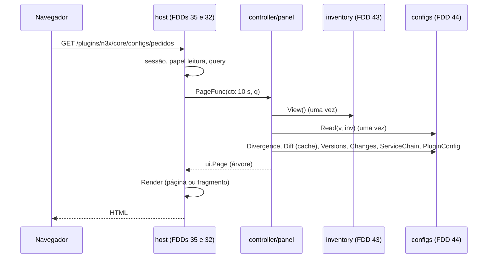
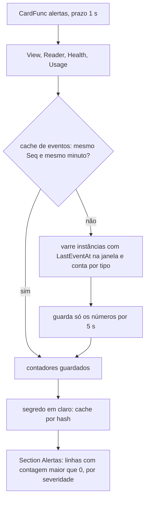

### FDD: Telas, cartões e métricas do plugin core (CORE-09)

Versão: 1.0
Data: 2026-10-21
Responsável: Guilherme Giusti

---

### 1. Contexto e motivação técnica

**Problema técnico.** O painel é a forma de o operador acompanhar os sidecars, as configs e as divergências (FR-006, FR-007 e FR-008), e as telas de inventário são do plugin core, não do host (ADR-003 do `n3x-controller`). Os dados já existem: o inventário com estados, sessões, manifestos, conflitos e eventos (FDD 43), as versões de config com divergência, diff, YAML e trecho (FDD 44), o diretório de usuários de leitura (FDD 40) e a saúde do Store (FDD 41). O host já serve o esqueleto, a sessão, o CSRF, o papel por rota, o polling e os cartões (FDDs 34 e 35), e o SDK já tem o catálogo de widgets (FDDs 10 e 11). Faltava o comportamento verificável que liga uma ponta à outra:

- quais rotas o core registra, com que papel, parâmetros e padrões de detalhe, e o que cada tela mostra, no nível da árvore de widgets
- como cada tela lê os dados sem trava e sem guardar snapshot (uma `inventory.View` e um `configs.Reader` por requisição, FDDs 41, 43 e 44)
- os textos em pt-BR das classes e fases de divergência, das marcas de config recusada, dos eventos (`panic` com `Suppressed`, `breaker_open`, `plugin_disabled` e os demais), das origens de schema e dos avisos do build (`vuln_scan`, `vuln` chamada, `load_test_skipped`)
- o que entra nos cartões da visão geral e o cartão de alertas, sem expor campo de segredo
- o que é exportável em CSV e JSON e o tratamento do IP anunciado (LGPD)
- o registro único das métricas `n3x_n3x_core_*` das duas metades, com nomes, tipos, rótulos e cardinalidade, que hoje estão espalhadas em sete FDDs (D-08 do README), e a lista única de alertas e indicadores de SLO sugeridos ao operador

**Encaixe no HLD.** O HLD do `n3x-plugin-core` põe o trabalho nos componentes `controller/panel` ("telas com widgets e cartões da visão geral") e `controller/metrics` ("métricas de negócio `n3x_n3x_core_*`"), na linha de "Interfaces públicas" das telas `/plugins/n3x/core/{sidecars,configs,fluxo,usuarios}` (página até 10 s, cartão até 1 s, p95 menor que 300 ms com 500 sidecars) e em "Observabilidade" (métricas, cartões e alertas). O HLD do `n3x-controller` ("Painel: mapa de telas") fixa as quatro rotas e os papéis. Esta FDD consome, sem redefinir:

- `ctrl.Routes.Page`, `InMenu`, `ctrl.Cards.Add`, `PageFunc`, `CardFunc`, `ErrNotFound`, `ErrBadRequest`, papéis `RoleRead` e `RoleRoot` (FDD 08)
- `ui.Page`, `Column`, `Row`, `Grid`, `Section`, `Text`, `Stat`, `Badge`, `Detail`, `Code` (`CodeYAML`, `CodeDiff`), `Empty`, `Pipeline`, `Table` com filtros e paginação, `ConfigDetail` (FDD 10); `Refresh`, `Link`, `LinkCell`, `Href`, `Table.Export`, `Code.Download` (FDD 11)
- `inventory.View`, `ManifestInfo`, `PluginDiff` (contratos 8 e 9 da FDD 43); `configs.Reader` (contratos 4 a 10 da FDD 44); `directory.Users` e `Summary` (contrato 6 da FDD 40); `store.Health` e `Usage` (FDD 41)
- `telemetry.Metrics` (FDD 06), prefixo `n3x_n3x_core_` e rótulos automáticos `plugin` e `instance` (FDD 01 e ADR-022 do `n3x-sdk`)
- `ctrltest`, `uitest.Lint` e `hostconformance` (FDD 12); slots, cartões, banners e job `panel-a11y` (FDD 35)

```text
 host do painel (FDD 35) ── sessão, CSRF, papel, Refresh, cartões em paralelo ──▶ PageFunc / CardFunc
                                                                                  │
                         controller/panel (esta FDD) ◀────────────────────────────┘
                           │ uma View e um Reader por requisição; caches só de valores derivados
       ┌───────────────────┼──────────────────────┬────────────────────┬────────────────────┐
       ▼                   ▼                      ▼                    ▼                    ▼
 inventory.View      configs.Reader        directory.Users      store.Health/Usage   metrics.Set
   (FDD 43)            (FDD 44)               (FDD 40)             (FDD 41)          (registro único)
                                                                                         ▲
 internal/metricdefs (catálogo) ── controller/metrics (metade de controller) ────────────┘
                                └─ agent/metrics (metade de proxy: agent_*, effective_config_*, session_*)
```

**Atores.** Operador root e usuários de leitura (leem; nunca editam, FR-007 e FR-009), host do painel (FDD 35, aplica sessão, CSRF, papel e polling), host de plugins (FDD 32, chama as funções com prazo e conta falhas), inventário (FDD 43), configs (FDD 44), diretório (FDD 40), Store (FDD 41), operador de observabilidade (lê métricas e alertas no Prometheus), simulador de 500 sidecars (FDD 51, mede o p95) e o job de acessibilidade (FDD 35).

**Limites.** Esta FDD não desenha layout, menu, login, banner por plugin nem confere papel no servidor (FDDs 34 e 35), não define widgets nem o renderizador (FDDs 10 e 11), não calcula estado, divergência, diff nem YAML (FDDs 43 e 44), não guarda dados (FDD 41) e não escreve guias nem as regras de deploy do Prometheus (FDD 47). Nenhuma tela tem `Form` nem `Action` (FR-007 e FR-009).

**Suposições**
- Uma réplica do controller; tudo em memória (ADR-001 do core); carga de referência de 500 sidecars em 50 serviços, até 20 versões por serviço, 10 abas com polling de 5 s (HLD do core, FDD 51)
- Go 1.26; regras da análise estática nas duas metades (FDD 24): sem instrução `go`, nenhum `ctx` guardado em campo
- As funções de página e de cartão são chamadas em paralelo por várias requisições (FDD 08)

**Restrições**
- Só widgets do SDK, sem HTML; página com prazo de `runtime.plugin_call_timeout` (10 s) e cartão de 1 s (ADR-018 do `n3x-sdk`)
- Uma `inventory.View` por requisição, sem guardá-la nem guardar o `*store.Snapshot` dela (pedido da FDD 41)
- Nenhum valor de segredo, texto `ENC[...]`, token, nonce, hash de senha ou custo de bcrypt de um usuário em tela, cartão, exportação, log ou métrica; só os marcadores da FDD 37
- Sem `Tabs` (contingência da FDD 10) e sem `Chart` (contingência da FDD 11): nenhuma tela do core depende deles
- `Refresh` só com resumos, nunca com tabela filtrável (pedido da FDD 11)

**Rastreabilidade**
- PRD 1.5: FR-006 (lista agrupada por serviço, filtros por estado, alvo, versão e hash, detalhe com idade da sessão, manifesto, config e eventos, destaque de divergência, alerta de listas de plugins diferentes, conflito, histórico), FR-007 (cadeia, campos por schema, YAML bruto, diff na mudança, grupos lado a lado, trecho YAML, última config válida com alerta), FR-008 (visão geral com sidecars por estado, serviços, configs divergentes e alertas de panics, plugin desligado e sidecar sem conexão; fluxo por serviço; polling de 5 s; banner), FR-009 (lista de usuários só para o root, sem ação), acessibilidade WCAG 2.1 AA e observabilidade do core; critérios de aceite "painel mostra serviço, instância, alvo, versão do Envoy, plugins e hash e destaca divergências com diff", "nenhuma tela altera config ou usuários", "usuário de leitura recebe 403 na lista de usuários" e "verificação automatizada de acessibilidade sem violações WCAG AA"
- HLD do `n3x-plugin-core`: componentes `controller/panel` e `controller/metrics`, "Interfaces públicas" (telas), "Observabilidade" (métricas, cartões, alertas e SLO); HLD do `n3x-controller`: "Painel: mapa de telas"
- ADRs: ADR-003, ADR-009 e ADR-010 do `n3x-plugin-core`; ADR-018 e ADR-022 do `n3x-sdk`; ADR-008 do `n3x-controller`
- **Lacunas:** L-67 aplicada (widget `ui.Pipeline`, fechada na FDD 10) na tela de fluxo; L-02 consumida (manifesto do controller por `inventory.View.ControllerPlugins()`, FDDs 09 e 43; o estado do core é mostrado pelo banner do host, FDD 35). Nenhuma lacuna nova fica aberta aqui. Aplicadas também L-07 (marcadores), L-15 (Store fora da cota do SDK, nos cartões e métricas) e L-34 (caminhos de campo)
- FDDs consumidas: 01, 02, 06, 08, 10, 11, 12, 18, 22, 32, 35, 36, 37, 39, 40, 41, 42, 43 e 44
- Decisões aprovadas pelo responsável do produto em 2026-10-22:
  - **D-01 (alertas):** entram na v1 apenas os 5 alertas sugeridos pelo HLD (degradado por 5 min, desconectados acima de 10% por 5 min, conflito de identidade, divergência de config por mais de 30 min, taxa alta de `logins_total{result="fail"}`) e os 2 indicadores de SLO (percentual de sidecars conectados e tempo de reconstrução do inventário, meta de 30 s). Os demais alertas e regras de gravação do contrato 13 ficam como proposta de backlog v1.x, fora do arquivo `docs/alertas/n3x-core.rules.yaml` da v1 e dos critérios de aceite "43 alertas e 4 regras de gravação" desta FDD (seções 2 e 9), que ficam superados por esta decisão
  - **D-02 (exportação):** as tabelas do painel oferecem exportação CSV e JSON sem nenhuma coluna de endereço ou IP; o `Address` anunciado aparece só no detalhe do sidecar e não é exportável. O FR-008 do PRD precisa citar a exportação (reflexo pendente)
  - **D-03 (métricas e telas):** aprovado o catálogo único `internal/metricdefs` com 47 famílias (35 da metade de controller e 12 da de proxy), a métrica `panel_build_seconds`, as 12 páginas e os 3 cartões do contrato 6. O ADR-010 e o HLD passam a apontar para o catálogo (reflexo pendente). As telas e filtros que citam o estado `history` seguem a D-01 da FDD 07 (sem fase de histórico) e devem ser reconciliados no WF3 (conflito C-RET)
- Pedidos do registro atendidos:
  - FDD 44: API `Reader` consumida conforme a tabela do contrato 10 dela (contratos 7 a 10 aqui), com `Code` (`CodeDiff`, `CodeYAML`, `Download`), `ConfigDetail` e `Pipeline`; textos das classes (`config`, `secrets`, `format`, `unknown`) e das fases (`recent`, `lasting`), layout lado a lado e origem do schema (P-06 dela, contrato 3); alertas de divergência por 30 min, marca `data_loss` ou `invalid_config`, marca `capacity` e recifragem frequente (contrato 13)
  - FDD 43: `inventory.View` uma por requisição (contrato 2); métricas novas consolidadas (contrato 12); alertas de conflito, desconectados acima de 10%, `permission_denied` crítico, ack p99, `orphan_dropped` e `controller_manifest` (contrato 13); exportação sem IP (contrato 5); P-06 dela respondido (rebuild com a mesma lista não é divergência; aparece como informação no serviço, contrato 7)
  - FDD 41: métricas novas e alertas consolidados; um `Snapshot()` por requisição, dentro da `View`, sem guardá-lo (contrato 2)
  - FDD 40: tela com `Users()` e `Summary()` (contrato 11); 3 métricas consolidadas; alertas `result="unknown"` e `result="busy"`; recomendação de custo único (P-03 dela respondido: sim, com o pedido de `MinCost` e `MaxCost`)
  - FDD 39: 4 métricas novas e alertas `hmac_key_configured == 0`, `token_rejections{reason=signature|not_yet_valid|key}` e `session_invalidations{cause=expired}`
  - FDD 42: 9 famílias `agent_*` e os alertas sugeridos
  - FDD 35: telas e cartões do core nos slots; `/usuarios` com `RoleRoot`; telas do core no job `panel-a11y` (contrato 14 e pedido)
  - FDD 22: como o painel mostra `load_test_skipped`, `vuln` chamada e `vuln_scan` (contratos 3 e 8)
  - FDDs 18 e 42: `panic` com `Suppressed`, `breaker_open` e `plugin_disabled` mapeados para texto e tom (contrato 3)
  - FDD 37: alertas de `effective_config_degraded` e de `effective_config_bytes`; detalhe com hash, `format` e selos de config não exibida (contrato 8)
  - FDDs 02 e 44: `Walk` pelo `ui.ConfigDetail` e pelo trecho da FDD 44
  - FDD 36: alerta de `registers_total{result="incompatible"}`
  - FDD 10: `Pipeline` no fluxo, sem `Tabs`, `ConfigDetail` nas configs; FDD 11: `Refresh` só com resumos, sem `ChartBar`, exportação sem IP
  - FDD 12: testes com `ctrltest`, `Link` e `hostconformance.Run(..., WithCore(...))`
- Pedidos desta FDD a outras (detalhe no checkpoint):
  - FDD 43: `ManifestInfo.WarningEntries []artifact.Warning` para os avisos do build (contrato 8)
  - FDD 40: `directory.Summary` com `MinCost` e `MaxCost` para a recomendação de custo único (contrato 11)
  - FDDs 37, 39, 40, 41, 42, 43 e 44: criar as famílias só pelo catálogo e receber os handles do `metrics.Set` (contrato 12)
  - FDD 35: telas do core no job `panel-a11y` com o core real, o `pages.json` e o cenário de dados; FDD 51: cenário `a11y-seed` e os padrões do contrato 6 no `routes.yaml`
  - FDD 47: regras do contrato 13 como `PrometheusRule`, painéis de referência e guia de cada alerta

---

### 2. Objetivos técnicos

- **Telas completas só com widgets.** Medida: as 12 páginas e os 3 cartões do contrato 6 passam no `ui.Check` e no `uitest.Lint` com 0 problemas em todas as fixtures, e nenhuma árvore contém `Form` nem `Action` (`ui.ActionTargets` vazio em todas).
- **Papel no servidor.** Invariante: `/plugins/n3x/core/usuarios` só responde 200 a root; usuário de leitura recebe 403 do host em `ctrltest` e no harness do host real; as demais rotas aceitam leitura.
- **Leitura sem trava e sem segurar memória.** Invariante: cada requisição chama `inv.View()` uma vez e `cfgs.Read` uma vez; nenhum campo do pacote guarda `View`, `Reader` ou `*store.Snapshot` (teste de reflexão sobre os tipos do pacote e revisão pelo `go vet` customizado do core).
- **Desempenho da construção.** Medida (hipótese de meta, benchmark com a fixture F1 de 500 sidecars): árvore de `/sidecars` em até 5 ms; detalhe do sidecar em até 1 ms; `/configs/{serviço}` com divergência e diff em cache em até 3 ms; cada cartão em até 2 ms (cartão de alertas em até 150 ms sem cache e até 1 ms com cache); o p95 de 300 ms da tela inteira é medido pela FDD 51.
- **Sem segredo e sem IP fora do controller.** Invariante: o canário (`secrettest.CanaryPrefix`) numa config de plugin e no `controller.secret` não aparece em nenhuma página, fragmento, cartão ou exportação; nenhuma exportação tem coluna ou valor de endereço (teste com expressão de IPv4 e IPv6 sobre os arquivos).
- **Registro único das métricas.** Invariante: as 35 famílias da metade de controller e as 12 da metade de proxy são criadas só a partir de `internal/metricdefs`; o teste de catálogo compara o registro real (`ctrltest` e `sdktest`) com o catálogo e com o golden `internal/metricdefs/testdata/catalog.txt`, nome, tipo, ajuda, rótulos, valores e buckets; toda série de rótulo fixo existe com valor 0 depois do `New`.
- **Alertas testados.** Medida: o arquivo `docs/alertas/n3x-core.rules.yaml` com os 43 alertas e as 4 regras de gravação do contrato 13 passa em `promtool check rules` e em `promtool test rules` com séries de exemplo para cada alerta.
- **Marco M3.** Medida: com `ctrltest.Link` e um agente real (FDD 42), um sidecar novo aparece em `/plugins/n3x/core/sidecars` no primeiro polling depois do `Register` aceito (até 5 s de relógio falso); a FDD 48 repete de ponta a ponta em docker compose.

---

### 3. Escopo e exclusões

**Incluído**
- Pacote `controller/panel`: `New`, registro das rotas e dos cartões, 12 páginas (sidecars: lista, serviço e detalhe; configs: lista, serviço, versão, instância, plugin e diff; fluxo: lista e serviço; usuários) e 3 cartões (`sidecars`, `configs`, `alertas`)
- Mapa de rotas, papéis, parâmetros de consulta e padrões de detalhe; ordenação, paginação, filtros, exportação e blocos `Refresh` de cada tela
- Textos e tons em pt-BR de estados, classes, fases, marcas de config recusada, eventos, origens de schema, avisos do build e divergência de manifesto
- Regras de leitura por requisição e os dois caches de valores derivados (alertas por 5 s e segredo em claro por hash)
- Decisão sobre exportação e IP anunciado (LGPD)
- Pacote `internal/metricdefs` (catálogo único), `controller/metrics` (registro da metade de controller) e `agent/metrics` (registro da metade de proxy), com a regra de pré-criação das séries
- Métrica nova `n3x_n3x_core_panel_build_seconds{page}` e logs do painel do core
- Lista única de alertas sugeridos e indicadores de SLO, com o arquivo de regras testado por `promtool`
- Lista de URLs e cenário de dados para o job de acessibilidade (contrato 14)

**Excluído**
- Layout, menu, login, banner, CSRF, papel no servidor, assets e o job `panel-a11y` em si: FDDs 34 e 35 (CTL-05 e CTL-06)
- Widgets, renderizador, exportação e polling no SDK: FDDs 10 e 11 (SDK-10 e SDK-11)
- Dados das telas: FDDs 40, 41, 43 e 44 (CORE-04, CORE-05, CORE-07 e CORE-08)
- Guias do operador, painel Grafana de referência, `PrometheusRule` e alertas de deploy: FDD 47 (SDK-15)
- Tela de auditoria, ações sobre usuários e troca de senha: fora da v1 (ADR-002 e ADR-003 do core)
- Gráficos de série temporal no painel (ficam no Prometheus e no Grafana; hipótese), exportação de usuários, eventos, sessões e plugins do manifesto (hipótese)
- Medida de p95 com 500 sidecars: FDD 51 (CTL-07)

---

### 4. Fluxos detalhados e diagramas

**Fluxo principal: subida**
1. `controller.New` (FDDs 39 a 44) cria primeiro `metrics.New(env.Metrics())`, que registra as 35 famílias da metade de controller a partir de `internal/metricdefs` e pré-cria as séries de rótulo fixo (contrato 12).
2. Os componentes recebem os handles do `*metrics.Set` (pedido às FDDs 39, 40, 41, 43 e 44) em vez de criar famílias.
3. Depois de Store, auth, diretório, configs e inventário, `panel.New(panel.Options{Inventory: inv, Configs: cfgs, Directory: dir, Store: st, Metrics: set, Log: env.Log()})`.
4. O host chama `Core.Routes(r)` e `Core.Cards(c)` (ordem da FDD 08); o core delega a `p.Routes(r)` e `p.Cards(c)`, que registram as 12 páginas e os 3 cartões; `panel_ready` (info) com as contagens.
5. Na metade de proxy, `agent.New` cria `agentmetrics.New(env.Metrics())` com as 12 famílias da metade de proxy (pedido às FDDs 37, 39 e 42).

**Fluxo principal: página (ex.: `GET /plugins/n3x/core/sidecars?sidecars.f.estado=desconectado`)**
1. O host confere sessão, papel (`RoleRead`) e query; chama a `PageFunc` com `ctx` de `runtime.plugin_call_timeout` (FDDs 08, 32 e 35).
2. A função lê `v := inv.View()` uma vez; para telas de config, `r := cfgs.Read(v, inv)` uma vez.
3. Monta a árvore: linhas da tabela a partir de `v.AllInstances(filtro)`; o filtro do inventário só é usado quando a query traz estado, alvo ou versão e há mais de 10.000 instâncias (contrato 5); o renderizador filtra, ordena e pagina as linhas entregues.
4. Observa `panel_build_seconds{page}`; devolve a árvore; o host renderiza, embrulha no layout ou devolve o fragmento.
5. Erros de leitura viram `ctrl.ErrNotFound` (404) ou `ctrl.ErrBadRequest` (400) pela tabela do contrato 5; o texto do erro nunca vai para a página.

**Fluxo principal: polling de um resumo**
1. O relógio do `Refresh` (ex.: `resumo`) faz `GET` na mesma rota com `HX-Target: n3x-p-resumo` e `N3X-Refresh: 1` a cada `panel.refresh_interval` (5 s).
2. A função monta a página inteira de novo, com uma `View` nova; o renderizador devolve só o bloco (FDD 10). Por isso os blocos `Refresh` só têm resumos baratos, e a página tem no máximo 2.

**Fluxo principal: visão geral**
1. O host chama os 3 cartões do core em paralelo, cada um com 1 s (FDD 35).
2. `sidecars`: `v.Counts()` e `v.Services()` (contagem). `configs`: `r.Summary()` e `r.Divergent()`. `alertas`: `st.Health()`, `st.Usage()`, `v.Counts()`, `r.Summary()`, a contagem de serviços com segredo em claro (cache por hash) e a contagem de eventos recentes (cache de 5 s).
3. Cada cartão devolve uma `Section` com título, de modo que o grupo `n3x.core` da visão geral mostra "Sidecars", "Configs" e "Alertas" como `<h3>`.

**Fluxo principal: contagem de eventos recentes (cartão de alertas)**
1. Chave do cache: `(v.Snapshot().Seq(), minuto atual)`; acerto devolve os contadores guardados, sem tocar no snapshot.
2. Falta: percorre `v.AllInstances(Filter{States: connected e disconnected})`; para as linhas com `LastEventAt` dentro da maior janela (24 h), chama `v.Instance(...)` e conta por tipo os eventos com `OccurredAt` dentro da janela do tipo (`panic` em 15 min; `breaker_open` e `plugin_disabled` em 24 h), somando `Suppressed` à parte e contando instâncias e serviços distintos.
3. Guarda só os números (nunca a `View` nem o snapshot) por até 5 s; loga `panel_events_scanned` em `debug` com `instances`, `events` e `duration_ms`.

**Fluxo principal: segredo em claro por serviço**
1. Para cada serviço, as versões em uso (`r.Versions(s)` com `InUse > 0`).
2. Para cada hash, o cache (até 1.024 hashes, LRU) devolve a quantidade de ocorrências do texto JSON exato `"***:plain"` no conteúdo; na falta, conta uma vez sobre o conteúdo da versão no snapshot da requisição (`ConfigInfo` da FDD 41) e guarda só o número. O hash é imutável, então o valor nunca muda.
3. O serviço entra no alerta se alguma versão em uso tem contagem maior que 0. O cartão mostra só a quantidade de serviços; o caminho do campo aparece só na tela de config (selo "em claro" do `ConfigDetail`) e nos eventos `secret_in_clear` do detalhe do sidecar.

**Fluxos alternativos e exceções**
- **Restart do controller:** o inventário vazio mostra estados vazios ("Nenhum sidecar registrado ainda.") até os `Register` chegarem; os caches do painel nascem vazios.
- **Store degradado:** as telas continuam com os últimos dados; o banner é do host; o cartão de alertas mostra "Core degradado" com o uso; a tela de configs mostra as marcas `capacity`.
- **Core `falho` em runtime:** o host responde 503 e tira os cartões (FDD 32); nada a fazer aqui.
- **Sem manifesto do controller:** `ControllerPlugins()` falso; a coluna e o alerta "plugins diferentes do controller" somem, e o detalhe do serviço diz "Comparação com o controller desligada: manifesto do controller indisponível."
- **Serviço ou instância que sumiu entre a lista e o clique:** 404 com a página genérica do host.
- **Versão descartada:** a mudança aparece com os dois hashes e "versão anterior não guardada", sem link de diff (`HashChange.Available` falso, FDD 44).
- **Config inteira mascarada** (`***:opaque` ou `***:omitted`): "Config não exibida" no lugar do `ConfigDetail`, com o motivo da FDD 37.
- **Schema indisponível:** YAML bruto em `Code` com `CodeYAML` e o selo "sem schema: YAML bruto".
- **Mais de 10.000 instâncias:** a lista pré-filtra pelo inventário com os filtros de seleção da query; sem filtro, o renderizador mostra "Mais de 10.000 linhas: use os filtros para reduzir." (FDD 10).
- **Usuário de leitura em `/usuarios`:** o host responde 403 antes de chamar; se a função for chamada sem root (defeito do host), devolve `ctrl.ErrNotFound`, sem dado.
- **Cartão estourando 1 s:** o host mostra "Cartão <id> indisponível agora." e conta `card_failures_total` (FDD 32); o cache do cartão de alertas reduz a chance.
- **Panic numa função do painel:** contido pelo host (`kind="panel"`, FDD 32); 5 em 60 s deixam o core `falho` (L-36); por isso as funções têm teste com fixtures de borda e fuzzing de query.

**Diagramas**

Leitura de uma página de configs:



Cartão de alertas com cache:



---

### 5. Contratos públicos (assinaturas, endpoints, headers, exemplos)

Os pacotes `controller/panel`, `controller/metrics`, `agent/metrics` e `internal/metricdefs` são internos ao repositório do core: mudam junto com as FDDs 40 a 44, sem semver próprio. São públicos para o operador as rotas, os textos, os nomes de arquivos exportados, as métricas e os alertas (contratos 3 a 14), estáveis na major do core (ADR-010).

**Contrato 1: `panel.New` e a ligação na metade de controller**
- Tipo: sdk (API Go interna do core)
- Assinatura/Rota:
  ```go
  package panel // github.com/giustech/n3x-plugin-core/controller/panel

  // Portas mínimas, para os testes trocarem as fontes.
  type Inventory interface {
      View() inventory.View
      ManifestInfo(h store.Hash) (*inventory.ManifestInfo, bool)
  }
  type Configs interface {
      Read(v inventory.View, ms configs.ManifestSource) configs.Reader
  }
  type Directory interface {
      Users() []directory.User
      Summary() directory.Summary
  }
  type StoreHealth interface {
      Health() store.Health
      Usage() store.Usage
  }

  type Options struct {
      Inventory Inventory    // *inventory.Inventory (FDD 43)
      Configs   Configs      // *configs.Configs (FDD 44)
      Directory Directory    // *directory.Directory (FDD 40)
      Store     StoreHealth  // store.Store (FDD 41)
      Metrics   *metrics.Set // registro único (contrato 12)
      Log       *slog.Logger // env.Log()
      Now       func() time.Time // nil = time.Now
  }

  func New(o Options) (*Panel, error) // erro só com opção nula

  func (p *Panel) Routes(r ctrl.Routes) // registra as 12 páginas (contrato 6)
  func (p *Panel) Cards(c ctrl.Cards)   // registra os 3 cartões (contrato 4)

  const (
      PanicWindow         = 15 * time.Minute // hipótese
      DisabledWindow      = 24 * time.Hour   // breaker_open e plugin_disabled; hipótese
      AlertCacheTTL       = 5 * time.Second  // igual ao polling padrão; hipótese
      InClearCacheEntries = 1024             // hipótese
      MaxSideBySideGroups = 6                // referência mais 5; hipótese
      SideBySideColumns   = 3                // hipótese
      MaxGroupNames       = 20               // nomes de instância listados por grupo; hipótese
      MaxScanInstances    = 10000            // teto da varredura de eventos; hipótese
  )
  ```
  ```go
  package controller

  func (c *Core) Routes(r ctrl.Routes) { c.panel.Routes(r) } // RoutesProvider (FDD 08)
  func (c *Core) Cards(cs ctrl.Cards)  { c.panel.Cards(cs) } // CardsProvider (FDD 08)
  ```
- Método: n/a (chamada local)
- Semântica de status/headers:
  - **Sem estado de requisição em campo:** `*Panel` guarda só as portas, o relógio, os handles de métrica e os dois caches de números (contrato 2); é seguro entre goroutines
  - **Sem tarefa de fundo:** os caches expiram por tempo na leitura; o core continua com 2 das 8 tarefas da metade de controller (FDD 43)
  - **Sem campo novo no `n3x.yaml`:** janelas e limites são constantes; mudam em minor do core (hipótese)

**Exemplo de requisição**
```go
p, err := panel.New(panel.Options{Inventory: inv, Configs: cfgs, Directory: dir, Store: st, Metrics: set, Log: env.Log()})
```

**Exemplo de resposta** (log do `Routes` e do `Cards`)
```json
{"ts":"2026-10-21T14:00:00.425Z","level":"info","component":"plugin","msg":"panel_ready","plugin_id":"n3x.core","pages":12,"menu":4,"cards":3,"panic_window":"15m0s","disabled_window":"24h0m0s","alert_cache_ttl":"5s"}
```

---

**Contrato 2: leitura por requisição e caches permitidos**
- Tipo: sdk (regra de uso das APIs das FDDs 40, 41, 43 e 44)
- Assinatura/Rota:
  ```go
  // Dentro de cada PageFunc e CardFunc:
  v := p.o.Inventory.View()        // uma vez; 0 alocações (FDD 43)
  r := p.o.Configs.Read(v, p.o.Inventory) // uma vez, só nas telas que leem config (FDD 44)
  h, u := p.o.Store.Health(), p.o.Store.Usage() // leituras atômicas (FDD 41)

  // Caches do pacote (os únicos):
  type eventTally struct {
      key        [2]int64      // Snapshot().Seq() e minuto Unix
      at         time.Time
      byKind     [7]int        // eventos na janela do tipo (índice: corev1.EventKind; 0 = unknown)
      suppressed [7]uint64
      instances  [7]int
      services   [7]int
  }
  type inClearCache struct{ /* LRU hash -> contagem de "***:plain", até InClearCacheEntries */ }
  ```
- Método: n/a
- Semântica de status/headers:
  - **Uma `View` por requisição:** todas as leituras da mesma resposta veem o mesmo corte do Store (FDD 41); a `View` e o `Reader` vivem só na pilha da função e nunca vão para campo, canal ou cache
  - **Caches de valores derivados:** só números e só chaves imutáveis (hash) ou com prazo (5 s); nenhum guarda ponteiro para snapshot, conteúdo, `View`, `Reader`, linha ou evento (atende o pedido da FDD 41 e o risco de memória fora da conta da L-15)
  - **Custo:** a varredura de eventos é O(instâncias com evento recente x eventos retidos), limitada a `MaxScanInstances`; com o cache, no máximo uma varredura por 5 s, seja qual for o número de abas
  - **Telas que não leem config** (sidecars, usuários) não chamam `Read`; a de usuários não chama `View`
  - **Polling:** cada polling é uma requisição nova, com `View` nova; nada é reaproveitado entre requisições além dos dois caches

**Exemplo de requisição**
```go
func (p *Panel) sidecars(ctx context.Context, q ui.Query) (ui.Widget, error) {
    start := p.now()
    v := p.o.Inventory.View()
    rows := p.instanceRows(v, q)            // até 10.000 linhas
    page := p.sidecarsPage(v.Counts(), rows) // árvore do contrato 7
    p.o.Metrics.PanelBuildSeconds.With("sidecars").ObserveDuration(p.now().Sub(start))
    return page, nil
}
```

**Exemplo de resposta**
```json
{ "View()": 1, "Read()": 0, "campos do *Panel com View, Reader ou Snapshot": 0, "panel_build_seconds{page=\"sidecars\"}": "0.0031" }
```

---

**Contrato 3: textos e tons em pt-BR (estados, divergência, marcas, eventos, schema e build)**
- Tipo: formato de dados (textos do painel; golden em `controller/panel/testdata/texts.golden`)
- Assinatura/Rota: funções puras não exportadas em `controller/panel/texts.go`; a tabela abaixo é o contrato
- Método: n/a
- Semântica de status/headers:

| Origem | Valor | Rótulo do `Badge` | Tom | Texto complementar |
| --- | --- | --- | --- | --- |
| estado (FDD 41) | `connected` | conectado | `ToneOK` | "desde <hora>" |
| estado | `disconnected` | desconectado | `ToneWarning` | "visto por último em <hora>" |
| estado | `history` | histórico | `ToneNeutral` | "no histórico desde <hora>; sai em <hora>" |
| conflito (FDD 43) | verdadeiro | conflito de identidade | `ToneDanger` | "duas instâncias com a mesma identidade desde <hora>; some sozinho 3 intervalos depois que a antiga parar" |
| classe (FDD 44) | `config` | config diferente | `ToneWarning` | "valores de config diferentes da referência" |
| classe | `secrets` | troca de segredo ou recifragem | `ToneInfo` | "só impressões digitais de segredo mudaram; conta como divergência" |
| classe | `format` | versões do core diferentes | `ToneNeutral` | "só campos novos do formato mais novo; não conta como divergência" |
| classe | `unknown` | diferença ainda não calculada | `ToneWarning` | "abra o diff para calcular" |
| fase (FDD 44) | `recent` | recente: possível rollout | `ToneInfo` | "divergente há <duração>" |
| fase | `lasting` | persistente: possível drift | `ToneWarning` | "divergente desde <hora> (mais de 30 min)" |
| marca (FDD 44) | `data_loss` | config corrompida | `ToneDanger` | "hash recebido não confere; mantida a última config válida (<hash curto>)" |
| marca | `invalid_config` | config fora do formato | `ToneDanger` | "config recebida recusada; mantida a última config válida (<hash curto>)" |
| marca | `capacity` | sem memória para versão nova | `ToneWarning` | "core degradado recusou a versão nova; mantida a última config válida (<hash curto>)" |
| origem do schema (FDD 44) | `instance` | schema da instância | `ToneNeutral` | "<plugin> <versão>, do manifesto da instância" |
| origem | `remembered` | schema lembrado | `ToneNeutral` | "último manifesto visto com esta versão" |
| origem | `controller` | schema do controller | `ToneWarning` | "<plugin> <versão> do binário do controller; pode diferir do sidecar" |
| origem | `none` | sem schema: YAML bruto | `ToneNeutral` | "nenhum manifesto com o schema deste plugin" |
| config da entrada (FDD 37) | `opaque`, `omitted` | config não exibida | `ToneWarning` | "config do plugin mascarada inteira pelo sidecar (<motivo>)" |
| divergência de manifesto (FDD 43) | `manifest` | manifestos diferentes | `ToneWarning` | "<N> listas de plugins entre as conectadas" |
| rebuild (P-06 da FDD 43) | mesma lista, outro manifesto | rebuild | `ToneInfo` | "<N> manifestos com a mesma lista de plugins; não conta como divergência" |
| controller (FDD 43) | `missing_in_controller` | falta no controller | `ToneDanger` | "o controller não tem este plugin; dados da metade de controller não têm quem os receba" |
| controller | `missing_in_sidecar` | falta no sidecar | `ToneWarning` | "o sidecar não tem este plugin" |
| controller | `version_mismatch` | versão diferente | `ToneWarning` (`ToneInfo` para `n3x.core`) | "sidecar <v> e controller <v>" |
| controller | `module_mismatch` | módulo diferente | `ToneDanger` | "sidecar <módulo> e controller <módulo>" |

  - **Eventos (FDDs 09, 18, 29, 36 e 42)**, coluna "Tipo" e texto do `Detail` traduzido (o `Detail` original fica na coluna "Detalhe técnico", em `MonoCell`):

| `kind` | Rótulo | Tom | Tradução do `Detail` |
| --- | --- | --- | --- |
| `panic` | panic contido | `ToneDanger` | `hook=<h>`: "no hook <h>"; `task=<t>`: "na tarefa de fundo <t>"; `Suppressed > 0`: "mais <N> no mesmo segundo, suprimidos pela fila" |
| `breaker_open` | disjuntor aberto | `ToneDanger` | `reason=panics`: "por panics repetidos"; `reason=zombies`: "por chamadas assíncronas que não voltaram"; sempre "a instância fica fora até o restart do sidecar" |
| `plugin_disabled` | plugin desligado automaticamente | `ToneDanger` | `reason=breaker instances=<n>`: "as <n> instâncias do plugin estão com o disjuntor aberto" |
| `config_error` | aviso de config | `ToneWarning` | `<caminho> [<código>]`: o próprio texto |
| `drain_start` | início da drenagem | `ToneInfo` | `drain_timeout=<d>`: "prazo de drenagem <d>" |
| `secret_in_clear` | segredo em claro | `ToneWarning` | `<caminho>`: "campo <caminho> sem ENC[...]; cifre com n3x encrypt" (só o caminho, nunca o valor) |
| outro número (`unknown`) | evento desconhecido | `ToneNeutral` | o próprio texto |

  - **Detalhe fora do formato conhecido:** sai como veio, escapado pelo renderizador; o `Detail` já é limitado a 256 bytes e sem valor (FDDs 18 e 36)
  - **Avisos do build (FDD 22), no detalhe do sidecar e na coluna "Build" da lista:**

| Entrada | Situação | Rótulo | Tom | Texto |
| --- | --- | --- | --- | --- |
| `vuln_scan` | `status: ok` | varredura ok | `ToneOK` | "base <source> de <modified>" |
| `vuln_scan` | `status: fallback` | varredura com base da imagem | `ToneWarning` | "base <source> de <modified>; pode estar desatualizada" |
| `vuln_scan` | `status: failed` | varredura não feita | `ToneDanger` | "o build não conferiu vulnerabilidades" |
| `vuln` | `called: true` | vulnerabilidade chamada | `ToneDanger` | "<id> em <module>@<version>; corrigida em <fixed> (ou sem correção); plugins <lista> ou runtime" |
| `vuln` | `called: false` | vulnerabilidade não chamada | `ToneInfo` | o mesmo texto, numa seção recolhida |
| `load_test_skipped` | `reason: cross_arch` | sem teste de carga | `ToneWarning` | "build cruzado em <host_arch>: o .so só passou pela comparação de símbolos" |
| `target_status` | `candidate`, `deprecated` | alvo <status> | `ToneWarning` | "alvo <target> marcado como <status> no catálogo do builder" |
| demais (`fetch_unverified`, `dependency_upgraded`, `deprecated_api`, `analysis_exception`, `truncated`, desconhecido) | qualquer | outros avisos | `ToneNeutral` | contagem por tipo e o JSON da entrada em `Code` com `CodeJSON`, numa seção recolhida |

  - **Coluna "Build" da lista:** o mais grave entre `vulnerabilidade chamada`, `varredura não feita`, `sem teste de carga` e `varredura com base da imagem`, ou vazio
  - **Formatação:** horas por `ui.FormatTime` (UTC), durações por `ui.FormatDuration`, contagens por `ui.FormatInt`, bytes por `ui.FormatBytes`; hash curto com 12 hex em `MonoCell` ou `TextMono`; a cor nunca é a única informação (o rótulo sempre existe)

**Exemplo de requisição**
```go
b, note := eventText(inventory.EventView{Kind: "panic", Plugin: "giustech.ratelimit", PluginInstance: "rl-api", Detail: "hook=request_headers", Suppressed: 9})
```

**Exemplo de resposta**
```json
{ "Badge": { "Label": "panic contido", "Tone": "danger" }, "note": "no hook request_headers; mais 9 no mesmo segundo, suprimidos pela fila" }
```

---

**Contrato 4: cartões da visão geral (`sidecars`, `configs`, `alertas`)**
- Tipo: sdk (registro por `ctrl.Cards.Add`, FDD 08) e formato da árvore
- Assinatura/Rota:
  ```go
  func (p *Panel) Cards(c ctrl.Cards) {
      c.Add("sidecars", ctrl.RoleRead, p.cardSidecars)
      c.Add("configs", ctrl.RoleRead, p.cardConfigs)
      c.Add("alertas", ctrl.RoleRead, p.cardAlertas)
  }
  ```
- Método: n/a (chamados pelo host a cada renderização e a cada polling da visão geral, com 1 s)
- Semântica de status/headers:
  - **Contêiner:** `ui.CardContainerID` dá `n3x-c-n3x-core-sidecars`, `n3x-c-n3x-core-configs` e `n3x-c-n3x-core-alertas`; grupo `n3x.core` primeiro (FDD 35)
  - **Título:** a raiz de cada cartão é uma `Section` (heading `<h3>` pelo `HeadingBase` 3 da FDD 35); assim o cartão não depende do título opcional pedido à FDD 08 (P-01 da FDD 35)
  - **`sidecars`:** `Row` com `Stat` "Conectados" (`ToneOK`), "Desconectados" (`ToneWarning` se maior que 0; `ToneDanger` e dica "acima de 10% dos ativos" se a razão passa de 0,1, igual ao alerta A-06), "No histórico" e "Serviços"; links "Ver sidecars" e "Ver desconectados" (`sidecars?sidecars.f.estado=desconectado`)
  - **`configs`:** `Stat` "Serviços divergentes" (`ToneWarning` se maior que 0, dica "<N> persistentes"), "Versões guardadas", "Mudanças em 30 min"; `Text` "<N> serviços só com versões do core diferentes" quando há; link "Ver configs"
  - **`alertas`:** `Detail` com uma linha por alerta com contagem maior que 0, na ordem abaixo; cada valor é um `Row` com `Badge`, `Text` e `Link`; sem nenhum, `Empty` "Nenhum alerta do core agora."

| Ordem | Linha | Fonte | Tom | Link |
| --- | --- | --- | --- | --- |
| 1 | Core degradado | `Health().Degraded`, `Usage()` | `ToneDanger` | `configs` (marcas `capacity`) |
| 2 | Plugins desligados automaticamente (24 h) | eventos `plugin_disabled` | `ToneDanger` | `sidecars?sidecars.sort=-evento` |
| 3 | Disjuntores abertos (24 h) | eventos `breaker_open` | `ToneDanger` | idem |
| 4 | Panics (15 min) | eventos `panic` e `Suppressed` | `ToneDanger` | idem |
| 5 | Conflitos de identidade | `Counts().Conflicts` | `ToneDanger` | `sidecars?sidecars.f.alerta=conflito` |
| 6 | Configs recusadas, mantida a última válida | `Summary().Alerts` | `ToneDanger` ou `ToneWarning` | `configs` |
| 7 | Segredo em claro | serviços com `"***:plain"` em versão em uso | `ToneWarning` | `configs?servicos.sort=-claro` |
| 8 | Plugins diferentes do controller | `Counts().ServicesControllerMismatch` | `ToneWarning` | `sidecars?sidecars.f.alerta=plugins diferentes do controller` |
| 9 | Sidecars sem conexão | `Counts().Disconnected` | `ToneWarning` | `sidecars?sidecars.f.estado=desconectado` |
| 10 | Manifestos divergentes | `Counts().ServicesManifestDivergent` | `ToneInfo` | `sidecars?servicos.f.situacao=manifestos diferentes` |
| 11 | Builds com vulnerabilidade chamada | `ManifestInfo` dos manifestos em uso | `ToneWarning` | `sidecars?sidecars.f.build=vulnerabilidade chamada` |

  - **Segredo em claro sem expor o campo (ponto do ASSUNTO):** a linha diz só "Segredo em claro: <N> serviços com segredo sem ENC[...] na config em uso" e o link; nenhum caminho, nome de campo, serviço específico ou valor; o caminho aparece só para quem abre a config ou o detalhe do sidecar (os dois só leitura e com sessão)
  - **Contagens:** eventos com o número de sidecars e serviços distintos ("<E> eventos em <S> sidecars de <N> serviços"); `Suppressed` somado no texto do panic ("mais <X> suprimidos")
  - **Links:** montados com `ui.PluginPath(...).With(chave, valor)` (FDD 11), que escapa os valores; o valor de um filtro de seleção é o texto exibido da célula (FDD 10), por isso os links usam os rótulos do contrato 3
  - **Prazo:** cada cartão em até 2 ms com o cache de eventos válido; sem o cache, a varredura limitada a `MaxScanInstances` (contrato 2)

**Exemplo de requisição**
```go
res := h.Card("alertas", ctrltest.As(ctrltest.Read("ana")))
```

**Exemplo de resposta** (`res.Text()` com o Store degradado, um conflito e panics)
```text
Alertas
Core degradado: desde 2026-10-21 14:03:07 UTC; uso 129,0 MiB de 128,0 MiB; novas versões de config recusadas. Ver configs
Panics (15 min): 14 eventos em 3 sidecars de 1 serviço, mais 52 suprimidos. Ver sidecars
Conflitos de identidade: 1 instância. Ver sidecars
Segredo em claro: 2 serviços com segredo sem ENC[...] na config em uso. Ver configs
```

---

**Contrato 5: regras comuns das telas (Refresh, tabelas, exportação, IP e erros)**
- Tipo: endpoint (comportamento de todas as páginas do contrato 6)
- Assinatura/Rota: páginas `GET` sob `/plugins/n3x/core/`; chaves de query do renderizador (`<id>.page`, `<id>.sort`, `<id>.f.<filtro>`, `<id>.export`, `<id>.refresh`) e as do core, sem `.`
- Método: `GET` e `HEAD`
- Semântica de status/headers:
  - **`Refresh`:** no máximo 2 blocos por página, só com `Stat`, `Badge`, `Detail`, `Text` e tabela sem filtros; intervalo padrão (`Every` zero, vale o `panel.refresh_interval`); tabelas com filtros e os `Code` de diff ficam fora dos blocos
  - **Tabelas:** `PageSize` 50 (padrão do SDK); ordenação padrão por tabela no contrato de cada tela; filtros combinam com "e" (FDD 10); a query preserva os parâmetros do core
  - **Pré-filtro:** com mais de 10.000 linhas, os filtros de seleção de estado, alvo e versão do Envoy vão também para `inventory.Filter`, para o renderizador receber até 10.000
  - **Exportação (ponto do ASSUNTO):** `Table.Export: []ui.Format{ui.CSV, ui.JSON}` só nas tabelas `sidecars` e `servicos` da lista de sidecars, `servicos` da lista de configs e `versoes` do serviço; `Code.Download` nos diffs, na versão inteira em YAML e no trecho de plugin. Sem exportação: usuários, eventos, sessões, plugins do manifesto e mudanças (hipótese). Nomes de arquivo pela FDD 11: `n3x-core-sidecars.csv`, `n3x-core-servicos.json`, `n3x-core-versoes.csv`, `n3x-core-versao.yaml`, `n3x-core-diff.diff`, `n3x-core-trecho.yaml`
  - **IP anunciado (LGPD, pedidos das FDDs 11 e 43):** o `Address` da instância aparece só no detalhe do sidecar, num `Detail` sem exportação; nenhuma tabela tem coluna de endereço, então nenhuma exportação leva IP. O IP fica dentro do controller, em memória, pelo tempo de `inventory_retention` (FDD 43). Quem precisa do endereço de muitos pods usa o orquestrador (hipótese)
  - **Sem ações:** nenhuma árvore tem `Form` nem `Action`; o filtro por GET é o do próprio `Table`
  - **Erros da leitura para status:**

| Erro | Origem | Status pelo host | Observação |
| --- | --- | --- | --- |
| serviço, instância ou plugin desconhecido (`ErrUnknownService`, `ErrUnknownInstance`, `ErrUnknownPlugin`, `View.Instance` falso) | FDDs 43 e 44 | 404 (`ctrl.ErrNotFound`) | página genérica |
| hash no path fora de 64 hex, ou `ErrInvalidHash` | FDD 44 | 404 | pedido da FDD 44 |
| versão não guardada no path (`ErrUnknownVersion`) | FDD 44 | 404 | |
| parâmetro do core inválido na query (`de`, `para`, `a`, `b`, `versao`, `historico`) | esta FDD | 400 (`ctrl.ErrBadRequest`) | |
| versão de `de` ou `para` não guardada | FDD 44 | 200 | página do diff com "versão não guardada no serviço" |
| `ErrConfigHidden` | FDD 44 | 200 | "config não exibida" |
| `ErrInvalidDocument` ou outro erro | FDD 44 | 500 | log do host (FDD 32) |
| prazo da página | host | 504 | |
| Caller sem root na página de usuários (defeito do host) | esta FDD | 404 (`ctrl.ErrNotFound`) | o host já respondeu 403 antes (hipótese) |

**Exemplo de requisição**
```text
GET /plugins/n3x/core/sidecars?sidecars.f.estado=desconectado&sidecars.export=csv HTTP/2
Cookie: n3x_session=<sessão de ana, leitura>
```

**Exemplo de resposta** (cabeçalhos da FDD 11; sem coluna de endereço)
```text
HTTP/2 200
Content-Type: text/csv; charset=utf-8; header=present
Content-Disposition: attachment; filename="n3x-core-sidecars.csv"
Cache-Control: no-store
X-Content-Type-Options: nosniff

Serviço,Instância,Estado,Alvo,Envoy,Config,Plugins,Sessão,Visto por último,Último evento,Alerta,Build
pedidos,pedidos-7d9f8b-xk2lp,desconectado,envoy-1.40,1.40.1,573ea08dfcea,8175a20a2029,1272,2026-10-21T14:09:51Z,2026-10-21T13:58:02Z,,
```

---

**Contrato 6: mapa de rotas, papéis, parâmetros e padrões de detalhe**
- Tipo: endpoint (registro por `ctrl.Routes.Page`, FDD 08; prefixo `/plugins/n3x/core/`)
- Assinatura/Rota:
  ```go
  func (p *Panel) Routes(r ctrl.Routes) {
      r.Page("/sidecars", ctrl.RoleRead, p.sidecars, ctrl.InMenu("Sidecars"))
      r.Page("/sidecars/{service}", ctrl.RoleRead, p.sidecarsService)
      r.Page("/sidecars/{service}/{instance}", ctrl.RoleRead, p.sidecar)
      r.Page("/configs", ctrl.RoleRead, p.configs, ctrl.InMenu("Configs"))
      r.Page("/configs/{service}", ctrl.RoleRead, p.configsService)
      r.Page("/configs/{service}/diff", ctrl.RoleRead, p.configsDiff)
      r.Page("/configs/{service}/versoes/{hash}", ctrl.RoleRead, p.configsVersion)
      r.Page("/configs/{service}/versoes/{hash}/{plugin}", ctrl.RoleRead, p.configsPlugin)
      r.Page("/configs/{service}/instancias/{instance}", ctrl.RoleRead, p.configsInstance)
      r.Page("/fluxo", ctrl.RoleRead, p.flows, ctrl.InMenu("Fluxo"))
      r.Page("/fluxo/{service}", ctrl.RoleRead, p.flow)
      r.Page("/usuarios", ctrl.RoleRoot, p.users, ctrl.InMenu("Usuários"))
  }
  ```
- Método: `GET` e `HEAD`
- Semântica de status/headers:

| Rota (padrão do rótulo `route`) | Papel | Parâmetros do core | Tabelas (ID) | `Refresh` (ID) | `page` da métrica |
| --- | --- | --- | --- | --- | --- |
| `/plugins/n3x/core/sidecars` | leitura | `historico=1` (inclui o histórico) | `servicos`, `sidecars` | `resumo` | `sidecars` |
| `/plugins/n3x/core/sidecars/{service}` | leitura | `historico=1` | `manifestos`, `controller`, `sidecars` | `resumo` | `sidecars_service` |
| `/plugins/n3x/core/sidecars/{service}/{instance}` | leitura | nenhum | `plugins`, `sessoes`, `eventos` | `estado`, `eventos_vivos` | `sidecar` |
| `/plugins/n3x/core/configs` | leitura | nenhum | `servicos`, `alertas` | `resumo` | `configs` |
| `/plugins/n3x/core/configs/{service}` | leitura | nenhum | `grupos_extra`, `versoes`, `mudancas` | `divergencia` | `configs_service` |
| `/plugins/n3x/core/configs/{service}/diff` | leitura | `de` e `para` (64 hex) ou `a` e `b` (instâncias) | `campos` | nenhum | `configs_diff` |
| `/plugins/n3x/core/configs/{service}/versoes/{hash}` | leitura | nenhum | nenhuma | nenhum | `configs_version` |
| `/plugins/n3x/core/configs/{service}/versoes/{hash}/{plugin}` | leitura | nenhum | nenhuma | nenhum | `configs_plugin` |
| `/plugins/n3x/core/configs/{service}/instancias/{instance}` | leitura | nenhum | `historico` | `estado` | `configs_instance` |
| `/plugins/n3x/core/fluxo` | leitura | nenhum | `servicos` | nenhum | `fluxo` |
| `/plugins/n3x/core/fluxo/{service}` | leitura | `versao` (64 hex) | nenhuma | nenhum | `fluxo_service` |
| `/plugins/n3x/core/usuarios` | root | nenhum | `usuarios` | nenhum | `usuarios` |

  - **Padrões de detalhe (pedido da FDD 51):** `{service}` e `{instance}` são os nomes como chegam no `Register` (gramática da FDD 15 e da FDD 25, até 253 bytes, podem ter `.`); `{hash}` é o hash da config com 64 hex minúsculos, sem o prefixo `sha256:` (a tela acrescenta o prefixo antes de chamar a FDD 44); `{plugin}` é o `instance` da entrada de `plugins[]` (FDD 37). Os links são gerados por `ui.PluginPath`, que escapa cada segmento (FDD 11)
  - **Sem página raiz:** `/plugins/n3x/core/` não é registrada (404); o menu leva às quatro entradas, e "Usuários" só aparece para root pelo filtro de papel do host (FDD 32)
  - **Gramática (FDD 08):** os literais `diff`, `versoes` e `instancias` ficam em posições em que não há curinga concorrente; nenhum par de padrões se cruza (regra `ambiguous_route` pedida pela FDD 35)
  - **Limites:** 12 páginas de 64, 3 cartões de 16, até 3 curingas por padrão (de 4)
  - **Parâmetros do core:** sem `.`, para não colidir com as chaves do renderizador; `historico` aceita só `1`; `de`, `para` e `versao` aceitam só 64 hex; `a` e `b` aceitam nomes de instância do serviço; `de` e `para` juntos ou `a` e `b` juntos, nunca os quatro
  - **Rótulo `route`:** o padrão com `{nome}` (FDD 35), então a cardinalidade de `n3x_controller_panel_requests_total` para o core é de 12 rotas

**Exemplo de requisição**
```text
GET /plugins/n3x/core/sidecars/pedidos/pedidos-7d9f8b-xk2lp HTTP/2
GET /plugins/n3x/core/configs/pedidos/diff?de=573ea08dfcea466c12a4eaf03609ef12bc2b3fea4d4d5502b7b8cd7f7077ff3b&para=0d4be1f2a9c34a1b8e7f60c2d9b3e5f1a8c7d6e5f4a3b2c1d0e9f8a7b6c5d4e3
GET /plugins/n3x/core/usuarios       (sessão de leitura)
GET /plugins/n3x/core/configs/pedidos/versoes/sha256:573ea08d...
```

**Exemplo de resposta**
```json
{
  "detalhe": { "status": 200, "route": "/plugins/n3x/core/sidecars/{service}/{instance}" },
  "diff": { "status": 200, "route": "/plugins/n3x/core/configs/{service}/diff" },
  "usuarios com leitura": { "status": 403, "corpo": "Esta página exige o papel root.", "log": "panel_forbidden" },
  "hash com prefixo no path": { "status": 404, "route": "/plugins/n3x/core/configs/{service}/versoes/{hash}" }
}
```

---

**Contrato 7: telas de sidecars (lista e serviço)**
- Tipo: endpoint (árvore de widgets)
- Assinatura/Rota: `/plugins/n3x/core/sidecars` e `/plugins/n3x/core/sidecars/{service}`
- Método: `GET`
- Semântica de status/headers:
  - **Lista, árvore:** `Page{Title: "Sidecars", Description: "Instâncias registradas no controller, agrupadas por serviço."}` com:
    1. `Refresh{ID: "resumo", Label: "Resumo dos sidecars"}` com `Row` de `Stat` (conectados, desconectados, histórico, serviços, conflitos) e `Text` muted "Inventário em memória: depois de um restart do controller, os sidecars se registram de novo."
    2. `Section{Title: "Serviços"}` com `Table{ID: "servicos"}`: Serviço (`LinkCell` para `/sidecars/{service}`), Conectados, Desconectados, Histórico (`IntCell`), Alvos e Versões do Envoy (`TextCell` unidas por vírgula), Situação (`BadgeCell`: "manifestos diferentes", "plugins diferentes do controller", "conflito", "ok"); filtro `situacao` (seleção) e `busca` (texto); ordem por serviço; exportação CSV e JSON
    3. `Section{Title: "Sidecars"}` com `Table{ID: "sidecars"}`: Serviço (`LinkCell`), Instância (`LinkCell` para o detalhe), Estado (`BadgeCell`), Alvo, Envoy, Config (hash curto em `MonoCell`), Plugins (`PluginsHash` em `MonoCell`), Sessão (`DurationCell`, idade desde `SessionIssuedAt`), Visto por último (`TimeCell`), Último evento (`TimeCell`), Alerta (`BadgeCell`: o mais grave entre "conflito", "config recusada", "plugins diferentes do controller", "config divergente"), Build (`BadgeCell`, contrato 3); filtros `estado`, `alvo`, `envoy`, `config`, `alerta`, `build` (seleção) e `busca` (texto em todas as colunas); ordem padrão Serviço crescente e, no empate, a ordem de entrega (instância); colunas ordenáveis: Serviço, Instância, Estado, Envoy, Sessão, Visto por último, Último evento (chave `evento`); exportação CSV e JSON
  - **Estado padrão (FR-006, "sai da lista ativa e fica só no histórico"):** sem `historico=1`, as linhas e as contagens da tabela trazem só `connected` e `disconnected`; um link "Mostrar também o histórico (<N>)" acrescenta `historico=1`
  - **Filtros de FR-006:** estado, alvo, versão e hash; alerta e build a mais
  - **"Config divergente" na coluna Alerta:** instância conectada cujo `ConfigHash` não é o da referência do serviço (`Divergence.Groups`), lido com `cfgs.Read` só quando algum serviço diverge (`r.Divergent()` não vazio)
  - **Serviço, árvore:** `Page{Title: "<serviço>", Description: "Sidecars do serviço <serviço>."}` com `Refresh{ID: "resumo"}` (as contagens do `ServiceSummary`, alvos, versões do Envoy e o `Badge` de divergência de config com link para `/configs/{service}`), `Section{Title: "Manifestos"}` com `Table{ID: "manifestos"}` (Plugins (`PluginsHash`), Instâncias, Core no sidecar (`Runtime`), Manifestos distintos) e o texto de rebuild quando há mais de um `ManifestHash` com o mesmo `PluginsHash`; `Section{Title: "Comparação com o controller"}` com `Table{ID: "controller"}` (Plugin, Tipo (`BadgeCell` do contrato 3), Sidecar, Controller), montada com o `ControllerDiff` de uma instância conectada por `PluginsHash` diferente do controller; `Section{Title: "Conflitos"}` com um `Detail` por conflito (instância, desde, os dois "emitida em"); e a mesma `Table{ID: "sidecars"}` restrita ao serviço
  - **Sem dados:** `Empty` "Nenhum sidecar registrado ainda." e, no serviço desconhecido, 404

**Exemplo de requisição**
```go
res := h.Page("/sidecars?sidecars.f.estado=desconectado", ctrltest.Target("n3x-p-sidecars")).AssertOK(t)
```

**Exemplo de resposta** (`res.Render()` e trecho de `res.Text()`)
```json
{ "Mode": "fragment", "Title": "Sidecars", "Rows": 9, "Notices": [] }
```
```text
Sidecars | Serviço Instância Estado Alvo Envoy Config Plugins Sessão Visto por último Último evento Alerta Build
pedidos pedidos-7d9f8b-xk2lp desconectado envoy-1.40 1.40.1 573ea08dfcea 8175a20a2029 21m12s 2026-10-21 14:09:51 UTC 2026-10-21 13:58:02 UTC
Página 1 de 1 (linhas 1 a 9 de 9)
```

---

**Contrato 8: tela de detalhe do sidecar**
- Tipo: endpoint (árvore de widgets)
- Assinatura/Rota: `/plugins/n3x/core/sidecars/{service}/{instance}`
- Método: `GET`
- Semântica de status/headers:
  - **Fonte:** `v.Instance(service, instance)` (`InstanceDetail`, FDD 43), `inv.ManifestInfo(ManifestHash)` e, para a config, `cfgs.Read(v, inv).Instance(...)` e `Chain(...)` (FDD 44)
  - **Árvore:** `Page{Title: "<instância>", Description: "Sidecar do serviço <serviço>."}` com:
    1. `Refresh{ID: "estado", Label: "Estado do sidecar"}` com `Detail`: Estado (`Badge` do contrato 3 e "desde"), Visto por último, Conflito (quando há), Sessão atual ("emitida em", "expira em", idade, intervalo de heartbeat, stream aberto)
    2. `Section{Title: "Identidade"}` com `Detail`: Serviço, Instância, Endereço anunciado (`Text` mono; o único lugar com o IP, contrato 5), Alvo, Versão do Envoy, Registrado em, Core no sidecar (`ManifestInfo.Runtime`)
    3. `Section{Title: "Config efetiva"}` com `Detail`: Hash atual (64 hex em `TextMono`), `format`, Situação (`Badge` de grupo ou "igual à referência"), Marca (`Badge` do contrato 3, quando há), Última mudança (de, para, classe, link do diff), Selos ("<N> plugins com config não exibida", pedido da FDD 37) e `Link` "Ver a config desta instância" para `/configs/{service}/instancias/{instance}`
    4. `Section{Title: "Plugins do manifesto"}` com `Table{ID: "plugins"}`: Plugin, Versão, Módulo (`MonoCell`), Metades, Controller (`BadgeCell` do `ControllerDiff` ou "igual"); e o `Badge` "rebuild" quando aplicável
    5. `Section{Title: "Avisos do build", Fold: FoldOpen}` com as linhas do contrato 3 (`vuln_scan` sempre, `vuln` chamada, `load_test_skipped`, `target_status`) e `Section{Title: "Outros avisos", Fold: FoldClosed}` para o resto; sem `ManifestInfo`, `Text` "Manifesto indisponível no cache e no Store."
    6. `Section{Title: "Sessões", Fold: FoldClosed}` com `Table{ID: "sessoes"}`: Emitida, Expira, Último ping, Intervalo, Stream, Atual, Vencida (sem nonce, FDD 43)
    7. `Refresh{ID: "eventos_vivos", Label: "Eventos"}` com `Table{ID: "eventos"}` sem filtros: Quando (`OccurredAt`), Tipo (`BadgeCell`), Plugin, Instância do plugin, O que houve (tradução do contrato 3), Suprimidos (`IntCell`), Detalhe técnico (`MonoCell`), Recebido; ordem Quando decrescente; até 200 linhas (FDD 41)
  - **Eventos do FR-006:** panics, plugin desligado automaticamente, erro de config e início da drenagem aparecem todos na mesma tabela, com os demais tipos
  - **Detalhe com as FDDs 37 e 22:** hash, `format` e selos (FDD 37); `vuln_scan`, `vuln` chamada e `load_test_skipped` (FDD 22) a partir de `ManifestInfo.WarningEntries` (pedido à FDD 43; até a consolidação, a seção mostra só "<N> avisos no manifesto" com `ManifestInfo.Warnings`)

**Exemplo de requisição**
```go
res := h.Page("/sidecars/pedidos/pedidos-7d9f8b-xk2lp", ctrltest.As(ctrltest.Read("ana"))).AssertOK(t)
```

**Exemplo de resposta** (trecho de `res.Text()`)
```text
pedidos-7d9f8b-xk2lp
Estado conectado desde 2026-10-21 13:48:13 UTC | Visto por último 2026-10-21 14:09:51 UTC | Sessão emitida em 2026-10-21 13:48:13 UTC, expira em 2026-10-21 14:48:13 UTC, idade 21m38s, heartbeat a cada 10s, stream aberto
Endereço anunciado 10.42.3.17:17000 | Alvo envoy-1.40 | Versão do Envoy 1.40.1
Config efetiva sha256:573ea08dfcea466c12a4eaf03609ef12bc2b3fea4d4d5502b7b8cd7f7077ff3b format 1 igual à referência
Avisos do build: varredura com base da imagem (base image de 2026-10-01 02:00:00 UTC; pode estar desatualizada) | vulnerabilidade chamada GO-2026-1234 em github.com/redis/go-redis/v9@v9.7.0; corrigida em v9.7.3; plugins giustech.ratelimit
Eventos: 2026-10-21 14:01:10 UTC panic contido giustech.ratelimit rl-api no hook request_headers; mais 9 no mesmo segundo, suprimidos pela fila 9 hook=request_headers
```

---

**Contrato 9: telas de configs (lista, serviço, versão, instância, plugin e diff)**
- Tipo: endpoint (árvore de widgets sobre o `configs.Reader`, tabela do contrato 10 da FDD 44)
- Assinatura/Rota: as seis rotas `/configs...` do contrato 6
- Método: `GET`
- Semântica de status/headers:
  - **Lista (`/configs`):** `Refresh{ID: "resumo"}` com `Stat` de `Summary()` (serviços, versões, divergentes, só formato, mudanças em 30 min, marcas por motivo); `Table{ID: "servicos"}`: Serviço (`LinkCell`), Versões, Em uso, Divergência (`BadgeCell` com a fase ou "igual" ou "versões do core diferentes"), Grupos, Desde (`TimeCell`), Marcas (`IntCell`), Segredos em claro (`IntCell`, chave `claro`), Última mudança (`TimeCell`); filtro `situacao` e `busca`; ordem por serviço; exportação; `Table{ID: "alertas"}` com `Alerts()`: Serviço, Instância (`LinkCell` para a config da instância), Marca (`BadgeCell`), Hash recusado, Mantida (hashes curtos), Desde, Vezes
  - **Serviço (`/configs/{service}`), layout lado a lado (P-06 da FDD 44):** `Refresh{ID: "divergencia"}` com `Detail` (referência, grupos, fase com o texto do contrato 3, desde, conectadas sem config); `Section{Title: "Grupos de instâncias"}` com `Grid{Columns: 3}` de até `MaxSideBySideGroups` `Section`s, uma por grupo, a referência primeiro: título "Referência <hash curto>" ou "Grupo <n>: <hash curto>", `Badge` de classe e de quantidade, `FirstSeen`, até 20 nomes de instância em `Text` mono e "mais <N>", e, nos grupos que não são a referência, `Code{ID: "diff_g<n>", Label: "Diferenças para a referência", Lang: ui.CodeDiff, Download: true}` com `r.Diff(serviço, referência, grupo).Unified` e o resumo das contagens; com mais grupos, `Table{ID: "grupos_extra"}` com o hash, as instâncias, a classe e um `LinkCell` para o diff; no `Grid`, a tela estreita vira uma coluna (FDD 10)
    - `Section{Title: "Cadeia"}` com o `Pipeline` do contrato 10 sobre `ServiceChain` e um link para `/fluxo/{service}`
    - `Section{Title: "Config de cada instância de plugin"}` com uma `Section` recolhida por entrada da cadeia: `Badge` da origem do schema e o texto, `ui.ConfigDetail(Schema, Entry.Config)` com schema, `Code{Lang: ui.CodeYAML}` sem schema, "config não exibida" com `opaque` ou `omitted`, e `Link` "Trecho para outro serviço" para a página do plugin
    - `Section{Title: "Versões"}` com `Table{ID: "versoes"}`: Versão (`LinkCell` hash curto), `format`, Primeira vez, Última vez, Em uso, Conectadas, Tamanho (`BytesCell`), Anterior (`LinkCell` "diff com a anterior" para `/diff?de=<anterior>&para=<esta>`); ordem por Primeira vez decrescente; exportação
    - `Section{Title: "Mudanças recentes"}` com `Table{ID: "mudancas"}` de `Changes()`: Quando, Instância, De, Para, Classe, Diff (`LinkCell` só com `Available`; senão "versão anterior não guardada")
  - **Versão (`/configs/{service}/versoes/{hash}`):** `Detail` (hash inteiro, `format`, primeira e última vez, em uso, conectadas, anterior com link), `Pipeline` da `Chain(h)`, `Code{ID: "diff_anterior", Lang: ui.CodeDiff, Download: true}` com `DiffPrevious` (ou `Text` "primeira versão guardada do serviço"), as configs das entradas como no serviço, `Section{Title: "Parâmetros do sidecar", Fold: FoldClosed}` com `Code{Lang: ui.CodeYAML}` de `Chain.Sidecar` e `Section{Title: "Versão inteira em YAML", Fold: FoldClosed}` com `Code{ID: "versao", Lang: ui.CodeYAML, Download: true}` de `VersionYAML`
  - **Plugin (`/configs/{service}/versoes/{hash}/{plugin}`):** `Detail` (plugin, instância, fase, ordem, política, assíncrono, recorte `match` em `Code` JSON), origem do schema, a config (como acima) e `Section{Title: "Trecho para outro serviço"}` com `Code{ID: "trecho", Label: "Trecho YAML do plugin", Lang: ui.CodeYAML, Download: true}` de `PluginSnippet` e o texto "<N> segredos trocados por ENC[...]: cifre de novo com n3x encrypt --service <destino>." (FR-007, copiar vira baixar; FDDs 11 e 44)
  - **Instância (`/configs/{service}/instancias/{instance}`):** `Refresh{ID: "estado"}` com `Detail` (estado, hash atual com link para a versão, grupo, marca com o texto do contrato 3); `Code{ID: "diff_ultima", Lang: ui.CodeDiff, Download: true}` com o diff da `LastChange` quando `Available`; `Table{ID: "historico"}` com os hashes do `History` (mais novo primeiro) e links para as versões
  - **Diff (`/configs/{service}/diff`):** `Detail` (de, para, classe, contagens, cortado), `Table{ID: "campos"}` com as `Change`: Caminho (`MonoCell`, L-34), Operação (`BadgeCell`: incluído, removido, alterado), Tipo (`BadgeCell`: valor, segredo, config não exibida, formato), Antes e Depois (`MonoCell` com o JSON canônico, só marcadores em segredo); filtros `operacao` e `tipo`; e `Code{ID: "diff", Lang: ui.CodeDiff, Download: true}`; com `Truncated`, `Badge` "diff cortado" e o texto da FDD 44
  - **Nunca:** `ENC[...]` do sidecar, valor em claro ou impressão digital fora dos marcadores; o trecho só tem o texto fixo `ENC[...]` da FDD 44

**Exemplo de requisição**
```go
res := h.Page("/configs/pedidos").AssertOK(t)
tree := res.Tree().(ui.Page)
```

**Exemplo de resposta** (resumo da árvore, 7 instâncias com `A` e 3 com `B`)
```go
ui.Section{Title: "Grupos de instâncias", Child: ui.Grid{Columns: 3, Children: []ui.Widget{
    ui.Section{Title: "Referência 573ea08dfcea", Child: ui.Column{Children: []ui.Widget{
        ui.Row{Children: []ui.Widget{ui.Badge{Label: "7 instâncias"}, ui.Badge{Label: "referência", Tone: ui.ToneOK}}},
        ui.Text{Text: "pedidos-0\npedidos-1\npedidos-2\npedidos-3\npedidos-4\npedidos-5\npedidos-6", Style: ui.TextMono},
    }}},
    ui.Section{Title: "Grupo 2: 0d4be1f2a9c3", Child: ui.Column{Children: []ui.Widget{
        ui.Row{Children: []ui.Widget{ui.Badge{Label: "3 instâncias"}, ui.Badge{Label: "config diferente", Tone: ui.ToneWarning},
            ui.Badge{Label: "recente: possível rollout", Tone: ui.ToneInfo}}},
        ui.Text{Text: "2 alterados, 1 de segredo", Style: ui.TextMuted},
        ui.Code{ID: "diff_g2", Label: "Diferenças para a referência", Lang: ui.CodeDiff, Download: true, Text: "--- 573ea08dfcea 2026-10-20 09:30:00 UTC\n+++ 0d4be1f2a9c3 ..."},
    }}},
}}}
```

---

**Contrato 10: tela de fluxo por serviço**
- Tipo: endpoint (árvore de widgets; `ui.Pipeline`, L-67)
- Assinatura/Rota: `/plugins/n3x/core/fluxo` e `/plugins/n3x/core/fluxo/{service}?versao=<64 hex>`
- Método: `GET`
- Semântica de status/headers:
  - **Lista:** `Table{ID: "servicos"}`: Serviço (`LinkCell`), Fases com plugin (`IntCell`), Instâncias de plugin (`IntCell`), Versões em uso, Divergência (`BadgeCell`); ordem por serviço; sem exportação
  - **Serviço:** `ServiceChain(serviço)` (a referência da divergência ou a única versão em uso); com `versao`, `Chain(serviço, versão)`. `Page{Title: "Fluxo de <serviço>", Description: "Cadeia de plugins na requisição, em ordem de fase."}` com `Detail` (versão mostrada com link, origem: "referência da divergência" ou "única versão em uso"), links para as outras versões em uso quando o serviço diverge, e `ui.Pipeline{Label: "Cadeia de <serviço> na requisição"}`
  - **Etapas (hipótese):** as 8 fases de `plugin.Phases()`, de `access` a `observe`, sempre na ordem, mesmo vazias ("Nenhum item."), para o operador ver em que ponto cada plugin roda; título = nome da fase; nota "grupo paralelo" quando a fase tem itens com `Parallel`
  - **Itens (contexto compacto):** um `Row` por instância de plugin com `Badge` do ID, `Badge` "instância <nome>", `Badge` "ordem <n>", `Badge` "fail-closed" (`ToneWarning`) ou "fail-open" (`ToneInfo`), `Badge` "paralelo" e "assíncrono" quando valem, `Badge` "config não exibida" quando a entrada é `opaque` ou `omitted`, e `Link` "config" para a página do plugin
  - **Sem `Tabs` nem diagrama:** a ordem vem da lista ordenada do `Pipeline` (FDD 10)

**Exemplo de requisição**
```go
res := h.Page("/fluxo/pedidos").AssertOK(t)
```

**Exemplo de resposta** (trecho da árvore)
```go
ui.Pipeline{Label: "Cadeia de pedidos na requisição", Stages: []ui.Stage{
    {Title: "access"}, {Title: "authn"}, {Title: "route"}, {Title: "authz"},
    {Title: "traffic", Items: []ui.Widget{ui.Row{Gap: ui.GapSmall, Children: []ui.Widget{
        ui.Badge{Label: "giustech.ratelimit"}, ui.Badge{Label: "instância rl-api"}, ui.Badge{Label: "ordem 20"},
        ui.Badge{Label: "fail-closed", Tone: ui.ToneWarning}, ui.Badge{Label: "assíncrono"},
        ui.Link{Label: "config", To: ui.PluginPath("configs", "pedidos", "versoes", "573ea08d...", "rl-api")},
    }}}},
    {Title: "transform", Items: []ui.Widget{ /* n3x.example add-header ordem 50 fail-open */ }},
    {Title: "upstream"}, {Title: "observe"},
}}
```

---

**Contrato 11: tela de usuários (só root)**
- Tipo: endpoint (árvore de widgets sobre o contrato 6 da FDD 40)
- Assinatura/Rota: `/plugins/n3x/core/usuarios`, `ctrl.RoleRoot`
- Método: `GET`
- Semântica de status/headers:
  - **Árvore:** `Page{Title: "Usuários de leitura", Description: "Lista só leitura, vinda de plugins[\"n3x.core\"].users no n3x.yaml do controller."}` com `Row` de `Stat` de `Summary()` (total, ativos, desativados); `Table{ID: "usuarios", Caption: "Usuários de leitura"}`: Nome (`TextCell`), Estado (`BadgeCell` "ativo" `ToneOK` ou "desativado" `ToneNeutral`); filtros `estado` e `busca`; ordem do `n3x.yaml` (ordem de entrega); sem exportação (hipótese); `Text` muted "Para criar, desativar, remover ou trocar a senha, edite a seção no n3x.yaml e reinicie o controller."
  - **Lista vazia:** `Empty` "Nenhum usuário de leitura: só o root entra no painel."
  - **Recomendação de custo único (P-03 da FDD 40):** com `Summary().MinCost != Summary().MaxCost` (pedido à FDD 40), `Badge` "custos de bcrypt diferentes" `ToneWarning` e o texto "Os hashes usam custos de <min> a <max>. Gere todos com o mesmo custo (n3x-controller hash --cost <max>), para o tempo de resposta do login não revelar quem existe." Nunca mostra o custo de um usuário
  - **Nunca:** hash, custo por usuário, `plugin.Secret`, ação ou formulário
  - **Papel:** o host responde 403 a leitura antes de chamar (FDD 35); a função confere `ctrl.Caller(ctx).Role.Meets(ctrl.RoleRoot)` de novo e devolve `ctrl.ErrNotFound` sem dado (defesa em profundidade, hipótese)

**Exemplo de requisição**
```go
h.Page("/usuarios", ctrltest.As(ctrltest.Root("admin"))).AssertOK(t).AssertContains(t, "ana", "ativo", "bruno", "desativado")
h.Page("/usuarios", ctrltest.As(ctrltest.Read("ana"))).AssertStatus(t, 403)
```

**Exemplo de resposta**
```json
{ "root": { "Status": 200, "Rows": 3, "Text": "Usuários de leitura Total 3 Ativos 2 Desativados 1 ... ana ativo bruno desativado carla ativo" }, "leitura": { "Status": 403, "função chamada": false } }
```

---

**Contrato 12: catálogo de métricas e registro único (`internal/metricdefs`, `controller/metrics`, `agent/metrics`)**
- Tipo: sdk (API Go interna do core) e stream (Prometheus em `17091/metrics` no controller; stats `n3x_` do Envoy no sidecar)
- Assinatura/Rota:
  ```go
  package metricdefs // github.com/giustech/n3x-plugin-core/internal/metricdefs (só telemetry do SDK)

  type Kind uint8   // Counter, Gauge, Histogram
  type Half uint8   // Controller, Sidecar

  type Label struct {
      Name   string
      Values []string // valores permitidos; nil = aberto (só "service" em divergences)
  }
  type Family struct {
      Name    string    // sem prefixo, ex.: "registers_total"
      Kind    Kind
      Half    Half
      Help    string    // texto único em pt-BR
      Labels  []Label   // rótulos do autor, na ordem de With
      Buckets []float64 // nil = telemetry.DefaultBuckets
      Owner   string    // FDD que define quando muda, ex.: "CORE-07"
  }

  func All() []Family                          // 47 famílias, ordem do catálogo
  func Lookup(h Half, name string) (Family, bool)
  func (f Family) FullName() string            // "n3x_n3x_core_" + Name
  func (f Family) FixedSeries() int            // produto dos valores; 0 com rótulo aberto
  func Counter(m *telemetry.Metrics, f Family) *telemetry.Counter     // panic se Kind não bate (bug)
  func Gauge(m *telemetry.Metrics, f Family) *telemetry.Gauge
  func Histogram(m *telemetry.Metrics, f Family) *telemetry.Histogram
  func Precreate(f Family, with func(values ...string))               // chama With para cada combinação válida
  ```
  ```go
  package metrics // github.com/giustech/n3x-plugin-core/controller/metrics

  type Set struct {
      Sidecars, IdentityConflicts, Divergences *telemetry.Gauge
      RegistersTotal, EventsTotal, LoginsTotal *telemetry.Counter
      HeartbeatLagSeconds                      *telemetry.Histogram
      PanelBuildSeconds                        *telemetry.Histogram
      // ... um campo por família da metade de controller (35)
  }

  func New(m *telemetry.Metrics) *Set // só no controller.New; pré-cria as séries de rótulo fixo
  ```
  ```go
  package metrics // github.com/giustech/n3x-plugin-core/agent/metrics (importado como agentmetrics)

  type Set struct{ /* 12 famílias da metade de proxy */ }
  func New(m *telemetry.Metrics) *Set // só no agent.New
  ```
- Método: n/a
- Semântica de status/headers:
  - **Registro único (D-08):** toda família `n3x_n3x_core_*` nasce de uma `Family` do catálogo; nenhum componente chama `env.Metrics().Counter` direto (teste `go/ast` no repositório); o mesmo handle é dividido quando dois componentes escrevem na mesma família (`divergences` com `kind` `manifest` e `controller_manifest` pela FDD 43 e `config` pela FDD 44, I-01)
  - **Pré-criação:** toda série de rótulo fixo é criada com valor 0 no `New` (para `increase` e `rate` dos alertas funcionarem desde a subida; FDD 33 lembra que séries que só nascem na primeira ocorrência quebram o `sum by`); `divergences` nasce por serviço no primeiro valor maior que 0 e depois fica em 0 (FDD 06 não remove séries)
  - **Rótulos automáticos:** `plugin="n3x.core"` em todas; `instance=""` no controller e `instance="core"` no sidecar (FDDs 06 e 08); nenhum rótulo com instância de sidecar, IP, nonce, hash, caminho, usuário ou `id` de evento
  - **Golden:** `internal/metricdefs/testdata/catalog.txt` com uma linha por família (nome, tipo, metade, rótulos e valores, buckets, dona, ajuda); muda só com valor novo de rótulo (minor) ou família nova (minor); renomear ou mudar tipo é quebra (major, ADR-010)
  - **Catálogo, metade de controller** (35 famílias; séries por família contadas sem os rótulos automáticos e, nos histogramas, como uma série):

| # | Família (`n3x_n3x_core_`) | Tipo | Rótulos e valores | Séries | Dona |
| --- | --- | --- | --- | --- | --- |
| 1 | `sidecars` | gauge | `state` (`connected`, `disconnected`, `history`) | 3 | CORE-07 (ADR-010) |
| 2 | `identity_conflicts` | gauge | | 1 | CORE-07 (ADR-010) |
| 3 | `registers_total` | counter | `result` (`ok`, `exhausted`, `incompatible`, `invalid_argument`, `permission_denied`, `data_loss`, `invalid_config`, `invalid_manifest`, `timeout`, `internal`) | 10 | CORE-07 (ADR-010) |
| 4 | `events_total` | counter | `kind` (`panic`, `breaker_open`, `plugin_disabled`, `config_error`, `drain_start`, `secret_in_clear`, `unknown`) | 7 | CORE-07 (ADR-010) |
| 5 | `events_rejected_total` | counter | `reason` (`duplicate`, `orphan_retry`, `orphan_dropped`, `invalid`) | 4 | CORE-07 |
| 6 | `heartbeat_lag_seconds` | histogram | buckets 0,01; 0,05; 0,1; 0,25; 0,5; 1; 2,5; 5; 10; 30 | 1 | CORE-07 (ADR-010) |
| 7 | `heartbeat_ack_seconds` | histogram | buckets padrão (18) | 1 | CORE-07 |
| 8 | `heartbeats_total` | counter | `result` (`ok`, `resend`, `expired`, `invalid`) | 4 | CORE-07 |
| 9 | `heartbeat_streams` | gauge | | 1 | CORE-07 |
| 10 | `exits_total` | counter | `reason` (`drain`, `sigterm`) x `result` (`disconnected`, `superseded`, `unknown`) | 6 | CORE-07 |
| 11 | `state_transitions_total` | counter | `from`, `to`, `reason` (9 combinações do contrato 6 da FDD 43) | 9 | CORE-07 |
| 12 | `divergences` | gauge | `service` (aberto, até 1.024) x `kind` (`manifest`, `controller_manifest`, `config`) | até 3.072 | CORE-07 e CORE-08 (ADR-010) |
| 13 | `config_versions` | gauge | | 1 | CORE-08 |
| 14 | `config_changes_total` | counter | `class` (`config`, `secrets`, `format`, `unknown`) | 4 | CORE-08 |
| 15 | `config_alerts` | gauge | `reason` (`data_loss`, `invalid_config`, `capacity`) | 3 | CORE-08 |
| 16 | `config_diff_seconds` | histogram | buckets 0,0005; 0,001; 0,002; 0,005; 0,01; 0,02; 0,05; 0,1; 0,25 | 1 | CORE-08 |
| 17 | `config_diff_cache_total` | counter | `result` (`hit`, `miss`) | 2 | CORE-08 |
| 18 | `config_diff_cache_bytes` | gauge | | 1 | CORE-08 |
| 19 | `config_diff_truncated_total` | counter | | 1 | CORE-08 |
| 20 | `config_schema_fallbacks_total` | counter | `source` (`remembered`, `controller`, `none`) | 3 | CORE-08 |
| 21 | `memory_bytes` | gauge | | 1 | CORE-05 (ADR-010) |
| 22 | `memory_limit_bytes` | gauge | | 1 | CORE-05 |
| 23 | `store_bytes` | gauge | `kind` (`instance`, `history`, `config`, `manifest`, `event`) | 5 | CORE-05 |
| 24 | `degraded` | gauge 0 ou 1 | | 1 | CORE-05 (ADR-010) |
| 25 | `store_discards_total` | counter | `kind` (`history`, `event`, `config`) x `reason` (`pressure`, `limit`), 5 combinações válidas | 5 | CORE-05 |
| 26 | `store_rejections_total` | counter | `kind` (`config`) | 1 | CORE-05 |
| 27 | `store_reclaim_seconds` | histogram | buckets padrão (18) | 1 | CORE-05 |
| 28 | `logins_total` | counter | `result` (`ok`, `fail`, `blocked`, `busy`, `timeout`, `invalid_request`, `error`) | 7 | CORE-03 (ADR-010) |
| 29 | `token_rejections_total` | counter | `reason` (`malformed`, `version`, `key`, `signature`, `lifetime`, `not_yet_valid`, `expired`, `not_ready`) | 8 | CORE-03 |
| 30 | `hmac_key_configured` | gauge 0 ou 1 | | 1 | CORE-03 |
| 31 | `session_index_entries` | gauge | | 1 | CORE-03 |
| 32 | `users` | gauge | `state` (`active`, `disabled`) | 2 | CORE-04 |
| 33 | `user_checks_total` | counter | `result` (`ok`, `invalid`, `disabled`, `unknown`, `busy`, `canceled`) | 6 | CORE-04 |
| 34 | `user_check_duration_seconds` | histogram | buckets 0,05; 0,1; 0,25; 0,5; 1; 2; 4; 8 | 1 | CORE-04 |
| 35 | `panel_build_seconds` | histogram | `page` (os 12 valores do contrato 6 mais `card_sidecars`, `card_configs` e `card_alertas`); buckets 0,001; 0,0025; 0,005; 0,01; 0,025; 0,05; 0,1; 0,25; 0,5; 1 | 15 | CORE-09 (nova, hipótese) |

  - **Catálogo, metade de proxy** (12 famílias, no `.so`, publicadas como stats do Envoy a cada 1 s, histograma sem `_sum`, FDD 16):

| # | Família (`n3x_n3x_core_`) | Tipo | Rótulos e valores | Séries | Dona |
| --- | --- | --- | --- | --- | --- |
| 36 | `agent_registers_total` | counter | `result` (`ok`, `exhausted`, `unavailable`, `unauthenticated`, `incompatible`, `refused`, `error`) | 7 | CORE-06 |
| 37 | `agent_registered` | gauge 0 ou 1 | | 1 | CORE-06 |
| 38 | `agent_register_bytes` | gauge | | 1 | CORE-06 |
| 39 | `agent_heartbeat_streams_total` | counter | `reason` (`first`, `rotate`, `reopen`) | 3 | CORE-06 |
| 40 | `agent_heartbeat_stream_ends_total` | counter | `reason` (`server_closed`, `unavailable`, `rejected`, `exhausted`, `refused`, `ack_timeout`, `rotate`, `shutdown`) | 8 | CORE-06 |
| 41 | `agent_heartbeat_rtt_seconds` | histogram | buckets padrão (18) | 1 | CORE-06 |
| 42 | `agent_resend_requests_total` | counter | `result` (`honored`, `coalesced`, `limited`) | 3 | CORE-06 |
| 43 | `agent_events_total` | counter | `kind` (7 valores de `events_total`) x `result` (`buffered`, `failed`) | 14 | CORE-06 |
| 44 | `agent_exits_total` | counter | `reason` (`drain`, `sigterm`) x `result` (`ok`, `failed`, `skipped`) | 6 | CORE-06 |
| 45 | `session_invalidations_total` | counter | `cause` (`rejected`, `expired`) | 2 | CORE-03 |
| 46 | `effective_config_bytes` | gauge | | 1 | CORE-02 |
| 47 | `effective_config_degraded` | gauge | `reason` (`schema_missing`, `marks_mismatch`, `invalid_config`, `omitted`) | 4 | CORE-02 |

  - **Cardinalidade:** controller com 119 séries fixas (incluindo as 15 de `panel_build_seconds`) mais `divergences` (até 3 por serviço que já divergiu, teto prático de 3.072); em séries do Prometheus, contando `_bucket`, `_sum` e `_count` dos 6 histogramas, cerca de 370 fixas; sidecar com 51 séries por instância, que viram 70 stats do Envoy (o histograma sai com 18 `_bucket`, `+Inf` e `_count`), ou 35.000 com 500 sidecars, todas sem rótulo de identidade (o `job` e o `instance` do scrape separam os pods)
  - **Quando cada uma muda:** pelo contrato da FDD dona (coluna Dona); esta FDD só fixa nome, tipo, rótulos, valores, buckets e o momento de criação
  - **Do host e do sidecar, usadas nos alertas mas fora deste catálogo:** `n3x_controller_plugin_state{plugin="n3x.core"}`, `n3x_controller_panel_duration_seconds{route}`, `n3x_controller_card_failures_total{plugin,card,reason}` (FDDs 32 e 35), `n3x_controller_connected`, `n3x_controller_session_age_seconds`, `n3x_controller_logins_total{result}` (sidecar, FDDs 09, 16 e 38), `process_start_time_seconds` (FDD 30)

**Exemplo de requisição**
```go
set := metrics.New(env.Metrics())
set.RegistersTotal.With("permission_denied").Inc()
f, _ := metricdefs.Lookup(metricdefs.Controller, "registers_total")
fmt.Println(f.FullName(), f.FixedSeries())
```

**Exemplo de resposta** (`17091/metrics`, trecho, e saída do `Println`)
```text
n3x_n3x_core_registers_total 10
# HELP n3x_n3x_core_registers_total Register recebidos pelo controller, por resultado.
# TYPE n3x_n3x_core_registers_total counter
n3x_n3x_core_registers_total{plugin="n3x.core",instance="",result="ok"} 497
n3x_n3x_core_registers_total{plugin="n3x.core",instance="",result="permission_denied"} 1
n3x_n3x_core_registers_total{plugin="n3x.core",instance="",result="data_loss"} 0
n3x_n3x_core_divergences{plugin="n3x.core",instance="",service="pedidos",kind="config"} 1
n3x_n3x_core_panel_build_seconds_bucket{plugin="n3x.core",instance="",page="sidecars",le="0.005"} 1431
```

---

**Contrato 13: alertas sugeridos e indicadores de SLO**
- Tipo: formato de dados (`docs/alertas/n3x-core.rules.yaml` no `n3x-plugin-core`, regras do Prometheus, e `docs/alertas/n3x-core.rules_test.yaml` para o `promtool test rules`)
- Assinatura/Rota: grupo `n3x-core`, alertas com rótulos `severity` (`critical`, `warning`, `info`) e `component` (`core`), anotações `summary` e `runbook` (âncora no guia da FDD 47)
- Método: n/a (carregado pelo Prometheus do operador; a FDD 47 transforma em `PrometheusRule` e no painel de referência)
- Semântica de status/headers:

| ID | Alerta | Expressão (prefixo `n3x_n3x_core_` omitido nas famílias do core) | Por | Severidade | Origem |
| --- | --- | --- | --- | --- | --- |
| A-01 | CoreDegraded | `degraded == 1` | 5m | crítico | HLD, FDD 41 |
| A-02 | CoreMemoryHigh | `memory_bytes / memory_limit_bytes > 0.9` | 15m | aviso | FDD 41 |
| A-03 | CoreStoreDiscarding | `increase(store_discards_total{reason="pressure"}[1h]) > 0` | | aviso | FDD 41 |
| A-04 | CoreConfigRejectedCapacity | `increase(store_rejections_total[10m]) > 0` | | aviso | FDD 41 |
| A-05 | CoreIdentityConflict | `identity_conflicts > 0` | 1m | aviso | HLD, FDD 43 |
| A-06 | CoreSidecarsDisconnected | `sum(sidecars{state="disconnected"}) / sum(sidecars{state=~"connected\|disconnected"}) > 0.1` | 5m | aviso | HLD, FDD 43 |
| A-07 | CoreRegisterPermissionDenied | `increase(registers_total{result="permission_denied"}[15m]) > 0` | | crítico | FDD 43 |
| A-08 | CoreRegisterDataLoss | `increase(registers_total{result="data_loss"}[5m]) > 0` | | aviso | FDDs 37 e 43 (I-02) |
| A-09 | CoreRegisterInvalid | `increase(registers_total{result=~"invalid_config\|invalid_manifest"}[15m]) > 0` | | aviso | FDD 43 |
| A-10 | CoreRegisterIncompatible | `increase(registers_total{result="incompatible"}[15m]) > 0` | | aviso | FDDs 36 e 43 |
| A-11 | CoreHeartbeatAckSlow | `histogram_quantile(0.99, sum by (le) (rate(heartbeat_ack_seconds_bucket[5m]))) > 0.05` | 10m | aviso | FDD 43 |
| A-12 | CoreEventsOrphanDropped | `increase(events_rejected_total{reason="orphan_dropped"}[1h]) > 0` | | aviso | FDD 43 |
| A-13 | CoreControllerManifestMismatch | `max by (service) (divergences{kind="controller_manifest"}) > 0` | 30m | aviso | FDD 43 |
| A-14 | CoreManifestDivergent | `max by (service) (divergences{kind="manifest"}) > 0` | 2h | info | esta FDD (hipótese) |
| A-15 | CoreConfigDivergent | `max by (service) (divergences{kind="config"}) > 0` | 30m | aviso | HLD, FDD 44 |
| A-16 | CoreConfigCorrupted | `sum(config_alerts{reason=~"data_loss\|invalid_config"}) > 0` | 5m | aviso | FDD 44 |
| A-17 | CoreConfigCapacity | `config_alerts{reason="capacity"} > 0` | 15m | aviso | FDD 44 |
| A-18 | CoreSecretsReencrypted | `increase(config_changes_total{class="secrets"}[1h]) > 50` | | info | FDD 44 |
| A-19 | CoreConfigDiffSlow | `histogram_quantile(0.99, sum by (le) (rate(config_diff_seconds_bucket[10m]))) > 0.1` | 10m | aviso | FDD 44 |
| A-20 | CoreHmacKeyMissing | `hmac_key_configured == 0` | 10m | aviso | FDD 39 |
| A-21 | CoreTokenSignature | `rate(token_rejections_total{reason="signature"}[5m]) > 0` | | crítico | FDD 39 (severidade hipótese) |
| A-22 | CoreTokenNotYetValid | `rate(token_rejections_total{reason="not_yet_valid"}[5m]) > 0` | | aviso | FDD 39 |
| A-23 | CoreTokenKey | `increase(token_rejections_total{reason="key"}[15m]) > 0` | | aviso | FDD 39 |
| A-24 | CoreLoginFailures | `increase(logins_total{result="fail"}[15m]) > 3` | | aviso | HLD, FDD 39 |
| A-25 | SidecarLoginFailures | `increase(n3x_controller_logins_total{result="fail"}[15m]) > 3` (sidecar) | | aviso | FDD 39 |
| A-26 | SidecarSessionOld | `n3x_controller_session_age_seconds > 1.1 * <session.ttl em segundos>` (padrão 3960) | 5m | aviso | FDD 39 (I-04) |
| A-27 | SidecarSessionExpired | `rate(session_invalidations_total{cause="expired"}[15m]) > 0` (sidecar) | | aviso | FDD 39 |
| A-28 | CoreUserEnumeration | `rate(user_checks_total{result="unknown"}[5m]) > 0.2` | 15m | aviso | FDD 40 |
| A-29 | CoreUserLoginBusy | `rate(user_checks_total{result="busy"}[5m]) > 0` | | aviso | FDD 40 |
| A-30 | SidecarNotRegistered | `agent_registered == 0 and on (pod) n3x_controller_connected == 1` | 5m | aviso | FDD 42 |
| A-31 | SidecarRegisterRefused | `increase(agent_registers_total{result=~"refused\|incompatible"}[15m]) > 0` | | crítico | FDD 42 |
| A-32 | SidecarHeartbeatUnstable | `increase(agent_heartbeat_stream_ends_total{reason=~"ack_timeout\|refused"}[15m]) > 3` | | aviso | FDD 42 |
| A-33 | SidecarExitFailing | `count(increase(agent_exits_total{result="failed"}[1h]) > 0) >= 5` | | aviso | FDD 42 (limiar hipótese) |
| A-34 | SidecarEffectiveConfigPartial | `sum without (reason) (effective_config_degraded) > 0` | 10m | aviso | FDD 37 |
| A-35 | SidecarEffectiveConfigLarge | `effective_config_bytes > 419430` | 10m | aviso | FDD 37 |
| A-36 | CorePluginDisabled | `increase(events_total{kind="plugin_disabled"}[15m]) > 0` | | crítico | FDDs 18 e 42 (hipótese) |
| A-37 | CoreBreakerOpen | `increase(events_total{kind="breaker_open"}[15m]) > 0` | | aviso | FDD 18 |
| A-38 | CorePanics | `increase(events_total{kind="panic"}[15m]) > 10` | | aviso | FDD 18 (limiar hipótese) |
| A-39 | CoreSecretInClear | `increase(events_total{kind="secret_in_clear"}[1h]) > 0` | | aviso | FDDs 03 e 37 |
| A-40 | CoreConfigWarnings | `increase(events_total{kind="config_error"}[1h]) > 0` | | info | FDD 17 |
| A-41 | CoreFailed | `n3x_controller_plugin_state{plugin="n3x.core",state="failed"} == 1` | | crítico | FDD 32 |
| A-42 | CorePanelSlow | `histogram_quantile(0.95, sum by (le) (rate(n3x_controller_panel_duration_seconds_bucket{route=~"/plugins/n3x/core/.*"}[10m]))) > 0.3` | 15m | aviso | HLD, SLO-3 |
| A-43 | CoreInventorySlowRebuild | `(time() - process_start_time_seconds{job="n3x-controller"}) > 60 and (time() - process_start_time_seconds{job="n3x-controller"}) < 900 and sum(sidecars{state="connected"}) < 0.9 * max_over_time(n3x:core_connected:sum[2h] offset 15m)` | 2m | aviso | HLD, SLO-2 (hipótese) |

  - **Regras de gravação (indicadores de SLO, hipótese de metas):**
    - `n3x:core_connected:sum = sum(n3x_n3x_core_sidecars{state="connected"})`
    - SLO-1 `n3x:core_connected:ratio = sum(n3x_n3x_core_sidecars{state="connected"}) / sum(n3x_n3x_core_sidecars{state=~"connected|disconnected"})`, meta de 99% em 30 dias
    - SLO-2 reconstrução do inventário depois de um restart em até 30 s (HLD do core): medida pelas FDDs 48 e 51; em produção, só o alerta A-43
    - SLO-3 `n3x:core_panel_p95:5m = histogram_quantile(0.95, sum by (le) (rate(n3x_controller_panel_duration_seconds_bucket{route=~"/plugins/n3x/core/.*"}[5m])))`, meta abaixo de 0,3 s
    - SLO-4 `n3x:core_register_ok:ratio = sum(rate(n3x_n3x_core_registers_total{result="ok"}[5m])) / sum(rate(n3x_n3x_core_registers_total[5m]))`, meta de 99,9%
  - **Rótulos do sidecar:** as expressões de sidecar (A-25 a A-27 e A-30 a A-35) agregam por `pod` ou pelo `instance` do scrape; o `honor_labels` e a colisão do rótulo `instance` ficam no guia (FDD 06 e FDD 47)
  - **Severidade:** crítico pede ação imediata (segurança, perda de dados ou de tráfego); aviso pede ação no dia; info é tendência

**Exemplo de requisição** (`n3x-core.rules_test.yaml`, trecho)
```yaml
rule_files: [n3x-core.rules.yaml]
evaluation_interval: 1m
tests:
  - interval: 1m
    input_series:
      - series: 'n3x_n3x_core_degraded{plugin="n3x.core",instance=""}'
        values: '0 1 1 1 1 1 1 1'
    alert_rule_test:
      - eval_time: 7m
        alertname: CoreDegraded
        exp_alerts:
          - exp_labels: { severity: critical, component: core, plugin: n3x.core, instance: "" }
```

**Exemplo de resposta**
```text
$ promtool test rules docs/alertas/n3x-core.rules_test.yaml
Unit Testing:  docs/alertas/n3x-core.rules_test.yaml
  SUCCESS
```

---

**Contrato 14: apoio a testes de tela e páginas de acessibilidade**
- Tipo: sdk (testes do core) e formato de dados (`controller/panel/testdata/a11y/pages.json`, lido pelo job `panel-a11y` da FDD 35)
- Assinatura/Rota:
  ```go
  // controller/panel/paneltest (só em _test.go)
  func Fixture(t testing.TB, name string) *ctrltest.Host // "small" (12 sidecars, 3 serviços) ou "f1" (500, 50)
  func Pages() []string                                  // as URLs de pages.json
  ```
  ```json
  {"format":1,"seed":"a11y-seed","pages":["/plugins/n3x/core/sidecars","/plugins/n3x/core/sidecars/pedidos","/plugins/n3x/core/sidecars/pedidos/pedidos-0","/plugins/n3x/core/configs","/plugins/n3x/core/configs/pedidos","/plugins/n3x/core/configs/pedidos/diff?a=pedidos-0&b=pedidos-9","/plugins/n3x/core/configs/pedidos/instancias/pedidos-9","/plugins/n3x/core/fluxo","/plugins/n3x/core/fluxo/pedidos","/plugins/n3x/core/usuarios"],"version_pages":"links da tabela versoes de /configs/pedidos","overview":true}
  ```
- Método: n/a
- Semântica de status/headers:
  - **Fixture `small`:** 3 serviços (`pedidos`, `estoque`, `pagamentos`), 12 sidecars com agentes reais por `ctrltest.Link` (FDD 12), duas configs em `pedidos` (7 e 3 instâncias), um conflito, uma instância desconectada, eventos `panic` com `Suppressed`, `breaker_open`, `plugin_disabled`, `drain_start`, `config_error` e `secret_in_clear`, um manifesto com `vuln` chamada e `load_test_skipped`, um segredo em claro e 3 usuários de leitura com custos 12 e 13
  - **Fixture `f1`:** a F1 da FDD 41 (500 sidecars em 50 serviços), para benchmarks
  - **Job `panel-a11y` (pedido à FDD 35):** sobe o controller de desenvolvimento com o core real da versão do `go.mod`, popula com o cenário `a11y-seed` do simulador da FDD 51 (mesmos dados da fixture `small`, pedido à FDD 51) e roda o axe nas URLs de `pages.json`, nas páginas de versão seguidas a partir de `/configs/pedidos` e na visão geral, nos temas claro e escuro, como root (as de leitura também em `/usuarios`, que precisa dar 403)
  - **Golden:** `testdata/golden/<página>.txt` com o `Text()` e `testdata/golden/<página>.tree` com a árvore serializada, para cada página e cartão da fixture `small`

**Exemplo de requisição**
```go
h := paneltest.Fixture(t, "small")
for _, u := range paneltest.Pages() {
    res := h.Page(strings.TrimPrefix(u, "/plugins/n3x/core"), ctrltest.As(ctrltest.Root("admin"))).AssertOK(t)
    ctrltest.AssertGolden(t, golden(u), []byte(res.Text()))
}
```

**Exemplo de resposta**
```text
--- PASS: TestTelasGolden (0.84s)
    10 páginas, 3 cartões, uitest.Lint: 0 problemas, ActionTargets: 0, canário: 0
```

---

### 6. Erros, exceções e fallback

**Matriz de erros previstos e tratamentos**

| Condição | Tratamento | Observações |
| --- | --- | --- |
| Serviço, instância, versão ou plugin desconhecido no path | `ctrl.ErrNotFound`, 404 | contrato 5 |
| Hash do path fora de 64 hex | 404 | pedido da FDD 44 |
| Parâmetro do core inválido na query | `ctrl.ErrBadRequest`, 400 | `de`, `para`, `a`, `b`, `versao`, `historico` |
| Versão de `de` ou `para` descartada | 200 com "versão não guardada no serviço" | `HashChange.Available` falso |
| `ErrConfigHidden` | "config não exibida" | FDD 37 |
| Schema indisponível | YAML bruto com o selo "sem schema" | FDD 44 |
| Manifesto fora do cache e do Store | "Manifesto indisponível no cache e no Store." | detalhe do sidecar |
| Sem manifesto do controller | comparação desligada com aviso | FDD 43 |
| Mais de 10.000 linhas | pré-filtro pelo inventário; senão aviso do renderizador | FDD 10 |
| Diff cortado | `Badge` "diff cortado" e a linha final da FDD 44 | `Truncated` |
| Cartão acima de 1 s | "indisponível agora" pelo host | `card_failures_total`; cache de 5 s |
| Página acima do prazo | 504 pelo host | `runtime.plugin_call_timeout` |
| Leitura sem root em `/usuarios` | 403 pelo host; `ErrNotFound` se chegar | defesa em profundidade |
| Árvore inválida (bug) | 500 pelo host, `render_failures_total{reason="invalid_tree"}` | golden e `ui.Check` nos testes evitam |
| Panic em função do painel | contido pelo host, `kind="panel"`; 5 em 60 s deixam o core `falho` | L-36; fuzzing de query |
| Família de métrica criada fora do catálogo | teste `go/ast` reprova o PR | contrato 12 |
| Família com definição diferente entre componentes | não acontece: handle único do `Set` | evita `ErrMetricConflict` (FDD 06) |
| Restart do controller | telas vazias até os `Register`; caches vazios | ADR-001 |

**Estratégias de resiliência**
- **Timeouts:** os do host (página 10 s, cartão 1 s); nenhuma espera própria; a varredura de eventos para em `MaxScanInstances` e confere `ctx.Err()` a cada 500 instâncias
- **Retries:** nenhum; o polling de 5 s é a nova tentativa
- **Backoff:** n/a
- **Circuit breaker:** o cache de 5 s do cartão de alertas limita a varredura a uma por 5 s; o `Refresh` só com resumos limita o custo do polling

**Política de fallback**
- Faltou um dado auxiliar (manifesto, schema, diff, comparação com o controller): a tela mostra o que tem com o texto do motivo, nunca erro
- Faltou o dado principal (serviço, instância, versão): 404
- Store degradado: leitura normal com os últimos dados

**Invariantes**
- Nenhuma tela ou cartão tem `Form` ou `Action`
- Uma `View` por requisição; nenhum campo guarda `View`, `Reader` ou snapshot
- O endereço anunciado só aparece no detalhe do sidecar e nunca em tabela ou exportação
- Nenhum valor de segredo, `ENC[...]` do sidecar, token, nonce, hash de senha ou custo por usuário em tela, cartão, exportação, log ou métrica
- O cartão de alertas nunca mostra caminho de campo nem nome de serviço do segredo em claro
- Toda família `n3x_n3x_core_*` vem do catálogo; toda série de rótulo fixo existe desde o `New`
- `/usuarios` exige root no host e na função

---

### 7. Observabilidade

**Métricas**
- O catálogo inteiro está no contrato 12 (47 famílias, 35 no controller e 12 no sidecar), com a regra do registro único
- Nova desta FDD: `n3x_n3x_core_panel_build_seconds{page}` (histogram), tempo de montagem da árvore pela função do core, sem a renderização; serve à FDD 51 para separar o custo do core do custo do renderizador (`n3x_controller_panel_duration_seconds` do host mede o total)
- A latência das telas e os status ficam no host: `n3x_controller_panel_requests_total{route,method,status}` e `n3x_controller_panel_duration_seconds{route}` com as 12 rotas do core; falhas de cartão em `n3x_controller_card_failures_total{plugin="n3x.core",card}` (FDDs 32 e 35)
- **Cardinalidade:** `page` com 15 valores fixos; nenhum rótulo com serviço, instância, hash ou usuário

**Logs** (JSON do SDK, `component=plugin`, `plugin_id=n3x.core`; nunca nome de usuário, IP, segredo, hash de senha, nonce nem conteúdo de config)

| Evento (`msg`) | Nível | Campos | Amostragem |
| --- | --- | --- | --- |
| `panel_ready` | info | `pages`, `menu`, `cards`, janelas e TTL | uma vez |
| `panel_events_scanned` | debug | `instances`, `events`, `duration_ms`, `cached` | em debug |
| `panel_scan_truncated` | warn | `instances`, `limit` | 1 por hora |
| `panel_page_slow` | warn | `page`, `duration_ms` (montagem acima de 1 s) | 1 por minuto por página |
| `panel_metrics_ready` | info | `families`, `fixed_series` | uma vez, no `metrics.New` |

- Os erros de página (texto do erro do plugin) já vão para o `page_failed` do host (FDD 32); as funções do core devolvem erros sem valor de usuário

**Tracing**
- Sem tracing distribuído na v1 (ADR-010 do core). Correlação pelo `request_id` do host (`X-Request-Id`, FDD 35)

**Dashboards e alertas**
- Lista única de alertas e indicadores de SLO no contrato 13, com o arquivo de regras testado
- Painéis de referência para a FDD 47 documentar: "Inventário do core" (sidecars por estado, `registers_total` por resultado, conflitos, ack e lag p99, streams, eventos por tipo, divergências), "Configs do core" (divergências por serviço, mudanças por classe, marcas, versões, diff p99, acerto do cache), "Store do core" (uso contra teto, bytes por tipo, descartes, recusas, passe), "Sessão e login" (logins nos dois lados, recusas de token, invalidações, idade da sessão, usuários), "Agente do core" (por sidecar) e "Painel do core" (p95 por rota, `panel_build_seconds` por página, falhas de cartão)

---

### 8. Dependências e compatibilidade

| Componente | Versão mínima | Observações |
| --- | --- | --- |
| Go | 1.26 | `iter.Seq`, `slices` |
| `n3x-sdk` `controller/` (`ctrl`) | FDDs 08 e 09 | `Routes.Page`, `InMenu`, `Cards.Add`, `ErrNotFound`, `ErrBadRequest`, `Caller` |
| `n3x-sdk` `controller/ui` | FDDs 10 e 11 | `Page`, `Grid`, `Section`, `Table`, `Detail`, `Code`, `Pipeline`, `ConfigDetail`, `Refresh`, `Link`, `LinkCell`, `Export`, `Download` |
| `n3x-sdk` `telemetry/` | FDD 06 | famílias só no `New`; mesma definição devolve a mesma família |
| `n3x-sdk` `sdktest/ctrltest`, `sdktest`, `hostconformance`, `uitest`, `secret/secrettest` | FDDs 03, 07, 10 e 12 | fixtures, golden, `Lint`, canário |
| `n3x-sdk/artifact` | `v0.2.0` (FDD 22) | tipos `VulnScan`, `Vuln`, `LoadTestSkipped`, `TargetStatus` |
| `n3x-plugin-core` `controller/inventory` | FDD 43, com `ManifestInfo.WarningEntries` (pedido) | `View`, `ManifestInfo`, `PluginDiff` |
| `n3x-plugin-core` `controller/configs` | FDD 44 | `Read`, `Reader` e os tipos dos contratos 4 a 10 |
| `n3x-plugin-core` `controller/directory` | FDD 40, com `Summary.MinCost` e `MaxCost` (pedido) | `Users`, `Summary` |
| `n3x-plugin-core` `controller/store` | FDD 41 | `Health`, `Usage`, `ConfigInfo` do snapshot |
| `n3x-plugin-core` `corev1` | FDD 36 | `EventKindLabel` |
| `n3x-controller` | FDDs 32 e 35 | slots, menu por papel, cartões em paralelo, 403, 503, job `panel-a11y` |
| Prometheus `promtool` | 2.x | só na CI do core, para o arquivo de regras |

**Garantias de compatibilidade**
- **Rotas e padrões:** estáveis na major do core; rota nova entra em minor; o rótulo `route` do host muda junto
- **Textos:** estáveis em patch (golden); mudança de texto é minor; tons e rótulos dos `Badge` acompanham
- **Exportações:** colunas por adição no fim, em minor; nomes de arquivo estáveis na major; nenhuma coluna de IP entra sem decisão nova de LGPD
- **Métricas:** nomes, tipos e rótulos estáveis na major (ADR-010); valores novos de rótulo e famílias novas em minor, sempre pelo catálogo
- **Alertas:** limiares e severidades podem mudar em minor; IDs `A-xx` estáveis
- **Pacotes internos:** `panel`, `metrics`, `agent/metrics` e `metricdefs` mudam junto com as FDDs 40 a 44

---

### 9. Critérios de aceite técnicos

- **Telas (fixture `small`):** as 12 páginas e os 3 cartões respondem 200 a root, as 11 de leitura respondem 200 a leitura, `/usuarios` responde 403 a leitura em `ctrltest` e no `pluginstest` do host real; golden do `Text()` e da árvore iguais; `uitest.Lint` com 0 problemas; `ui.ActionTargets` vazio em todas (nenhuma tela com `Form` ou `Action`)
- **M3:** com `ctrltest.Link` e um agente real, depois do `Register` aceito de um sidecar novo, o próximo polling de `/sidecars` (`Polling("resumo")`) mostra a contagem nova e a página mostra a linha em até 5 s de relógio falso
- **FR-006:** a lista mostra serviço, instância, alvo, versão do Envoy, plugins e hash; os filtros de estado, alvo, versão e hash combinados reduzem as linhas conforme a tabela de casos; o histórico só aparece com `historico=1`; o detalhe mostra a idade da sessão, os plugins do manifesto, a config efetiva e os eventos dos 4 tipos do FR-006
- **FR-007:** `/configs/pedidos` mostra 2 grupos lado a lado com o diff da referência para o grupo, a classe "config diferente" e a fase "recente: possível rollout"; com o relógio falso 30 min à frente, "persistente: possível drift"; o diff de segredo mostra "troca de segredo ou recifragem"; config com `data_loss` mostra "config corrompida" com o hash mantido; o trecho baixado tem `ENC[...]` no segredo e `Content-Disposition` com `n3x-core-trecho.yaml`
- **Fluxo:** `/fluxo/pedidos` tem um `Pipeline` com as 8 fases na ordem de `plugin.Phases()` e os itens com ordem, política e link de config; sem `Tabs` em nenhuma árvore
- **Eventos (FDDs 18 e 42):** os 7 tipos com os textos do contrato 3; um `panic` com `Suppressed` 9 mostra "mais 9 no mesmo segundo"; `breaker_open` com `reason=zombies` e `plugin_disabled` com `instances=2` com os textos certos; tipo desconhecido não quebra a página
- **Build (FDD 22):** com `ManifestInfo.WarningEntries`, `vuln` chamada aparece como "vulnerabilidade chamada" em `ToneDanger`, `load_test_skipped` como "sem teste de carga" e `vuln_scan` com `fallback` como "varredura com base da imagem"; a coluna Build e o filtro `build` funcionam
- **Usuários (FDD 40):** com custos 12 e 13, o aviso de custo único aparece com "12 a 13"; com custo único, não aparece; nenhuma página contém `$2a$`, `$2b$` ou `$2y$`
- **Exportação e IP:** o CSV e o JSON das 4 tabelas exportáveis passam no teste de expressão de IPv4 e IPv6 com 0 ocorrências; o detalhe do sidecar mostra o endereço; os cabeçalhos seguem a FDD 11
- **Segredos:** canário numa config de plugin e no `controller.secret` da fixture: `secrettest.Leaks` igual a 0 em todas as páginas, fragmentos, cartões, exportações e logs
- **Cartão de alertas:** com a fixture `small`, mostra as linhas 2 a 11 aplicáveis na ordem do contrato 4, sem nome de campo nem nome de serviço do segredo em claro; com o Store degradado (falso), a linha 1 aparece primeiro
- **Leitura por requisição:** um falso de `Inventory` conta 1 chamada a `View()` e um falso de `Configs` conta no máximo 1 a `Read()` por página e por cartão; teste de reflexão confirma que nenhum campo de `Panel` tem tipo `inventory.View`, `configs.Reader` ou `*store.Snapshot`
- **Cache de eventos:** 10 chamadas ao cartão de alertas em 5 s de relógio falso fazem 1 varredura; uma escrita no Store (novo `Seq`) ou a virada do minuto força outra
- **Benchmarks (`-benchmem`, fixture `f1`, hipóteses de meta):** `/sidecars` até 5 ms; detalhe até 1 ms; `/configs/{serviço}` divergente com diff em cache até 3 ms; `/fluxo/{serviço}` até 0,5 ms; cartões `sidecars` e `configs` até 0,2 ms; `alertas` até 150 ms sem cache e 1 ms com cache
- **Métricas:** o teste de catálogo sobe o core com `ctrltest` e com `sdktest` e compara o registro com o catálogo e o golden: 35 e 12 famílias, nomes, tipos, ajuda, rótulos, valores e buckets iguais; as 119 séries fixas do controller e as 51 do sidecar existem com 0 depois do `New`; o teste `go/ast` acha 0 chamadas a `Metrics().Counter`, `Gauge` ou `Histogram` fora de `metricdefs`
- **Alertas:** `promtool check rules` sem erro e `promtool test rules` com pelo menos um caso que dispara e um que não dispara para cada um dos 43 alertas
- **Acessibilidade:** com o job `panel-a11y` da FDD 35 e o cenário `a11y-seed`, o axe (WCAG 2.1 AA) acha 0 violações nas 10 URLs de `pages.json`, nas páginas de versão e de plugin seguidas e na visão geral com os cartões do core, nos dois temas; em 320 px de largura, nenhuma página do core rola na horizontal
- **Conformidade:** `hostconformance.Run(t, ctrltest.Harness(), hostconformance.WithCore(...))` passa com o core desta versão (FDD 12)
- **Análise estática e cobertura:** pacotes passam nas regras da FDD 24 sem `//n3x:allow`; cobertura de linhas de no mínimo 85% (hipótese); `go vet` e `go test -race` passam
- **O que a FDD 51 mede (não é critério desta FDD):** p95 abaixo de 300 ms nas 12 rotas com 500 sidecars e 10 abas; `panel_build_seconds` por página; custo da varredura de eventos numa tempestade de panics

---

### 10. Riscos e mitigação

### Catálogo de widgets não cobre uma tela

- **Probabilidade:** média
- **Impacto:** tela pior que o FR pede (ex.: só um `Badge` por célula, grupos lado a lado em tela larga), sem escape para HTML
- **Mitigação:**
    - telas do core feitas e testadas antes da `v1.0.0` do SDK (HLD do `n3x-sdk`)
    - a coluna "Alerta" mostra só o mais grave, e o detalhe mostra todos
    - `Grid` com `Section`s para o lado a lado, que vira coluna única em tela estreita
- **Plano de contingência:** pedir ao SDK, numa minor antes da `v1.0.0`, um construtor de célula com vários `Badge`; a tela muda sem quebrar a API

### p95 acima de 300 ms com 500 sidecars

- **Probabilidade:** média
- **Impacto:** polling de 10 abas pesa no orçamento de 0,15 vCPU do core
- **Mitigação:**
    - uma `View` por requisição, sem cópia do Store, e leituras publicadas pelas FDDs 43 e 44
    - `Refresh` só com resumos; tabelas grandes fora dos blocos
    - cache de 5 s do cartão de alertas e cache por hash do segredo em claro
    - `panel_build_seconds` separa o custo do core do renderizador
- **Plano de contingência:** pedir à FDD 43 contadores de eventos recentes mantidos pelo inventário (`View.EventTally`), reduzir `PageSize` da lista ou montar as linhas da tabela só para a página pedida quando o SDK oferecer

### Exportação levando IPs para fora do controller

- **Probabilidade:** baixa
- **Impacto:** dado tratado como pessoal (LGPD) fora do controle de retenção
- **Mitigação:**
    - nenhuma tabela com endereço; o endereço só no detalhe, sem exportação
    - teste de expressão de IP sobre todas as exportações
- **Plano de contingência:** se o operador pedir, exportação com endereço só para root numa versão futura, com aviso de retenção (P-05)

### Alertas ruidosos ou mudos

- **Probabilidade:** média
- **Impacto:** operador ignora alertas (ruído no rollout, na recifragem) ou perde um problema real
- **Mitigação:**
    - janelas de 30 min para divergência, severidade `info` para tendências
    - séries pré-criadas para `increase` funcionar desde a subida
    - `promtool test rules` com casos de disparo e de silêncio
- **Plano de contingência:** ajustar limiares em minor e no guia da FDD 47 com os números da FDD 51

### Catálogo de métricas divergindo do código

- **Probabilidade:** média
- **Impacto:** alerta apontando para nome ou rótulo que não existe
- **Mitigação:**
    - registro só pelo catálogo, com teste `go/ast`
    - teste de catálogo contra o registro real e o golden
- **Plano de contingência:** o golden reprova o PR; renomear exige major

### Segredo ou caminho exposto pela tela

- **Probabilidade:** baixa
- **Impacto:** vazamento de um valor ou indicação de onde há segredo em claro para quem só vê a visão geral
- **Mitigação:**
    - só marcadores chegam ao painel (FDDs 37 e 43)
    - cartão só com contagem; caminho só nas telas de config e detalhe
    - canário em todas as saídas
- **Plano de contingência:** se a FDD 47 julgar o caminho sensível, a tela de config passa a mostrar só "segredo em claro" sem o caminho (mudança de texto em minor)

### Job de acessibilidade sem dados reais

- **Probabilidade:** média
- **Impacto:** axe passa em telas vazias e deixa de pegar tabela, diff ou `Pipeline`
- **Mitigação:**
    - cenário `a11y-seed` com os mesmos dados da fixture `small` (pedido à FDD 51)
    - `pages.json` versionado no core e lido pelo job
- **Plano de contingência:** gerar no core um HTML estático das telas com a folha do SDK e rodar o axe sobre ele, sem o layout do host
